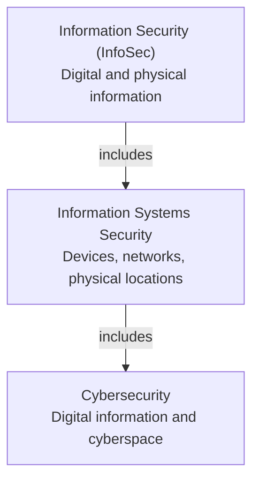
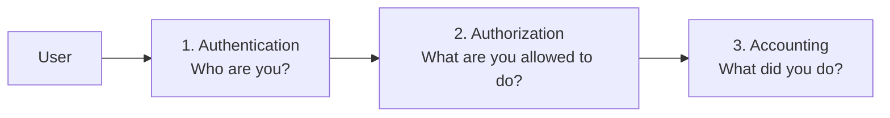

# Module 1: Introduction to Cybersecurity

This module builds the foundation for everything else in NSE 1. You will learn what **cybersecurity**, **information security**, and **information systems security** mean, how they relate to each other, and which core principles (**CIA**, **DAD**, and **AAA**) guide the work of every security professional.

---

## 📚 Table of Contents

- [🎯 Learning Objectives](#-learning-objectives)
- [Lesson 1: Security Terminology](#lesson-1-security-terminology)
  - [What Is Cybersecurity?](#what-is-cybersecurity)
  - [Why Cybersecurity Matters](#why-cybersecurity-matters)
  - [What Is Information Security (InfoSec)?](#what-is-information-security-infosec)
  - [Information Classification](#information-classification)
  - [What Is Information Systems Security?](#what-is-information-systems-security)
  - [How the Three Terms Relate](#how-the-three-terms-relate)
  - [The First Line of Defense](#the-first-line-of-defense)
- [Lesson 2: Principles of Information Security](#lesson-2-principles-of-information-security)
  - [The CIA Triad](#the-cia-triad)
  - [The DAD Triad](#the-dad-triad)
  - [The AAA Security Framework](#the-aaa-security-framework)
- [🌍 Real-World Scenarios](#-real-world-scenarios)
- [📊 Comparisons](#-comparisons)
- [🧠 Key Takeaways](#-key-takeaways)
- [📝 Quick Revision](#-quick-revision)
- [❓ Knowledge Check](#-knowledge-check)
- [🔗 Related Modules](#-related-modules)

---

## 🎯 Learning Objectives

After completing this module, you will be able to:

- Describe the terms **cybersecurity**, **information security**, and **information systems security**.
- Explain how IT security determines what information needs protecting.
- Explain the **first line of defense** against cyberattacks.
- List the **principles of information security** (the CIA triad).
- Describe **authentication, authorization, and accounting (AAA)**.

> 📝 **Note:** Cybersecurity is more than technology. It is also the correct actions and behaviors of people that keep computer systems safe.

---

# Lesson 1: Security Terminology

## What Is Cybersecurity?

> 💡 **Definition:** **Cybersecurity** is the practice of protecting computer networks, devices, and information from damage, loss, or unauthorized access. It is the collective methods, technologies, and processes that protect computer systems, networks, and the information they contain.

### 📖 Explanation

- Cybersecurity protects **digital** information from cyberthreats.
- "Protecting information" means preserving its **confidentiality, integrity, and availability** in cyberspace (see the [CIA Triad](#the-cia-triad)).
- Cybersecurity professionals protect **servers, endpoints, databases, and networks** by finding **security gaps** and **misconfigurations** that create vulnerabilities.

> 📖 **Beginner Explanation (added):** An *endpoint* is any device that connects to a network, such as a laptop, phone, or desktop. A *misconfiguration* is a setting that was left wrong or insecure, for example a server with a default password that was never changed.

### 🔐 The Five Categories of Cybersecurity

Cybersecurity can be divided into five categories:

| # | Category |
|---|----------|
| 1 | Critical infrastructure security |
| 2 | Application security |
| 3 | Network security |
| 4 | Cloud security |
| 5 | Internet of Things (IoT) security |

> 📝 **Note:** Other organizations may group or label cybersecurity types differently. Besides these five categories, cybersecurity also includes the **people and processes** that use technology to defend computer systems, networks, and the information in them.

📖 Beginner Explanation (added): what do the five categories mean?

The course names these categories but does not define them in the supplied notes. These are simple, general descriptions to help beginners:

- **Critical infrastructure security:** protecting systems society depends on, such as electrical grids and gas pipelines.
- **Application security:** protecting software and apps from flaws attackers could exploit.
- **Network security:** protecting the connections and traffic between devices.
- **Cloud security:** protecting data and services stored or run on cloud platforms.
- **IoT security:** protecting smart, internet-connected devices such as cameras, sensors, and printers.

---

## Why Cybersecurity Matters

The five categories above reflect how far computer technology has transformed the world. Technology now touches almost everything:

- Online management of **gas pipelines** and **electrical grids**
- **Buying and selling** goods online
- **Collaborating** with colleagues regardless of geography
- Renting **data storage in the cloud**
- Tracking **printer toner and maintenance**

### 🌍 The Digital Transformation

The digital transformation has brought:

- Enormous **efficiencies** and unheard-of **conveniences**
- Omnipresent **access to information**
- Exponentially increased **productivity**, which has grown wealth and improved quality of life

> 🌍 **Real-world Scenario:** People in remote areas of the world can access medical experts using computer technologies. Personal medical information can be collected locally and sent to medical experts to help with diagnosis and treatment.

> 🚨 **Critical:** Without securing computer networks and the links that connect them, **all of these advances are at risk**.

---

## What Is Information Security (InfoSec)?

> 💡 **Definition:** **Information security (InfoSec)** is the practice of protecting information. It includes the tools and processes used for **preventing, detecting, and remediating** attacks and threats to sensitive information, in both **digital and physical** form.

### 📖 Explanation

- InfoSec also includes **documenting** the processes, threats, and systems that affect the security of information.
- The nature of the information is **broad and inclusive**. It can be:
  - Information stored electronically on a computer
  - Information lying on someone's desk
  - Information stored in a file cabinet
- Examples of information that may need protection range from **mission-critical data** to **HR policies** to **legal contracts**.

> 📖 **Beginner Explanation (added):** *Remediating* means fixing or cleaning up after something has gone wrong. So InfoSec covers the full cycle: prevent attacks, detect them, and fix the damage.

> 🧠 **Remember:** InfoSec protects information in **any form**, digital *or* physical. Cybersecurity focuses on **digital** information.

---

## Information Classification

IT security examines all the information in an organization to **categorize and prioritize its sensitivity**. Not all information needs the same level of protection.

| Label | Meaning | Level of Control |
|-------|---------|------------------|
| **Unprotected** | No controls are necessary | None |
| **Protected** | Some level of protection and control is required | Some |
| ↳ **Confidential** | Protected, depending on criticality | Rigorous |
| ↳ **Secret** | Protected, more critical | More rigorous |
| ↳ **Top Secret** | Protected, most critical | Most rigorous |

> 🎯 **Exam Focus:** Each successive protected level requires **more rigorous control and safeguards**. The order is Confidential → Secret → Top Secret.

> 📖 **Beginner Explanation (added):** This is how IT security decides *what* needs protecting and *how much*. A public company brochure needs no protection, while a legal contract or a secret business plan needs strong controls.

---

## What Is Information Systems Security?

> 💡 **Definition:** **Information systems security** is the protection of information systems against **unauthorized access, modification, destruction, or the denial of access to authorized users**.

- **Information systems** include the **devices, computer networks, and physical locations** that store or transmit sensitive information.
- The information can be **digital or physical**.
- Information systems security is **a part of InfoSec**.

---

## How the Three Terms Relate

According to the course, **information systems security is a subset of InfoSec**, and **cybersecurity is a subset of information systems security**.

> ⚠️ **Warning:** Different textbooks and organizations draw this relationship differently, and some treat cybersecurity and InfoSec as nearly interchangeable. For this course and exam, follow the hierarchy above.

---

## The First Line of Defense

Protecting cyber infrastructure, which is vital to prosperity and quality of life, starts with **people and education** and with **preparing for disaster**.

### 1. Educate People

- Studies have identified **human error** as the **leading cause** of network and computer breaches.
- The fix is to educate people at work and at home to **think before clicking**.
- People should learn to identify **phishing attacks** and other common attack methods used by bad actors.

### 2. Prepare for Disaster and Plan for Recovery

- Do **regular backups** of your data.
- Keep the backups **safely offline**.
- If data is **deleted, corrupted by malware, or encrypted by ransomware**, you can restore it with the **least data loss and interruption**.

> 📖 **Beginner Explanation (added):** *Phishing* is a fake message (often an email) that tricks you into clicking a bad link or sharing private details. *Ransomware* is malware that locks your files until you pay. Backups must stay offline so that malware cannot reach and damage them too.

> 🎯 **Exam Focus:** The first line of defense = **user education** + **regular offline backups with a recovery plan**.

---

# Lesson 2: Principles of Information Security

After this lesson you will be able to:

- List the principles of information security.
- Describe the terms authentication, authorization, and accounting.

## The CIA Triad

The objectives of information security are built on three principles: **Confidentiality, Integrity, and Availability**. Together they form the **CIA triad**.

| Principle | Meaning | Key Question |
|-----------|---------|--------------|
| 🔒 **Confidentiality** | Private information must stay private. You must know who is trying to access the information and whether they are authorized. | *Who can see it?* |
| ✅ **Integrity** | Information must be authentic and protected from unauthorized change. If it is altered, you must be alerted. | *Can I trust it?* |
| 🟢 **Availability** | Authorized parties must be able to access the information. Technologies, policies, and processes must ensure reliable availability. | *Can authorized people reach it?* |

> 🌍 **Real-world Scenario (added):** Think of online banking. **Confidentiality:** only you can see your balance. **Integrity:** nobody can silently change the amount. **Availability:** you can log in when you need to.

---

## The DAD Triad

InfoSec works to **prevent** the disclosure and alteration of information, and to make sure authorized parties are **not denied** access. These threats are known as the **DAD triad**, the **opposite of the CIA triad**.

| DAD Threat | What It Means | Opposes |
|------------|---------------|---------|
| **Disclosure** | Confidential data is exposed to unauthorized parties | Confidentiality |
| **Alteration** | Data is changed, or you cannot test whether it was changed, so it becomes untrustworthy | Integrity |
| **Denial** | Legitimate, authorized users are prevented from accessing data | Availability |

> 💡 **Remember:** An effective security solution, such as a **network firewall**, helps neutralize the DAD triad.

---

## The AAA Security Framework

**Authentication, Authorization, and Accounting (AAA)** together form a security framework that **controls resources, enforces policies, and audits usage**. It plays a major role in network management and cybersecurity by **screening users and tracking their activity while they are connected**.

### 🔐 1. Authentication

- The process of **identifying and verifying** a person or thing.
- As an **identity and access management (IAM)** tool, a **AAA server** compares a user's credentials with its database of stored credentials.
- It checks whether the **username, password, and other authentication tools** match that specific user.

### 🔐 2. Authorization

- The process of **controlling access to resources**.
- A user can be granted privileges to access **certain areas of a network or system**.
- The areas and permissions granted are stored in a **database along with the user's identity**.
- An **administrator** can change the user's privileges.

### 🔐 3. Accounting

- **Record-keeping and tracing** of agent activities on computer devices and networks.
- It tracks information such as:
  - How long a user was **logged in**
  - The **data sent or received**
  - The user's **IP address**
  - The **URI** they used
  - The **services** they accessed
- Accounting can be used to **analyze user trends, audit user activity, and provide more accurate billing**.

> 🌍 **Real-world Scenario (added):** In an office building, the **ID check at the front desk** is authentication. The **keycard that opens only your floor** is authorization. The **visitor log and CCTV** are accounting.

---

## 🌍 Real-World Scenarios

| Scenario | Concept Applied |
|----------|-----------------|
| A doctor in a city reviews a remote patient's medical data online | Digital transformation; the data needs cybersecurity |
| An employee hesitates before clicking a suspicious email link | First line of defense: user education |
| Ransomware encrypts a company's files, and they restore from offline backups | First line of defense: backups and recovery planning |
| A legal contract is kept in a locked file cabinet | InfoSec covers physical information |
| An attacker silently changes a number in a financial record | DAD: **Alteration** (breaks Integrity) |
| A user logs in, can open only their department's folder, and the system logs their session | AAA: Authentication → Authorization → Accounting |

---

## 📊 Comparisons

### Cybersecurity vs InfoSec vs Information Systems Security

| Aspect | InfoSec | Information Systems Security | Cybersecurity |
|--------|---------|------------------------------|---------------|
| Protects | Information | Information systems (devices, networks, locations) | Digital information and networks |
| Form of information | Digital **and** physical | Digital **or** physical | Digital |
| Relationship | Broadest | Subset of InfoSec | Subset of information systems security |

### CIA vs DAD

| CIA (Goals) | DAD (Threats) |
|-------------|---------------|
| Confidentiality | Disclosure |
| Integrity | Alteration |
| Availability | Denial |

### AAA at a Glance

| Term | Purpose | Example Data |
|------|---------|--------------|
| Authentication | Verify identity | Username, password |
| Authorization | Control access | Permissions stored in a database |
| Accounting | Track activity | Login time, IP address, URI, services used |

---

## 🧠 Key Takeaways

- ✅ Cybersecurity protects **digital** information, systems, and networks. It is about **technology and people**.
- ✅ InfoSec protects information in **any form** (digital and physical).
- ✅ Information is **classified** by sensitivity: unprotected, or protected (confidential, secret, top secret).
- ✅ Hierarchy: **InfoSec ⊃ Information systems security ⊃ Cybersecurity**.
- ✅ **Human error** is the leading cause of breaches, so **education** is a first line of defense.
- ✅ **Offline backups** let you recover from deletion, malware, and ransomware.
- ✅ **CIA** = Confidentiality, Integrity, Availability. **DAD** = Disclosure, Alteration, Denial (the opposite).
- ✅ **AAA** = Authentication (who), Authorization (what allowed), Accounting (what did).

---

## 📝 Quick Revision

- **Cybersecurity** → protecting digital info, networks, devices.
- **Five categories** → critical infrastructure, application, network, cloud, IoT.
- **InfoSec** → prevent, detect, remediate; digital + physical.
- **Classification** → unprotected → confidential → secret → top secret.
- **Info systems security** → protects against unauthorized access, modification, destruction, and denial of access.
- **First line of defense** → educate people + offline backups.
- **CIA** ↔ **DAD**.
- **AAA** → verify identity, grant privileges, record activity.

---

## ❓ Knowledge Check

**Q1. (Multiple choice)** What does the "I" in the CIA triad stand for?

- A) Identity
- B) Integrity
- C) Information
- D) Isolation

Show answer

**B) Integrity.** Integrity means information is authentic and protected from unauthorized change.

**Q2. (True/False)** Cybersecurity protects only physical documents such as paper files.

Show answer

**False.** Cybersecurity protects *digital* information. InfoSec covers both digital and physical information.

**Q3. (Multiple choice)** Which label requires the MOST rigorous controls?

- A) Confidential
- B) Secret
- C) Top Secret
- D) Unprotected

Show answer

**C) Top Secret.** Each successive protected level requires more rigorous control and safeguards.

**Q4. (Conceptual)** According to studies mentioned in the course, what is the leading cause of network and computer breaches, and how can it be addressed?

Show answer

**Human error.** It can be addressed by educating people at work and at home to think before clicking and to recognize phishing and other common attack methods.

**Q5. (Multiple choice)** Which part of AAA compares a user's username and password with stored credentials?

- A) Authorization
- B) Accounting
- C) Authentication
- D) Availability

Show answer

**C) Authentication.** It identifies and verifies a person or thing.

**Q6. (True/False)** The DAD triad is the opposite of the CIA triad.

Show answer

**True.** Disclosure opposes Confidentiality, Alteration opposes Integrity, and Denial opposes Availability.

**Q7. (Conceptual)** Why should data backups be kept safely offline?

Show answer

So that if data is deleted, corrupted by malware, or encrypted by ransomware, you can restore it with the least data loss and interruption.

**Q8. (Multiple choice)** Which of the following is tracked by accounting?

- A) The user's password strength
- B) How long a user was logged in and which services they accessed
- C) The firewall's brand
- D) The user's job title

Show answer

**B).** Accounting tracks login duration, data sent or received, IP address, URI used, and services accessed.

**Q9. (Conceptual)** How are InfoSec, information systems security, and cybersecurity related?

Show answer

Information systems security is a subset of InfoSec, and cybersecurity is a subset of information systems security.

---

## 🔗 Related Modules

| Module | Link |
|--------|------|
| ⬅️ Previous | *None (this is the first module)* |
| ➡️ Next | *[Placeholder: link to Module 02 will be added]* |
| 🔗 Related topics | *[Placeholder: cross-module links will be added after other modules are submitted]* |
