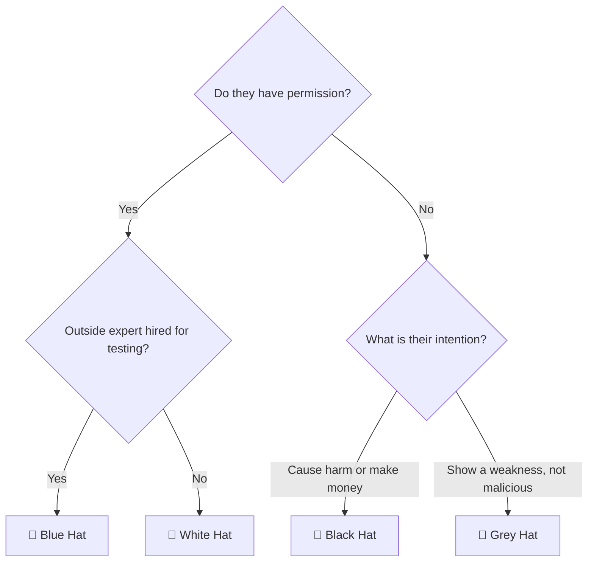
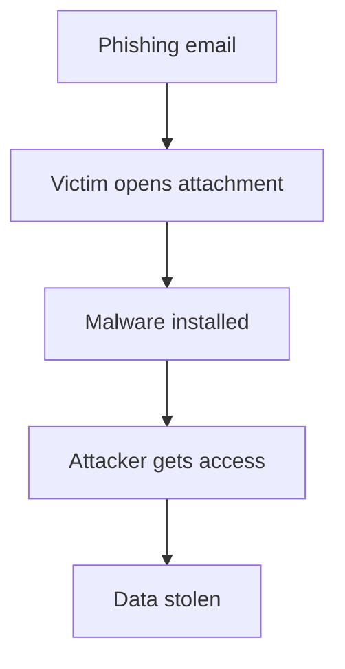
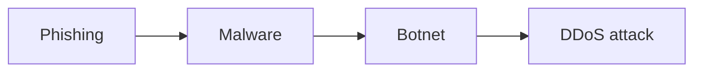
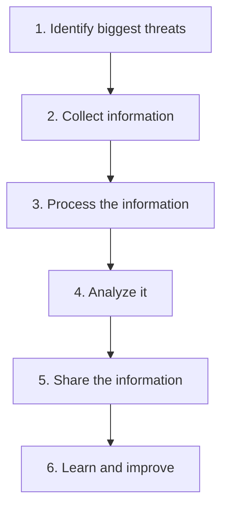
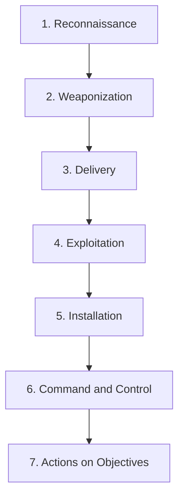
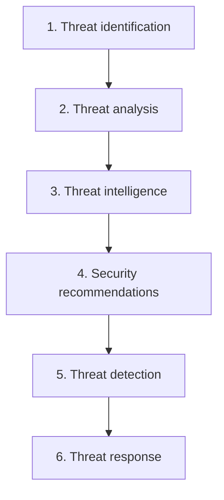

# Module 2: The Threat Landscape

This module explains the physical and digital **threat landscape** and the common **attack vectors** inside it. You will meet the cast of **bad actors**, learn their motivations and methods, and see how **threat intelligence**, **attack frameworks**, and **outbreak alerts** help organizations identify, stop, and prevent cyberattacks.

---

## 📚 Table of Contents

- [🎯 Learning Objectives](#-learning-objectives)
- [Lesson 1: Threat Landscape Overview](#lesson-1-threat-landscape-overview)
  - [1.1 What Is a Threat Landscape?](#11-what-is-a-threat-landscape)
  - [1.2 Know Your Enemy](#12-know-your-enemy)
  - [1.3 Threat Classification and Attack Surface](#13-threat-classification-and-attack-surface)
  - [1.4 What the Rest of the Module Covers](#14-what-the-rest-of-the-module-covers)
- [Lesson 2: Threat Actors](#lesson-2-threat-actors)
  - [2.1 Bad Actors and Their Motivations](#21-bad-actors-and-their-motivations)
  - [2.2 Hacker Hat Categories](#22-hacker-hat-categories)
  - [2.3 Penetration Testing](#23-penetration-testing)
  - [2.4 Comparing the Four Hats](#24-comparing-the-four-hats)
  - [2.5 Quick Decision Guide](#25-quick-decision-guide)
- [Lesson 3: Cybersecurity Threats](#lesson-3-cybersecurity-threats)
  - [3.1 What Is a Cybersecurity Threat?](#31-what-is-a-cybersecurity-threat)
  - [3.2 Vulnerabilities](#32-vulnerabilities)
  - [3.3 Attack Vectors](#33-attack-vectors)
  - [3.4 Attack Paths](#34-attack-paths)
  - [3.5 Types of Attack Vectors](#35-types-of-attack-vectors)
  - [3.6 The Four Threat Categories](#36-the-four-threat-categories)
  - [3.7 Combining Attack Vectors](#37-combining-attack-vectors)
  - [3.8 Phishing Variants and Trojans](#38-phishing-variants-and-trojans)
  - [3.9 Human Weakness and Passwords](#39-human-weakness-and-passwords)
- [Lesson 4: Threat Intelligence](#lesson-4-threat-intelligence)
  - [4.1 What Is Threat Intelligence?](#41-what-is-threat-intelligence)
  - [4.2 Three Qualities of Good Threat Intelligence](#42-three-qualities-of-good-threat-intelligence)
  - [4.3 Sources of Threat Intelligence](#43-sources-of-threat-intelligence)
  - [4.4 CVSS, STIX and TAXII](#44-cvss-stix-and-taxii)
  - [4.5 Indicators of Compromise](#45-indicators-of-compromise)
  - [4.6 The Threat Intelligence Process](#46-the-threat-intelligence-process)
- [Lesson 5: Attack Frameworks](#lesson-5-attack-frameworks)
  - [5.1 Attack Frameworks and APTs](#51-attack-frameworks-and-apts)
  - [5.2 The Cyber Kill Chain](#52-the-cyber-kill-chain)
  - [5.3 Limitations of the Cyber Kill Chain](#53-limitations-of-the-cyber-kill-chain)
  - [5.4 MITRE ATT&CK](#54-mitre-attck)
  - [5.5 Tactics and Techniques](#55-tactics-and-techniques)
  - [5.6 Benefits of MITRE ATT&CK](#56-benefits-of-mitre-attck)
  - [5.7 Cyber Kill Chain vs MITRE ATT&CK](#57-cyber-kill-chain-vs-mitre-attck)
  - [5.8 Both Frameworks on One Attack](#58-both-frameworks-on-one-attack)
- [Lesson 6: Outbreak Alerts and Advisories](#lesson-6-outbreak-alerts-and-advisories)
  - [6.1 What Is an Outbreak?](#61-what-is-an-outbreak)
  - [6.2 Outbreak Alerts and Security Advisories](#62-outbreak-alerts-and-security-advisories)
  - [6.3 Where to Find Alerts and Security Information](#63-where-to-find-alerts-and-security-information)
  - [6.4 What Is CVE?](#64-what-is-cve)
  - [6.5 The Log4Shell Example](#65-the-log4shell-example)
  - [6.6 The FortiGuard Outbreak Alert Report](#66-the-fortiguard-outbreak-alert-report)
  - [6.7 How Outbreak Alerts Help Security Teams](#67-how-outbreak-alerts-help-security-teams)
  - [6.8 Predictive Analytics](#68-predictive-analytics)
  - [6.9 Fortinet Products for Outbreak Defense](#69-fortinet-products-for-outbreak-defense)
  - [6.10 NIST CSF and Related Frameworks](#610-nist-csf-and-related-frameworks)
  - [6.11 The Complete Outbreak Alert Process](#611-the-complete-outbreak-alert-process)
- [🌍 Real-World Scenarios](#-real-world-scenarios)
- [📊 Comparisons](#-comparisons)
- [🧠 Key Takeaways](#-key-takeaways)
- [📝 Quick Revision](#-quick-revision)
- [❓ Knowledge Check](#-knowledge-check)
- [🔗 Related Modules](#-related-modules)

---

## 🎯 Learning Objectives

After completing this module, you will be able to:

- Define a **threat landscape** and explain why knowing your enemy matters.
- Describe the physical and digital threat landscape.
- Explain the **cast of bad actors**, their motivations, and the four **hacker hat** categories.
- Explain what a **cybersecurity threat**, **vulnerability**, **attack vector**, and **attack path** are.
- List the **four threat categories** and common attack methods.
- Describe **threat intelligence**, its qualities, sources, and standards (CVSS, STIX, TAXII, IoC).
- Explain the **Cyber Kill Chain** and **MITRE ATT&CK** frameworks.
- Explain **outbreak alerts** and **security advisories**, and which Fortinet products help defend against outbreaks.

---

# Lesson 1: Threat Landscape Overview

## 1.1 What Is a Threat Landscape?

> 💡 **Definition:** A **threat landscape** is the **collection of threats in a given context or domain**, including information about the perpetrators of the threats: the **bad actors**.

- In cybersecurity, the threat landscape includes **all known and possible threats** to computer networks.
- New technologies and methods keep the landscape **dynamic**: new, evolving threats arise on an ongoing basis.

> 🧠 **Remember:** Understanding the nature of the threats to your network gives you the knowledge to **counter and defeat** attacks against computer systems.

> 📖 **Beginner Explanation (added):** Think of a weather map. It shows all the storms that exist or could form in an area. A threat landscape is the same idea for cyber threats: a map of what can go wrong and who might cause it.

---

## 1.2 Know Your Enemy

**Lesson objectives:** identify the different types of bad actors and hackers by their **motivations and tactics**.

Different bad actors are more likely to attack certain **verticals** (types of businesses or sectors):

| Target | Likely Attacker | What They Want |
|--------|-----------------|----------------|
| 🏥 **Hospitals** | Cybercriminals | To **ransom valuable medical information** and enrich themselves |
| 🛡️ **A nation's department of defense** | Nation-state threat actors | To **steal state secrets** rather than extract money |

> 🎯 **Exam Focus:** By **knowing your enemy**, you are better equipped to counter their attacks.

> 🔗 **Connection (added):** These two attacker types line up with the bad actors in [2.1](#21-bad-actors-and-their-motivations): **Cybercriminal** (money) and **Cyberwarrior** (national interest). The lesson text says "nation state threat actors"; the actor list in Lesson 2 uses the term *Cyberwarrior*.

---

## 1.3 Threat Classification and Attack Surface

**Lesson objective:** describe **attack vectors**, **cybersecurity threats**, and the **categories** that threats fit into.

- Understanding how threats are **classified** gives you insight into **how attacks can be carried out**.
- This helps you **identify weaknesses** in your environment and take precautions to **reduce the attack surface**.

> 📖 **Beginner Explanation (added):** The *attack surface* is the total set of places where an attacker could try to get in or cause harm, such as devices, software, accounts, and people. Fewer weak points mean a smaller attack surface.

Lesson 3 explains [attack vectors and the four threat categories](#lesson-3-cybersecurity-threats).

---

## 1.4 What the Rest of the Module Covers

### 🔍 Threat Intelligence

**Lesson objective:** define threat intelligence and explain how it is processed.

> 💡 **Remember:** For information to be threat intelligence it must be **relevant, actionable, and contextual**. If it is not all three, **it is not threat intelligence**.

> ⚠️ **Warning:** This is **situational**. What is intelligence for one organization may **not** be intelligence for another.

See [Lesson 4](#lesson-4-threat-intelligence).

### 🔍 Attack Frameworks

**Lesson objective:** describe different attack frameworks, such as the **Cyber Kill Chain** and **MITRE ATT&CK**.

- Attack frameworks give you a glimpse into the **anatomy of a cyberattack**.
- Understanding the **chain of actions** in an attack lets you **anticipate your enemy's actions and counter them**.
- Frameworks like MITRE ATT&CK are **rich in information and threat intelligence** that you need to be an effective IT security professional.

See [Lesson 5](#lesson-5-attack-frameworks).

> 📝 **Note:** The module description also mentions the **physical and digital** threat landscape. Lesson 3's examples include both physical attacks (such as tailgating into a server room) and digital attacks (such as phishing).

---

# Lesson 2: Threat Actors

## 2.1 Bad Actors and Their Motivations

A **bad actor** is a person or group that attacks computer systems. Different bad actors attack for different reasons.

| Bad Actor | Motivation |
|-----------|------------|
| 👨‍💻 **Explorer** | Attention / fame |
| ✊ **Hacktivist** | Belief / cause |
| 💰 **Cybercriminal** | Money |
| 💣 **Cyberterrorist** | Fear and chaos |
| 🇺🇳 **Cyberwarrior** | National interest |

<details>
<summary>📖 Beginner Explanation (added): what do these roles mean?</summary>

The supplied notes give only the motivation for each actor. These short descriptions are general beginner explanations based on those motivations:

- **Explorer:** attacks to get attention or fame, for example to show off skill.
- **Hacktivist:** attacks to support a political or social belief or cause (a mix of *hacker* and *activist*).
- **Cybercriminal:** attacks to make money, for example by stealing and selling data.
- **Cyberterrorist:** attacks to create fear and chaos.
- **Cyberwarrior:** attacks on behalf of a nation's interests.

</details>

> 💡 **Remember:** *Bad actors* are classified by **why they attack** (motivation). *Hacker hats* are classified by **how they behave** (permission and intent). See [2.2](#22-hacker-hat-categories).

---

## 2.2 Hacker Hat Categories

Hackers are divided into **4 categories** based on their intentions. The "hat" represents the hacker's **behavior**, not a real hat.

| Hat | Meaning |
|-----|---------|
| 🤍 **White Hat** | Ethical hacker with permission |
| 🖤 **Black Hat** | Criminal hacker |
| 🩶 **Grey Hat** | Hacks without permission but usually not malicious |
| 💙 **Blue Hat** | External ethical hacker hired for penetration testing |

### 🤍 White Hat Hacker

> 💡 **Definition:** A **White Hat Hacker** is an **ethical (good) hacker** who hacks **with permission** to find security weaknesses before criminals do.

- Find security weaknesses
- Report them to the company
- Help fix the problems and improve security
- Do **not** steal data or cause damage

> 🌍 **Analogy:** A bank hires a security expert and says, *"Try to break into our building. If you find weak doors or windows, tell us so we can fix them."* The expert is allowed to test the building. That is a White Hat.

> 🌍 **Real-world Scenario:** A company hires an ethical hacker to test its website. The hacker finds that anyone can access customer data. Instead of stealing it, the hacker informs the company so it can fix the issue.

### 🖤 Black Hat Hacker

> 💡 **Definition:** A **Black Hat Hacker** is a **criminal hacker** who hacks **without permission**.

Usual goals: **money**, **stealing data**, **damaging systems**, **causing harm**.

A Black Hat might:

- Steal passwords
- Install ransomware
- Hack bank accounts
- Delete company data
- Sell stolen information

> 🌍 **Analogy:** A thief breaks into your house without permission to steal valuables. A Black Hat does the same with computers and networks.

### 🩶 Grey Hat Hacker

> 💡 **Definition:** A **Grey Hat Hacker** sits between White Hat and Black Hat. They hack **without permission** (which is illegal), but usually **without bad intentions**.

- Called **"Grey"** because they are **between good and bad**:
  - Not fully ethical (like White Hat)
  - Not fully malicious (like Black Hat)

> 🌍 **Analogy:** You notice a neighbor forgot to lock their front door. Instead of telling them, you secretly enter to prove it was unlocked, then leave a note: *"Your door was unlocked. Please lock it."* You wanted to help, but entering without permission was still wrong.

### 💙 Blue Hat Hacker

> 💡 **Definition:** A **Blue Hat Hacker** is a type of White Hat Hacker who is usually **not a permanent employee** of the company. They are often **outside security experts or consultants** hired to test a system **before it is launched**.

- They perform **penetration testing (pen testing)**. See [2.3](#23-penetration-testing).

> ⚠️ **Warning:** The word "Blue Hat" is used differently in some other sources. For this course and exam, use the definition above: an external ethical hacker hired for testing.

---

## 2.3 Penetration Testing

> 💡 **Definition:** **Penetration Testing (Pen Testing)** means **legally trying to hack a system** to find security weaknesses **before attackers do**. Think of it as a "practice attack."

> 🌍 **Analogy:** A company is opening a new shopping mall. Before opening, it hires security experts to test the doors, cameras, and alarm systems. Weak points are fixed before customers arrive.

### 🌍 One App, Four Hats

A new mobile banking app is about to launch:

| Hat | What Happens | Legal? |
|-----|--------------|--------|
| 🤍 White Hat | The bank's own security team tests the app regularly | ✅ Allowed |
| 🖤 Black Hat | A criminal hacks the app to steal customer money | ❌ Illegal |
| 🩶 Grey Hat | Someone hacks the app without permission, finds a weakness, and tells the bank. Nothing was stolen, but permission was missing | ⚠️ Illegal but not usually malicious |
| 💙 Blue Hat | Before launch, the bank hires an outside cybersecurity company to legally try to hack the app and report weaknesses | ✅ Authorized consultant |

### 🔑 Important Terms

| Term | Easy Meaning |
|------|--------------|
| **Ethical Hacker** | A hacker who helps improve security with permission |
| **Authorization** | Official permission to perform an action |
| **Pen Testing** | Legally trying to hack a system to find weaknesses before attackers do |
| **Vulnerability** | A weakness in a computer system or software |
| **Consultant** | An outside expert hired for a specific job |

---

## 2.4 Comparing the Four Hats

| | 🤍 White Hat | 🖤 Black Hat | 🩶 Grey Hat | 💙 Blue Hat |
|---|---|---|---|---|
| **Type** | Ethical hacker | Criminal hacker | Between good and bad | External ethical hacker |
| **Permission** | Yes | No | No | Yes |
| **Goal** | Helps improve security | Steals or damages | Usually reports the weakness | Tests systems before launch |
| **Legal?** | Legal | Illegal | Illegal | Legal |

> 📖 **Memory Trick (traffic lights):**
> 🟢 **White Hat** = Go / good: *"I'm here to protect."*
> 🔴 **Black Hat** = Stop / bad: *"I'm here to steal."*
> 🟡 **Grey Hat** = In between: *"I broke the rules, but I wasn't trying to harm anyone."*
> 🔵 **Blue Hat** = Guest expert: *"I'm an outside tester helping before launch."*

---

## 2.5 Quick Decision Guide



> 🎯 **Exam Focus:**
> - **Permission? Yes** → White Hat or Blue Hat. **No** → Black Hat or Grey Hat.
> - **Intention:** help the organization → White/Blue. Cause harm or make money → Black. Show a weakness without malicious intent → Grey.

---

# Lesson 3: Cybersecurity Threats

After this lesson you will be able to explain what a cybersecurity threat is, list the main threat categories, and understand attack vectors.

## 3.1 What Is a Cybersecurity Threat?

> 💡 **Definition:** A **cybersecurity threat** is anything that can harm a computer, network, or data by **exploiting a weakness**.

```text
Weakness (Vulnerability) + Attacker = Cybersecurity Threat
```

If there is no weakness, it becomes much harder for the attacker to succeed.

> 🌍 **Analogy:** You leave your front door open and a thief enters.
> - Open door = **Vulnerability**
> - Thief = **Bad actor**
> - Theft = **Cybersecurity threat**

---

## 3.2 Vulnerabilities

> 💡 **Definition:** A **vulnerability** is a weakness in a system, software, or person.

Examples:

- Weak password
- Old (unpatched) software
- Unlocked server room
- Employee trusting strangers

---

## 3.3 Attack Vectors

> 💡 **Definition:** An **attack vector** is the **method or path** a hacker uses to attack a system. It answers: *"How does the attacker get inside?"*

> 🌍 **Analogy:** A thief could enter your house through the front door, window, roof, or garage. Each is a different way in, like different attack vectors.

### 🔍 The Three Parts of an Attack Vector

| Part | Question | Example |
|------|----------|---------|
| **Vulnerability** | What weakness exists? | Employee trusts strangers |
| **Mechanism** | What tool or trick is used? | Malware, fake email |
| **Pathway** | How does it reach the victim? | Email, USB drive, website, phone call |

> 🧠 **Remember (robbery analogy):** Weak door = **Vulnerability**, crowbar = **Mechanism**, front door = **Pathway**.

### 🌍 Example 1: Email Attack (Diego)

1. Diego receives an email that looks like it came from a colleague.
2. He downloads the attachment.
3. He opens it.
4. Malware gets installed.

| Part | In This Attack |
|------|----------------|
| Vulnerability | Diego trusted the email (human weakness) |
| Mechanism | Malware |
| Pathway | Email attachment |

### 🌍 Example 2: Server Room Attack

This one combines physical and technical attacks.

1. A woman stands outside the server room.
2. She says, *"I forgot my access card."*
3. A helpful employee opens the door.
4. She plugs in a USB drive.
5. Malware infects the server.

| Part | In This Attack |
|------|----------------|
| Vulnerability | Helpful employee; no USB protection |
| Mechanism | Malware; social engineering |
| Pathway | Server room door; USB drive |

---

## 3.4 Attack Paths

> 💡 **Definition:** Sometimes attackers need multiple steps to finish an attack. The full sequence of steps is called an **attack path**.

> 🌍 **Analogy:** A thief wants to steal jewelry. He tricks the guard, gets inside, opens the safe, and steals the jewelry. The whole sequence is the attack path.



> 🧠 **Remember:** **Attack vector** = the method used to attack. **Attack path** = the complete chain of steps.

---

## 3.5 Types of Attack Vectors

The lesson mentions three common types:

| Type | Meaning | Example |
|------|---------|---------|
| **Electronic social engineering** | Using emails, messages, or websites | Phishing email |
| **Physical social engineering** | Tricking someone in person | Pretending to be an electrician to enter the server room |
| **Technical attack** | Using technical weaknesses | Software bugs, weak passwords, misconfigured firewall, outdated operating system |

---

## 3.6 The Four Threat Categories

Fortinet divides threats into four categories.

### 👤 1. Social Engineering

> 💡 **Definition:** Tricking people into doing something they shouldn't.

- Examples: fake bank email, fake IT support call, fake WhatsApp message.
- 🧠 **Memory:** *Hack the human, not the computer.*

### 🦠 2. Malware

> 💡 **Definition:** Software designed to harm computers.

- Examples: **virus, worm, Trojan, ransomware**.
- Like a disease infecting your body, malware infects your computer.

### 🚪 3. Unauthorized Access

Someone accesses something they shouldn't. It can be:

- **Physical:** entering a server room without permission.
- **Digital:** logging into someone else's account.

| Term | Meaning | Example |
|------|---------|---------|
| **Tailgating** | An unauthorized person follows an authorized person through a secure door | An employee scans their ID, the door opens, and an attacker walks in behind them with no badge |
| **Shoulder surfing** | Secretly watching someone enter a password, PIN, or credit card number | Someone behind you watches you enter your ATM PIN |

### ⚙️ 4. System Design Failure

The problem is not the user. The **system itself has a security flaw**.

- Examples: weak software design, programming bug, missing security checks, vulnerable application.

> 🎯 **Exam Focus:** The four categories are **Social Engineering, Malware, Unauthorized Access, System Design Failure**.

### 🔐 Birthday Attack

> 💡 **Definition (from the notes):** A **birthday attack** is a mathematical attack used against some cryptographic systems (hash functions) by exploiting the probability of **collisions**.

- For NSE 1, remember: it attacks **cryptographic algorithms** and is a **technical attack**, not a social engineering attack.

> 📖 **Beginner Explanation (added):** A *hash function* turns data into a short fixed-size fingerprint. A *collision* happens when two different inputs produce the same fingerprint.

---

## 3.7 Combining Attack Vectors

Attackers rarely use only one method. Multi-stage attacks combine several.



### 🌍 DDoS Example

1. Millions of phishing emails are sent.
2. Some users click.
3. Their computers become infected.
4. Thousands of infected computers form a **botnet**.
5. The botnet launches a **DDoS** attack.

> 📝 **Note:** Phishing happened *before* the DDoS. One attack helped create another.

> 🔗 **Connection to Module 1 (added):** A DDoS attack is a **Denial** of service, the *D* in the DAD triad. It attacks **Availability**. See [Module 1](../Module-01/README.md#the-dad-triad).

---

## 3.8 Phishing Variants and Trojans

| Term | Meaning | Example |
|------|---------|---------|
| **Whale phishing** | Phishing aimed at very important people, whose access to company systems is valuable | CEO, CFO, company director |
| **Spear phishing** | Phishing that targets **one specific person** | A network administrator |
| **Trojan horse** | Malware that **pretends to be harmless** | A file named `Resume.pdf` that looks normal but installs malware |
| **DDoS** | Flooding a server with requests from many computers | Botnet attack |

---

## 3.9 Human Weakness and Passwords

Many attacks succeed because of **human nature**. People:

- Trust others
- Panic
- Click quickly
- Use weak passwords

Attackers take advantage of these behaviors.

| Password | Example | Strength |
|----------|---------|----------|
| Weak | `123456` | Easy to guess |
| Strong | `T7#kQ9!vLm2$Rw` (illustrative) | Hard to guess |

> 📝 **Note:** Strong passwords reduce the chance of successful password attacks. The strong example above is a generic illustration; do not use it as a real password.

> 🔗 **Connection to Module 1 (added):** Human error is the leading cause of breaches and **phishing** is a social engineering attack, which is why *thinking before clicking* is part of the [first line of defense](../Module-01/README.md#the-first-line-of-defense).

---

# Lesson 4: Threat Intelligence

## 4.1 What Is Threat Intelligence?

> 💡 **Definition:** **Threat intelligence** is useful information about cyber threats that helps organizations protect themselves and prevent attacks before they happen.

It answers questions like:

- What new cyber attacks are happening?
- Who is being targeted?
- How do attackers attack?
- How can we stop them?

> 🌍 **Analogy:** Before a road trip you check the weather, traffic, and road closures. Threat intelligence gives the cyber version: new malware alerts, new hacker techniques, new vulnerabilities, and security warnings.

- ❌ **Without** threat intelligence, organizations don't know about new attacks.
- ✅ **With** threat intelligence, they know what threats exist and can prepare in advance.

---

## 4.2 Three Qualities of Good Threat Intelligence

Good threat intelligence must be **Relevant, Actionable, and Contextual** (memory trick: **RAC**).

| Quality | Meaning | Example |
|---------|---------|---------|
| **Relevant** | Important for *your* organization | A macOS virus is irrelevant to a Windows-only company, but relevant to a Mac-only company |
| **Actionable** | You can *act* on it | "Hackers are attacking Windows Server 2022" lets IT update Windows, block malicious IPs, and increase monitoring |
| **Contextual** | Gives the *full story*: who, how, which systems, how serious | Not just "Hackers are attacking" |

> 🌍 **Real-world Scenario:** Fortinet warns: *"New ransomware targets hospitals using Windows Server."* For a hospital, this is **relevant**, it is **actionable** (install updates), and it is **contextual** (the report explains the attack method, indicators, and how to detect it). That is perfect threat intelligence.

---

## 4.3 Sources of Threat Intelligence

| Source Type | Meaning | Examples |
|-------------|---------|----------|
| **Internal** | Information from inside your own organization | Firewall logs, server logs, IDS/IPS alerts, network traffic, security devices |
| **External** | Information from outside organizations | Government security agencies, security companies, research organizations, cybersecurity communities |

### Examples of External Sources

| Source | What It Is |
|--------|------------|
| **FortiGuard Labs** | Fortinet's own threat intelligence service: new malware information, virus updates, security research, attack trends |
| **NIST** (National Institute of Standards and Technology) | Publishes security standards, best practices, vulnerability information |
| **SANS Institute** | Respected cybersecurity training organization: threat reports, research, security guidance |
| **MITRE ATT&CK** | A huge database of hacker techniques, attack methods, and real-world attack examples (see [Lesson 5](#54-mitre-attck)) |

> 🌍 **Analogy:** MITRE ATT&CK is like a police handbook listing how thieves enter houses, how they escape, and what tools they use, but for cyber attacks.

---

## 4.4 CVSS, STIX and TAXII

### 📊 CVSS

> 💡 **Definition:** **CVSS** (Common Vulnerability Scoring System) tells us **how serious a vulnerability is**, on a scale of **0 to 10**.

- 0 = lowest, 10 = extremely dangerous.
- Illustrative examples from the notes: a weak password policy might score around **3** (minor problem), while a remote code execution bug might score **9.8** (critical, fix immediately).

### 📄 STIX and 🚚 TAXII

| Standard | Full Form | Role | Analogy |
|----------|-----------|------|---------|
| **STIX** | Structured Threat Information Expression | A **standard format** for sharing threat intelligence | A common language |
| **TAXII** | Trusted Automated eXchange of Indicator Information | The **delivery system (transport)** that exchanges it | The courier |

> 🧠 **Remember:** **STIX = Format. TAXII = Transport.**

---

## 4.5 Indicators of Compromise

> 💡 **Definition:** An **IoC (Indicator of Compromise)** is **evidence that a system may have been attacked**.

Examples:

- Unknown IP address
- Suspicious file
- Unusual login
- Malware hash
- Strange network traffic

Think of IoCs as **clues** that help investigators identify a cyber attack, like footprints or a broken window showing someone already entered.

---

## 4.6 The Threat Intelligence Process

The lesson explains 6 steps:



| Step | What Happens | Example |
|------|--------------|---------|
| 1. **Identify** | Ask: *"What attacks are most likely against us?"* | Hospital → ransomware |
| 2. **Collect** | Gather from sources | Firewall logs, antivirus, FortiGuard, NIST, MITRE |
| 3. **Process** | Remove unnecessary data and keep only the useful information | |
| 4. **Analyze** | Look for IoCs, attack patterns, suspicious behavior | |
| 5. **Share** | Send to security team, partners, other organizations | |
| 6. **Learn and improve** | Did we stop the attack? What should we improve? What new rules should we add? | |

> 📖 **Beginner Explanation (added):** These six steps match the commonly used *threat intelligence lifecycle*, usually named direction, collection, processing, analysis, dissemination, and feedback.

**Complete flow:** New threat → Collect → Analyze → Understand → Protect the organization → Share with others.

> 🧠 **Remember (security guard analogy):** Threat intelligence = news about planned attacks. Relevant = news about *your* building. Actionable = you can lock doors. Contextual = who, how, and when. IoC = footprints showing someone already entered. CVSS = danger rating 0 to 10. STIX = report format. TAXII = delivery truck.

---

# Lesson 5: Attack Frameworks

## 5.1 Attack Frameworks and APTs

> 💡 **Definition:** An **attack framework** is a structured guide that helps cybersecurity professionals understand **how cyberattacks happen**. Think of it as a roadmap of an attack.

It helps teams understand how attackers select targets, prepare, enter a network, steal information, and how organizations can detect and prevent attacks.

### 🚨 APT (Advanced Persistent Threat)

| Word | Meaning |
|------|---------|
| **Advanced** | Attackers use sophisticated tools and techniques |
| **Persistent** | They try to keep access to the victim's network for a long time |
| **Threat** | They are a danger to the organization |

> 🌍 **Example:** An attacker spends months spying on a government organization to steal confidential information.

Two popular frameworks:

- **Lockheed Martin Cyber Kill Chain** (developed in 2011)
- **MITRE ATT&CK** (introduced in 2013)

---

## 5.2 The Cyber Kill Chain

> 💡 **Definition:** The **Cyber Kill Chain** is a framework developed by **Lockheed Martin in 2011** that explains the **seven stages** an attacker generally follows to carry out a cyberattack. It shows an attack from beginning to end.

> 🌍 **Analogy:** A bank robber doesn't just walk in. They observe the bank, prepare tools, find a way inside, enter, reach the vault, maintain control, and steal the money.



**Scenario:** an attacker wants to steal confidential information from a company.

| # | Stage | Meaning | Example | Memory |
|---|-------|---------|---------|--------|
| 1 | **Reconnaissance** | Collect information about the target before attacking (company, systems, employees, email addresses, possible vulnerabilities) | Attacker finds on LinkedIn that the network admin is John and the company uses Windows servers | Research your target |
| 2 | **Weaponization** | Prepare the malicious file or tool (malware, Trojan, malicious code in a document, exploit file) | Attacker creates a Word document that looks like a normal report but contains malicious code | Prepare the weapon |
| 3 | **Delivery** | Send the malicious file to the target (phishing emails, malicious links, infected USB drives, malicious attachments) | Attacker emails John: *"Please review the attached company report."* | Send the weapon |
| 4 | **Exploitation** | Exploit a vulnerability or trick the victim into running the payload | John opens the document and malicious code runs | Use the weakness |
| 5 | **Installation** | Install malware (Trojan, rootkit, other malicious software) to keep access | Malware installs and keeps running even if John closes the document | Put malware inside |
| 6 | **Command and Control (C&C)** | The attacker communicates with the infected computer and sends commands, often through a **C&C server** | Malware connects to the attacker's server, which can order it to collect files, send information, or contact other compromised systems | Remote control |
| 7 | **Actions on Objectives** | The attacker achieves the main goal (steal confidential data, extract databases, steal financial records, destroy data, disrupt operations, attack other targets) | Malware collects company documents and sends them to an external server: a data breach | Achieve the goal |

> 📝 **Note:** Exploitation can involve a **software vulnerability or human behavior**, depending on the attack.

> 🎯 **Exam Focus:** Security teams don't have to wait until Stage 7. If they **detect and stop an attack during Stage 1, 2, or 3**, they may prevent the later stages.

---

## 5.3 Limitations of the Cyber Kill Chain

- It assumes the attack generally **starts outside** the organization's network.
- It follows a relatively **linear** sequence of stages.
- Modern attacks can be more complicated and may not follow all seven stages in order.
- It does not describe every possible attacker technique in detail.

This is one reason **MITRE ATT&CK** was developed.

---

## 5.4 MITRE ATT&CK

> 💡 **Definition:** **MITRE ATT&CK** (**A**dversarial **T**actics, **T**echniques, and **C**ommon **K**nowledge) is a cybersecurity **knowledge base** describing how attackers behave, which techniques they use, and how they compromise systems. It is based on **observations of real-world cyberattacks**. It was introduced in **2013**.

It contains information about how attackers gain initial access, steal passwords, move between computers, avoid detection, and steal information.

> 🌍 **Real-world Scenario:** You are a network security engineer and discover an attacker in your network. You consult MITRE ATT&CK to study what attackers commonly do next. This helps you identify suspicious activities, create firewall and security rules, improve monitoring, and prepare defensive strategies.

---

## 5.5 Tactics and Techniques

| | **Tactic** | **Technique** |
|---|-----------|---------------|
| Explains | **WHY** the attacker does something | **HOW** the attacker does it |
| Represents | The attacker's **goal** | The attacker's **method** |
| Example | Steal credentials (*Credential Access*) | Phishing or brute force |

> 🧠 **Remember:** **Tactic = Why. Technique = How.**

**Example:** Tactic = *Credential Access* (goal: steal passwords). Possible techniques:

- **Brute force:** trying many password combinations
- **Phishing:** tricking someone into revealing credentials
- **Credential dumping:** extracting credentials from a system

### The 14 Enterprise ATT&CK Tactics

| Tactic | Easy Explanation |
|--------|------------------|
| Reconnaissance | Collect information about the target |
| Resource Development | Prepare tools and resources for an attack |
| Initial Access | Get into the target's network |
| Execution | Run malicious commands or programs |
| Persistence | Maintain access even after restarts or other changes |
| Privilege Escalation | Gain higher-level permissions |
| Defense Evasion | Avoid detection by security systems |
| Credential Access | Steal usernames and passwords |
| Discovery | Explore the victim's network and systems |
| Lateral Movement | Move from one compromised computer to another |
| Collection | Gather valuable information |
| Command and Control | Communicate with compromised systems |
| Exfiltration | Transfer stolen information outside the network |
| Impact | Damage, disrupt, or manipulate systems and data |

> 📝 **Note:** The course material shows some examples of tactics. The complete list of 14 Enterprise tactics comes from the supplied notes. MITRE also has separate matrices for other environments.

---

## 5.6 Benefits of MITRE ATT&CK

| Benefit | Explanation |
|---------|-------------|
| **Common language** | Different teams and organizations use the same terms. For example, an engineer in India and one in the USA can discuss a phishing technique the same way |
| **Understand attacker behavior** | What attackers want, which techniques they use, how they move, how they steal or manipulate information |
| **Identify security gaps** | Compare your security controls with known techniques. For example, if attackers use phishing and you have no email security or awareness training, that is a gap |
| **Improve detection and prevention** | Create monitoring rules, configure SIEM alerts, improve firewall and endpoint security, develop incident response plans |
| **Prioritize threats** | Focus resources on the most dangerous techniques. For example, a hospital may prioritize ransomware prevention |

---

## 5.7 Cyber Kill Chain vs MITRE ATT&CK

| Cyber Kill Chain | MITRE ATT&CK |
|------------------|--------------|
| Developed by Lockheed Martin | Developed by MITRE |
| Introduced in 2011 | Introduced in 2013 |
| Explains 7 stages of an attack | Describes attacker tactics and techniques |
| High-level attack sequence | Detailed attacker behavior |
| Focuses on the progression of an attack | Focuses on how attackers operate |
| Helps identify where an attack can be interrupted | Helps identify, detect, and defend against specific techniques |

> 🌍 **Analogy (bank robbery):** The **Cyber Kill Chain** is the overall journey (study the bank, prepare, enter, bypass security, reach the vault, steal). **MITRE ATT&CK** is the detailed methods (how did they enter, bypass the alarm, get the vault password, avoid the cameras?).

---

## 5.8 Both Frameworks on One Attack

The two frameworks describe the **same attack from different perspectives**.

| Attacker Activity | Cyber Kill Chain Stage | MITRE ATT&CK Tactic |
|-------------------|------------------------|---------------------|
| Researches the company and employees | Reconnaissance | Reconnaissance |
| Prepares a malicious document and resources | Weaponization | Resource Development |
| Sends a phishing email | Delivery | Initial Access |
| Employee opens the document, malicious code runs | Exploitation | Execution |
| Malware gets installed | Installation | Persistence |
| Steals passwords | (no single stage) | Credential Access |
| Explores the network | (no single stage) | Discovery |
| Malware communicates with the attacker's server | Command and Control | Command and Control |
| Steals confidential company data | Actions on Objectives | Exfiltration |

> 📖 **Beginner Explanation (added):** The Kill Chain column is matched to the practical example in the supplied notes. The notes do not give a stage for "steals passwords" or "explores the network," so those cells say "(no single stage)." This shows ATT&CK covers more detail than the seven Kill Chain stages.

---

# Lesson 6: Outbreak Alerts and Advisories

## 6.1 What Is an Outbreak?

> 💡 **Definition:** An **outbreak** means a threat is **spreading** or affecting many systems or organizations.

> 🌍 **Real-world Scenario:** A new ransomware infects 10 computers, then 100, then thousands across different organizations. Just like a disease spreads between people, malware spreads between computers and networks.

If organizations don't respond quickly, more computers get infected, data can be stolen, operations can stop, money can be lost, and reputation can be damaged. That is why security teams need **timely warnings**.

---

## 6.2 Outbreak Alerts and Security Advisories

> 💡 **Outbreak Alert:** A cybersecurity warning about a **newly discovered or actively spreading cyber threat**. It tells teams what the threat is, how the attack works, which technologies are affected, how serious it is, and how to detect, prevent, or stop it.

> 🌍 **Analogy:** A weather emergency warning, but for cybersecurity.

> 💡 **Security Advisory:** An **official notification** about a security vulnerability, threat, or issue, with recommendations to fix or reduce the risk. It explains the vulnerability, affected products, severity, what an attacker could do, and how to fix it.

> 🌍 **Example:** Microsoft finds a weakness in Windows Server. Its advisory explains the vulnerability, that attackers may gain unauthorized access, that the severity is high, and that users should install the latest security update.

| Outbreak Alert | Security Advisory |
|----------------|-------------------|
| Warns about a significant or emerging cyber threat | Gives details about a security issue or vulnerability |
| Often focuses on active threats and attacks | Often focuses on a particular vulnerability or product |
| Explains the threat and how to respond | Explains the vulnerability, severity, affected products, and fixes |

---

## 6.3 Where to Find Alerts and Security Information

Security teams should collect information from **multiple sources**.

### 🏛️ Government Sources

| Source | Full Form | What It Does |
|--------|-----------|--------------|
| **CISA** | Cybersecurity and Infrastructure Security Agency | A US government agency that protects important computer systems and infrastructure; provides alerts, vulnerability information, recommendations, and information on ongoing threats |
| **US-CERT** | United States Computer Emergency Readiness Team | Coordinates cybersecurity incident response and shares threat information; described in the course as part of the US Department of Homeland Security |

> 📝 **Note:** US-CERT functions have since been integrated into CISA's broader operations.

### 🏢 Non-Government Sources

| Source | What It Provides |
|--------|------------------|
| **MITRE** | Cybersecurity research and resources, including MITRE ATT&CK and vulnerability-related information |
| **FortiGuard Labs** | Fortinet's threat research team: malware, viruses, new vulnerabilities, attack methods, emerging threats, recommendations. Also supplies threat intelligence to Fortinet products |
| **NIST** | Cybersecurity standards and vulnerability information |
| **SANS Institute** | Training, research, and threat information |
| **Apache Software Foundation** | Information and updates about Apache open-source software |
| **Fortinet PSIRT** | Security vulnerability reports and advisories for Fortinet products |

> 📖 **PSIRT** stands for **Product Security Incident Response Team**. It handles reports of security vulnerabilities in a company's products and coordinates investigation and disclosure.

---

## 6.4 What Is CVE?

> 💡 **Definition:** **CVE (Common Vulnerabilities and Exposures)** is a system that gives each publicly known cybersecurity vulnerability a **unique identification number**.

- Example: **CVE-2021-44228** identifies the famous **Log4Shell** vulnerability.
- Why it helps: engineers in India, the USA, and Japan can all say "CVE-2021-44228" and know exactly which vulnerability is meant.

> 🧠 **Remember:** **CVE** *identifies* a vulnerability. **CVSS** *measures how serious* it is. (CVSS is covered in [4.4](#44-cvss-stix-and-taxii).)

---

## 6.5 The Log4Shell Example

The Fortinet material uses the **Apache Log4j2** vulnerability to show how an outbreak alert works.

- **Log4j2** is a **Java-based logging library**. *Logging* means recording events inside an application, such as user logins, login failures, errors, and system activities.
- **Log4Shell** (**CVE-2021-44228**) was a serious vulnerability in Log4j2 that could let attackers **execute malicious code remotely** on vulnerable systems under certain conditions.

> 🌍 **Real-world Scenario:** A company runs a Java application that uses a vulnerable version of Log4j2. An attacker exploits the flaw and runs malicious code remotely. The attacker may gain unauthorized access or cause more damage, without needing physical access to the server.

**Why it is an outbreak alert example:** once a serious vulnerability is known, many organizations using the affected software must investigate and respond quickly. An outbreak alert tells them which software is affected, how severe it is, how attackers may exploit it, which security solutions help, and what administrators should do.

---

## 6.6 The FortiGuard Outbreak Alert Report

FortiGuard Labs provides an outbreak alert report with these sections:

| Section | What It Contains | Memory |
|---------|------------------|--------|
| **Overview** | General introduction: vulnerability description, severity level, vendor name, attack type, related CVE information, links to more resources | Summary of the whole report |
| **Analysis** | Latest developments: what is happening, how attackers exploit it, new information, the current threat situation | Understand the threat in detail |
| **Solutions** | How Fortinet security products and services help defend (detect malicious activity, block suspicious traffic, identify infected systems, prevent further attacks) | How to protect your network |
| **Threat Intelligence** | Technical information: IoCs, attacker techniques, related MITRE ATT&CK techniques, links to more research | Technical evidence and techniques |
| **References** | Original advisories, vendor documentation, vulnerability information, research reports | More sources to learn from |

> 💡 **IoC examples used in reports:** malicious IP addresses, suspicious domains, malware file hashes, unusual network connections. See [4.5](#45-indicators-of-compromise).

---

## 6.7 How Outbreak Alerts Help Security Teams

| Benefit | How It Helps | Example |
|---------|--------------|---------|
| **Identify security gaps** | Reveal weaknesses in the network | An alert about web server vulnerability leads IT to find vulnerable servers |
| **Threat detection** | Identify signs of an ongoing attack | A computer talking to a known malicious IP address gets investigated |
| **Threat prevention** | Recommendations to stop attacks before damage | Install patches, block malicious IPs, update antivirus signatures, configure firewall rules, disable vulnerable services |
| **Incident response and recovery** | Guidance after an attack | Identify infected computers, contain the attack, remove malware, restore systems, improve security |

---

## 6.8 Predictive Analytics

> 💡 **Definition:** **Predictive analytics** means analyzing **historical and current data** to find patterns and estimate **what might happen in the future**. In cybersecurity, **AI** analyzes large amounts of information to spot suspicious patterns and predict potential threats.

> 🌍 **Real-world Scenario:** Normal traffic is about 100 connections per minute with regular logins. Suddenly there are thousands of connections, an unusual amount of data leaves, and a computer talks to suspicious servers. AI-powered analysis recognizes this as unusual and raises an alert, so the team can investigate earlier.

> 🧠 **Remember:** Historical data = what happened before. Predictive analytics = what might happen next. Threat intelligence = information that helps make security decisions.

---

## 6.9 Fortinet Products for Outbreak Defense

Different security products protect against different stages of an attack (recall the [Cyber Kill Chain](#52-the-cyber-kill-chain)).

| Product | Focus | What It Does | Memory |
|---------|-------|--------------|--------|
| **FortiDeceptor** | Early attack detection | Uses **deception technology**: creates fake systems (decoys) that look real. If an attacker touches a decoy, the security team is alerted | Decoys to attract and detect attackers |
| **FortiClient** | Endpoint protection | Secures endpoints such as desktops, laptops, and servers. Capabilities include malware protection, endpoint detection and response (depending on deployment and license), vulnerability management, VPN connectivity | Protects computers and endpoints |
| **FortiAnalyzer** | Log analysis | Collects and analyzes logs from Fortinet devices and supported systems to help identify suspicious connections, incidents, unusual traffic, and potential attacks | Collects and analyzes security logs |
| **FortiSIEM** | Centralized security monitoring | **SIEM** = Security Information and Event Management. Collects and correlates information from firewalls, servers, endpoints, and network devices to identify suspicious activity and generate alerts | Correlates events from many systems |
| **FortiSOAR** | Automation and response | **SOAR** = Security Orchestration, Automation and Response. Automates repetitive tasks and coordinates incident response using predefined workflows (receive alert, investigate threat info, block malicious IP, notify team) | Automates investigation and response |
| **FortiEDR** | Advanced endpoint protection | **EDR** = Endpoint Detection and Response. Detects, investigates, and responds to advanced threats on endpoints (for example, detecting ransomware behavior and helping contain it) | Detects and responds on endpoints |

> 📖 **Clarification (from the notes): FortiAnalyzer vs FortiSIEM**
>
> | FortiAnalyzer | FortiSIEM |
> |---------------|-----------|
> | Focuses on log management and analysis, particularly for Fortinet environments | Provides broader security information and event management |
> | Analyzes security logs and generates reports | Correlates events across multiple sources |
> | Helps investigate network security activity | Helps identify threats across the organization's IT environment |

> 📖 **Beginner Explanation (added):** *Endpoint* (from Module 1) means any device that connects to a network. *Orchestration* means coordinating several tools so they work together.

---

## 6.10 NIST CSF and Related Frameworks

The notes mention three frameworks that help organizations organize their security activities.

### A. NIST Cybersecurity Framework (CSF)

A structured approach to managing cybersecurity risks. The notes list the six functions of **CSF 2.0**:

| Function | Easy Meaning |
|----------|--------------|
| **Govern** | Establish cybersecurity policies and responsibilities |
| **Identify** | Understand assets and risks |
| **Protect** | Implement security measures |
| **Detect** | Identify cybersecurity attacks |
| **Respond** | Take action against attacks |
| **Recover** | Restore normal operations |

> 🧠 **Memory trick:** Govern, Identify, Protect, Detect, Respond, Recover.

> ⚠️ **Warning:** Older versions of the NIST CSF have **five** functions (Identify, Protect, Detect, Respond, Recover). **Govern** was added in CSF 2.0. If your course slides show five functions, that is the older version.

### B. Cyber Kill Chain

Helps identify where security solutions should be deployed to interrupt an attack. See [5.2](#52-the-cyber-kill-chain).

### C. MITRE ATT&CK

Gives detailed attacker tactics and techniques to understand and defend against real-world attacks. See [5.4](#54-mitre-attck).

---

## 6.11 The Complete Outbreak Alert Process



| Step | What Happens |
|------|--------------|
| 1. Threat identification | Discover a new vulnerability or cyberattack |
| 2. Threat analysis | Understand the vulnerability, affected products, and attack methods |
| 3. Threat intelligence | Collect IoCs, attacker techniques, and related research |
| 4. Security recommendations | Identify patches, configurations, and protection methods |
| 5. Threat detection | Use security products to identify suspicious activity |
| 6. Threat response | Contain the threat, investigate, and recover affected systems |

---

## 🌍 Real-World Scenarios

| Scenario | Concept Applied |
|----------|-----------------|
| A bank hires an outside firm to legally test a new app before launch | Blue Hat, penetration testing |
| Someone hacks an app without permission and reports the weakness | Grey Hat |
| An attacker follows an employee through a badge-controlled door | Tailgating (unauthorized access) |
| Someone watches you enter your ATM PIN | Shoulder surfing |
| An email attachment `Resume.pdf` secretly installs malware | Trojan horse |
| Phishing emails create a botnet that floods a server | Multi-stage attack: phishing, malware, botnet, DDoS |
| A hospital reads a warning about ransomware targeting Windows Server | Relevant, actionable, contextual threat intelligence |
| A server connects to an unknown IP address | IoC |
| An attacker prepares a malicious Word document | Kill Chain: Weaponization |
| A security team uses a technique library to build detection rules | MITRE ATT&CK |
| Companies worldwide discuss CVE-2021-44228 | CVE and Log4Shell outbreak alert |
| Fake servers alert the team when touched | FortiDeceptor |

---

## 📊 Comparisons

### Bad Actors vs Hacker Hats

| | Bad Actors | Hacker Hats |
|---|-----------|-------------|
| **Classified by** | Motivation (why they attack) | Behavior and permission (how they act) |
| **Categories** | Explorer, Hacktivist, Cybercriminal, Cyberterrorist, Cyberwarrior | White, Black, Grey, Blue |

### Attack Vector vs Attack Path

| Attack Vector | Attack Path |
|---------------|-------------|
| The method used to attack: vulnerability + mechanism + pathway | The full chain of steps to reach the goal |

### Threat Intelligence Terms

| Term | Meaning |
|------|---------|
| **CVE** | Unique ID for a known vulnerability |
| **CVSS** | Severity score from 0 to 10 |
| **IoC** | Evidence a system may be compromised |
| **STIX** | Format for sharing threat intelligence |
| **TAXII** | Transport for exchanging threat intelligence |
| **MITRE ATT&CK** | Knowledge base of attacker tactics and techniques |

### Commonly Confused Concepts

| Pair | Difference |
|------|------------|
| Tactic vs Technique | Tactic = *why* (goal). Technique = *how* (method) |
| CVE vs CVSS | CVE = *identifies* a vulnerability. CVSS = *scores* its severity |
| STIX vs TAXII | STIX = *format*. TAXII = *transport* |
| Spear phishing vs Whale phishing | Spear = one specific person. Whale = top executives |
| Tailgating vs Shoulder surfing | Tailgating = following someone through a door. Shoulder surfing = watching someone enter secrets |
| Grey Hat vs Blue Hat | Grey = no permission, usually not malicious. Blue = has permission, hired outside tester |
| Outbreak Alert vs Security Advisory | Alert = significant or emerging threat. Advisory = a vulnerability, severity, and fixes |
| FortiAnalyzer vs FortiSIEM | FortiAnalyzer = log analysis. FortiSIEM = broader event correlation |

### Cyber Kill Chain vs MITRE ATT&CK

See the full table in [5.7](#57-cyber-kill-chain-vs-mitre-attck).

---

## 🧠 Key Takeaways

- ✅ A **threat landscape** is the collection of known and possible threats, plus information about the bad actors. It keeps changing as new technology arrives.
- ✅ **Know your enemy**: different bad actors target different sectors (cybercriminals target hospitals, nation-states target defense departments).
- ✅ Bad actors attack for different reasons: attention, belief, money, fear and chaos, or national interest.
- ✅ Hacker hats: **White** (ethical, permission), **Black** (criminal), **Grey** (no permission, usually not malicious), **Blue** (external tester hired for pen testing).
- ✅ A **threat** = weakness + attacker. An **attack vector** = vulnerability + mechanism + pathway. An **attack path** = the full chain of steps.
- ✅ Four threat categories: **social engineering, malware, unauthorized access, system design failure**.
- ✅ Good threat intelligence is **Relevant, Actionable, Contextual (RAC)**.
- ✅ **CVSS** rates severity (0 to 10), **STIX** is the format, **TAXII** is the transport, **IoC** is evidence of compromise.
- ✅ The **Cyber Kill Chain** has **7 stages**. Stopping an attack early prevents later stages.
- ✅ **MITRE ATT&CK**: **tactic = why**, **technique = how**.
- ✅ **Outbreak alerts** warn about emerging threats. **Security advisories** detail vulnerabilities and fixes. **CVE** identifies a vulnerability.
- ✅ Fortinet products: FortiDeceptor (decoys), FortiClient (endpoints), FortiAnalyzer (logs), FortiSIEM (correlation), FortiSOAR (automation), FortiEDR (endpoint detection and response).

---

## 📝 Quick Revision

**Threat landscape**
- Collection of known and possible threats plus the bad actors behind them; always evolving.
- Know your enemy: hospitals face ransom-seeking cybercriminals, defense departments face nation-state actors.
- Understanding threat classification helps you reduce the attack surface.
- Information is threat intelligence only if it is relevant, actionable, **and** contextual, and that is situational.

**Threat actors**
- Explorer = fame, Hacktivist = cause, Cybercriminal = money, Cyberterrorist = fear and chaos, Cyberwarrior = national interest.
- White = ethical, Black = criminal, Grey = no permission but usually not malicious, Blue = external pen tester.

**Threats**
- Vector parts: Vulnerability, Mechanism, Pathway.
- Vector types: electronic social engineering, physical social engineering, technical attack.
- Categories: Social Engineering, Malware, Unauthorized Access, System Design Failure.
- Terms: tailgating, shoulder surfing, Trojan, whale phishing, spear phishing, DDoS, botnet, birthday attack.

**Threat intelligence**
- Relevant, Actionable, Contextual.
- Internal sources: logs, alerts, traffic. External: FortiGuard Labs, NIST, SANS, MITRE ATT&CK.
- Process: identify, collect, process, analyze, share, learn and improve.

**Attack frameworks**
- Kill Chain (Lockheed Martin, 2011): Reconnaissance, Weaponization, Delivery, Exploitation, Installation, Command and Control, Actions on Objectives.
- MITRE ATT&CK (2013): tactics (why) and techniques (how).

**Outbreak alerts**
- Sources: CISA, US-CERT, MITRE, FortiGuard Labs, NIST, SANS, Apache, Fortinet PSIRT.
- Report sections: Overview, Analysis, Solutions, Threat Intelligence, References.
- Example: Log4Shell, CVE-2021-44228.
- NIST CSF 2.0: Govern, Identify, Protect, Detect, Respond, Recover.

---

## ❓ Knowledge Check

**Q1. (Multiple choice)** Which hacker is usually an outside consultant hired to test a system before launch?

- A) White Hat
- B) Black Hat
- C) Grey Hat
- D) Blue Hat

<details>
<summary>Show answer</summary>

**D) Blue Hat.** A Blue Hat is an external ethical hacker who performs penetration testing, often before a system is launched.

</details>

**Q2. (True/False)** A Grey Hat hacker has permission to test a system.

<details>
<summary>Show answer</summary>

**False.** A Grey Hat hacks without permission, which is illegal, but usually without malicious intent.

</details>

**Q3. (Multiple choice)** Which set lists the three parts of an attack vector?

- A) Firewall, router, switch
- B) Vulnerability, mechanism, pathway
- C) Confidentiality, integrity, availability
- D) Tactic, technique, procedure

<details>
<summary>Show answer</summary>

**B) Vulnerability, mechanism, pathway.** Example: an employee trusting a fake email (vulnerability), malware (mechanism), an email attachment (pathway).

</details>

**Q4. (Conceptual)** What is the difference between an attack vector and an attack path?

<details>
<summary>Show answer</summary>

An attack vector is the method used to attack. An attack path is the complete sequence of steps an attacker takes to reach their goal.

</details>

**Q5. (Multiple choice)** An attacker walks through a secure door right behind an employee who just scanned their badge. What is this called?

- A) Shoulder surfing
- B) Tailgating
- C) Spear phishing
- D) Birthday attack

<details>
<summary>Show answer</summary>

**B) Tailgating.** It is a form of unauthorized access.

</details>

**Q6. (Multiple choice)** Which is NOT one of the three qualities of good threat intelligence?

- A) Relevant
- B) Actionable
- C) Contextual
- D) Anonymous

<details>
<summary>Show answer</summary>

**D) Anonymous.** Good threat intelligence is Relevant, Actionable, and Contextual (RAC).

</details>

**Q7. (True/False)** TAXII is the standard format for threat intelligence, and STIX is the transport.

<details>
<summary>Show answer</summary>

**False.** It is the other way around: STIX is the format, and TAXII is the transport.

</details>

**Q8. (Multiple choice)** An attacker prepares a malicious Word document before sending it. Which Cyber Kill Chain stage is this?

- A) Delivery
- B) Weaponization
- C) Exploitation
- D) Command and Control

<details>
<summary>Show answer</summary>

**B) Weaponization.** Preparing the malicious file or tool is Weaponization. Sending it is Delivery.

</details>

**Q9. (Conceptual)** In MITRE ATT&CK, what is the difference between a tactic and a technique? Give an example.

<details>
<summary>Show answer</summary>

A tactic is *why* the attacker acts (the goal), and a technique is *how* they do it (the method). Example: the tactic Credential Access can use the techniques brute force, phishing, or credential dumping.

</details>

**Q10. (Multiple choice)** Which statement correctly distinguishes CVE from CVSS?

- A) CVE rates severity from 0 to 10, and CVSS identifies the vulnerability
- B) CVE is a unique ID for a vulnerability, and CVSS rates its severity from 0 to 10
- C) CVE and CVSS both describe malware families
- D) CVE is a Fortinet product, and CVSS is a firewall

<details>
<summary>Show answer</summary>

**B).** CVE identifies a publicly known vulnerability (for example CVE-2021-44228), and CVSS measures how serious it is.

</details>

---

## 🔗 Related Modules

| Module | Link |
|--------|------|
| ⬅️ Previous | [Module 1: Introduction to Cybersecurity](../Module-01/README.md) |
| ➡️ Next | *[Placeholder: link to Module 03 will be added]* |

### 🔗 Connections to Module 1

| Module 2 Topic | Connects To (Module 1) |
|----------------|------------------------|
| DDoS attacks | **Denial** in the [DAD triad](../Module-01/README.md#the-dad-triad), which opposes Availability |
| Social engineering and phishing | Human error and the [first line of defense](../Module-01/README.md#the-first-line-of-defense) |
| Malware and ransomware | Offline backups and recovery planning |
| Unauthorized access | **Authentication and authorization** in the [AAA framework](../Module-01/README.md#the-aaa-security-framework) |
| Vulnerabilities, threats, protecting information | [CIA triad](../Module-01/README.md#the-cia-triad) |
