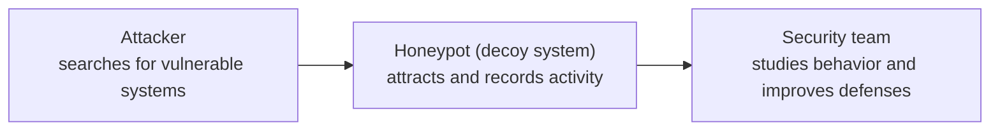
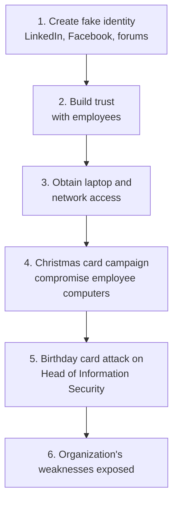
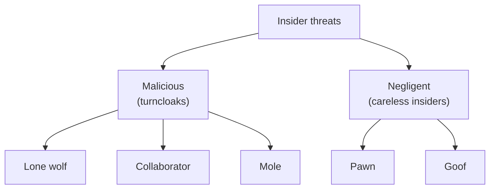
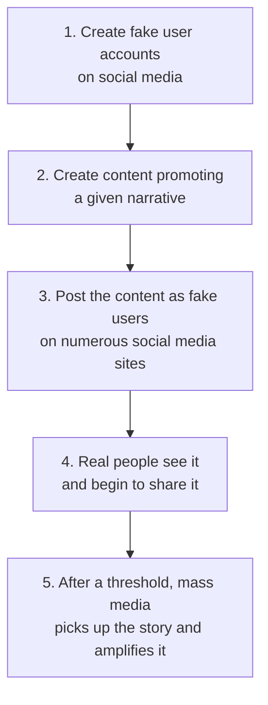

# Module 3: Social Engineering

This module covers the many **social engineering** methods bad actors use to get what they want: phishing and its variants, scareware, watering holes, tailgating, insider threats, fraud, scams, and influence campaigns. You will also learn how and why social engineering works: it targets **people**, not computers.

---

## 📚 Table of Contents

- [🎯 Learning Objectives](#-learning-objectives)
- [Lesson 1: Social Engineering Overview](#lesson-1-social-engineering-overview)
  - [1.1 Lesson Status](#11-lesson-status)
- [Lesson 2: Social Engineering Techniques, Part A](#lesson-2-social-engineering-techniques-part-a)
  - [2.1 What Is Social Engineering?](#21-what-is-social-engineering)
  - [2.2 Spotting a Social Engineering Attack](#22-spotting-a-social-engineering-attack)
  - [2.3 Real-Life Examples](#23-real-life-examples)
  - [2.4 Phishing](#24-phishing)
  - [2.5 Spear Phishing and Whaling](#25-spear-phishing-and-whaling)
  - [2.6 Smishing and Vishing](#26-smishing-and-vishing)
  - [2.7 Quid Pro Quo, Pretexting and Baiting](#27-quid-pro-quo-pretexting-and-baiting)
  - [2.8 Protecting Yourself](#28-protecting-yourself)
- [Lesson 3: Social Engineering Techniques, Part B](#lesson-3-social-engineering-techniques-part-b)
  - [3.1 Part A vs Part B](#31-part-a-vs-part-b)
  - [3.2 Scareware](#32-scareware)
  - [3.3 Watering Hole Attacks](#33-watering-hole-attacks)
  - [3.4 Honeypot Traps and Honeypots](#34-honeypot-traps-and-honeypots)
  - [3.5 Tailgating](#35-tailgating)
  - [3.6 Combining Methods: The Toolbox](#36-combining-methods-the-toolbox)
  - [3.7 Case Study: Emily Williams](#37-case-study-emily-williams)
- [Lesson 4: Insider Threat](#lesson-4-insider-threat)
  - [4.1 What Is an Insider Threat?](#41-what-is-an-insider-threat)
  - [4.2 Types of Insider Threats](#42-types-of-insider-threats)
  - [4.3 Attack Methods Used Against Insiders](#43-attack-methods-used-against-insiders)
  - [4.4 Insider Threat Indicators](#44-insider-threat-indicators)
  - [4.5 Mitigating Insider Threats](#45-mitigating-insider-threats)
  - [4.6 Employee Security Recommendations](#46-employee-security-recommendations)
- [Lesson 5: Fraud, Scams, and Influence Campaigns](#lesson-5-fraud-scams-and-influence-campaigns)
  - [5.1 Cyber Fraud and Cyber Scams](#51-cyber-fraud-and-cyber-scams)
  - [5.2 Examples of Cyber Fraud and Scams](#52-examples-of-cyber-fraud-and-scams)
  - [5.3 Online Influence Campaigns](#53-online-influence-campaigns)
  - [5.4 Hybrid Warfare](#54-hybrid-warfare)
- [🌍 Real-World Scenarios](#-real-world-scenarios)
- [📊 Comparisons](#-comparisons)
- [🧠 Key Takeaways](#-key-takeaways)
- [📝 Quick Revision](#-quick-revision)
- [❓ Knowledge Check](#-knowledge-check)
- [🔗 Related Modules](#-related-modules)

---

## 🎯 Learning Objectives

After completing this module, you will be able to:

- Explain **social engineering** and the signs of an attack.
- Describe the different social engineering methods: **phishing, spear phishing, whaling, smishing, vishing, quid pro quo, pretexting, baiting, scareware, watering hole, honeypot trap, and tailgating**.
- Define **insider threat**, explain the types of insiders, the attack methods used against them, the threat indicators, and mitigation methods.
- Describe **fraud, scams, and influence campaigns**, list examples of cyber fraud and scams, and explain how a typical online influence campaign unfolds.

> 📝 **Note:** Social engineering attacks **people** rather than computers. Even strong technical defenses can be bypassed if a person is manipulated.

---

# Lesson 1: Social Engineering Overview

## 1.1 Lesson Status

> ⚠️ **Notes Pending:** Notes for **Lesson 01: Social Engineering Overview** were not clearly identified in the supplied material, so no content is written here to avoid inventing course content.

The module description says this module also explains **how and why social engineering works**. Lessons 2 to 5 below already cover the methods, warning signs, and defenses.

> 📝 **Note:** Add the Lesson 1 notes here once they are available.

---

# Lesson 2: Social Engineering Techniques, Part A

## 2.1 What Is Social Engineering?

> 💡 **Definition:** **Social engineering** refers to a wide range of attacks that **leverage human emotions to manipulate a target**. The attack may incite the target to **action or inaction**. Ultimately, it aims to steer the target in a direction chosen by the orchestrator, often to the target's detriment.

According to one source cited in the course, social engineering remains a **leading cause of network breaches**.

**Examples of social engineering goals:**

- Disclosing confidential information
- Transferring money
- Influencing a person or persons to think in a certain way

### 🔑 Two Important Characteristics

| # | Characteristic | Meaning |
|---|----------------|---------|
| 1 | **Desired outcome** | The aim is an outcome desirable to the orchestrator (attacker) |
| 2 | **Emotional manipulation** | The method is emotional manipulation |

> 🧠 **Remember:** Social engineering = attacker's goal + emotional manipulation.

> 🌍 **Real-world Scenario:** Someone says, *"I'm from the IT department. Your computer has a security problem. Tell me your password so I can fix it."* They did not hack your computer. They hacked your **trust**.

---

## 2.2 Spotting a Social Engineering Attack

Look for these three signs:

| Sign | Meaning | Example |
|------|---------|---------|
| 😨 **Emotional plea** | Leverages fear, curiosity, excitement, anger, sadness, or guilt | *"Your bank account will be blocked!"* |
| ⏱️ **Urgency** | Pressure so you don't have time to think | *"Your account will be deleted in 30 minutes. Click now."* |
| 🤝 **Trust-building** | Attacker tries to establish trust | Pretending to be your manager, bank employee, IT admin, police officer |

> ⚠️ **Warning:** Take caution when a message has any of these attributes. Don't let a bad actor pull your strings. The bad actor has devised a play and intends you to play the tragic role. Stop and **verify** before acting.

---

## 2.3 Real-Life Examples

### 🎭 Frank Abagnale

- Perhaps the most famous social engineering bad actor. His criminal life was shown in the movie *Catch Me If You Can* and in an autobiography of the same name.
- He impersonated a **doctor, lawyer, and airline pilot** to gain people's trust and take advantage of them.
- 💡 *Lesson:* never trust someone only because they claim to be an authority. Verify.

### 🎯 The 2011 Security Company Attack

1. An attacker targeted a well-respected security company with **spear phishing** emails sent to groups of employees.
2. The emails had an **Excel spreadsheet** attached with malicious code embedded.
3. The code exploited a vulnerability in **Adobe Flash** to install a **backdoor** on the host computer.
4. At least one employee opened the attachment.

> 🎯 **Exam Focus:** *It only takes one.* One employee falling for the attack can compromise a highly secure organization.

> 📖 **Beginner Explanation (added):** A *backdoor* is a hidden way into a system that bypasses normal login and security controls.

A social engineering attacker can speak to the target directly (like Abagnale), or use email or another method. These are different **attack vectors**. See [Module 2: Attack Vectors](../Module-02/README.md#33-attack-vectors).

---

## 2.4 Phishing

> 💡 **Definition:** **Phishing** is malicious spam sent to as many people as possible, hoping at least one is taken in.

Two important characteristics:

- It uses **email** as the attack vector.
- It targets **anyone with an email address**. It is **indiscriminate**.

> 📝 **Note:** *Phishing* can also be used as a **category name** for all electronic social engineering attacks, including spear phishing, whaling, smishing, and vishing.

> 🌍 **Example:** An email says *"Your bank account will be blocked! Click to verify."* You enter your banking details on the fake page and the attacker steals them.

---

## 2.5 Spear Phishing and Whaling

Some phishing variants belong to sophisticated campaigns and require **research and reconnaissance** by the attacker. Both spear phishing and whaling are social engineering attacks that use **email** to target a **specific individual or group** in order to steal confidential information or profit.

| | 🎯 Spear Phishing | 🐋 Whaling |
|---|---|---|
| **Target** | An individual or category of individuals with **lower profiles** (for example, employees at the security company) | **High-ranking individuals** in an organization |
| **Method** | Personalized email | Researched, personalized email to gain the target's trust |
| **Memory** | **Spear** = specific target | **Whale** = big target |

- Executives and board members can be just as susceptible to email attacks as the people who work for them.

> 🌍 **Real-world Case:** One of the most successful whaling attacks ever was against a **Belgian bank**. The CEO didn't know he had been compromised until a **routine internal audit** revealed the attackers had escaped with over **70 million euros**. They have never been caught.

---

## 2.6 Smishing and Vishing

Email is not the only vector. Instant messaging, live chat, SMS, and phone calls can work the same way.

| Attack | Name Comes From | Vector | Example |
|--------|-----------------|--------|---------|
| **Smishing** | **SMS + phishing** | SMS / text messages (also instant messaging and live chat) | *"Your parcel delivery failed. Update your details using this link."* |
| **Vishing** | **Voice + phishing** | Telephone or mobile device | A fake bank caller asks for your OTP |

These attacks are identical to phishing, spear phishing, or whaling, except the **attack vectors are different**. They can be equally profitable.

> 🌍 **Real-world Case (Vishing):** In **March 2019**, the CEO of a **UK energy provider** got a call from someone who sounded exactly like his boss. Fraudsters are known to use **AI voice technology** to impersonate people. He transferred **$243,000** to a "Hungarian supplier", which was the bad actor's bank account.

> 🌍 **Real-world Case (2020 social media breach):** Hackers took control of **130 accounts** on a well-known social media platform, including celebrity accounts. They downloaded user data, accessed direct messages, and posted requests for donations to a **Bitcoin wallet**. Within minutes they made **$110,000 through 320 transactions**. The method is unknown, but it is **speculated** that employees were tricked into revealing credentials.

---

## 2.7 Quid Pro Quo, Pretexting and Baiting

These tactics are **not restricted to one attack vector**. They can use email, messaging, voice, or face-to-face contact.

### 🔄 Quid Pro Quo

> 💡 **Definition:** *Quid pro quo* is Latin for **"one thing for another."** The bad actor offers a **service, usually tech support**, in exchange for **access to information**, such as user credentials.

> 🌍 **Example:** *"I'm from technical support. I can fix your network problem, but first I need your username and password."*

### 🎬 Pretexting

> 💡 **Definition:** **Pretexting** involves a situation, or **pretext**, devised to **invoke an emotional response** from the target.

> 🌍 **Real-life Example (the grandfather):**
> 1. A "police officer" (bad actor) calls a grandfather and says his grandson was arrested for narcotics possession, resisted arrest, and had his nose broken.
> 2. The "officer" puts the "grandson" (another bad actor) on the phone, sobbing and begging for bail money.
> 3. The voice doesn't sound quite right, but the grandfather reasons that sobbing and a broken nose would explain it.
> 4. Fortunately, he **hangs up and phones the grandson's parents to verify**. The story was false.

### 🪤 Baiting

> 💡 **Definition:** **Baiting** is similar to phishing. It relies on **positive emotions**, such as a reward, or on **curiosity**, to entice you to act.

- **Obvious baiting:** an email, text, or call saying you **won a prize** or qualify for a **rebate**.
- **Subtle baiting:** a bad actor leaves a **USB stick** in a public place near the target organization (parking lot, lobby, washroom) with an intriguing label like *"managers' salaries and compensation."* If you plug it in, malware installs a **backdoor** and the bad actor gets a **gateway into the network**.

### 🔍 Quid Pro Quo vs Pretexting vs Baiting

| Technique | Core Idea | Example |
|-----------|-----------|---------|
| **Quid pro quo** | Something **in exchange** for something | *"I'll fix your computer if you give me your password."* |
| **Pretexting** | A **believable fake story** that triggers emotion | *"I'm a police officer. Your grandson needs help."* |
| **Baiting** | An **attractive offer or object** used as bait | A USB labelled *"Managers' Salaries"* |

---

## 2.8 Protecting Yourself

> 📖 **Added guidance (from the supplementary notes, not from the course text):**

1. Never share **passwords or OTPs** over calls, emails, or messages.
2. **Verify the sender** before opening attachments or clicking links.
3. **Don't trust urgency.** Take time to verify unexpected requests.
4. Don't plug **unknown USB drives** into office computers.
5. Verify unusual payment requests through a **separate trusted channel**.
6. Check website addresses before entering credentials.
7. Use **MFA (multi-factor authentication)** for an extra layer of account security.
8. Report suspicious messages to your IT or security team.

> 🔗 **Connection to Module 1:** This is the **user education** part of the [first line of defense](../Module-01/README.md#the-first-line-of-defense).

---

# Lesson 3: Social Engineering Techniques, Part B

## 3.1 Part A vs Part B

| | Part A | Part B |
|---|--------|--------|
| **Approach** | Bad actors **initiate** actions against targets | Less intrusive, sometimes **clandestine**. The methods depend on **you going to the bad actor**, or at least it is made to look that way |
| **Examples** | Phishing, vishing, quid pro quo, baiting | Scareware, watering hole, honeypot trap, tailgating |

---

## 3.2 Scareware

> 💡 **Definition:** **Scareware** frightens users into downloading fake security software or doing something unsafe. It is also known as a **rogue attack**.

> 🌍 **Example:** While browsing, a warning says your computer is infected by malware and you should download antivirus software from the provided link. The software, offered free or for a fee, is very likely **fake or malware**.

**How it works:**

1. The attacker creates a fake virus warning.
2. The victim sees it while browsing.
3. Fear and panic follow.
4. The victim downloads the "antivirus."
5. It is fake or malicious.

- 🧠 **Memory:** Scareware = *scaring people into downloading fake security software.*

> 📖 **Beginner Explanation (added):** *Rogue* security software pretends to be real antivirus but is fraudulent or malicious. To stay safe, don't trust unexpected website warnings, download software only from official sources, and close suspicious browser tabs.

---

## 3.3 Watering Hole Attacks

> 💡 **Definition:** In a **watering hole attack**, the attacker **compromises a site that is likely to be visited by a particular target group**.

> 🌍 **Analogy:** Animals regularly visit a water source. A hunter waits nearby instead of chasing each animal.
> - Animals = target users
> - Watering hole = site they often visit
> - Hunter = attacker
> - Trap = malicious code on the site

### 👥 Relationship Grooming on Social Media

- Bad actors exploit social media sites like **Facebook and LinkedIn** to **start and groom relationships** with targets.
- The same applies in the **physical world**: a bad actor or agent orchestrates a **chance encounter** at a place the target is known to frequent. If talented, the agent develops that contact into a relationship they can exploit.
- **Cinema example:** in the movie *Red Sparrow*, a female agent goes swimming at a public pool where she knows she can meet her target. Her attractiveness ensures **he approaches her**, which avoids the suspicion that her approaching him might cause.

> 🧠 **Remember:** Watering hole = compromise a site the target group already visits and trusts.

---

## 3.4 Honeypot Traps and Honeypots

### 🍯 Honeypot Trap (espionage)

A **honeypot trap** has its origins, at least in popular culture, in **espionage**. The secret services of some nations recruit and groom agents to act as professional temptresses.

- The **agent** is the **honeypot**.
- The public pool in the example is the **watering hole**.

### 🍯 Honeypot (cybersecurity defense)

> 💡 **Definition:** A **honeypot** is a **security mechanism that creates a virtual trap to lure attackers**. An **intentionally compromised** computer system lets attackers exploit vulnerabilities, so analysts can **study the attacker's tactics** and use what they learn to improve network security.

- **White hat** analysts apply this concept to strengthen network defenses.
- Many network security companies sell honeypot systems. Fortinet's product is **FortiDeceptor**.

> ⚠️ **Warning:** A cybersecurity honeypot is a **defensive** tool, not a social engineering attack against the organization. The *honeypot trap* in espionage is the attack concept it was named after.

---

## 3.5 Tailgating

> 💡 **Definition:** **Tailgating** involves a bad actor **following someone with security clearance into a secure building or access-controlled room**. The tailgater relies on the **courtesy or sympathy** of the target.

Common tricks:

- The target holds a door open for someone behind them, not knowing the person has malicious intent.
- The attacker pretends to be **burdened with parcels** and needs help opening the door.
- The attacker claims they **forgot their security pass**.

> 🎯 **Exam Focus:** If a tailgater slips through **without you noticing**, it does **not** qualify as social engineering. There must be **psychological manipulation** between attacker and target.

> 🧠 **Remember:** An attack can be **physical** (tailgating), **active** (whaling, pretexting), or **subtle** (baiting).

> ✅ **What to do:** If you don't recognize the person or know their security status, involve **reception or security** to help them.

> ⚠️ **Warning:** The supplementary notes draw a distinction between *tailgating* and *piggybacking*. The course text in Lesson 4 treats them as the **same** thing ("tailgating, or piggybacking"), so this README follows the course. See also [Module 2: Unauthorized Access](../Module-02/README.md#36-the-four-threat-categories).

---

## 3.6 Combining Methods: The Toolbox

In real life, bad actors use **several methods and attack vectors**. As a campaign progresses and new targets appear, their tactics can **evolve and change**.

> 🌍 **Analogy:** Social engineering techniques and malware types are **tools in a toolbox**. A carpenter needs more than a hammer. A cyberattacker needs different tools too.

Tools named in the course: **social engineering, ransomware, Trojan horse, backdoor, worm, bot, and zero-day attacks**.

📖 Beginner Explanation (added): what do these tools do?

- **Ransomware:** blocks access to data or systems until a ransom is paid.
- **Trojan horse:** malware disguised as legitimate software.
- **Backdoor:** a hidden way to keep access to a system.
- **Worm:** malware that spreads between systems.
- **Bot:** an infected device controlled as part of a botnet.
- **Zero-day exploit:** an attack on a vulnerability before a fix is available.

---

## 3.7 Case Study: Emily Williams

A real-life social engineering attack carried out by a **blue hat penetration testing team** (see [Module 2: Penetration Testing](../Module-02/README.md#23-penetration-testing)). The analyst presented the results at the **RSA Europe security conference in 2012**. The organization was not named, but it **specializes in cybersecurity**.

### 👩 Phase 1: Fake Identity

- Built a credible online identity for a fictitious woman, **Emily Williams**, on **LinkedIn**.
- Set up matching profiles on **Facebook and other sites**, and posted on **university forums** under her name, so Google searches would **match** her social profiles.
- Profile: a **28-year-old MIT graduate** with **ten years' experience**, **just hired** by the targeted organization.

### 🤝 Phase 2: Building Trust

- Within **15 hours**: **60 Facebook friends** and **55 LinkedIn connections** among the organization's employees and contractors.
- After **24 hours**: **three job offers** from other companies.
- Soon after: LinkedIn **endorsements**, and men at the organization offered to help her get started faster.

### 💻 Phase 3: Laptop and Network Access

- The team manipulated these men into giving "Emily" a **work laptop and network access**, **skirting proper channels and normal procedures**.
- She received **more network privileges than a normal new hire**.
- The team chose **not to use** the laptop and access, and continued the social engineering assault instead.

### 🎄 Phase 4: Christmas Card Attack

- Around the holidays, the team created a site with a **Christmas card** and posted the link on Emily's profiles.
- Visitors were prompted to run a **signed Java applet** that opened a **reverse shell** back to the attack team through an **SSL connection**.
- With a shell, the team used **privilege escalation exploits** to gain **administrative rights**, **sniff passwords**, **install other applications**, and **steal documents with sensitive information**.
- **Unplanned victims:** contractors, including employees of **antivirus companies**. At least one was a **developer with access to source code**, which could have allowed compromising the code and made an attack harder to detect.

> 📖 **Beginner Explanation (added):** A *reverse shell* is a connection where the compromised computer connects **back** to the attacker, giving the attacker remote command access. *SSL* is an older protocol for encrypted communication, now replaced by TLS. *Privilege escalation* means gaining higher permissions on a system.

### 🎂 Phase 5: Birthday Card Attack

- Via Facebook, the team learned two employees were discussing the upcoming **birthday of the head of information security**, who had **no social media exposure**.
- They emailed him a **birthday card** that appeared to come from one of those employees.
- He clicked the link, his computer was infected, and because of his **elevated privileges**, much of the network and sensitive information was compromised.

### 📈 Phase 6: Targeting All Levels

- The attack began with **low-level employees** (sales and accounting). Befriending them first gave **credibility and trust**, which made reaching higher-ranking people easier.
- As the network grew, the team targeted **technical people, security people, and even executives**.

> ✅ **Conclusion:** Even **technically sophisticated organizations** can fall victim to social engineering.

> 🔗 **Connection:** In Lesson 4, "Emily Williams" is the course's example of a **mole**, and the head of information security is an example of a **pawn**.

---

# Lesson 4: Insider Threat

## 4.1 What Is an Insider Threat?

Organizations tend to focus on external threats, but a significant number of breaches are due to **insiders**. Teams should address insider threats through initiatives such as **employee awareness training**.

> 💡 **Definition:** An **insider threat** is an individual or individuals who **work for an organization or have authorized access** to its networks or systems and who pose a **physical or cyber threat** to the organization.

The insider is typically a **current employee**, but may also be:

- A **former** employee
- A **contractor**
- A **business partner**
- A **board member**
- An **imposter** who gains access to sensitive information or network privileges

> 📝 **Note:** An insider threat does not always mean a criminal. Ordinary human mistakes can create serious security problems.

---

## 4.2 Types of Insider Threats

There are two main groups:

| Group | Meaning |
|-------|---------|
| **Negligent (careless)** | Unintentionally assist bad actors through human error, poor judgment, or carelessness |
| **Malicious** | Act maliciously on the inside |

### 😈 Malicious Insiders (Turncloaks)

**Principal goals:** **espionage, fraud, intellectual property theft, and sabotage**.

> 🌍 **Real-world Case:** In 2020, a former executive of company A stole **trade secrets from its self-driving-car division** and handed them to his new employer. He was sentenced to **18 months in prison**.

| Type | Meaning | Example |
|------|---------|---------|
| 🐺 **Lone wolf** | Works **independently**, without outside influence. May seem as harmless as a sheep but harbors malicious intent | An unhappy employee steals confidential data and sells it online |
| 🤝 **Collaborator** | An authorized user who **works with a third party**: a competitor, nation-state, organized criminal network, or individual | A network engineer sells firewall configurations to an outside attacker |
| 🕵️ **Mole** | An **outsider** who gained access by **posing as a vendor, partner, contractor, or employee** | A fake employee gets a laptop and network access (the Emily Williams attack) |

### 😟 Careless Insiders

The more benign, yet equally dangerous category: insiders who **inadvertently help a bad actor** by falling for phishing and other social engineering.

| Type | Meaning | Example |
|------|---------|---------|
| ♟️ **Pawn** | An authorized user **manipulated** into unintentionally helping the bad actor, often through social engineering such as tailgating or spear phishing | The head of information security fooled by the digital birthday card |
| 🤦 **Goof** | An insider who **deliberately takes potentially harmful actions but has no malicious intent**. Arrogant, ignorant, or incompetent, and refuses to recognize the need to follow security policies | An employee knowingly plugs a personal USB drive into a work computer because the policy is inconvenient |

> 🧠 **Memory trick (added):** Malicious = **LCM** (Lone wolf, Collaborator, Mole). Negligent = **PG** (Pawn, Goof).

> 📝 **Note:** There are different ways to categorize and name insider threats. These names follow the course.

---

## 4.3 Attack Methods Used Against Insiders

Malicious agents use many methods and vectors against careless insiders.

### 🚪 Physical Vector

| Method | Meaning |
|--------|---------|
| **Tailgating (piggybacking)** | An unauthorized person gains physical access to a restricted area by following someone authorized |
| **Shoulder surfing** | Using direct observation, such as looking over someone's shoulder, to get information |
| **Dumpster diving** | Looking for information in someone else's garbage or recycle bin. It can also happen in a general-access area such as a **printing room** where confidential printouts are not retrieved right away |
| **Eavesdropping** | **Physical:** listening to a conversation where confidential information is discussed. **Digital:** **network snooping or sniffing**, when an actor exploits an insecure or vulnerable network to read or steal information traveling between two devices |

> 📝 **Note:** Eavesdropping is **more common in wireless** communications than on Ethernet networks because wireless networks are more accessible.

### 💻 Digital Vectors

| Vector | Methods |
|--------|---------|
| **Email** | Spear phishing, whaling |
| **Messaging or telephone** | Smishing, vishing, pretexting |
| **Social media** | Watering hole attacks |

---

## 4.4 Insider Threat Indicators

An insider attack can be **harder to detect** than an external one. Insiders have access to, and knowledge about, the network that an external attacker likely lacks. Indicators can help.

> ⚠️ **Warning:** **Context is everything.** Go-getter or Type A personalities take on challenges aggressively. A threat indicator is a **noticeable behavior change without a logical explanation**. A single sign is not proof of malicious intent.

| 🧑 Behavioral Indicators | 💻 Digital Indicators |
|---|---|
| Dissatisfaction with the organization | **Activity at unusual times** (for example logging in at 4 AM, or always working late) |
| Holding a grudge against the organization | **Volume of traffic** (unusual amounts of data transferred within the network) |
| Taking on more tasks with **excessive enthusiasm** | **Type of activity** (accessing resources atypical or not needed for the job) |
| **Routine violations** of policies | **Repeated requests for access** to systems not relevant to their job |
| Open contempt of organization policies | **Unauthorized devices**, such as USB drives |
| Attempts to **circumvent security** | **Network crawling** and deliberate searches for sensitive information |
| | **Emailing sensitive information** outside the organization |

> 📖 **Beginner Explanation (added):** *Network crawling* means exploring internal systems to discover what exists, for example an employee with access to one server browsing other servers for sensitive information with no work reason.

---

## 4.5 Mitigating Insider Threats

> 📖 **Beginner Explanation (added):** *Mitigation* means reducing the chance or impact of a threat.

| Measure | What It Means |
|---------|---------------|
| **Identify critical assets** | List logical and physical assets: networks, systems, confidential data, facilities, and people |
| **Rank and prioritize** | Rank each asset, identify its current protection, and secure the most important first |
| **Machine learning (ML)** | Helps analyze the data stream and **prioritize the most relevant alerts** |
| **UEBA** | Digital forensics and analytics tools help detect, analyze, and alert on potential insider threats. User and device behavior analytics establish a **baseline of normal** data access activity |
| **Database activity monitoring** | Identifies **policy violations** |
| **Monitor and correlate** | Deploy tools that monitor user activity and **aggregate and correlate** information from multiple sources |
| **Deception software** | **FortiDeceptor** sets traps to attract malicious insiders and tracks their actions to understand their intentions. Honeypot information can be shared with other intelligence to improve detection |
| **Security policies** | **Define, document, and disseminate** policies |
| **Training and testing** | Train staff, then test to ensure comprehension. This prevents ambiguity and creates a basis for enforcement |
| **Security-aware culture** | The key to mitigating insider threat: the right beliefs and attitudes combat negligence and reduce opportunities for malicious behavior |

> ⚠️ **Warning:** The course text expands **UEBA** as "user and **event** behavior analytics." Many other sources call it "user and **entity** behavior analytics." Both are shown in study material, so know the acronym and its purpose: learn normal behavior, then flag abnormal behavior.

> 📖 **Beginner Explanation (added):** A *baseline* is the normal pattern used for comparison. For example, if an admin normally logs in 9 AM to 6 PM and suddenly downloads 10 GB at 3 AM, UEBA flags it.

> 🔗 **Connection:** FortiDeceptor also appears in [Module 2: Fortinet Products](../Module-02/README.md#69-fortinet-products-for-outbreak-defense).

---

## 4.6 Employee Security Recommendations

Your behavior can **jeopardize or enhance** security. Follow these:

- Learn your organization's **security policies**.
- Do **not** take shortcuts around security protocols.
- Do **not** leave login credentials exposed.
- Do **not** allow tailgating.
- Do **not** store confidential digital documents **unencrypted** or leave physical documents unsecured.
- Do **not** disable endpoint security and controls.
- Do **not** share proprietary or confidential information with unauthorized people.
- **Patch** your devices as soon as OS and software updates are available.

---

# Lesson 5: Fraud, Scams, and Influence Campaigns

## 5.1 Cyber Fraud and Cyber Scams

The internet has become a platform for large-scale **fraud, scams, and malevolent influence**. These often use social engineering such as phishing, together with malware.

> 💡 **Cyber fraud:** A social engineering technique, malware, or other type of deception used to **defraud or take advantage of a person or organization for financial or personal gain**.

> 💡 **Cyber scams:** A type of fraud, but generally classified as **petty or not as serious** as cyber fraud. This does **not** mean scams are trivial.

> 🌍 **Real-world Statistic:** According to the **FBI**, elderly Americans lose **more than three billion dollars annually** to scams. Seniors are often targeted because they are **more trusting** than younger adults and have a **lifetime of savings**.

Fraud and scams are criminal activities that use the **same threat vectors and methods** from earlier lessons.

| Cyber Fraud | Cyber Scams |
|-------------|-------------|
| Deception for financial or personal gain | A type of fraud |
| Generally more serious | Generally petty or less serious |

> 📝 **Note:** The difference is mainly about scale or seriousness, not a strict legal definition.

---

## 5.2 Examples of Cyber Fraud and Scams

| Type | What Happens | Example |
|------|--------------|---------|
| 🏛️ **Copycat government websites** | Bad actors use phishing, spear phishing, or another variant to link to a **fake government site**, usually to steal credentials or credit card information | A fake portal that looks like the official one asks for your card details |
| 💔 **Dating and romance scams** | Bad actors use legitimate **dating websites, social networks, and chat rooms** to get personal details or money | A fake partner builds trust, then invents an emergency |
| 🏖️ **Holiday fraud** | Bad actors offer **online holidays and accommodation that are unavailable or don't exist** | You pay an advance for a hotel booking that doesn't exist |
| 🧾 **Mandate fraud** | A bad actor **hacks an email transaction**, for example between a customer and a vendor, then sends a **duplicate invoice with the bad actor's bank account** and requests payment | A vendor "changes bank details" and you pay the attacker |
| 🔀 **Pharming** | Bad actors **redirect traffic from a legitimate website to a fake one**, such as an e-commerce or banking site | You type your bank's address but land on a fake site |
| 💌 **Greeting card scams** | Sending a **malicious greeting card** on a **birthday** or important holiday such as Christmas or Easter | A fake birthday card link installs malware |

> 📖 **Beginner Explanation (added): Phishing vs Pharming.** In phishing, you are tricked into *clicking* a bad link. In pharming, you may type the *correct* address and still be redirected, for example through manipulated **DNS** (the Domain Name System, which translates website names into IP addresses). The course text only says traffic is redirected, so the DNS detail is a general explanation.

> 📖 **Beginner Explanation (added):** Mandate fraud is closely associated with *business email compromise (BEC)*. To defend, verify bank detail changes through a known, trusted phone number.

> 🔗 **Connection:** The greeting card scam matches the Christmas and birthday card attacks in the [Emily Williams case](#37-case-study-emily-williams).

---

## 5.3 Online Influence Campaigns

> 💡 **Definition:** **Influence campaigns** are **large-scale efforts to shift public opinion**. They are generally executed in **bad faith** and seek to promote a **false narrative**. They are often carried out by groups with high capability, up to and including **nation-state actors**.

### 📈 How a Typical Campaign Unfolds

> 📖 **Beginner Explanation (added):** A *narrative* is the story or viewpoint the attacker wants people to accept. *Amplification* means increasing how far information reaches.

### 💪 Why Influence Campaigns Are Powerful

- With **little cost and effort**, a bad actor can manipulate the opinions of **hundreds of thousands** of people.
- Social media lets the bad actor operate **secretly**, without fear of being identified as the source.
- **Publicly** attacking an adversary can bring undesirable consequences. **Secretly** turning public opinion is **harder to prove and harder to retaliate against**.
- If someone **openly** makes a false claim, the victim can take **legal recourse**, which puts the accuser's reputation at stake.

### 🍽️ Scenario: Two Rival Restaurant Owners

> 🌍 **Real-world Scenario:** Owner A uses **anonymous social media accounts** to spread disinformation about Owner B, claiming B refused to hire someone because of their **race**. Others join in, demand retribution, and **boycott** the restaurant.
>
> Whatever Owner B does (stay silent, deny, or accuse A of foul play) is a **losing proposition**. Accusing A could backfire and provoke the mob further.

---

## 5.4 Hybrid Warfare

> 💡 **Definition:** Influence campaigns can be part of **hybrid warfare**, as conducted by **"psyops"**, a division of the military. Hybrid warfare combines **traditional warfare tactics, political strategy, and cyber warfare**. Cyber warfare can include **hacking, social engineering, influence campaigns, and promoting fake news**.

> 🎯 **Exam Focus:** In hybrid warfare, the objective of influence campaigns is to **weaken the enemy's resolve by sowing confusion and division**.

> 📖 **Beginner Explanation (added):** *PsyOps* means **psychological operations**: activities meant to influence the emotions, beliefs, and behavior of a target audience.

---

## 🌍 Real-World Scenarios

| Scenario | Concept Applied |
|----------|-----------------|
| An email says your account will be blocked in 30 minutes; click now | Phishing; emotional plea and urgency |
| A phishing email names a network admin and references their manager | Spear phishing |
| A fake payment request goes to a bank's CEO | Whaling |
| A text says your parcel delivery failed | Smishing |
| A caller who sounds like your boss asks for a wire transfer | Vishing |
| A "technician" offers to fix your PC for your password | Quid pro quo |
| A fake police officer says your grandson needs bail | Pretexting |
| An infected USB labelled "Managers' Salaries" is left in a lobby | Baiting |
| A pop-up says "15 viruses found! Download now" | Scareware (rogue attack) |
| A forum popular with a target company is compromised | Watering hole |
| A stranger asks you to hold the door because they "forgot their pass" | Tailgating |
| An outsider poses as a new employee and gets a laptop | Mole (the Emily Williams attack) |
| An employee falls for a birthday card with a bad link | Pawn |
| An employee emails confidential files to a personal account | Digital insider threat indicator |
| An invoice arrives with changed vendor bank details | Mandate fraud |
| You type your bank address but land on a fake site | Pharming |
| Fake accounts spread a false story about a rival restaurant | Influence campaign |

---

## 📊 Comparisons

### Phishing Family

| Attack | Target / Vector | Memory |
|--------|-----------------|--------|
| **Phishing** | Email, anyone | Fake email to many people |
| **Spear phishing** | Email, specific individual or lower-profile group | Specific target |
| **Whaling** | Email, high-ranking individuals | Big target |
| **Smishing** | SMS or text | SMS + phishing |
| **Vishing** | Voice or phone | Voice + phishing |

### Part A vs Part B Techniques

| Part A (attacker initiates) | Part B (attacker lures you) |
|-----------------------------|------------------------------|
| Quid pro quo | Scareware |
| Pretexting | Watering hole |
| Baiting | Honeypot trap |
| Phishing family | Tailgating |

### Insider Threat Types

| Type | Group | Behavior |
|------|-------|----------|
| Lone wolf | Malicious | Works alone |
| Collaborator | Malicious | Works with a third party |
| Mole | Malicious | Outsider posing as insider |
| Pawn | Negligent | Manipulated by an attacker |
| Goof | Negligent | Ignores policy, no malicious intent |

### Behavioral vs Digital Indicators

| Behavioral | Digital |
|------------|---------|
| What the person does or how they act | What the account does on computers and networks |

### Commonly Confused Concepts

| Pair | Difference |
|------|------------|
| Spear phishing vs Whaling | Specific lower-profile targets vs high-ranking targets |
| Smishing vs Vishing | SMS vs voice |
| Quid pro quo vs Pretexting vs Baiting | Exchange vs fake story vs attractive bait |
| Watering hole vs Honeypot (cybersecurity) | Watering hole is an attack on a trusted site. A honeypot is a defensive decoy |
| Honeypot trap vs Honeypot | Espionage-style lure of a person vs decoy system for attackers |
| Phishing vs Pharming | Tricked into clicking vs redirected to a fake site |
| Mole vs Pawn | Mole is an outsider posing as an insider. Pawn is a real insider who was manipulated |
| Goof vs Lone wolf | Goof has no malicious intent. Lone wolf does |
| Fraud vs Scam | A scam is a type of fraud, generally petty or less serious |

---

## 🧠 Key Takeaways

- ✅ Social engineering = **attacker's desired outcome + emotional manipulation**. Warning signs: **emotional plea, urgency, trust-building**.
- ✅ **Phishing** = email to many. **Spear phishing** = specific target. **Whaling** = high-ranking target. **Smishing** = SMS. **Vishing** = voice.
- ✅ **Quid pro quo** (exchange), **pretexting** (believable story), **baiting** (attractive bait) work through any vector.
- ✅ **Scareware** scares you into downloading fake security software. **Watering hole** compromises a site the target group visits.
- ✅ A **cybersecurity honeypot** is a defensive decoy. Fortinet's product is **FortiDeceptor**.
- ✅ **Tailgating** only counts as social engineering when there is **psychological manipulation**.
- ✅ Attackers combine methods like **tools in a toolbox**. Even sophisticated organizations fall, as the **Emily Williams** case shows.
- ✅ An **insider threat** is anyone with authorized access who creates risk. **Malicious:** lone wolf, collaborator, mole. **Negligent:** pawn, goof.
- ✅ Detect insiders through **behavioral and digital indicators**. Mitigate with asset prioritization, ML, UEBA, monitoring, FortiDeceptor, policies, training, and a **security-aware culture**.
- ✅ **Cyber fraud** = deception for gain. A **scam** is a petty type of fraud.
- ✅ Six examples: **copycat government sites, romance scams, holiday fraud, mandate fraud, pharming, greeting card scams**.
- ✅ **Influence campaigns** shift public opinion in **five stages** and, in hybrid warfare, aim to **sow confusion and division**.

---

## 📝 Quick Revision

**Social engineering basics**
- Two characteristics: desired outcome + emotional manipulation.
- Three signs: emotional plea, urgency, trust-building.
- Famous cases: Frank Abagnale, 2011 security company attack (Excel + Flash + backdoor), Belgian bank (70 million euros), UK energy CEO ($243,000), 2020 social media breach (130 accounts, $110,000).

**Methods**
- Part A: phishing, spear phishing, whaling, smishing, vishing, quid pro quo, pretexting, baiting.
- Part B: scareware (rogue attack), watering hole, honeypot trap, tailgating.
- Honeypot = defensive decoy; FortiDeceptor.

**Emily Williams**
- Fake identity, trust building, laptop and network access, Christmas card (Java applet, reverse shell, privilege escalation), birthday card to head of infosec, low-level to high-level targets.

**Insider threats**
- Malicious: lone wolf, collaborator, mole. Negligent: pawn, goof.
- Physical vectors: tailgating, shoulder surfing, dumpster diving, eavesdropping. Digital: spear phishing, whaling, smishing, vishing, pretexting, watering hole.
- Indicators: behavioral (dissatisfaction, grudge, excessive enthusiasm, policy violations) and digital (unusual times, volume, type, USB, crawling, emailing out).
- Mitigation: critical assets, ML, UEBA, database monitoring, correlation, FortiDeceptor, policies, training, culture.

**Fraud, scams, influence**
- Six examples: copycat gov sites, romance, holiday, mandate, pharming, greeting card.
- Influence campaign stages: fake accounts, content, spread, real people share, mass media amplifies.
- Hybrid warfare = traditional + political strategy + cyber warfare; goal: confusion and division.

---

## ❓ Knowledge Check

**Q1. (Multiple choice)** Which two characteristics define social engineering?

- A) Encryption and compression
- B) A desired outcome for the attacker and emotional manipulation
- C) Hardware failure and power loss
- D) Speed and bandwidth

Show answer

**B).** The aim is an outcome desirable to the orchestrator, and the method is emotional manipulation.

**Q2. (Multiple choice)** An attacker researches a bank's CEO and sends a personalized email asking for an urgent money transfer. What is this?

- A) Phishing
- B) Smishing
- C) Whaling
- D) Baiting

Show answer

**C) Whaling.** It targets a high-ranking individual with a researched, personalized email.

**Q3. (True/False)** Smishing is phishing done over SMS, and vishing is phishing done over voice calls.

Show answer

**True.** Smishing = SMS + phishing. Vishing = voice + phishing.

**Q4. (Multiple choice)** An infected USB drive labelled "managers' salaries" is left in a company lobby. Which technique is this?

- A) Quid pro quo
- B) Pretexting
- C) Baiting
- D) Vishing

Show answer

**C) Baiting.** It relies on curiosity or a reward to entice the victim to act.

**Q5. (Conceptual)** What is a watering hole attack?

Show answer

The attacker compromises a site that is likely to be visited by a particular target group and waits for them to visit it.

**Q6. (True/False)** If someone slips through a secure door behind you without you noticing, it automatically counts as social engineering.

Show answer

**False.** There must be psychological manipulation between the attacker and the target for it to be social engineering.

**Q7. (Multiple choice)** An outsider poses as a new employee and gets a laptop and network access. Which insider type is this?

- A) Lone wolf
- B) Collaborator
- C) Mole
- D) Goof

Show answer

**C) Mole.** A mole is an outsider who gains access by posing as an employee, vendor, partner, or contractor.

**Q8. (Multiple choice)** An employee knowingly ignores the USB policy because it is inconvenient, with no intent to harm. Which type is this?

- A) Pawn
- B) Goof
- C) Mole
- D) Collaborator

Show answer

**B) Goof.** A goof deliberately takes potentially harmful actions but has no malicious intent.

**Q9. (Conceptual)** Name three digital indicators of an insider threat.

Show answer

Any three of: activity at unusual times, unusual traffic volume, accessing atypical resources, repeated access requests for irrelevant systems, unauthorized devices such as USB drives, network crawling, emailing sensitive information outside the organization.

**Q10. (Multiple choice)** What does an online influence campaign aim to do, and what is its first stage?

- A) Steal bank cards; create a phishing site
- B) Shift public opinion; create fake user accounts
- C) Encrypt files; send ransomware
- D) Speed up a network; install updates

Show answer

**B).** Influence campaigns aim to shift public opinion. They start with fake user accounts, then content creation, spreading, real people sharing, and mass media amplification.

---

## 🔗 Related Modules

| Module | Link |
|--------|------|
| ⬅️ Previous | [Module 2: The Threat Landscape](../Module-02/README.md) |
| ➡️ Next | *[Placeholder: link to Module 04 will be added]* |

### 🔗 Connections to Earlier Modules

| Module 3 Topic | Connects To |
|----------------|-------------|
| Social engineering, phishing | [Module 2: Four threat categories](../Module-02/README.md#36-the-four-threat-categories) and [phishing variants](../Module-02/README.md#38-phishing-variants-and-trojans) |
| Spear phishing and whaling | [Module 2: Phishing variants](../Module-02/README.md#38-phishing-variants-and-trojans) |
| Tailgating, shoulder surfing | [Module 2: Unauthorized access](../Module-02/README.md#36-the-four-threat-categories) |
| Emily Williams (blue hat pen test) | [Module 2: Hacker hats and penetration testing](../Module-02/README.md#22-hacker-hat-categories) |
| FortiDeceptor and honeypots | [Module 2: Fortinet products](../Module-02/README.md#69-fortinet-products-for-outbreak-defense) |
| Mandate fraud, pharming, scams | [Module 2: Attack vectors](../Module-02/README.md#33-attack-vectors) |
| Insider threats and authorized access | [Module 1: AAA framework](../Module-01/README.md#the-aaa-security-framework) |
| Employee awareness training | [Module 1: First line of defense](../Module-01/README.md#the-first-line-of-defense) |
| Loss of confidential data | [Module 1: CIA triad](../Module-01/README.md#the-cia-triad) |
