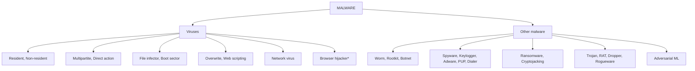
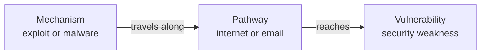
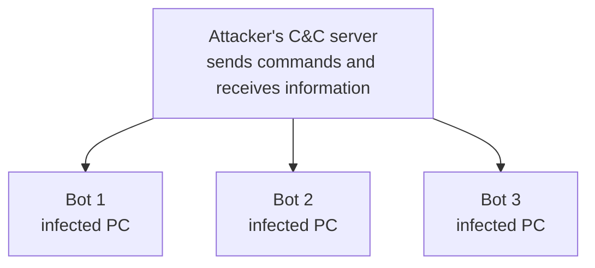

# Module 4: Malware

This module covers the many types of **malware**, such as viruses, worms, and ransomware. After learning their characteristics and intended use, you will be better prepared for cyberattacks against your home or computer and your extended network. You will also learn the three parts of an **attack vector**, how it differs from an **attack surface**, and the common attack mechanisms attackers use.

---

## 📚 Table of Contents

- [🎯 Learning Objectives](#-learning-objectives)
- [Lesson 1: Malware Overview](#lesson-1-malware-overview)
  - [1.1 What Is Malware?](#11-what-is-malware)
  - [1.2 What Malware Can Do](#12-what-malware-can-do)
  - [1.3 Symptoms of Malware Infection](#13-symptoms-of-malware-infection)
- [Lesson 2: Malware Types](#lesson-2-malware-types)
  - [2.1 Computer Viruses](#21-computer-viruses)
  - [2.2 Virus vs Worm](#22-virus-vs-worm)
  - [2.3 Types of Computer Viruses](#23-types-of-computer-viruses)
  - [2.4 Other Malware Types](#24-other-malware-types)
  - [2.5 Malware Classification Map](#25-malware-classification-map)
- [Lesson 3: Malware Attack Vectors and Methods](#lesson-3-malware-attack-vectors-and-methods)
  - [3.1 Attack Vectors and Their Three Components](#31-attack-vectors-and-their-three-components)
  - [3.2 Attack Vector vs Attack Surface](#32-attack-vector-vs-attack-surface)
  - [3.3 Watering Hole Attacks](#33-watering-hole-attacks)
  - [3.4 Botnets and Command and Control](#34-botnets-and-command-and-control)
  - [3.5 Attack Mechanisms and Exploitation Methods](#35-attack-mechanisms-and-exploitation-methods)
- [🌍 Real-World Scenarios](#-real-world-scenarios)
- [📊 Comparisons](#-comparisons)
- [🧠 Key Takeaways](#-key-takeaways)
- [📝 Quick Revision](#-quick-revision)
- [❓ Knowledge Check](#-knowledge-check)
- [🔗 Related Modules](#-related-modules)

---

## 🎯 Learning Objectives

After completing this module, you will be able to:

- Define **malware** and recognize the symptoms of an infection.
- Explain what a **computer virus** is and how it differs from a **worm**.
- Describe the different **types of computer viruses**.
- Describe other malware types: **rootkit, keylogger, spyware, adware, PUP, dialer, ransomware, Trojan horse, RAT, dropper, botnet, cryptojacking**, and more.
- Explain the **three components of an attack vector** and the difference between an **attack vector** and an **attack surface**.
- Describe malware attack mechanisms such as **watering hole, botnet C&C, backdoor, logic bomb, Easter egg, downloader, shellcode, and code injection**.

> 📝 **Note on sources:** For this module, the supplied notes were a single combined set covering all three lessons. I grouped them under the three lessons listed in the module description. If the lesson boundaries in your course differ, the content is unchanged and only the grouping would move.

---

# Lesson 1: Malware Overview

## 1.1 What Is Malware?

> 💡 **Definition:** **Malware** (malicious software) is software designed to **disrupt, damage, spy on, or gain unauthorized access** to a computer or network.

In simple words, malware performs harmful activities on your computer without your permission. The person who creates or distributes it is generally called a **malicious actor** or **attacker**.

> 🌍 **Real-world Scenario:** You download an unofficial app from an unknown website. After installation, the malware might:
> 1. Run in the background
> 2. Monitor your activities
> 3. Collect saved passwords
> 4. Send them to the attacker's server
> 5. Let the attacker access your computer remotely
>
> You may not even realize your computer is compromised.

> ⚠️ **Warning:** One infection can involve **multiple types of malware working together** to achieve the attacker's objectives.

---

## 1.2 What Malware Can Do

| Malware Activity | Meaning | Example |
|------------------|---------|---------|
| Damage systems | Damage files or the operating system | Delete important files |
| Spy on users | Secretly monitor activity | Record keyboard inputs |
| Steal information | Collect and send confidential data | Steal saved passwords |
| Encrypt data | Make files inaccessible | Lock company documents |
| Demand ransom | Ask for money to restore access | Ransomware |
| Gain unauthorized access | Let attackers into a computer | Backdoor |
| Disrupt services | Stop systems from working properly | DDoS attack |

> 🔗 **Connection to Module 1 (added):** Malware attacks **confidentiality** (spyware, keyloggers), **integrity** (overwrite viruses), and **availability** (ransomware, DDoS). See the [CIA triad](../Module-01/README.md#the-cia-triad).

---

## 1.3 Symptoms of Malware Infection

| # | Symptom | What It Looks Like |
|---|---------|--------------------|
| 1 | **Computer becomes slow** | Sluggish, freezes, or stops responding |
| 2 | **Unwanted pop-ups** | Strange ads, warnings, or windows appear |
| 3 | **Applications crash** | Apps close, fail to open, or log you out |
| 4 | **System crashes** | The computer shuts down or restarts unexpectedly |
| 5 | **Emails you didn't send** | Your account sends messages without your knowledge, possibly spreading malware or phishing links |
| 6 | **Unexplained system changes** | Browser homepage, default search engine, or settings change |

> 📖 **Added by the supplementary notes (beyond the six symptoms above):** files opening automatically, strange error messages, random characters on screen, and unusual network activity.

> ⚠️ **Warning:** These symptoms are **warning signs, not proof**. Hardware problems, faulty software, and legitimate updates can cause similar behavior.

---

# Lesson 2: Malware Types

> 💡 **Remember:** **Malware** is the broad category. Viruses, worms, spyware, ransomware, and Trojans are **different types** of malware.

## 2.1 Computer Viruses

> 💡 **Definition:** A **computer virus** is malicious code that **attaches itself to a legitimate file or application** and **spreads when the infected code is executed**.

### 🔑 Three Defining Characteristics

| # | Characteristic | Meaning |
|---|----------------|---------|
| 1 | **User invocation** | Needs a user (or an execution event) to run it, such as opening an infected file |
| 2 | **Attaches to legitimate files** | Latches onto an existing application or file |
| 3 | **Spreads the infection** | Tries to infect other files, applications, or computers |

**How a virus works:**

1. You download an infected application.
2. You open it.
3. The virus runs along with it.
4. The virus infects other files.
5. When those files are shared and run elsewhere, the infection spreads.

> 🧠 **Remember:** A traditional virus **depends on execution** of its infected host or code.

---

## 2.2 Virus vs Worm

> 💡 **Worm:** Malware that can **replicate and spread automatically** between computers and networks **without a user running an infected host file**. It does not need to attach to a legitimate application like a traditional file-infecting virus.

> 🌍 **Real-world Scenario:** One of 100 office computers gets a network worm. The worm finds vulnerable computers on the network and spreads to them automatically, without anyone opening a file.

| Feature | Virus | Worm |
|---------|-------|------|
| Requires host file | Yes, traditionally | No |
| User execution needed | Usually yes | No |
| Self-replicates | Yes, through infected hosts | Yes, independently |
| Spreads automatically | Not typically | Yes |
| Can spread through networks | Yes | Yes |

> 🎯 **Exam Focus:** **Virus** = attaches to a file and needs execution. **Worm** = independent malware that spreads automatically.

---

## 2.3 Types of Computer Viruses

| Virus Type | What It Does | Example | Memory |
|------------|--------------|---------|--------|
| **Resident** | Stays in **memory (RAM)** and infects applications as they are opened | After you open one infected app, it infects every app you open later | Stays in memory |
| **Non-resident** | Does **not** stay active in memory. Searches for executable files and infects them | Scans the computer for `.exe` files and infects them even when they are not running | Searches for files |
| **Multipartite** | Uses **multiple infection methods**, infecting system areas and files | Infects memory, the boot sector, and executables, and spreads to other drives | Multiple methods |
| **Direct action** | Becomes active when an infected file runs, infects selected files, then typically **stops** | Runs, infects executables in chosen folders, then terminates | Execute, infect, stop |
| **Browser hijacker** | Changes browser settings without permission (homepage, search engine, new tab page). May show unwanted ads | After installing suspicious software, your homepage becomes an unknown search site | Takes over the browser |
| **Overwrite** | **Destroys** existing file content by replacing it with malicious code or other data. Infected files generally must be **deleted** | `Network_Configuration.txt` is overwritten and becomes unusable | Replaces content |
| **Web scripting** | Exploits weaknesses in browser security or web applications to run malicious scripts (such as malicious JavaScript) | A compromised page runs a malicious script in visitors' browsers | Malicious web scripts |
| **File infector** | Attaches to **executable files**, commonly `.exe` and `.com` | An infected `setup.exe` infects other executables when run | Infects executables |
| **Network virus** | Spreads through **network connections** and infects multiple computers | One of 50 networked computers is infected and the rest follow | Spreads across the network |
| **Boot sector** | Infects the **boot sector** of a storage device or the **Master Boot Record (MBR)** of a disk, so malicious code runs during startup | An infected bootable USB drive infects the boot process | Attacks the boot area |

> ⚠️ **Warning:** The course states that a **browser hijacker is technically not a virus** because it does not infect files. It is still potentially harmful unwanted software.

📖 Beginner Explanation (added): terms used in this table

- **Memory (RAM):** the computer's short-term working memory while programs run.
- **Executable file:** a file that runs as a program, such as `.exe`.
- **Client-side scripting:** code, such as JavaScript, that runs inside your browser when you visit a website.
- **MBR (Master Boot Record):** a special area at the start of a traditional disk that contains boot code and partition information, used when the computer starts.

---

## 2.4 Other Malware Types

### 🕳️ Rootkit

> 💡 **Definition:** A **rootkit** is a collection of malicious software designed to **hide its presence** and provide **unauthorized access** to a computer or operating system.

- Can hide malicious processes, files, and unauthorized accounts, and conceal other malware.
- Helps the attacker keep **privileged access**. Some rootkits operate at or near the operating system **kernel**.
- Does **not** self-replicate like a worm.
- 🧠 **Memory:** Rootkit = hides malicious activity and keeps unauthorized access.

> 📖 **Beginner Explanation (added):** The *kernel* is the core part of an operating system. It manages the CPU, memory, hardware, and running processes.

### 🧩 DLL Injection

- **DLL** = Dynamic Link Library. In Windows, a DLL contains reusable code that applications can share.
- **DLL injection** loads malicious code into another application's process, often through a malicious or manipulated DLL (for example by replacing a legitimate DLL with a malicious one).
- Hard to detect because the activity appears to come from a legitimate application.
- 🧠 **Memory:** Makes an application run malicious code through a DLL.

### 🔧 Driver Manipulation

- A **device driver** is software that lets the operating system talk to hardware (network adapter, graphics card, printer).
- **Driver manipulation** means modifying, replacing, or abusing driver software for malicious purposes. For example, a malicious network driver could interfere with communication, hide activity, or help gain elevated privileges.

### ⌨️ Keylogger

> 💡 **Definition:** A **keylogger** is a program or device that **records the keys pressed** by a user, often used to steal confidential information.

- Can capture usernames, passwords, emails, messages, and other typed information.
- A keylogger is a type of **spyware** because it secretly monitors activity.
- 🧠 **Memory:** Keylogger = records everything you type.

### 📦 Potentially Unwanted Program (PUP)

> 💡 **Definition:** A **PUP** is software users may not want on their computers, even though they may have agreed to install it. It is often **bundled with another application**.

> 🌍 **Example:** You install a free PDF converter and click *Next* without reading the options. An unknown browser extension and a changed default search engine get installed too.

- Common PUPs include **adware, spyware, and dialers**.

### 🕵️ Spyware

> 💡 **Definition:** **Spyware** secretly monitors a user's activities and collects information **without their knowledge or consent**, often sending it to an external attacker.

- Collects browsing history, personal information, login details, and activity.

### 📢 Adware

> 💡 **Definition:** **Adware** displays unwanted advertisements on a computer or mobile device. Some adware also monitors behavior to target ads.

| Spyware | Adware |
|---------|--------|
| Secretly monitors activity | Displays advertisements |
| Collects personal information | Often generates advertising revenue |
| May steal sensitive information | May track browsing to target ads |

> 🧠 **Memory:** Spyware **spies** on you. Adware **shows ads**.

### 📞 Dialer

> 💡 **Definition:** A **dialer** uses a computer's telephone-dialing functionality to connect to a phone number, potentially causing unauthorized or expensive charges. It was most relevant in the dial-up era.

> 🌍 **Example:** A free app secretly uses your modem to call a premium-rate number, and you get a huge phone bill.

### 🤖 Adversarial Machine Learning

> 💡 **Definition:** **Adversarial machine learning** deliberately creates malicious or manipulated inputs to **fool a machine-learning model** into a wrong prediction.

> 🌍 **Example:** A specially modified image still looks like a stop sign to a human, but an AI system misclassifies it as a speed-limit sign.

- Matters because AI is used in facial recognition, autonomous vehicles, security systems, image recognition, and fraud detection.

### 🔒 Ransomware

> 💡 **Definition:** **Ransomware** is malware that **blocks access to a computer or its information**, commonly by **encrypting files**, and **demands payment** to restore access.

> 📖 **Beginner Explanation (added):** *Encryption* converts readable data into an unreadable form that needs a key to open. Ransomware encrypts your files so you cannot open them without the attacker's key.

- It can disrupt entire organizations.
- ⚠️ Paying the ransom does **not guarantee** recovery. **Backups** and security controls reduce the damage.
- 🔗 **Connection to Module 1:** This is why [regular offline backups](../Module-01/README.md#the-first-line-of-defense) are part of the first line of defense.

### 🐴 Trojan Horse

> 💡 **Definition:** A **Trojan horse** is malware **disguised as legitimate or harmless software** to trick users into installing or running it.

- Named after the Greek story in which soldiers hid inside a wooden horse that the enemy brought into the city.
- Common hiding places: unofficial apps, fake software updates, pirated games, bootlegged movies, suspicious file-sharing sites.
- Once installed, it may steal information, install more malware, give remote access, or monitor activity.
- 🔗 See also [Module 2: Trojan horse](../Module-02/README.md#38-phishing-variants-and-trojans).

### 🎮 Remote Access Trojan (RAT)

> 💡 **Definition:** A **RAT** is a Trojan that lets an attacker **remotely control** an infected computer: access files, run commands, monitor activity, install more malware.

### 📬 Dropper

> 💡 **Definition:** A **dropper** is a malicious program that **installs or delivers other malware** onto a computer. Think of it as a delivery vehicle.

1. You run a malicious file.
2. The dropper runs.
3. It extracts embedded malware, or downloads more.
4. The next-stage malware, such as spyware, gets installed.

### 😱 Rogue Security Software (Scareware)

> 💡 **Definition:** **Rogue security software** is fake security software that falsely claims your computer is infected and tries to make you pay for unnecessary or malicious software. It uses **fear** to manipulate you.

- 🔗 See [Module 3: Scareware](../Module-03/README.md#32-scareware).

### 🧟 Botnet Malware

- A **bot** is an infected computer that an attacker can control remotely. It is also called a **zombie**, because it keeps working normally in many ways while the attacker secretly controls it.
- A **botnet** is a **collection of infected devices** controlled by an attacker through a **Command and Control (C&C) server**.
- Attackers use botnets to send spam, spread phishing, steal information, attack websites, and run **DDoS** attacks.
- See [3.4 Botnets and Command and Control](#34-botnets-and-command-and-control).

### ⛏️ Cryptojacking

> 💡 **Definition:** **Cryptojacking** is the **unauthorized use of another person's computing resources to mine cryptocurrency**.

- Mining uses lots of CPU, GPU, and electricity.
- **Signs:** unusually high CPU usage, a hot laptop, a fan running continuously, slow performance.
- You pay for the electricity and resources; the attacker gets the benefit.
- **In-browser mining:** the course material mentions **Coinhive**, a service that allowed JavaScript-based mining through websites using visitors' computers.

> 📝 **Note (added):** Coinhive is mentioned as a historical example of in-browser mining. It is no longer operating.

### 📋 Quick Comparison of Other Malware

| Malware | Main Purpose or Behavior |
|---------|--------------------------|
| Rootkit | Hides malicious activity and keeps unauthorized access |
| DLL injection | Runs malicious code inside another process |
| Driver manipulation | Modifies or abuses device drivers |
| Keylogger | Records keyboard input |
| PUP | Potentially unwanted software, often bundled |
| Spyware | Secretly collects user information |
| Adware | Displays unwanted ads |
| Dialer | Makes unauthorized, possibly expensive phone calls |
| Adversarial ML | Tricks an AI model with manipulated inputs |
| Ransomware | Encrypts or blocks data and demands ransom |
| Trojan horse | Disguises malware as legitimate software |
| RAT | Gives remote control of an infected computer |
| Dropper | Delivers or installs other malware |
| Rogue security software | Shows fake security warnings |
| Botnet | Attacker-controlled network of infected devices |
| Cryptojacking | Steals computing resources to mine cryptocurrency |

---

## 2.5 Malware Classification Map

> 📝 **Note:** *Browser hijacker is technically not a virus, as explained in the course.

---

# Lesson 3: Malware Attack Vectors and Methods

## 3.1 Attack Vectors and Their Three Components

> 💡 **Definition:** An **attack vector** is the **method or pathway** an attacker uses to gain unauthorized access to a computer, network, or physical facility. In simple words, the route or technique used to reach a target.

> 🌍 **Real-world Scenario:** An attacker emails an employee a malicious attachment. The employee opens it, malware installs, and the attacker uses the infected computer to reach internal resources.

### 🔑 The Three Components

| Component | Meaning | Examples | Memory |
|-----------|---------|----------|--------|
| **Vulnerability** | A weakness or security flaw an attacker can exploit | Weak passwords, unpatched or outdated software, misconfigured firewalls, insecure applications, human weaknesses such as trusting suspicious emails | The weakness |
| **Mechanism** | The tool, technique, or object used to exploit the vulnerability | Malware, botnet, malicious scripts, exploit code, Trojan horse, social engineering techniques | The tool |
| **Pathway** | The route the mechanism takes to reach the vulnerability | Internet, email, USB drive, wireless network, social media, physical access | The route |

### 🌍 Examples

| Component | Example 1: Outdated app | Example 2: Botnet DDoS |
|-----------|-------------------------|------------------------|
| **Vulnerability** | An outdated application with a security flaw | The target server's limited capacity or inability to handle the malicious traffic |
| **Mechanism** | Malicious code or exploit | Botnet (thousands of infected computers controlled through a C&C server) |
| **Pathway** | Email attachment | Internet |

> ⚠️ **Terminology note:** In the supplementary notes' list of attack vector examples, some items such as "malware" and "social engineering" also appear as *mechanisms*. In the three-component model, malware is a **mechanism**, and the **pathway** is how it travels. Use the three-component model for exam answers. See also [Module 2: Attack Vectors](../Module-02/README.md#33-attack-vectors).

---

## 3.2 Attack Vector vs Attack Surface

> 💡 **Definition:** An **attack surface** is the **total collection of possible entry points or exposed areas** an attacker could target to gain unauthorized access to a system or network.

| Attack Vector | Attack Surface |
|---------------|----------------|
| The **method** used to attack | All possible **entry points and exposed areas** |
| Describes **how** an attack happens | Describes **where** an attack could happen |
| Example: phishing | Example: email system and employee accounts |
| Example: malware delivery | Example: vulnerable applications and endpoints |
| Can exploit the attack surface | Can **expand or contract** |

**Example attack surface:** a public-facing web server, an email server, a VPN, wireless access points, employee computers, and remote access services.

| 📈 Surface **Expands** | 📉 Surface **Contracts** |
|------------------------|---------------------------|
| Weak passwords | Strong password policies |
| Outdated software | Regular updates |
| Unnecessary services exposed to the internet | Unnecessary services disabled |
| Unauthorized USB devices allowed | MFA in use |
| Poor access controls | Restricted network access and proper firewall rules |

> 🎯 **Exam Focus:** One goal of IT security is to **reduce the organization's attack surface** and make unauthorized access more difficult.

> 🔗 **Connection:** See the beginner explanation of attack surface in [Module 2](../Module-02/README.md#13-threat-classification-and-attack-surface).

---

## 3.3 Watering Hole Attacks

> 💡 **Definition:** In a **watering hole attack**, the attacker compromises a website or online platform that a particular group **frequently visits**, then uses it to infect visitors or steal information.

**How it works:**

1. The attacker identifies a site the target group often visits.
2. The attacker compromises that site.
3. The attacker places malicious content on it.
4. Target users visit.
5. Their devices may be infected or exposed.

> 🌍 **Example:** Most of a company's 500 employees often read one industry news site. The attacker compromises it and injects malicious code that exploits browser vulnerabilities.

> 🔗 This was introduced in [Module 3: Watering Hole Attacks](../Module-03/README.md#33-watering-hole-attacks).

---

## 3.4 Botnets and Command and Control

**How a botnet works:**

1. The attacker infects computers with bot malware.
2. Each infected computer becomes a **bot (zombie)**.
3. The bots connect to a **Command and Control (C&C) server**.
4. The attacker sends commands through the C&C server.
5. The bots carry out those commands.
6. The attacker may collect stolen information or launch attacks.

> 💡 **C&C server:** A server an attacker uses to send commands to compromised devices and receive information from them.

> 💡 **DDoS (Distributed Denial of Service):** Many compromised devices send huge amounts of traffic to a target so it becomes overloaded and legitimate users cannot reach it.

> 🌍 **Real-world Scenario:** A botnet of 10,000 devices all send requests to a company's customer portal. The firewall and server are overwhelmed and customers cannot get in.

| Term | Meaning |
|------|---------|
| **Bot** | One infected computer |
| **Botnet** | Many infected computers |
| **C&C** | The server controlling the bots |
| **DDoS** | One possible attack performed using a botnet |

> 🔗 **Connections:** C&C is **Stage 6** of the [Cyber Kill Chain](../Module-02/README.md#52-the-cyber-kill-chain). A DDoS is a **Denial** attack on **Availability** (the [DAD triad](../Module-01/README.md#the-dad-triad)). Phishing can be used to build a botnet, as in [Module 2](../Module-02/README.md#37-combining-attack-vectors).

---

## 3.5 Attack Mechanisms and Exploitation Methods

| Mechanism | Definition | Example | Memory |
|-----------|------------|---------|--------|
| **Backdoor** | An unauthorized way into a computer, application, or network that **bypasses normal security controls** and authentication | Malware creates a hidden access path so the attacker can return even after losing the original access | Hidden entry |
| **Logic bomb** | Malicious code that stays **inactive until a specific condition or event** occurs | A departing employee plants code set to delete files on a particular date | Activates on a condition |
| **Easter egg** | A **hidden feature, message, or code** intentionally placed in software by its developers. Usually harmless, but hidden functionality can create a security risk | A poorly secured hidden admin feature that someone discovers and misuses | Hidden feature |
| **Dropper** | A program that **extracts or installs** additional malware. It may contain the malware inside itself | A dropper installs ransomware on a computer | Unpacks and installs |
| **Downloader** | A malicious program that **connects to a remote server and downloads** additional programs, commonly malware | A fake app connects to the attacker's server and pulls down more malware | Connects and downloads |
| **Shellcode** | A small set of **machine-level instructions** used in an exploit to execute commands on a compromised system | An exploit with shellcode runs commands on a vulnerable server | Instructions run through an exploit |
| **Code injection** | Inserting malicious code into an application so it runs it, usually because the application mishandles untrusted input | A search box treats specially crafted input as code | Inserts malicious code |

> ⚠️ **Warning:** An **Easter egg is not automatically malware**. It becomes a security concern only when hidden functionality creates an exploitable weakness.

> 📖 **Beginner Explanation (added):** Common examples of code injection include **SQL injection**, **command injection**, and **cross-site scripting (XSS)**. A *logic bomb* can trigger on a date, a time, or an event such as a user account being deleted.

### 🔍 Dropper vs Downloader

| Dropper | Downloader |
|---------|------------|
| Extracts or installs other files | Downloads additional files from an external location |
| May contain embedded malware | Typically retrieves malware from a remote server |
| Delivers malware already packaged inside or otherwise provided | Gets more malware through a network connection |

> 🧠 **Remember:** Dropper = **unpacks and installs**. Downloader = **connects and downloads**.

> 🔗 **Connection:** Backdoors and rootkits fit the **Installation** stage of the [Cyber Kill Chain](../Module-02/README.md#52-the-cyber-kill-chain). The 2011 spear phishing attack in [Module 3](../Module-03/README.md#23-real-life-examples) installed a backdoor. The malware tools listed in the [Module 3 toolbox](../Module-03/README.md#36-combining-methods-the-toolbox) are explained in detail here.

---

## 🌍 Real-World Scenarios

| Scenario | Concept Applied |
|----------|-----------------|
| Slow computer, pop-ups, and settings that keep changing | Malware symptoms |
| A user opens an infected `setup.exe` and other executables become infected | File infector virus |
| A network worm spreads across 100 office computers with no user action | Worm |
| Your homepage and search engine change after installing free software | Browser hijacker (PUP) |
| Malicious code hides processes and files after a server is breached | Rootkit |
| A banking password is captured as it is typed | Keylogger |
| A free PDF converter installs an extra toolbar | PUP |
| A file server's documents are encrypted and a ransom is demanded | Ransomware |
| An unofficial game secretly installs malware | Trojan horse |
| A fake "antivirus" pop-up says you have 25 viruses | Rogue security software (scareware) |
| Thousands of infected PCs flood a shopping site | Botnet DDoS |
| A laptop gets hot and slow because a script mines cryptocurrency | Cryptojacking |
| A departing employee plants code that deletes files on a set date | Logic bomb |
| A fake app connects to an attacker's server for more malware | Downloader |
| An employee site visited by 500 people is compromised | Watering hole |

---

## 📊 Comparisons

### Virus vs Worm vs Trojan

| | Virus | Worm | Trojan |
|---|-------|------|--------|
| Attaches to a host file | Yes | No | No (disguised as software) |
| Spreads automatically | Not typically | Yes | No |
| Key idea | Infects host files, needs execution | Self-propagates | Looks legitimate |

### Important Differences to Remember

| Comparison | Main Difference |
|------------|-----------------|
| Virus vs Worm | Virus attaches to a host file. A worm spreads independently |
| Spyware vs Adware | Spyware collects information. Adware displays ads |
| Trojan vs Virus | A Trojan disguises itself as legitimate software. A virus infects host files |
| Dropper vs Downloader | Dropper unpacks or installs malware. Downloader retrieves it remotely |
| Bot vs Botnet | Bot is one infected device. Botnet is a collection of bots |
| Ransomware vs Spyware | Ransomware blocks access to data. Spyware secretly collects information |
| Backdoor vs Logic bomb | Backdoor provides unauthorized access. Logic bomb waits for a trigger |
| Attack vector vs Attack surface | Vector is the method of attack. Surface is the collection of possible entry points |
| Rootkit vs Worm | Rootkit hides malicious activity. A worm replicates and spreads |
| Resident vs Non-resident virus | Resident stays in memory. Non-resident searches for files |

### Virus Types at a Glance

See the table in [2.3 Types of Computer Viruses](#23-types-of-computer-viruses).

---

## 🧠 Key Takeaways

- ✅ **Malware** is malicious software that damages, disrupts, spies on, or gains unauthorized access to systems. One infection can combine several types.
- ✅ Symptoms such as slowness, pop-ups, crashes, unsent emails, and setting changes are **warning signs, not proof**.
- ✅ A **virus** attaches to a legitimate file and needs execution. A **worm** spreads automatically on its own.
- ✅ Virus types: **resident, non-resident, multipartite, direct action, overwrite, web scripting, file infector, network, boot sector**. A **browser hijacker** is technically not a virus.
- ✅ **Rootkits** hide, **keyloggers** record keystrokes, **spyware** spies, **adware** shows ads, **ransomware** encrypts and demands payment, **Trojans** disguise themselves, **RATs** give remote control, **droppers** install other malware, **botnets** are controlled networks of infected devices, **cryptojacking** steals computing power.
- ✅ An **attack vector** has three components: **vulnerability, mechanism, pathway**.
- ✅ **Attack vector** = how. **Attack surface** = all the places an attack could happen. Reduce the surface to improve security.
- ✅ Mechanisms: **backdoor, logic bomb, Easter egg, dropper, downloader, shellcode, code injection**, plus **watering hole** and **botnet C&C**.

---

## 📝 Quick Revision

**Overview**
- Malware: damage, spy, steal, encrypt, ransom, unauthorized access, disrupt.
- Symptoms: slow, pop-ups, app crashes, system crashes, emails you didn't send, unexplained changes.

**Viruses**
- Three characteristics: user invocation, attaches to legitimate files, spreads.
- Types: resident, non-resident, multipartite, direct action, browser hijacker*, overwrite, web scripting, file infector, network, boot sector.
- Worm = self-propagating, no host file.

**Other malware**
- Rootkit (hides), DLL injection, driver manipulation, keylogger, PUP, spyware, adware, dialer, adversarial ML, ransomware, Trojan, RAT, dropper, rogueware, botnet (bot, C&C, DDoS), cryptojacking.

**Attack vectors and surfaces**
- Vulnerability = weakness. Mechanism = tool. Pathway = route.
- Attack surface = all possible entry points. It expands with weaknesses and contracts with controls.

**Mechanisms**
- Backdoor (hidden entry), logic bomb (condition), Easter egg (hidden feature), dropper (unpacks), downloader (downloads), shellcode (exploit instructions), code injection (malicious code into an app), watering hole (compromised popular site).

---

## ❓ Knowledge Check

**Q1. (Multiple choice)** What is the main characteristic of a computer virus?

- A) It always spreads without any user action
- B) It attaches itself to legitimate files and needs execution
- C) It only displays advertisements
- D) It only encrypts files

Show answer

**B).** A virus attaches to a legitimate file or application and spreads when the infected code is executed.

**Q2. (Multiple choice)** Which malware can spread automatically without a user running an infected host file?

- A) Virus
- B) Worm
- C) Keylogger
- D) Adware

Show answer

**B) Worm.** It self-replicates and spreads automatically through vulnerable systems.

**Q3. (True/False)** A browser hijacker is technically a type of virus because it infects files.

Show answer

**False.** The course states a browser hijacker is technically not a virus because it does not infect files. It still changes browser settings without permission.

**Q4. (Multiple choice)** Which virus infects the Master Boot Record (MBR)?

- A) File infector
- B) Multipartite
- C) Boot sector virus
- D) Overwrite virus

Show answer

**C) Boot sector virus.** It infects the boot sector or MBR so malicious code runs during startup.

**Q5. (Multiple choice)** Which malware secretly records everything a user types?

- A) Adware
- B) Keylogger
- C) Ransomware
- D) Dropper

Show answer

**B) Keylogger.** It is a kind of spyware.

**Q6. (Conceptual)** What is the difference between a bot and a botnet, and what does a C&C server do?

Show answer

A bot is one infected device that an attacker can control. A botnet is a collection of such devices. The C&C (Command and Control) server sends commands to the bots and receives information from them.

**Q7. (Multiple choice)** What is the difference between a dropper and a downloader?

- A) A dropper extracts or installs malware, and a downloader gets it from a remote server
- B) They are exactly the same
- C) A dropper encrypts files, and a downloader encrypts networks
- D) A downloader hides malware, and a dropper deletes it

Show answer

**A).** A dropper unpacks or installs malware. A downloader connects to a remote server and downloads it.

**Q8. (Multiple choice)** What are the three components of an attack vector?

- A) Firewall, router, switch
- B) Vulnerability, mechanism, pathway
- C) User, password, server
- D) Virus, worm, Trojan

Show answer

**B) Vulnerability, mechanism, pathway.** Weakness, tool, and route.

**Q9. (Conceptual)** How does an attack surface differ from an attack vector, and how can a company reduce its attack surface?

Show answer

An attack vector is the method used to attack (how). The attack surface is the total set of possible entry points and exposed areas (where). A company can reduce it with strong password policies, regular updates, disabling unnecessary services, MFA, restricted network access, and proper firewall rules.

**Q10. (Multiple choice)** A departing employee plants code that deletes files on a specific date. What is this?

- A) Logic bomb
- B) Backdoor
- C) Easter egg
- D) Cryptojacking

Show answer

**A) Logic bomb.** It stays inactive until a specific condition or event occurs.

---

## 🔗 Related Modules

| Module | Link |
|--------|------|
| ⬅️ Previous | [Module 3: Social Engineering](../Module-03/README.md) |
| ➡️ Next | *[Placeholder: link to Module 05 will be added]* |

### 🔗 Connections to Earlier Modules

| Module 4 Topic | Connects To |
|----------------|-------------|
| Malware attacks confidentiality, integrity, availability | [Module 1: CIA triad](../Module-01/README.md#the-cia-triad) and [DAD triad](../Module-01/README.md#the-dad-triad) |
| Ransomware and backups | [Module 1: First line of defense](../Module-01/README.md#the-first-line-of-defense) |
| Attack vector (vulnerability, mechanism, pathway) | [Module 2: Attack vectors](../Module-02/README.md#33-attack-vectors) |
| Attack surface | [Module 2: Threat classification and attack surface](../Module-02/README.md#13-threat-classification-and-attack-surface) |
| Malware as a threat category | [Module 2: The four threat categories](../Module-02/README.md#36-the-four-threat-categories) |
| Trojan horse, botnet, DDoS | [Module 2: Phishing variants and Trojans](../Module-02/README.md#38-phishing-variants-and-trojans) and [Combining attack vectors](../Module-02/README.md#37-combining-attack-vectors) |
| C&C, installation, backdoors | [Module 2: Cyber Kill Chain](../Module-02/README.md#52-the-cyber-kill-chain) |
| Scareware and rogue security software | [Module 3: Scareware](../Module-03/README.md#32-scareware) |
| Watering hole | [Module 3: Watering hole attacks](../Module-03/README.md#33-watering-hole-attacks) |
| Malware toolbox (ransomware, Trojan, backdoor, worm, bot) | [Module 3: Combining methods](../Module-03/README.md#36-combining-methods-the-toolbox) |
