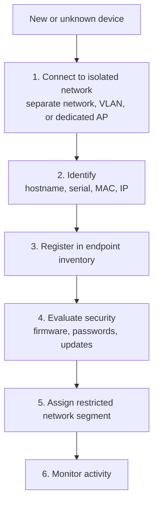
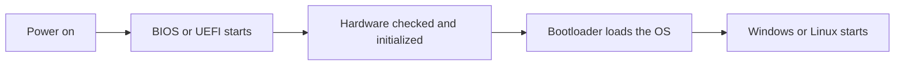
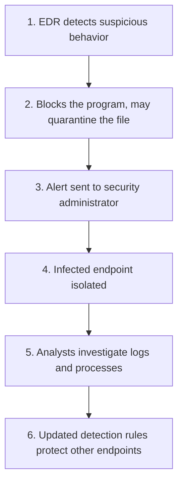
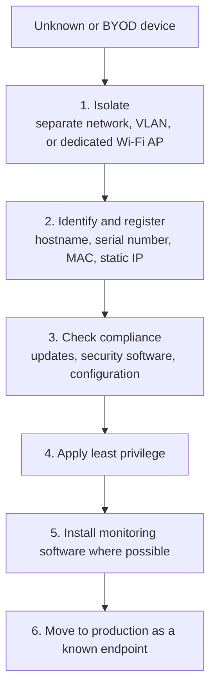

# Module 8: Endpoint Security

In this module you will learn what **endpoints** are, how to secure them, and how the spread of **bring your own device (BYOD)** and the **Internet of Things (IoT)** complicates network security. You will also learn about endpoint monitoring technology such as the **endpoint protection platform (EPP)** and **endpoint detection and response (EDR)**.

---

## 📚 Table of Contents

- [🎯 Learning Objectives](#-learning-objectives)
- [Lesson 1: Endpoint Security Overview](#lesson-1-endpoint-security-overview)
  - [1.1 What Is an Endpoint?](#11-what-is-an-endpoint)
  - [1.2 Why Endpoints Matter](#12-why-endpoints-matter)
- [Lesson 2: Internet of Things](#lesson-2-internet-of-things)
  - [2.1 What Is IoT?](#21-what-is-iot)
  - [2.2 Three Categories of IoT](#22-three-categories-of-iot)
  - [2.3 Personal IoT Devices](#23-personal-iot-devices)
  - [2.4 Smart Homes and Smart Cities](#24-smart-homes-and-smart-cities)
  - [2.5 Industrial IoT (IIoT), IT and OT](#25-industrial-iot-iiot-it-and-ot)
  - [2.6 Why IoT Complicates Security](#26-why-iot-complicates-security)
  - [2.7 Connecting New IoT Devices Securely](#27-connecting-new-iot-devices-securely)
  - [2.8 Segmenting Endpoints](#28-segmenting-endpoints)
- [Lesson 3: Endpoint Hardening Techniques](#lesson-3-endpoint-hardening-techniques)
  - [3.1 What Is Endpoint Hardening?](#31-what-is-endpoint-hardening)
  - [3.2 Administrative Controls](#32-administrative-controls)
  - [3.3 Firmware and Boot Process Security](#33-firmware-and-boot-process-security)
  - [3.4 Operating System Security](#34-operating-system-security)
  - [3.5 Protecting Data: FDE, TPM, SED and DLP](#35-protecting-data-fde-tpm-sed-and-dlp)
  - [3.6 Endpoint Maintenance: Patching and Backups](#36-endpoint-maintenance-patching-and-backups)
- [Lesson 4: Endpoint Monitoring](#lesson-4-endpoint-monitoring)
  - [4.1 What Is Endpoint Monitoring?](#41-what-is-endpoint-monitoring)
  - [4.2 Local vs Network Monitoring](#42-local-vs-network-monitoring)
  - [4.3 EPP](#43-epp)
  - [4.4 EDR and IOC](#44-edr-and-ioc)
  - [4.5 EPP vs EDR](#45-epp-vs-edr)
  - [4.6 SOC and CVE](#46-soc-and-cve)
  - [4.7 Securing Unknown Endpoints](#47-securing-unknown-endpoints)
  - [4.8 Endpoints That Cannot Run EPP or EDR](#48-endpoints-that-cannot-run-epp-or-edr)
  - [4.9 Blocking Unauthorized Devices](#49-blocking-unauthorized-devices)
- [🌍 Real-World Scenarios](#-real-world-scenarios)
- [📊 Comparisons](#-comparisons)
- [🧠 Key Takeaways](#-key-takeaways)
- [📝 Quick Revision](#-quick-revision)
- [❓ Knowledge Check](#-knowledge-check)
- [🔗 Related Modules](#-related-modules)

---

## 🎯 Learning Objectives

After completing this module, you will be able to:

- Describe what constitutes an **endpoint**.
- Explain how the number of endpoints has grown, and list the industries that use **IoT**.
- Explain why **IoT complicates** cybersecurity.
- Explain why it is critical to **identify and secure all endpoints** that connect to a network.
- List common methods for **hardening endpoints** (administrative controls, boot and firmware security, encryption, DLP, patching, backups).
- Describe the features of **EPP** and **EDR**.
- List ways administrators can **secure unknown endpoints**.

> 📝 **Note on sources:** This README **follows the course wording** and uses the simplified notes for examples. Differences are marked with **⚠️ Flagged** and added material with **(added)**. Examples marked **(from notes)** are illustrative.

> 📝 **Note on structure:** The lesson boundaries follow the course page's lesson list. Lesson 1 is built from the module introduction text, since the notes begin with it.

---

# Lesson 1: Endpoint Security Overview

## 1.1 What Is an Endpoint?

> 💡 **Definition:** An **endpoint** is any device that connects to a network and communicates with other devices or systems.

| Era | What an Endpoint Meant |
|-----|------------------------|
| **Traditionally** | Devices connecting to a network, such as **desktop computers and traditional hardware servers**, over **wired connections** using routers and switches |
| **Today** | **Wi-Fi, Bluetooth, and cellular data** let almost anything connect: from a **watch to a toothbrush** that is "smart" and controlled by other connected devices such as phones and computers |

- Connected devices also **transmit usage statistics, performance data, and other information** that can be used for monitoring, for example to improve the efficiency of everything from **home heating costs** to **which crops to plant**.
- This proliferation of connected devices is called the **Internet of Things (IoT)**.

> 🌍 **Examples of modern endpoints (from notes):** smartwatches, smart TVs, security cameras, smart refrigerators, medical monitors, smart cars, industrial sensors, smart locks, wireless printers.

---

## 1.2 Why Endpoints Matter

- Any device that connects to the internet or to other devices is **potentially vulnerable to compromise by a bad actor**.
- Most new smart devices are **not designed with security in mind**. Manufacturers usually prioritize **usability and cost** over security. Awareness is improving, but securing IoT is a huge concern for **individuals, businesses, and governments**.
- **Each new endpoint is a potential avenue of attack**, so the **attack surface has grown larger**. This demands **new tools** that let administrators **identify and protect new endpoints** as they join the network.
- New endpoint protection tools have **simplified securing both traditional and new endpoints**.

> 🧠 **Remember:** A network is only as secure as its **most vulnerable endpoint**.

> 🔗 **Connection to Module 1:** The attack surface idea builds on [Module 4: Attack vector vs attack surface](../Module-04/README.md) and on the [first line of defense](../Module-01/README.md#the-first-line-of-defense).

---

# Lesson 2: Internet of Things

After this lesson you will be able to explain how the number of potential endpoints has expanded, list the industries and businesses that have embraced IoT, and explain why IoT has complicated cybersecurity protection.

## 2.1 What Is IoT?

> 💡 **Definition:** The **Internet of Things (IoT)** is the **network of physical objects connected to the internet** using **software, sensors, and other technologies**.

- A **home security camera** you can access from your phone and a **sensor on a factory line** monitored remotely are both IoT.
- These devices collect information, exchange data, and sometimes perform actions automatically.

> 🌍 **Example (from notes): smart thermostat.** It measures room temperature with sensors, sends it over Wi-Fi, lets you check it on your phone and change it remotely, and adjusts heating or cooling by schedule.

---

## 2.2 Three Categories of IoT

| Category | Examples |
|----------|----------|
| **1. Personal devices** | Smart watches, cell phones, helmet cameras, heart monitors, cars |
| **2. Residential locations** | **Smart homes** and **smart cities** |
| **3. Industrial devices** | Manufacturing, energy production, agriculture |

> 📝 There are many other connected "smart" devices beyond these categories. It is safe to say they are involved in **every aspect of our lives**.

---

## 2.3 Personal IoT Devices

Personal devices keep growing: smart watches, cameras, and fitness monitors.

| Device | What It Does |
|--------|--------------|
| Medical monitors | Notify individuals of **heart abnormalities, blood sugar, and oxygen levels** |
| Smart cars and bicycles | Monitor vehicle health, give diagnostics, and help with navigation |
| Smart toothbrush | Tracks how often and how well you brush |
| Smart tags | Show travelers where their luggage is |
| Smart speakers | Suggest and play music based on time of day and mood |

> 🚨 **Security concern:** Keeping control of personal data is **much harder** because so many devices collect and share potentially sensitive information.
>
> **Course example:** a **glucometer** helps someone with diabetes and can be checked over the internet. If it is compromised, bad actors can reach the user's **personal information and medical status** and potentially use it to harm them.

- In the personal space, individuals can take precautions themselves: **patch smart home devices, change default passwords, and limit what data is shared** on the internet.

---

## 2.4 Smart Homes and Smart Cities

### 🏠 Smart Home

- One of the earliest connected devices was the **smart thermostat**: sensors around the house adjust heating and cooling by schedule and conditions, and a mobile device can control it.
- Now **smart locks, alarms, cameras, lights, refrigerators, and microwaves** connect through a common **smart home hub**.

### 🏙️ Smart City

An extension of the smart home. Smart devices let personnel monitor and control all aspects of city infrastructure:

- **Traffic management** with smart roads and streetlights.
- **Utilities**: water, power, and waste management.
- **Security**: a city-wide authentication system and integrated cameras.
- **Public services** such as ambulances.

> 🌍 **Course example: ambulance.** A person is injured. The ambulance crew immediately identifies which hospital has the **most vacant beds**, signals the city traffic system to **clear traffic**, and the patient's **vital statistics** are transmitted from smart devices on the gurney directly to the hospital's systems.

> 🚨 **Security concern:** A large, interlaced network like a city has a **massive number of endpoint connections** that must be **secured and validated at the enterprise level** so that **only valid devices** can participate and send information over the city networks.

---

## 2.5 Industrial IoT (IIoT), IT and OT

| Term | Meaning |
|------|---------|
| **IT** (information technology) | Development and management of **computer systems for exchanging information** |
| **OT** (operational technology) | The **hardware and software used to manage and control industrial equipment and systems** |
| **IIoT** (industrial IoT) | **Connection of instruments, sensors, and other devices** used in manufacturing and utility management over **local networks and the cloud**, for better automation, efficiency, and data collection |

- **Before:** factories and utility plants were **self-contained islands** where all OT controls connected to a **central control room**, with **no external access**.
- **Now:** factories, energy producers, and agriculture drive the **convergence of OT and IT**. Warehouses, assembly lines, chemical plants, oil rigs, and farms can connect to **local and central monitoring stations through the internet**.

### ✅ Benefits

| Benefit | Meaning |
|---------|---------|
| **Visibility** | Real-time tracking and asset management, especially in warehouses and supply chains |
| **Efficiency** | ICS systems monitor and adjust assembly-line parameters and power usage |
| **Safety and maintenance** | Devices report problems, flag themselves for maintenance, and can **shut themselves down before accidents** based on preprogrammed parameters |

> 🚨 **Security concern:** Power stations and factories handling dangerous materials are now at risk of **external compromise and tampering**. OT security has **lagged behind IT** but is improving as awareness grows.

> 🔗 **Connection to Module 6:** See [Operational Technology (OT) Security](../Module-06/README.md#lesson-11-operational-technology-ot-security) for IT-OT convergence, OT components, and OT threats.

---

## 2.6 Why IoT Complicates Security

The number and reach of endpoints grew **without a corresponding increase in security reach**. Treat **any device that can connect to the internet, or be connected to by wireless, RF, or Bluetooth,** with the same security concern as a traditional computer.

| Risk | Explanation |
|------|-------------|
| **Larger attack surface** | A breach in one device can lead to **easy compromise of others** on the same network. A compromised **wireless camera** can let an attacker into a home. Many recent breaches **start from a connected device** used as the entry point |
| **Weak or no security** | Many IoT devices have **poor or no encryption** and **very weak or default passwords** |
| **Botnets** | Compromised devices become **botnets** used to compromise local devices and **attack other sites** |
| **Other consequences** | **Data loss, infrastructure attacks, and privacy violations** |

> 🧠 **Rule:** It is safest to consider **every device on your network**, even your toothbrush or wireless camera, as a **potentially vulnerable system**.

> 📖 **Beginner Explanation (added):** A **botnet** is a group of compromised devices controlled remotely by an attacker. **Lateral movement** means moving from one compromised device to others on the same network.

> 🌍 **Examples (from notes):**
> - **Botnet:** an attacker finds thousands of poorly secured IP cameras, compromises them, controls them remotely, and uses them to attack other websites.
> - **Lateral movement:** a compromised wireless camera shares a network with employee computers, so the attacker uses it as an entry point to reach other systems.

> 🔗 **Connection to Module 4:** See [Botnets and command and control](../Module-04/README.md#34-botnets-and-command-and-control).

---

## 2.7 Connecting New IoT Devices Securely

**The challenge:** IoT devices are usually **not well-known devices already configured** to be managed by existing infrastructure, so letting them connect **directly to a corporate network is a large risk**.

> 🎯 **Recommendation:** Connect all **unidentified or new devices to an isolated network** until you can **secure and register** them as valid devices. Use a **physically separate network, a VLAN, or a dedicated Wi-Fi access point**.

Once a device is identified, **register its information**, such as **hostname, serial number, MAC address, or static IP address**. Do this **even if you are not installing management software**, because most IoT devices **do not support traditional security software**. Then, if security devices detect malicious activity, you can **track down and block** the offending device more easily.

---

## 2.8 Segmenting Endpoints

**Basic strategy for companies:** first **learn and profile all endpoints**, including IoT. Build a **catalog**, divide devices into **groups by security and connection needs**, and place **only devices that need to talk to each other** on the same network infrastructure.

> 🌍 **Course example:** A **closed-circuit TV system** keeps video feeds on **separate physical links** from other traffic to prevent tampering. The same applies to **electronic locks, security cameras, and assembly line controls**. Companies then **tightly control access to and from** these networks using **firewalls and other network security devices**.

**Why segmentation helps:**

- Keeping device traffic separate makes it simpler to **enforce rules that stop a compromised device from attacking neighbors**.
- It helps administrators **monitor and identify new objects** on the protected network. If you know **30 cameras** are on a network, **any new camera** trying to connect should be **flagged as suspicious**. This is much easier on a **small discrete network** than on one shared with hundreds of other devices.

> 🌍 **Example (from notes):**
>
> | Network | Devices |
> |---------|---------|
> | VLAN 10 | Employee computers |
> | VLAN 20 | IP cameras |
> | VLAN 30 | Printers |
> | VLAN 40 | Industrial equipment |
> | VLAN 50 | Guest devices |
>
> A firewall or Layer 3 device controls communication between segments. The 30 cameras can reach the authorized **NVR** but not the finance computers, which **limits the impact of a compromise**.

> 🎯 **Key idea:** Treat IoT devices as **new endpoints to secure like any other**, adapting traditional network security concepts to them.

> 🔗 **Connection to Modules 6 and 7:** [Network segmentation](../Module-06/README.md#51-what-is-network-segmentation) and [NAC profiling](../Module-07/README.md#74-device-profiling-and-segmentation) (the same camera-and-NVR idea).

---

# Lesson 3: Endpoint Hardening Techniques

After this lesson you will be able to list ways to harden an endpoint using administrative controls, describe methods to secure endpoint software and firmware, explain why managing endpoints is critical, and describe how to harden an endpoint without administrative access.

## 3.1 What Is Endpoint Hardening?

> 💡 **Definition (from notes):** **Endpoint hardening** means applying security configurations and controls to a device to **reduce vulnerabilities and prevent unauthorized access**.

Many techniques target enterprises, but you can use them in **personal and home environments** too.

### The Four Categories

| # | Category | Main Purpose | Covered In |
|---|----------|--------------|------------|
| 1 | **Administrative controls** | Enforce **secure passwords** and restrict user and network access using **PoLP** | Lesson 3 |
| 2 | **Local endpoint protection** | **OS security, boot management, local disk encryption, and DLP** | Lesson 3 |
| 3 | **Endpoint maintenance** | **Patching, regular policy checkups, accurate backups** | Lesson 3 |
| 4 | **Endpoint monitoring** | EPP client, network IDS, and EDR | [Lesson 4](#lesson-4-endpoint-monitoring) |

---

## 3.2 Administrative Controls

### 🔑 A. Strong Passwords

- The simplest way to harden endpoints and IoT devices is a **secure password**. This matters most for **household IoT devices** that ship with a **default password** users are not required to change.
- A common first attack is to **scan a network for devices and try default passwords**.

> 🌍 **Example (from notes):** A new IP camera ships with username `admin` and password `admin`. If never changed, attackers can easily get in.

**Practices (from notes):** change default passwords immediately, use long unique passwords, avoid reuse, enable MFA where supported, disable unused accounts.

### 🔑 B. Principle of Least Privilege (PoLP)

> 💡 **Definition:** Users, especially administrators, should have **only the permissions they need** to do their duties.

- Many endpoints, even basic IoT devices, let you create **administrative roles and permission sets**, giving users **only the features they need**.
- This stops a **weak password or social engineering attack** from giving an attacker extra permissions by accident. A **restricted** account is far less damaging if compromised than the **default full administrator**.

| Employee | Needs Access To |
|----------|-----------------|
| HR employee | HR application |
| NOC engineer | Network monitoring tools |
| Finance employee | Finance application |

> 🌍 **Role example (from notes):** An IP camera may offer **Administrator** (configure everything), **Operator** (view and control), and **Viewer** (watch the feed only).

### 🔑 C. Endpoints That Cannot Restrict Access

For simple endpoints that **cannot restrict user or administrative access**:

- Lock down access with **very secure passwords or two-factor authentication**, or
- **Restrict which IP addresses can access the device** using another device, such as a **router or firewall**.

> 🌍 **NOC example (from notes):** If a camera should only be accessed by the NVR and an authorized management PC, use firewall rules to block access from other networks.

> 🎯 **Defense in depth:** With **multiple layers** of security it is harder to compromise an endpoint and use it to attack further. A broader top-down view helps set policies, even if they cannot be applied equally to all devices.

> 🔗 **Connection to Module 7:** [PoLP](../Module-07/README.md#66-least-privilege-and-zero-trust) and [RBAC](../Module-07/README.md#57-role-based-access-control).

---

## 3.3 Firmware and Boot Process Security

> 🚨 **Often overlooked:** Most practices focus on devices while they are **running and connected**. But threats that attack **firmware and boot processes** are emerging. This matters especially for **IoT devices**, which lack many built-in protections that desktops, laptops, and servers have gained over the years.

### 🔒 Physical Security

- Physically securing devices is extremely important. It is **much easier to compromise a computer with physical access**, because many devices have an **administrator account reset procedure requiring only physical access**.
- **Locking down BIOS and other boot-time systems** can stop these attacks.

### 💾 Firmware, BIOS and UEFI

| Term | Meaning |
|------|---------|
| **Firmware** | Software that usually runs from a **chip** on the endpoint. It detects and reports **connected hardware**, then **helps load the operating system** |
| **BIOS** | **Legacy basic input/output system** |
| **UEFI** | **Unified extensible firmware interface**, newer, usually with a **graphical interface and more robust security features** |

- Both perform similar functions. **Restricting firmware so it loads only approved software** is one of the most important features of UEFI over BIOS.
- **Firmware malware attacks** insert code into firmware that can make endpoints load **malicious software or entire new operating systems** to compromise other devices.

| BIOS | UEFI |
|------|------|
| Older firmware interface | Modern replacement |
| More limited security features | Supports more advanced security features |
| Traditionally text-based | Often graphical |

### 🥾 Boot Sequence (from notes)

**Why secure it?** Someone with physical access might change boot settings, boot from a USB drive, reset local credentials with external tools, or load unauthorized software.

**Measures (from notes):** set a BIOS/UEFI administrator password, disable booting from unauthorized external devices, enable **Secure Boot**, keep firmware updated, physically protect devices.

> 💡 **Secure Boot (from notes):** a UEFI feature that checks whether startup software is **trusted and properly signed**, preventing unauthorized bootloaders and malicious startup software.
> **BIOS/UEFI** is the firmware interface. **Secure Boot** is a security feature that helps ensure trusted boot software loads.

> 📝 While BIOS and UEFI are specific to traditional computers, **most endpoints use some bootloader and firmware** to secure and load the OS, so locking these down is a **fundamental step**.

---

## 3.4 Operating System Security

- Choosing the OS is not always possible, but if you can, choose one that is **easy to manage and secure**. Many OSs have **built-in security features** that simplify policy enforcement.
- Many network security devices can **allow access based on OS type**. A **fixed list of trusted OSs** means only known OS types and versions access your network. If a **firmware attack** compromises a device and it connects with an **unknown OS**, security devices can **deny access**.

> 🌍 **Example (from notes):** A corporate network permits only approved, supported Windows and Linux versions. An unknown or unsupported OS is denied by network policy.

---

## 3.5 Protecting Data: FDE, TPM, SED and DLP

**Why:** Laptops and phones are portable. If a laptop is stolen **and the data is not encrypted**, a thief can easily extract information. Even **browsing history and cached DNS queries** can reveal sensitive network information and security procedures. Encrypting endpoints is critical, especially for **high-risk devices**.

| Technology | What It Is |
|------------|-----------|
| **FDE** (full disk encryption) | **Software-based**: the **OS encrypts the disk**. At boot, **UEFI loads the decrypting information from the OS**. Keys are usually stored in a **TPM** and protected by a **password or other authentication**. After the keys are accessed, the disk is decrypted and the OS loads. If stolen, nothing useful is retrievable except by **brute force**, which is very costly |
| **TPM** (trusted platform module) | Security component that **securely stores cryptographic keys** and helps verify boot integrity. For example, Windows BitLocker can use TPM |
| **SED** (self-encrypting drive) | A drive with a **built-in module** that automatically **encrypts and decrypts** using instructions from firmware and OS, pushing the cryptographic work onto the drive instead of the **CPU and software** |
| **DLP** (data loss prevention) | Software that **detects attempts to copy sensitive information** from a device or send it over the network, and can **block or log** the transaction |

**DLP details:**

- Prevents or limits **attachable drives** such as **USB flash drives and external hard drives**, to stop large data copying.
- Can be **network-based**, with devices that **inspect traffic** and alert administrators to keywords or other sensitive information.
- Use cases (from notes): restricting USB storage, stopping confidential documents being emailed externally, detecting sensitive data in traffic, logging unauthorized transfers.

| FDE | SED |
|-----|-----|
| Generally managed by **software/OS** | Handled by **hardware** built into the drive |
| Uses device resources | Uses the drive's built-in module |

> 📝 Many modern devices such as smartphones **use full disk encryption automatically**, but on some devices it may be **disabled by default**. **Always check whether disk encryption and DLP are available**, especially on IoT devices.

> 🧠 **Remember:** **FDE protects stored data. SED encrypts using drive hardware. DLP prevents unauthorized data movement.**

> 🔗 **Connection to Module 5:** FDE keys rely on cryptography. See [Symmetric algorithms](../Module-05/README.md#34-symmetric-algorithms).

---

## 3.6 Endpoint Maintenance: Patching and Backups

### 🩹 Patching and Updates

- It is extremely important to be able to **update, patch, and back up all connected endpoints**. The difficulty comes from the **sheer number of different devices and procedures**.
- A **standardized model and manufacturer** for desktops, laptops, servers, and smartphones simplifies maintenance, but this is not always possible because of **critical legacy equipment** and **BYOD**.
- Keeping patches current is critical because **closing vulnerabilities** is a key step in preventing a large-scale attack. Update **OSs, firmware, and vulnerable software**.
- Patching is **not necessarily effective against zero-day attacks**, but a fully patched system **slows and restricts compromise** using well-established malware and attack vectors. A new unknown attack may get in, but **further infiltration may be hindered** because the attacker has no other effective tools for pivoting, collecting, and exfiltrating data.

> 📖 **Beginner Explanation (added, from notes):** A **patch** is an update that fixes a bug or vulnerability. A **zero-day** vulnerability is one for which defenders may have **no available patch** or may not yet know about it.

> 🌍 **Example (from notes):** A camera maker finds a remote-access vulnerability and releases a firmware update. If the administrator doesn't install it, the camera stays vulnerable.

### 💾 Backups

- A comprehensive backup solution **greatly assists recovery** from cyberattacks or accidents. Back up **smartphones, laptops, servers, and databases frequently**.
- If a device is compromised, you can **collect forensic information** and **restore the latest clean copy** with minimal disruption.
- **IoT devices** such as cameras and smart locks often **cannot be backed up** (depends on the manufacturer). Instead, keep **backup equipment that is easy to configure** to replace damaged, stolen, or compromised devices as part of a **disaster recovery plan**.
- A **regular backup schedule** is one of the most effective ways to **mitigate ransomware**: with a current backup, affected endpoints are much easier to restore.

**Good practices (from notes):** regular backups, protect backups from unauthorized access, **test restoration**, keep backups separate from production, keep at least one backup protected against ransomware.

> 🔗 **Connection to Module 4:** [Ransomware](../Module-04/README.md) and [zero-day attacks in Module 2](../Module-02/README.md).

---

# Lesson 4: Endpoint Monitoring

After this lesson you will be able to define endpoint monitoring and its role among the hardening categories, describe the features of EPP and EDR, and list ways to secure unknown endpoints.

## 4.1 What Is Endpoint Monitoring?

> 💡 **Definition (from notes):** **Endpoint monitoring** is the **continuous observation** of connected devices to identify security threats, suspicious activities, vulnerabilities, and system health issues.

It is the **fourth** category of endpoint hardening. **Hardening makes endpoints more secure. Monitoring identifies when something suspicious happens.**

> 🌍 **Example (from notes):** A company with 100 computers and 20 servers can't check each manually. Monitoring tools help find **malware infections, suspicious connections, outdated software, unauthorized programs, unusual behavior, and policy violations**.

---

## 4.2 Local vs Network Monitoring

| | **Local monitoring** | **Network monitoring** |
|---|---------------------|-----------------------|
| **How** | An **EPP or EDR client** (agent) on the endpoint | Specialized **network intrusion detection systems (IDS)** monitor traffic on the network |
| **Sees** | Local files, processes, and activity | Suspicious communication |
| **Example** | EDR agent on a Windows laptop | NIDS sensor |

---

## 4.3 EPP

> 💡 **Definition:** The **endpoint protection platform (EPP)** is the **first endpoint security solution**. It developed from administrators' need to ensure **servers and desktops are patched and have appropriate antivirus software**.

**Modern EPP can:**

| Feature | Meaning |
|---------|---------|
| **Verify software and firmware versions** | Check devices run approved, updated versions |
| **Scan for viruses and malware** | Scan the local system |
| **Enforce DLP and company-defined policies** | Keep devices compliant |
| **Basic monitoring and visibility** | Identify **out-of-date devices** |
| **Remote patching and software installation** | Maintain **uniform updates across the enterprise** |

EPP is usually viewed as a **defensive measure against malicious attacks**.

> 🌍 **Example (from notes):** An admin with 200 laptops uses EPP to check that antivirus is installed and updated, the OS is patched, and required policies are on, and to find non-compliant devices.

> 🧠 **Remember:** **EPP = prevent and protect.**

Most endpoint solutions support **servers, desktops, laptops, and smartphones**, with plugins and support for **new, unknown, and IoT devices**.

---

## 4.4 EDR and IOC

> 💡 **Definition:** **Endpoint detection and response (EDR)** is a **more proactive** security solution that **constantly scans a device** to detect **indicators of compromise (IOC)**.

> 💡 **IOC (from notes):** evidence or a sign that a device may have been compromised.

| Examples of IOC (from notes) |
|------------------------------|
| A computer communicates with a suspicious IP address |
| An unknown program starts executing |
| Multiple files are suddenly encrypted |
| A suspicious file tries to modify system settings |
| A process unexpectedly accesses sensitive files |

**What EDR does:**

- If it detects a suspicious connection, program, or behavior, it can **block the action and send an alert**.
- It helps stop **ransomware and zero-day attacks** that may have **no established signature** for traditional anti-malware to detect.
- It usually leverages **artificial intelligence and large databases of known attacks** to **predict and recognize** suspicious files and programs.
- It can **alert other connected endpoints** so they **immediately block** the suspicious program or file, **even before it is opened or executed**.
- It has tools for investigators to **gather data on new threats** and **quarantine** systems suspected of compromise.

> ⚠️ **Flagged:** The course says EDR provides an immediate response against zero-day and previously unidentified attacks. The notes add an important caution: EDR **can help detect unknown attacks, but it does not guarantee protection against every zero-day attack.** Also, "EPP vs EDR" product boundaries blur in practice because many modern products combine both.

> 🌍 **Ransomware example (from notes):** A user opens a malicious attachment and malware starts encrypting files. EDR notices a program accessing many files, rapid modification, unusual processes, and suspicious connections, then blocks the process, quarantines files, isolates the endpoint, and alerts the team.

> 🧠 **Remember:** **EDR = detect, investigate, and respond.**

---

## 4.5 EPP vs EDR

| Feature | **EPP** | **EDR** |
|---------|---------|---------|
| **Full form** | Endpoint Protection Platform | Endpoint Detection and Response |
| **Main focus** | **Prevention and protection** | **Detection, investigation, and response** |
| **Approach** | Verifies versions, scans for malware, enforces DLP and policies | **Constantly scans** for IOCs, **proactive** |
| **Known vs unknown threats** | Mostly known threats and policy compliance | Also suspicious behavior, helping with unknown threats |
| **Response** | Enforces policies, blocks threats | Blocks processes, quarantines files, isolates devices, alerts other endpoints |
| **Investigation** | More limited | Detailed |
| **Monitoring** | Basic visibility and management | Continuous, detailed |

> 🏠 **Analogy (from notes):** EPP is like **strong locks, security doors, and an alarm**. EDR is like a **security team** that spots an intruder and acts. Organizations commonly use **both**.

---

## 4.6 SOC and CVE

Both EPP and EDR usually provide **monitoring resources** for top-down visibility into endpoint health and a **quick response** to attacks or outages. They are a **key component of monitoring by a security operations center (SOC)**. Many EDR solutions **automate** responses, such as **locking down devices** or acting on threats detected elsewhere on the network.

| Term | Meaning |
|------|---------|
| **SOC** | **Security operations center**: a centralized team or facility that monitors security, identifies threats, investigates incidents, and coordinates responses |
| **CVE** | **Common Vulnerabilities and Exposures**: a system for assigning identifiers to **publicly known** vulnerabilities, for example an illustrative ID like `CVE-2026-12345` |

> 🌍 **Course example:** A security analyst publishes an **updated malware detection rule** based on a **CVE alert** to **plug a potential security risk before a patch is available** from the device manufacturer.

> ⚠️ **Flagged (from notes):** A detection rule is **not the same as a software patch**. It can help detect or block exploitation attempts but doesn't necessarily fix the underlying vulnerability.

> 🔗 **Connection to Module 7:** The SOC also receives alerts from [NAC](../Module-07/README.md#75-additional-nac-capabilities).

---

## 4.7 Securing Unknown Endpoints

> 💡 **BYOD (bring your own device):** Many companies let employees use **personal computers and phones**. These devices are usually **not well known and not managed by the company**, so letting them connect directly to the corporate network is a **large risk**.

**Unknown to the organization (from notes):** whether the device has antivirus, whether the OS is updated, whether it has malware, whether the password is secure, and whether it follows company policy.

**Monitoring and detection** that can **identify and isolate unknown devices** is critical for onboarding them. The course steps:

**Least privilege for hard-to-secure or unknown devices:** if a device needs access only to a specific internet or internal server, isolate it on a **unique network** and allow **only that connection** through firewalls and routers. If it does not meet compliance because it isn't running endpoint security, it has **as limited access as possible**.

---

## 4.8 Endpoints That Cannot Run EPP or EDR

Some IoT devices have limited hardware resources and **cannot run security agents**, for example basic IP cameras, smart sensors, printers, and industrial controllers.

> 🎯 **Key idea (from notes):** **If you cannot secure an endpoint locally, restrict what it can access through network security devices.** Use **network-level security**.

> 🌍 **Example: IP camera that talks only to an NVR.**
> 1. Assign it to a **dedicated VLAN**.
> 2. Record its **MAC and IP address**.
> 3. Create a **firewall rule** allowing the NVR.
> 4. **Block** access to other internal networks.
> 5. **Monitor traffic** for suspicious activity.

This applies **least privilege at the network level**.

---

## 4.9 Blocking Unauthorized Devices

Once all known devices are registered, configure **wireless access points, switches, routers, firewalls, and other connectivity points** to **block unauthorized devices**. **Disabling unmonitored devices** forces users with unknown devices to **register**, and stops attackers inserting their own devices **remotely or by plugging in locally**.

**Possible approaches (from notes):** 802.1X port-based authentication, NAC policies, switch port security, wireless access control, firewall rules.

### 🧾 Device-Related Terms (from notes)

| Term | Meaning |
|------|---------|
| **Identification** | Finding out what device is connected |
| **Registration** | Recording it as an authorized device |
| **Authentication** | Verifying it is permitted to connect |
| **Authorization** | Deciding which network resources it can access |
| **Monitoring** | Watching its activity for suspicious behavior |

> 🔗 **Connection to Module 7:** [802.1X](../Module-07/README.md#47-ieee-8021x) and [NAC](../Module-07/README.md#lesson-7-network-access-control) are the technologies behind blocking and onboarding unknown devices.

---

## 🌍 Real-World Scenarios

| Scenario | Concept Applied |
|----------|-----------------|
| A smart watch or glucometer syncs data to a phone | Personal IoT and data privacy risk |
| A thermostat, lock, and camera share a home hub | Smart home |
| An ambulance clears traffic and sends vitals to a hospital | Smart city |
| A factory sensor is monitored remotely | IIoT and IT-OT convergence |
| A new IP camera still uses `admin` / `admin` | Default password risk |
| A compromised wireless camera is used to reach other systems | Lateral movement |
| Thousands of weak cameras are controlled by an attacker | Botnet |
| A new device is placed in a VLAN before registration | Isolated onboarding |
| Cameras live on their own VLAN and reach only the NVR | Segmentation and least privilege |
| A stolen laptop with an encrypted disk reveals nothing | FDE with TPM |
| A user copies files to a USB drive and it is blocked and logged | DLP |
| A camera firmware update closes a vulnerability | Patching |
| Ransomware encrypts files, but a clean backup restores them | Backups |
| EDR notices rapid file encryption and isolates the laptop | EDR response to ransomware |
| A SOC analyst publishes a rule for a CVE before a patch exists | CVE-based detection rule |
| A personal laptop is sent to an isolated Wi-Fi first | BYOD onboarding |

---

## 📊 Comparisons

| Pair | Difference |
|------|------------|
| IT vs OT | Computer systems for exchanging information vs hardware and software controlling industrial equipment |
| IoT vs IIoT | Connected physical objects in general vs those in industrial settings |
| BIOS vs UEFI | Legacy firmware interface vs newer, with a graphical interface and stronger security |
| UEFI vs Secure Boot | Firmware interface vs the feature checking that boot software is trusted |
| FDE vs SED | Software/OS-based disk encryption vs hardware encryption built into the drive |
| DLP vs FDE | Stops unauthorized data movement vs protects stored data |
| Patch vs detection rule | Fixes the vulnerability vs helps detect or block exploitation |
| EPP vs EDR | Prevent and protect vs detect, investigate, and respond |
| Local vs network monitoring | Agent on the endpoint vs IDS on the network |
| IOC vs CVE | Sign a device may be compromised vs identifier for a known vulnerability |
| Attack surface vs botnet | Entry points available vs devices already taken over |

### 🔐 Four Categories of Hardening

| Category | Examples |
|----------|----------|
| Administrative controls | Strong passwords, PoLP, roles |
| Local endpoint protection | OS security, BIOS/UEFI, Secure Boot, FDE, SED, DLP |
| Maintenance | Patching, updates, backups |
| Monitoring | EPP, EDR, network IDS |

---

## 🧠 Key Takeaways

- ✅ An **endpoint** is any device that connects to a network. The **number of endpoints has exploded** through **IoT**.
- ✅ IoT spans **personal, residential (smart home and city), and industrial (IIoT)** devices. IT and OT are converging.
- ✅ IoT **enlarges the attack surface**: weak or default passwords, poor encryption, **botnets, lateral movement**, data loss, and privacy violations.
- ✅ Put **new or unknown devices on an isolated network** first, **identify and register** them (hostname, serial, MAC, IP), and **segment** by function.
- ✅ Harden endpoints through **four categories**: administrative controls, local protection, maintenance, and monitoring.
- ✅ **PoLP**, strong passwords, **firmware and boot security** (BIOS/UEFI, Secure Boot), a **trusted OS list**, **FDE/TPM/SED**, **DLP**, **patching**, and **backups**.
- ✅ **EPP** protects and enforces policy. **EDR** detects IOCs, blocks, isolates, and investigates. Neither guarantees protection from every zero-day.
- ✅ A **SOC** uses endpoint alerts. A **CVE** identifies a known vulnerability.
- ✅ If an endpoint can't run security software, **restrict it through the network** (VLAN, firewall rules, monitoring).
- ✅ Once devices are registered, **block unknown devices** at switches, APs, firewalls, and NAC.

---

## 📝 Quick Revision

**Endpoints and IoT**
- Endpoint = device connected to a network. IoT = physical objects with sensors and software connected to the internet.
- Categories: personal, residential (home, city), industrial. IIoT = IoT in industry. IT vs OT, now converging.

**Risks**
- Larger attack surface, default or weak passwords, weak encryption, botnets, lateral movement, data loss.

**Secure onboarding**
- Isolate, identify, register, evaluate, assign segment, monitor. Segment by function (camera VLAN to NVR only).

**Hardening**
- Administrative: strong passwords, PoLP, roles, IP restrictions.
- Firmware and boot: BIOS vs UEFI, Secure Boot, admin password, physical security, trusted OS list.
- Data: FDE (software, TPM), SED (hardware), DLP.
- Maintenance: patches, updates, backups (replacement hardware for IoT).

**Monitoring**
- Local (EPP/EDR agent) vs network (IDS).
- EPP: antivirus, version checks, DLP, policies, remote patching.
- EDR: IOCs, AI and threat databases, block, quarantine, isolate, alert other endpoints.
- SOC and CVE. Unknown devices: isolate, register, check, least privilege, monitor, move to production.
- No agent possible: VLAN plus firewall plus network monitoring.

---

## ❓ Knowledge Check

**Q1. (Multiple choice)** What is an endpoint?

- A) Only a desktop computer
- B) Any device that connects to a network
- C) Only a server
- D) Only a router or switch

Show answer

**B).** Today this includes phones, cameras, sensors, watches, and more.

**Q2. (Multiple choice)** Which is NOT one of the three IoT categories in the course?

- A) Personal devices
- B) Residential locations
- C) Industrial devices
- D) Financial devices

Show answer

**D).** The categories are personal, residential (smart homes and cities), and industrial.

**Q3. (Conceptual)** Why does IoT enlarge the attack surface, and what can attackers do with compromised devices?

Show answer

There are many more connected devices, often with default or weak passwords and poor encryption. A breach in one can lead to others on the same network (lateral movement), and compromised devices can form **botnets** to attack other sites. Data loss, infrastructure attacks, and privacy violations are also common.

**Q4. (Multiple choice)** What should you do first with a new, unidentified IoT device?

- A) Connect it to the corporate LAN
- B) Give it administrator access
- C) Place it on an isolated network, then identify and register it
- D) Ignore it

Show answer

**C).** Use a separate network, VLAN, or dedicated Wi-Fi AP, then register hostname, serial number, MAC, or IP.

**Q5. (Multiple choice)** What does Secure Boot help prevent?

- A) Users changing passwords
- B) Unauthorized or untrusted boot software from loading
- C) All network attacks
- D) Disk failure

Show answer

**B).** It is a UEFI feature that checks the startup software is trusted and signed.

**Q6. (Multiple choice)** Which technology encrypts the entire disk using the OS, with keys often in a TPM?

- A) DLP
- B) FDE
- C) NAC
- D) EDR

Show answer

**B) FDE.** An SED does the same job in drive hardware.

**Q7. (True/False)** DLP can block or log attempts to copy sensitive data to a USB drive.

Show answer

**True.** DLP can also inspect network traffic for sensitive information.

**Q8. (Conceptual)** Why are backups important for IoT and endpoints?

Show answer

They let you restore a clean copy after an attack or accident and are one of the best defenses against ransomware. For IoT devices that can't be backed up, keep replacement hardware that is easy to configure as part of a disaster recovery plan.

**Q9. (Multiple choice)** Which solution primarily focuses on detecting indicators of compromise and responding by blocking, quarantining, or isolating?

- A) EPP
- B) EDR
- C) NIDS
- D) DNS

Show answer

**B) EDR.** EPP focuses on protection, policy enforcement, and updates. NIDS monitors network traffic.

**Q10. (Conceptual)** An IP camera cannot run EDR. How can you secure it?

Show answer

Use network-level security: put it on a dedicated VLAN, record its MAC and IP, allow only its connection to the NVR with a firewall rule, block other internal networks, and monitor its traffic. This applies least privilege at the network level.

---

## 🔗 Related Modules

| Module | Link |
|--------|------|
| ⬅️ Previous | [Module 7: Authentication and Access Control](../Module-07/README.md) |
| ➡️ Next | *[Placeholder: link to Module 09 will be added]* |

### 🔗 Connections to Earlier Modules

| Module 8 Topic | Connects To |
|----------------|-------------|
| Endpoints as first line of defense, attack surface | [Module 1: First line of defense](../Module-01/README.md#the-first-line-of-defense) |
| Botnets and ransomware | [Module 4: Botnets and command and control](../Module-04/README.md#34-botnets-and-command-and-control) |
| FDE and encryption keys | [Module 5: Symmetric algorithms](../Module-05/README.md#34-symmetric-algorithms) |
| IT-OT convergence and IIoT | [Module 6: OT Security](../Module-06/README.md#lesson-11-operational-technology-ot-security) |
| Segmentation of IoT and cameras | [Module 6: Network segmentation](../Module-06/README.md#51-what-is-network-segmentation) |
| Sandbox and unknown threats | [Module 6: Sandbox](../Module-06/README.md#lesson-9-sandbox) |
| Zero trust and least privilege | [Module 6: Implementing zero trust](../Module-06/README.md#34-implementing-zero-trust) |
| PoLP, RBAC, default passwords | [Module 7: Access control best practices](../Module-07/README.md#lesson-6-access-control-best-practices) |
| NAC, 802.1X, BYOD, IoT profiling | [Module 7: Network access control](../Module-07/README.md#lesson-7-network-access-control) |
