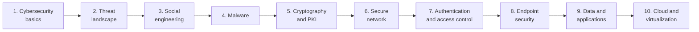
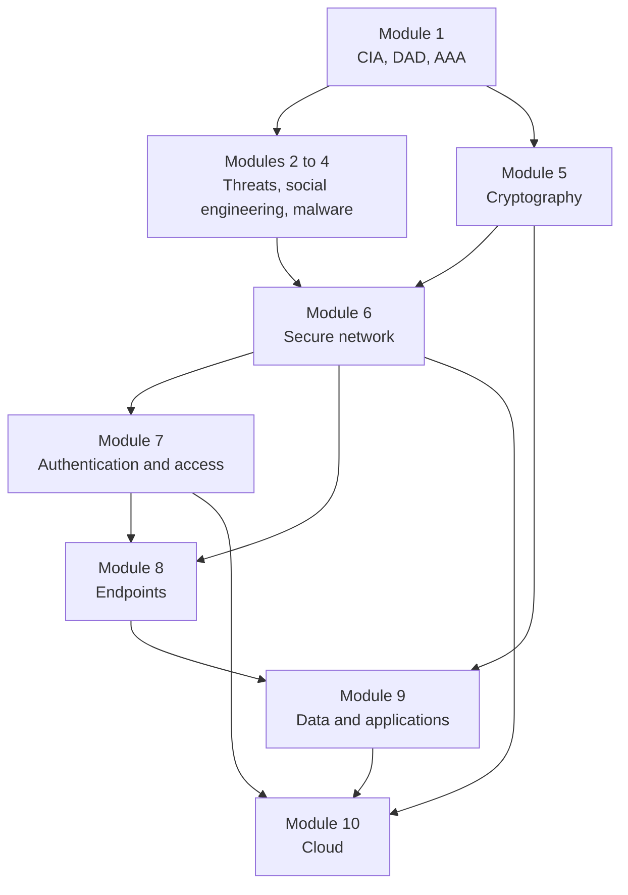

# 🛡️ NSE 1 Notes

**Beginner-friendly study notes for Fortinet NSE 1 (Network Security Associate).**

These are my personal notes for all **10 modules** of the course. Each module is written in plain, simple language with real-world examples, diagrams, comparison tables, quick revision sections, and practice questions with hidden answers, so you can learn the topic and then test yourself.

---

## 📚 Index

- [🚀 How to Use These Notes](#-how-to-use-these-notes)
- [🧭 Course Roadmap](#-course-roadmap)
- [📖 Modules at a Glance](#-modules-at-a-glance)
- [📘 Module Details](#-module-details)
  - [Module 1: Introduction to Cybersecurity](#module-1-introduction-to-cybersecurity)
  - [Module 2: The Threat Landscape](#module-2-the-threat-landscape)
  - [Module 3: Social Engineering](#module-3-social-engineering)
  - [Module 4: Malware](#module-4-malware)
  - [Module 5: Cryptography and the Public Key Infrastructure](#module-5-cryptography-and-the-public-key-infrastructure)
  - [Module 6: Secure Network](#module-6-secure-network)
  - [Module 7: Authentication and Access Control](#module-7-authentication-and-access-control)
  - [Module 8: Endpoint Security](#module-8-endpoint-security)
  - [Module 9: Secure Data and Applications](#module-9-secure-data-and-applications)
  - [Module 10: Cloud Security and Virtualization](#module-10-cloud-security-and-virtualization)
- [🧩 How the Modules Connect](#-how-the-modules-connect)
- [🔑 Key Terms Cheat Sheet](#-key-terms-cheat-sheet)
- [🎯 Suggested Study Plan](#-suggested-study-plan)
- [🔖 Symbols Used in the Notes](#-symbols-used-in-the-notes)
- [📁 Repository Structure](#-repository-structure)

---

## 🚀 How to Use These Notes

1. **Start with Module 1** and go in order. Each module builds on the earlier ones.
2. Read the **Learning Objectives** at the top of each module so you know what to expect.
3. Use the **Table of Contents** inside each module to jump to a topic.
4. Before an exam, read **Key Takeaways** and **Quick Revision** at the end of each module.
5. Finish with the **Knowledge Check** questions. Try to answer first, then open the hidden answer.
6. Follow the **Related Modules** links to see how topics connect across modules.

> 💡 **Tip:** Every module ends with a "Connections to Earlier Modules" table, so you can revise one topic across the whole course.

---

## 🧭 Course Roadmap



The course moves in three stages:

| Stage | Modules | What You Learn |
|-------|---------|----------------|
| 🧱 **Foundations and threats** | 1 to 4 | What security is, who attacks, how they attack, and the malware they use |
| 🔐 **Protection building blocks** | 5 to 7 | Cryptography, secure networks, and who gets access to what |
| 🏢 **Securing the environment** | 8 to 10 | Endpoints, data and applications, and the cloud |

---

## 📖 Modules at a Glance

| # | Module | Lessons | Main Focus | Notes |
|---|--------|---------|------------|-------|
| 1 | Introduction to Cybersecurity | 2 | CIA, DAD, AAA, InfoSec terms | [Open](modules/Module-01-README.md) |
| 2 | The Threat Landscape | 6 | Threat actors, attack vectors, threat intelligence, Kill Chain, MITRE ATT&CK | [Open](modules/Module-02-README.md) |
| 3 | Social Engineering | 5 | Phishing family, insider threats, fraud, influence campaigns | [Open](modules/Module-03-README.md) |
| 4 | Malware | 3 | Viruses, worms, ransomware, botnets, attack mechanisms | [Open](modules/Module-04-README.md) |
| 5 | Cryptography and the Public Key Infrastructure | 6 | Ciphers, hashing, digital signatures, PKI, quantum security | [Open](modules/Module-05-README.md) |
| 6 | Secure Network | 11 | Perimeter, zero trust, segmentation, firewalls, sandbox, OT | [Open](modules/Module-06-README.md) |
| 7 | Authentication and Access Control | 7 | MFA, SSO, RADIUS/LDAP, 802.1X, access control models, NAC | [Open](modules/Module-07-README.md) |
| 8 | Endpoint Security | 4 | IoT, hardening, EPP and EDR, unknown devices | [Open](modules/Module-08-README.md) |
| 9 | Secure Data and Applications | 7 | Data protection, privacy laws, email security, WAF, content filters | [Open](modules/Module-09-README.md) |
| 10 | Cloud Security and Virtualization | 8 | Hypervisors, IaaS/PaaS/SaaS, cloud threats, SASE, APIs | [Open](modules/Module-10-README.md) |

---

## 📘 Module Details

### Module 1: Introduction to Cybersecurity

📄 **[Read the notes](modules/Module-01-README.md)**

The foundation for everything else. What cybersecurity, information security and information systems security mean, and the principles that guide security work.

- Lesson 1: Security Terminology
- Lesson 2: Principles of Information Security

**Key topics:** CIA triad, DAD triad, AAA framework, information classification, first line of defense.

---

### Module 2: The Threat Landscape

📄 **[Read the notes](modules/Module-02-README.md)**

Who attacks, why, and how. Also how defenders use intelligence and frameworks to stay ahead.

- Lesson 1: Threat Landscape Overview
- Lesson 2: Threat Actors
- Lesson 3: Cybersecurity Threats
- Lesson 4: Threat Intelligence
- Lesson 5: Attack Frameworks
- Lesson 6: Outbreak Alerts and Advisories

**Key topics:** hacker hats, attack vector vs attack path, CVSS, STIX/TAXII, IoC, Cyber Kill Chain, MITRE ATT&CK, CVE, FortiGuard outbreak alerts.

---

### Module 3: Social Engineering

📄 **[Read the notes](modules/Module-03-README.md)**

How attackers manipulate people instead of computers.

- Lesson 1: Social Engineering Overview
- Lesson 2: Social Engineering Techniques, Part A
- Lesson 3: Social Engineering Techniques, Part B
- Lesson 4: Insider Threat
- Lesson 5: Fraud, Scams, and Influence Campaigns

**Key topics:** phishing, spear phishing, whaling, smishing, vishing, pretexting, baiting, scareware, watering hole, tailgating, insider types, mandate fraud, pharming.

---

### Module 4: Malware

📄 **[Read the notes](modules/Module-04-README.md)**

The types of malicious software and the attack mechanisms they use.

- Lesson 1: Malware Overview
- Lesson 2: Malware Types
- Lesson 3: Malware Attack Vectors and Methods

**Key topics:** virus vs worm, virus types, rootkit, keylogger, spyware, ransomware, Trojan, RAT, botnet, cryptojacking, attack surface, logic bomb, backdoor.

---

### Module 5: Cryptography and the Public Key Infrastructure

📄 **[Read the notes](modules/Module-05-README.md)**

How data is kept secret, unchanged, and trustworthy.

- Lesson 1: Cryptography and PKI Overview
- Lesson 2: Ciphers
- Lesson 3: Keys and Cryptographic Algorithms
- Lesson 4: Hashing and Digital Signatures
- Lesson 5: Public Key Infrastructure
- Lesson 6: Introducing Quantum Security

**Key topics:** substitution and transposition ciphers, symmetric vs asymmetric, hybrid encryption, hashing, digital signatures, certificates, CA and RA, chain of trust, post-quantum cryptography.

---

### Module 6: Secure Network

📄 **[Read the notes](modules/Module-06-README.md)**

The largest module. How networks are designed and protected.

- Lesson 1: Secure Network Overview
- Lesson 2: Secure Perimeter
- Lesson 3: Zero Trust Principles
- Lesson 4: Centralized Security Network Management
- Lesson 5: Network Segmentation
- Lesson 6: Firewalls
- Lesson 7: Secure Switching and Ports
- Lesson 8: Security Protocols
- Lesson 9: Sandbox
- Lesson 10: Common Network Threats and Prevention
- Lesson 11: Operational Technology (OT) Security

**Key topics:** secure perimeter vs zero trust, SD-WAN vs SASE, Fortinet Security Fabric, segmentation, firewall types, secure switching, encryption protocols, sandboxing, OT security.

---

### Module 7: Authentication and Access Control

📄 **[Read the notes](modules/Module-07-README.md)**

Proving who you are and controlling what you can do.

- Lesson 1: Authentication and Access Control Overview
- Lesson 2: Authentication Methods
- Lesson 3: Single Sign-On
- Lesson 4: Authentication Framework, Protocols and Tools
- Lesson 5: Access Control and Methods
- Lesson 6: Access Control Best Practices
- Lesson 7: Network Access Control

**Key topics:** single-factor vs MFA, SSO, SAML, OAuth, RADIUS, LDAP, TACACS+, 802.1X, MAC/DAC/RBAC/ABAC, least privilege, NAC and FortiNAC.

---

### Module 8: Endpoint Security

📄 **[Read the notes](modules/Module-08-README.md)**

Protecting every device that connects to the network, from laptops to IoT.

- Lesson 1: Endpoint Security Overview
- Lesson 2: Internet of Things
- Lesson 3: Endpoint Hardening Techniques
- Lesson 4: Endpoint Monitoring

**Key topics:** IoT and IIoT, attack surface growth, segmentation, PoLP, Secure Boot, FDE/TPM/SED, DLP, patching, backups, EPP vs EDR, SOC, onboarding unknown devices.

---

### Module 9: Secure Data and Applications

📄 **[Read the notes](modules/Module-09-README.md)**

Keeping data private and applications safe.

- Lesson 1: Secure Data and Applications Overview
- Lesson 2: Data Protection
- Lesson 3: Data Privacy
- Lesson 4: Secure Email Gateway
- Lesson 5: Web Application Firewall
- Lesson 6: Content Filters
- Lesson 7: Application Hardening Techniques

**Key topics:** data life cycle, DLP, privacy laws (GDPR, HIPAA, PCI DSS), SPF/DKIM/DMARC, FortiMail, WAF generations, FortiWeb, SQL injection, content filtering, browser hardening.

---

### Module 10: Cloud Security and Virtualization

📄 **[Read the notes](modules/Module-10-README.md)**

Securing virtual machines, cloud services and the APIs that connect them.

- Lesson 1: Cloud Security and Virtualization Overview
- Lesson 2: Virtualization Overview
- Lesson 3: Cloud Overview
- Lesson 4: Cloud Security
- Lesson 5: Virtual Machine Risks
- Lesson 6: Common Cloud Threats
- Lesson 7: Cloud Hosted Security Services
- Lesson 8: Securing the Cloud

**Key topics:** type 1 vs type 2 hypervisors, IaaS/PaaS/SaaS, shared responsibility, VM escape, data remanence, CASB, SIEM/SOC, SASE, forward vs reverse proxy, REST vs SOAP, API gateway.

---

## 🧩 How the Modules Connect



| Idea | Where It Starts | Where It Returns |
|------|-----------------|------------------|
| CIA triad | [Module 1](modules/Module-01-README.md) | Malware attacks it ([4](modules/Module-04-README.md)), crypto protects it ([5](modules/Module-05-README.md)), data protection extends it ([9](modules/Module-09-README.md)) |
| AAA | [Module 1](modules/Module-01-README.md) | Authentication and access control in depth ([7](modules/Module-07-README.md)) |
| Attack vector and surface | [Module 2](modules/Module-02-README.md) | Malware ([4](modules/Module-04-README.md)), endpoints ([8](modules/Module-08-README.md)), cloud ([10](modules/Module-10-README.md)) |
| Phishing | [Module 3](modules/Module-03-README.md) | Secure email gateway ([9](modules/Module-09-README.md)) |
| Botnets | [Module 4](modules/Module-04-README.md) | IoT risks ([8](modules/Module-08-README.md)) |
| Encryption and signatures | [Module 5](modules/Module-05-README.md) | Disk encryption ([8](modules/Module-08-README.md)), DKIM ([9](modules/Module-09-README.md)), migration security ([10](modules/Module-10-README.md)) |
| Segmentation and zero trust | [Module 6](modules/Module-06-README.md) | NAC ([7](modules/Module-07-README.md)), IoT segments ([8](modules/Module-08-README.md)), SASE ([10](modules/Module-10-README.md)) |
| Least privilege | [Module 7](modules/Module-07-README.md) | Endpoint hardening ([8](modules/Module-08-README.md)), cloud identity ([10](modules/Module-10-README.md)) |
| Sandbox | [Module 6](modules/Module-06-README.md) | Email and WAF defense ([9](modules/Module-09-README.md)), cloud sandbox ([10](modules/Module-10-README.md)) |
| DLP | [Module 8](modules/Module-08-README.md) | Data protection ([9](modules/Module-09-README.md)), cloud DLP ([10](modules/Module-10-README.md)) |

---

## 🔑 Key Terms Cheat Sheet

| Term | One-Line Meaning | Module |
|------|------------------|--------|
| **CIA** | Confidentiality, Integrity, Availability | [1](modules/Module-01-README.md) |
| **AAA** | Authentication, Authorization, Accounting | [1](modules/Module-01-README.md) |
| **IoC** | Evidence a system may be compromised | [2](modules/Module-02-README.md) |
| **CVE / CVSS** | ID for a known vulnerability / its severity score (0 to 10) | [2](modules/Module-02-README.md) |
| **Cyber Kill Chain** | Seven stages of an attack | [2](modules/Module-02-README.md) |
| **MITRE ATT&CK** | Knowledge base of attacker tactics (why) and techniques (how) | [2](modules/Module-02-README.md) |
| **Phishing** | Fake messages that trick people into acting | [3](modules/Module-03-README.md) |
| **Ransomware** | Malware that encrypts data and demands payment | [4](modules/Module-04-README.md) |
| **Botnet** | Infected devices controlled through a C&C server | [4](modules/Module-04-README.md) |
| **Hybrid encryption** | Symmetric key encrypts the data, public key protects the key | [5](modules/Module-05-README.md) |
| **PKI** | CA, RA, directory server and end entity managing certificates | [5](modules/Module-05-README.md) |
| **Zero trust** | Never trust, always verify | [6](modules/Module-06-README.md) |
| **SD-WAN / SASE** | Smart WAN networking / cloud-delivered networking plus security | [6](modules/Module-06-README.md), [10](modules/Module-10-README.md) |
| **MFA / SSO** | Multiple proofs of identity / one login for many apps | [7](modules/Module-07-README.md) |
| **RBAC** | Access based on role | [7](modules/Module-07-README.md) |
| **NAC** | Controls which devices may join the network | [7](modules/Module-07-README.md) |
| **EPP vs EDR** | Prevent and protect vs detect and respond on endpoints | [8](modules/Module-08-README.md) |
| **DLP** | Stops sensitive data from leaking | [8](modules/Module-08-README.md), [9](modules/Module-09-README.md) |
| **SPF / DKIM / DMARC** | Email sender authentication trio | [9](modules/Module-09-README.md) |
| **WAF** | Firewall for web applications (HTTP/HTTPS) | [9](modules/Module-09-README.md) |
| **Hypervisor** | Software that creates and runs VMs | [10](modules/Module-10-README.md) |
| **Shared responsibility** | Provider secures the cloud, customer secures what is in it | [10](modules/Module-10-README.md) |
| **CASB** | Broker that controls user access to cloud apps | [10](modules/Module-10-README.md) |

---

## 🎯 Suggested Study Plan

| Week | Modules | Goal |
|------|---------|------|
| 1 | 1, 2 | Learn the vocabulary and the threat landscape |
| 2 | 3, 4 | Understand how people and software are attacked |
| 3 | 5 | Master cryptography and PKI basics |
| 4 | 6 | Work through secure network design (the biggest module) |
| 5 | 7, 8 | Access control and endpoint security |
| 6 | 9, 10 | Data, applications and cloud |
| 7 | All | Revise using Key Takeaways, Quick Revision and Knowledge Checks |

> 🧠 **Tip:** Spend extra time on Module 6 and the comparison tables. Comparisons (for example EPP vs EDR, SPF vs DKIM vs DMARC, Type 1 vs Type 2 hypervisors) are easy to mix up.

---

## 🔖 Symbols Used in the Notes

| Symbol | Meaning |
|--------|---------|
| 💡 | Definition or key idea |
| 📖 | Beginner explanation, marked **(added)** when it goes beyond the course text |
| 🌍 | Real-world scenario or analogy |
| 🎯 | Exam focus |
| 🧠 | Something to remember |
| ⚠️ | Warning, or **Flagged** where a course statement is dated or technically debatable |
| 🔗 | Connection to another module |
| ✅ | Key takeaway |
| 📝 | Note |

Diagrams are written in **Mermaid**, which GitHub renders automatically. Knowledge Check answers are hidden inside **collapsible sections**: click "Show answer" to reveal.

---

## 📁 Repository Structure

```text
NSE-1-Notes/
├── README.md
└── modules/
    ├── Module-01-README.md   Introduction to Cybersecurity
    ├── Module-02-README.md   The Threat Landscape
    ├── Module-03-README.md   Social Engineering
    ├── Module-04-README.md   Malware
    ├── Module-05-README.md   Cryptography and the Public Key Infrastructure
    ├── Module-06-README.md   Secure Network
    ├── Module-07-README.md   Authentication and Access Control
    ├── Module-08-README.md   Endpoint Security
    ├── Module-09-README.md   Secure Data and Applications
    └── Module-10-README.md   Cloud Security and Virtualization
```

---

⭐ If these notes help you, consider giving the repository a star.
