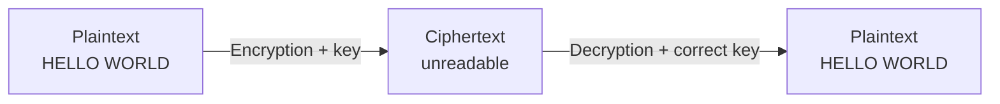
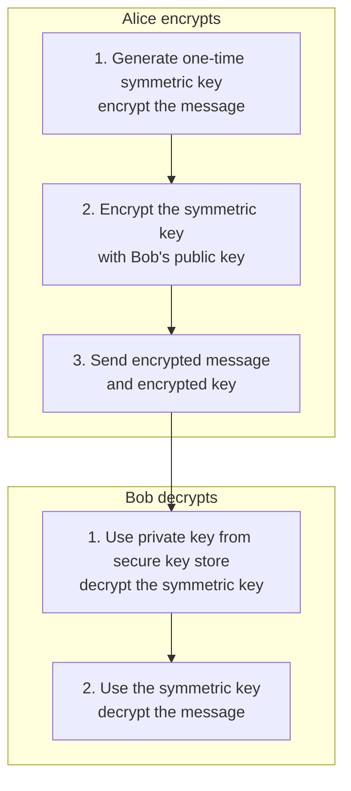
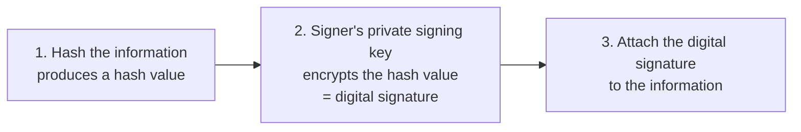
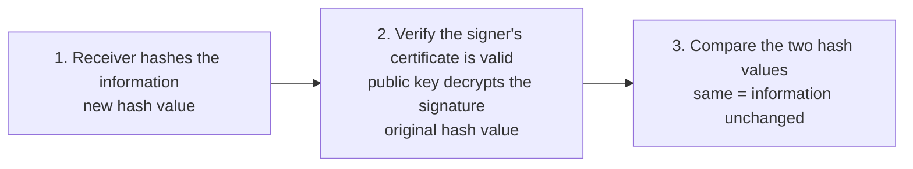
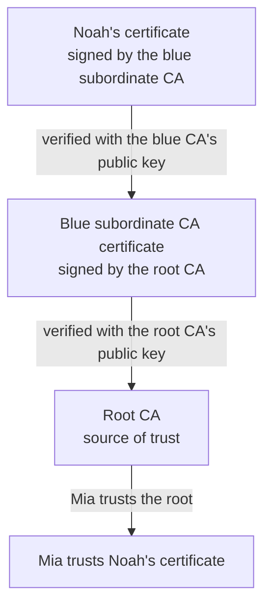
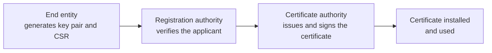
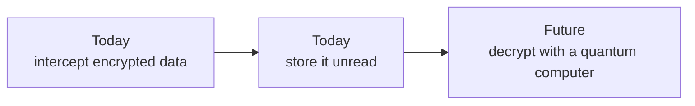

# Module 5: Cryptography and the Public Key Infrastructure

This module explains a variety of **cryptographic mechanisms** (ciphers, encryption, digital signatures, and hashing) and how they solve security problems. You will also learn the purpose and components of **public key infrastructure (PKI)** and why **quantum computing** is changing the future of cryptography.

---

## 📚 Table of Contents

- [🎯 Learning Objectives](#-learning-objectives)
- [Lesson 1: Cryptography and the Public Key Infrastructure Overview](#lesson-1-cryptography-and-the-public-key-infrastructure-overview)
  - [1.1 What Is Cryptography?](#11-what-is-cryptography)
  - [1.2 Plaintext, Ciphertext, Encryption and Decryption](#12-plaintext-ciphertext-encryption-and-decryption)
  - [1.3 What Is PKI?](#13-what-is-pki)
  - [1.4 Encryption and Digital Signatures](#14-encryption-and-digital-signatures)
  - [1.5 The Four Security Objectives](#15-the-four-security-objectives)
- [Lesson 2: Ciphers](#lesson-2-ciphers)
  - [2.1 What Is a Cipher?](#21-what-is-a-cipher)
  - [2.2 Substitution Ciphers](#22-substitution-ciphers)
  - [2.3 Transposition Ciphers](#23-transposition-ciphers)
  - [2.4 One-Time Pad](#24-one-time-pad)
  - [2.5 Practice: Solve a One-Time Pad](#25-practice-solve-a-one-time-pad)
  - [2.6 Stream Ciphers and Block Ciphers](#26-stream-ciphers-and-block-ciphers)
- [Lesson 3: Keys and Cryptographic Algorithms](#lesson-3-keys-and-cryptographic-algorithms)
  - [3.1 What Is a Digital Key?](#31-what-is-a-digital-key)
  - [3.2 Key Size and Key Strength](#32-key-size-and-key-strength)
  - [3.3 Key Stretching](#33-key-stretching)
  - [3.4 Symmetric Algorithms](#34-symmetric-algorithms)
  - [3.5 Asymmetric Algorithms](#35-asymmetric-algorithms)
  - [3.6 Symmetric vs Asymmetric](#36-symmetric-vs-asymmetric)
  - [3.7 Hybrid Encryption](#37-hybrid-encryption)
- [Lesson 4: Hashing and Digital Signatures](#lesson-4-hashing-and-digital-signatures)
  - [4.1 What Is Hashing?](#41-what-is-hashing)
  - [4.2 Digital Signatures](#42-digital-signatures)
  - [4.3 Common Hash Functions](#43-common-hash-functions)
  - [4.4 Hashing Attacks](#44-hashing-attacks)
  - [4.5 The Birthday Paradox](#45-the-birthday-paradox)
  - [4.6 Defending Against Hashing Attacks](#46-defending-against-hashing-attacks)
- [Lesson 5: Public Key Infrastructure](#lesson-5-public-key-infrastructure)
  - [5.1 PKI and Its Four Components](#51-pki-and-its-four-components)
  - [5.2 Digital Certificates](#52-digital-certificates)
  - [5.3 The Certificate Authority](#53-the-certificate-authority)
  - [5.4 CA Hierarchies and Cross Certification](#54-ca-hierarchies-and-cross-certification)
  - [5.5 The Chain of Trust](#55-the-chain-of-trust)
  - [5.6 Directory Servers](#56-directory-servers)
  - [5.7 Registration Authorities and Enrollment](#57-registration-authorities-and-enrollment)
- [Lesson 6: Introducing Quantum Security](#lesson-6-introducing-quantum-security)
  - [6.1 Why Quantum Computing Matters](#61-why-quantum-computing-matters)
  - [6.2 Quantum Computing Basics](#62-quantum-computing-basics)
  - [6.3 Which Algorithms Are at Risk?](#63-which-algorithms-are-at-risk)
  - [6.4 Quantum Cryptography vs Post-Quantum Cryptography](#64-quantum-cryptography-vs-post-quantum-cryptography)
  - [6.5 Four PQC Approaches](#65-four-pqc-approaches)
  - [6.6 NIST PQC Standards and Cryptographic Agility](#66-nist-pqc-standards-and-cryptographic-agility)
- [🌍 Real-World Scenarios](#-real-world-scenarios)
- [📊 Comparisons](#-comparisons)
- [🧠 Key Takeaways](#-key-takeaways)
- [📝 Quick Revision](#-quick-revision)
- [❓ Knowledge Check](#-knowledge-check)
- [🔗 Related Modules](#-related-modules)

---

## 🎯 Learning Objectives

After completing this module, you will be able to:

- Define **cryptography** and associated terms.
- Explain what cryptographic mechanisms do and how they solve different problems.
- Discuss how **ciphers, encryption, digital signatures, and hashing** work.
- Contrast **symmetric vs asymmetric** cryptography and **stream vs block** ciphers.
- List examples of cryptographic algorithms and ciphers.
- Describe **public key infrastructure (PKI)** and its purpose, and list its main components and what each does.
- Explain why **quantum computing** threatens current cryptography, and define **post-quantum cryptography (PQC)**.

> 📝 **Note on sources:** The supplied material included the original course text and supplementary notes that point out several technical inaccuracies in the course. This README **follows the course wording** and marks differences with **⚠️ Flagged** callouts so you can decide what to rely on.

---

# Lesson 1: Cryptography and the Public Key Infrastructure Overview

## 1.1 What Is Cryptography?

> 💡 **Definition (course):** **Cryptography** is the study of writing or solving codes.

This simple definition hides the complexity of cryptography and the challenge of implementing it on a computer network.

> 📖 **Supplementary definition (added):** Cryptography is the science of protecting information by converting readable data into an unreadable form so unauthorized people cannot understand it.

> 🌍 **Real-world Scenario:** If you have ever connected to a secure website to bank or to buy something, you have used cryptography. It is everywhere in modern communication and commerce, and it is simple to use even though the technology behind it is not.

---

## 1.2 Plaintext, Ciphertext, Encryption and Decryption

| Term | Meaning |
|------|---------|
| **Plaintext** | Original readable information |
| **Ciphertext** (crypto text) | Encrypted, unreadable information |
| **Encryption** | Converting plaintext into ciphertext |
| **Decryption** | Converting ciphertext back into plaintext |

> 🌍 **Analogy:** Sending your ATM PIN as plain text lets anyone who intercepts it read it. Encrypted, they see only unreadable data, and only the receiver with the correct key can restore it.

---

## 1.3 What Is PKI?

> 💡 **Definition (course):** **Public key infrastructure (PKI)** is an infrastructure of **hardware, software, policies, and procedures** that facilitates the management of **public digital keys** and makes cryptography over a network and the internet possible.

PKI is the name for the **implementation** of network cryptography. Lesson 5 covers its components in detail.

> 🧠 **Remember:** PKI = the complete system used to manage digital certificates and public-key cryptography.

---

## 1.4 Encryption and Digital Signatures

Cryptographic technology lets you **encrypt** data and **sign data digitally**.

- **Encryption:** converting plaintext to crypto text, making something readable into something unreadable.
- **Digital signature:** uses cryptography to produce a **unique value that can be tied to a person**. In **most jurisdictions**, a digital signature is **legally equivalent to a hand-written signature**.

---

## 1.5 The Four Security Objectives

By satisfying these four objectives, cryptography has made **e-commerce and secure communications** possible.

| Objective | Meaning | Provided By | Memory |
|-----------|---------|-------------|--------|
| **Confidentiality** | Information is private and only accessible to authorized people | **Encryption** | Secret |
| **Data integrity** | Information is authentic and has not been changed without authorization | **Digital signatures** (and hashing) | Unchanged |
| **Authentication** | Verifying the identity of a person, device, or system | **Digital signatures** and **digital certificates** | Identity |
| **Non-repudiation** | The signee **cannot deny** having signed the information. It has legal implications: for a legal contract, the signee is bound by it | **Digital signature** | Evidence |

> 🌍 **Real-world Scenario (added):** You transfer ₹5,000, and an attacker changes the amount to ₹50,000 in transit. Integrity mechanisms (hashes and signatures) let you detect the change.

> 🔗 **Connection to Module 1:** Confidentiality and integrity are two of the three goals of the [CIA triad](Module-01-README.md#the-cia-triad). Authentication links to the [AAA framework](Module-01-README.md#the-aaa-security-framework).

---

# Lesson 2: Ciphers

After this lesson you will be able to define a cipher, describe the types of ciphers, and describe how ciphers work at a high level.

## 2.1 What Is a Cipher?

> 💡 **Definition:** A **cipher** is a secret or disguised way of writing a code.

In computers, **cryptographic algorithms** act as ciphers and, together with **digital keys**, convert plaintext to ciphertext and back again. This is **encryption and decryption**.

| Part | Role |
|------|------|
| **Algorithm** | The method used. Usually **public** information |
| **Key** | The value that controls how the method works. Usually **secret**, but not always. Secrets must be safeguarded |

---

## 2.2 Substitution Ciphers

> 💡 **Definition:** A **substitution cipher** **replaces** each letter of the plaintext with another letter. It is the simplest cipher type. **Julius Caesar** used it.

**Caesar shift of 3** (Western 26-letter alphabet):

- *"hail Caesar"* becomes *"kdlo fdhvdu"*.
- To decrypt, shift **in the opposite direction** by the same number (shifting left by 3 turns K back into H and D back into A).
- The **number of shifts is the shared secret (key)**. The **method is the cipher algorithm**.

> 📖 **Added example:** `HELLO` with a shift of 3 becomes `KHOOR` (H→K, E→H, L→O, L→O, O→R).

> ⚠️ **Weakness:** The Caesar cipher has only **26 possible combinations**, so it is easy to break by **brute force** (trying every possible key until the message becomes readable).

---

## 2.3 Transposition Ciphers

> 💡 **Definition:** A **transposition cipher** **rearranges** the letters instead of replacing them. It is more complicated than substitution.

**Example: Rail Fence cipher** (named because the layout looks like a fence).

- Write the plaintext in a **zigzag** across a number of rows (any number; the course example uses **three**).
- To encipher, read the letters **row by row**.
- The receiver must know the **number of rows**. This is the shared secret (key).
- Course example message: *"He had a bad day. What a day Dad had."* (The resulting ciphertext and the four-row example were shown on screen and are not in the supplied notes.)

> 📖 **Added example (3 rows):** `HELLOWORLD` is written in a zigzag, then read row by row: row 1 gives `HOL`, row 2 gives `ELWRD`, row 3 gives `LO`, so the ciphertext is `HOLELWRDLO`.

| Substitution | Transposition |
|--------------|---------------|
| Replaces letters | Rearranges letters |
| Characters change | Characters stay the same |
| Example: Caesar cipher | Example: Rail Fence cipher |

---

## 2.4 One-Time Pad

> 💡 **Definition:** The **one-time pad** introduces **randomness** to the substitution method. A normal substitution cipher uses **one shift value for the whole message**. The one-time pad uses a **different value for each letter**.

> 🌍 **Course example:** Roll a 26-sided die for each letter. For *"Hi Bob"* with rolls **10, 4, 3, 11, 18**, the message becomes **`RMEZT`**.

**Why it is powerful:**

- The randomness means **no repetitive patterns** and an **equal chance** that a plaintext letter becomes any of the 26 letters.
- A five-letter message has 26 × 26 × 26 × 26 × 26 ≈ **almost twelve million** combinations. Without a computer, such ciphertext is **virtually impossible to break**.

> 📖 **Added: conditions for a perfectly secure one-time pad:** the key must be **truly random**, **at least as long as the message**, kept **secret**, and **never reused**.

---

## 2.5 Practice: Solve a One-Time Pad

**Problem:** ciphertext **`GDCHV`**, key **5, 21, 15, 1, 7**.

**Hints from the course:**

- Think of the alphabet as a **continuous circle**.
- To encrypt, move **right (clockwise)**. To **decrypt, move left (counterclockwise)**.
- Example: ciphertext **C** with key **7**: move 7 letters counterclockwise from C, wrapping past A, and you land on **V**.

📖 Show the solution (added)

| Cipher letter | Key | Move left by key | Plaintext |
|---------------|-----|------------------|-----------|
| G | 5 | G → F E D C B | **B** |
| D | 21 | wraps around the circle | **I** |
| C | 15 | wraps around the circle | **N** |
| H | 1 | H → G | **G** |
| V | 7 | V → U T S R Q P O | **O** |

The plaintext is **BINGO**.

---

## 2.6 Stream Ciphers and Block Ciphers

Computers allow more sophisticated encipherment, but the concepts remain the same. Two commonly used types:

| | **Stream cipher** | **Block cipher** |
|---|-------------------|------------------|
| **How it works** | Encrypts a stream of plaintext **one bit or byte at a time** | Breaks plaintext into **blocks** and encrypts each block |
| **Speed** | **Faster** than block ciphers | Slower |
| **Examples** | **FISH**, **RC4** | **DES**, **3DES**, **AES**, **Blowfish** |
| **Memory** | Continuous flow of data | Data divided into fixed-size blocks |

**Course example for block ciphers:** with a 256-bit key, blocks are also 256 bits. A one-megabyte message would be divided into many 256-bit blocks.

> ⚠️ **Flagged:** The course says block size is determined by **key size**. Supplementary notes point out that block size is normally set by the **algorithm**, not the key. For example, **AES always uses 128-bit blocks**, whether the key is 128, 192, or 256 bits. Know the course wording, but be aware of this difference.

> ⚠️ **Modern security note (added):** The older algorithms here are for learning history and classification. **AES** is widely used. **DES** and **3DES** are obsolete for new deployments. **RC4** is insecure and should not be used.

---

# Lesson 3: Keys and Cryptographic Algorithms

After this lesson you will be able to describe a digital key, explain key stretching, describe symmetric vs asymmetric algorithms, list examples, and describe encryption using both.

## 3.1 What Is a Digital Key?

> 💡 **Definition:** A **digital key** is a value (expressible alphanumerically) used to perform **cryptographic operations**.

**Keys can be used for:**

- **Digital signatures**
- **Message authentication codes (MAC)**
- **Encryption**

With encryption, keys can protect the flow of information between two devices, **bulk stationary data**, or a **small piece of data** such as another key or a hash value.

**Key lifetime depends on the task:**

| Key Use | Lifetime |
|---------|----------|
| Signing certificates | Ten or more years |
| Encrypting a session between two devices | Only the length of that session (seconds to minutes) |

- Keys are usually **private or secret**, but they can also be **public**. Public keys are often written to **digital certificates**.

> 📖 **Beginner Explanation (added):** A *MAC* is a value that proves a message came from someone who knows a shared secret and was not changed.

---

## 3.2 Key Size and Key Strength

| Key Type | Typical Size | Use |
|----------|--------------|-----|
| **Public keys** | Often **1024, 2048 bits**, or larger | Encrypt **small** data (another key or a hash). Too slow for large data |
| **Smaller keys** | **128 to 256 bits** | Encrypt **bulk data**, where performance matters |

**Rule of thumb:** encrypting a key to transfer it safely → use a **larger key**. Encrypting a data stream where performance is critical → use a **smaller key**.

**Strength depends on length *and* complexity:**

| Password | Possible Combinations |
|----------|-----------------------|
| 10 characters, all digits | 10 billion |
| 8 characters, digits + upper + lower case letters | Over **218 trillion** |

The shorter but more complex password is **much stronger**.

> ⚠️ **Flagged (added by supplementary notes):** A longer key is not automatically stronger than a shorter key from a *different* algorithm. A 256-bit AES key and a 2048-bit RSA key are not directly comparable. They use different mathematics. Also, 1024-bit public keys are no longer considered strong for new use.

---

## 3.3 Key Stretching

> 💡 **Definition:** **Key stretching** strengthens keys or passwords that are **too short or predictable**. The key or password is fed into a **hashing algorithm** to produce an **enhanced** key or password.

- **Examples:** **PBKDF2** (password-based key derivation function two) and **BCRYPT**.
- **Salt:** a **random value** added to another value to **increase entropy**.

**Course description of BCRYPT:** it is the default key stretching algorithm in **OpenBSD and various Linux distributions**. The key or password is hashed multiple times, then a **128-bit salt** is added, then the combined value is hashed once more. The final output is the enhanced key or password.

> ⚠️ **Flagged:** Supplementary notes say this description of bcrypt is **inaccurate**: bcrypt builds the salt into its hashing process rather than hashing first and salting afterward, and it is not simply the default everywhere. Use the course wording for the exam, but verify before quoting it in other settings.

> 📖 **Added:** Other modern password-hashing algorithms include **scrypt** and **Argon2**. Key stretching does not make a weak password unguessable. It makes **each guess more expensive**.

---

## 3.4 Symmetric Algorithms

> 💡 **Definition:** A **symmetric algorithm** is a cipher that uses the **same key** to encrypt and decrypt data.

**Examples:** **DES, Triple DES, IDEA, AES, RC4, RC5, RC6, Blowfish, Twofish.** With the exception of **RC4 (a stream cipher)**, the rest are **block ciphers**.

**Advantage:** faster than asymmetric cryptography, because symmetric keys are shorter and one key does both jobs.

**Disadvantage:** the key **must stay secret**, and delivering it securely is hard. *If Alice encrypts a message for Bob, she can safely send the ciphertext, but how does she securely deliver the key?*

> 🌍 **Course analogy (combination lock):** Frank, Javier, and Nora all need a key to a secure room that must stay in the building. The employer locks it in a lock box with a **combination code**, and all three need the code. The shared code is like a shared symmetric key.

**How it works:** a crypto application uses the **symmetric key and cipher** to turn plaintext into ciphertext. The **same key and cipher** turn ciphertext back into plaintext.

---

## 3.5 Asymmetric Algorithms

> 💡 **Definition:** An **asymmetric algorithm** is a cipher used for cryptographic operations with a **pair of mathematically related keys**. It can perform all or some of: **encryption, key exchange, digital signature**. Asymmetric cryptography is also called **public-key cryptography**.

- **Key exchange:** two parties safely exchange a secret or key over a **public channel** such as the internet.
- **Examples:** **Diffie-Hellman, RSA, Elliptic Curve Cryptography (ECC), PGP and GPG, DSA.**

**Advantage:** **greater data security**. Users are **never required to share their private keys**.

**Disadvantage:** the crypto processes are **very slow** compared with symmetric cryptography, which makes it impractical for streaming or encrypting large amounts of data.

> 🌍 **Course analogy:** Like a lock and key. The lock secures the item and only the correct key can open it.

**How it works (encryption):**

1. The sender's application uses the **recipient's public key** and an asymmetric cipher to turn plaintext into ciphertext.
2. The recipient's application uses their **private key** and the same cipher to decrypt.

> ⚠️ **Flagged (added by supplementary notes):** Diffie-Hellman is primarily a **key-agreement** protocol, not a general encryption algorithm. **PGP and GPG** are software systems that use several algorithms, not single algorithms. The course names DSA the "Digital Signing Algorithm," while it is generally called the **Digital Signature Algorithm**.

---

## 3.6 Symmetric vs Asymmetric

| Feature | Symmetric | Asymmetric |
|---------|-----------|------------|
| Number of keys | One shared secret key | Public and private key pair |
| Speed | **Fast** | **Slow** |
| Key sharing | Secret key must be delivered securely | Public key can be shared freely |
| Best use | **Bulk data** | Key exchange, small data, signatures |
| Main disadvantage | Secure key delivery | Slowness |
| Examples | AES, 3DES | RSA, ECC, Diffie-Hellman |

> 🧠 **Remember:** Symmetric's weakness is **key delivery**. Asymmetric's weakness is **speed**.

---

## 3.7 Hybrid Encryption

Combining both fixes both weaknesses: **symmetric encryption** protects the bulk data (fast), and the small **symmetric key** is protected with the **recipient's public asymmetric key** (solves delivery).

> 📝 **Note:** In step 1 of decryption, Bob may be asked to submit credentials to access his private key in the secure key store. Alice uses the **same** algorithms that Bob uses to decrypt.

> 🌍 **Real-world Scenario (added):** HTTPS/TLS uses public-key cryptography for authentication and key agreement, then symmetric encryption to protect the actual data.

---

# Lesson 4: Hashing and Digital Signatures

After this lesson you will be able to define hashing, describe how it works in a digital signature, list hash functions, and describe common hashing attacks and defenses.

## 4.1 What Is Hashing?

> 💡 **Definition (course):** **Hashing** converts data of **arbitrary size** into a **unique value of fixed size**.

| # | Feature | Meaning |
|---|---------|---------|
| 1 | **Fixed length** | The output length is set by the hash function. The attacker learns nothing about the input size (a 12-character password or a six-page document look the same) |
| 2 | **Unique output** | The course says each input gives a unique output, like a **fingerprint**. A tiny change in a document produces a completely different hash, so tampering is detected |
| 3 | **Non-reversible (one-way)** | Running the output through the function again does not give the input. The attacker cannot work backward from the hash |

> ⚠️ **Flagged:** A hash cannot be *guaranteed* unique, because the input can be any size and the output is a fixed size, so **collisions must exist**. A secure hash function makes finding useful collisions **computationally infeasible**. Know the course's "unique" wording, but understand this nuance.

> 📖 **Added: Hashing vs encryption**
>
> | Hashing | Encryption |
> |---------|------------|
> | Mainly for **integrity** and verification | Mainly for **confidentiality** |
> | One-way, **not reversible** | **Reversible** with the correct key |
> | No key needed for ordinary hashing | Key required |
> | Example: SHA-256 | Example: AES |

---

## 4.2 Digital Signatures

A digital signature ensures the **data integrity** of signed information, **authenticates** the signer, and supports **non-repudiation**.

### ✍️ Signing

### ✅ Verifying

The receiver needs the signer's **public verification key**, found in a **certificate**:

- Certificates are **issued and signed by a certificate authority (CA)** and contain the owner's **name** plus the public key.
- The receiver gets the certificate from a **repository**, or it comes **attached** to the signed document.

- If the values match, the information has **not changed** (integrity).
- Because the public key successfully decrypted the signature, and the certificate names the key's owner, you can confirm the **authenticity** of the signer.

> ⚠️ **Flagged (added by supplementary notes):** The "private key encrypts the hash" description is a **simplified** explanation that fits RSA. Other algorithms (for example ECDSA and EdDSA) use different signing mathematics. Also, a digital signature does **not** make a document confidential. Anyone who can access the document can still read it unless it is encrypted too.

---

## 4.3 Common Hash Functions

| Hash Function | Output | Notes (from the course) |
|---------------|--------|-------------------------|
| **MD5** | 128-bit | Widely used until weaknesses were found, mainly **susceptibility to collisions** |
| **MD6** | | The course says MD6 **supplanted** MD5 |
| **SHA-1** | 160-bit | Became popular after MD5 |
| **SHA-2** | Suite: **SHA-224, SHA-256, SHA-384, SHA-512** | Followed SHA-1 |
| **SHA-3** | You **choose the output length** | Followed SHA-2 |
| **LANMAN** | | Legacy Windows password storage. Uses **DES**, proven not secure and defeated by brute force |
| **NTLM** (and NTLMv2) | | Succeeded LANMAN |
| **HAVAL, RIPEMD** | | Popular **outside North America** |

> ⚠️ **Flagged:** Supplementary notes say the claim that **MD6 supplanted MD5** is misleading. MD6 was a proposed design that did not become the standard replacement. **SHA-2 and SHA-3** are the important modern families. They also note that SHA-1 is deprecated for collision-resistant uses, and NTLM is weak by modern standards.

---

## 4.4 Hashing Attacks

### 🔨 Brute Force Attack

The attacker tries different input values until one produces the **same hash** as the original.

- If the attacker knows nothing about the input size, success is limited.
- If the attacker knows something, they can **narrow the search**. Examples: a password policy with a known minimum and maximum length and required character types, or a **four-number PIN hashed with MD5**, where every combination can be tried.

### 🎂 Birthday Attack

A type of brute force attack based on the **birthday paradox**. It exploits hash functions known to produce **collisions**.

- A **collision** occurs when two or more inputs produce the same output.
- Servers don't store passwords. They store the **hashes**. An attacker doesn't need your exact password, only an input that produces **the same hash output**, and then they can log in as you.
- The attack depends on the higher likelihood of finding collisions among random attempts.

> 🔗 **Connection:** The birthday attack was first mentioned as a technical attack in [Module 2](Module-02-README.md#36-the-four-threat-categories).

---

## 4.5 The Birthday Paradox

| Question | Answer |
|----------|--------|
| People needed for a **50% chance that someone shares *your* birthday** | **183** |
| People needed for a **50% chance that *any two* share a birthday** | Only **23** |

**Why:** with 23 people there are many possible **pairs**, and the attacker doesn't care *which* two match. For hashes, it is much easier to find **any** two inputs that match than to match one specific hash.

**The math (course):** calculate the chance that **no one** shares a birthday and invert.

| People in room | Chance that the newest person avoids earlier birthdays | Running chance of no match |
|----------------|--------------------------------------------------------|----------------------------|
| 2nd | 364/365 | |
| 3rd | 363/365 | 0.9973 × 363/365 |
| 4th | 362/365 | 0.9918 × 362/365 |
| 23rd | 343/365 | 0.5243 × 343/365 = **0.4927** |

About **49%** chance of no shared birthday, so about **51%** that two people share one (ignoring leap years).

> 📖 **Added:** For a hash with *n* bits, collisions become likely after roughly 2^(n/2) random inputs.

---

## 4.6 Defending Against Hashing Attacks

- The best defense against brute force is a hash function with an output **long enough to be computationally infeasible to break**.
- For **password hashes**, a longer output alone may not be enough if the function is **susceptible to collisions**. Increase entropy with **key stretching** (see [3.3](#33-key-stretching)).

> 📖 **Added defenses and attack types (from supplementary notes, not the course):**
> - **Dictionary attack:** trying common passwords instead of every combination.
> - **Rainbow table attack:** precomputed tables of passwords and hashes. A **unique salt per password** makes them much less useful.
> - Use long, unpredictable passwords, **MFA**, login attempt limits, and dedicated password-hashing functions (Argon2id, bcrypt, scrypt, PBKDF2) rather than plain SHA-256.

---

# Lesson 5: Public Key Infrastructure

After this lesson you will be able to describe PKI and its main components, define a digital certificate, list common certificate content, and explain the chain of trust.

## 5.1 PKI and Its Four Components

> 💡 **Definition:** **PKI** is an **ecosystem** of the **policies, procedures, software, and hardware** needed to **create, distribute, store, use, and revoke digital certificates**.

A certificate is **revoked** when it is no longer trusted. Its content, such as a public key, becomes void.

**Four entities compose a PKI:**

| Entity | Role |
|--------|------|
| 🏛️ **Certification authority (CA)** | Issues and signs certificates |
| 🪪 **Registration authority (RA)** | Verifies applicants and forwards certificate requests to the CA |
| 📚 **Directory server** | Stores and provides certificates and related PKI information |
| 👤 **End entity** | The person, device, or application that requests and uses a certificate |

---

## 5.2 Digital Certificates

> 💡 **Definition:** A **digital certificate** is an electronic document **issued and signed by a trusted entity**, such as a CA. It contains the **name of the certificate holder** and may or may not contain a public key. For a specific person, device, or application, it **binds the entity's identity to the public key** by way of a digital signature.

> 🌍 **Analogy:** A certificate is trusted because a trusted entity signed it, just like a **driver's license** is trusted because a government authority issued it.

### 📜 Types of Certificates

| Type | Contains |
|------|----------|
| **Encryption certificate** | Public **encryption** key (for encipherment) |
| **Verification certificate** | Public **verification** key (to verify signatures) |
| **Policy certificate** | Policy information, such as password criteria for securing your key store |
| **Certificate revocation list (CRL)** | Information about **revoked** certificates (no longer trusted) |

> 📝 **Note:** Not all certificates contain keys.

> ⚠️ **Flagged:** The course describes a CRL as a "certificate." Supplementary notes point out that a CRL is more precisely a **signed list of revoked certificates**, not a certificate itself. They also mention **OCSP (Online Certificate Status Protocol)** as another way to check revocation status.

### 📋 X.509 Version 3 and Certificate Fields

**X.509 version 3** is the most important standard. It defines what content can be written to a certificate and how it is expressed. Common fields:

| Field | Meaning |
|-------|---------|
| **Serial number** | Unique identifier assigned by the issuer |
| **Algorithms** | Algorithms used (such as the signature algorithm) |
| **Validity period** | Start and expiry dates |
| **Issuer name** | The CA that issued it |
| **Subject name** | The entity the certificate identifies |
| **Key value** | The public key |
| **Key usage** | Permitted purposes |

- **Certificate templates** specify the attributes of different certificate types, including purpose. For example, a certificate with **key usage = key encipherment** is used to encrypt objects.
- **Customized content** can also be written to certificates.

> 🌍 **Real-world Scenario (added):** When you visit an HTTPS website, your browser checks the website's certificate to help confirm you are talking to the real site. This is why [copycat websites](Module-03-README.md#52-examples-of-cyber-fraud-and-scams) are risky when you ignore certificate warnings.

---

## 5.3 The Certificate Authority

The CA performs two primary functions:

1. **Issues certificates** to end entities (persons, devices) and also issues certificates that **manage** end-entity certificates (CRLs, policy certificates).
2. **Provides an ecosystem of trust** so all entities can interact safely. Trust **hinges on the CA's private key**, because every certificate it issues is signed with that key.

**Why do end entities trust the CA?**

- They may have a **relationship** with it, like a bank client with a bank or a citizen with a government.
- A **legal framework** supports the trust. A **high-assurance CA** can prove in court that its key pair was created in a manner consistent with the highest security standards.
- **Low-assurance CAs** generally lack the same rigorous legal requirements and may not implement all the same security elements.
- The **required degree of trust** determines the assurance level and PKI implementation.

---

## 5.4 CA Hierarchies and Cross Certification

| Structure | Description |
|-----------|-------------|
| **Hierarchical** | One **root CA** (the **source of trust**) and one or more **subordinate CAs** that issue certificates to end entities. A subordinate CA can have its own subordinates, making a deeper hierarchy |
| **Cross certification** (lateral) | A CA in one PKI **trusts a CA in another PKI**. **Cross certificates** let users of each PKI trust users of the other. It can happen between root or subordinate CAs of the two PKIs |

**Building a hierarchy from the ground up:**

1. Start with the **root CA**. Its certificate is **signed by its own private key**.
2. Create subordinate CAs below the root. During setup, each sends its **public key** to the root CA, which writes it into an **X.509 certificate** signed with the **root's private key**.
3. A subordinate CA under a subordinate repeats the request, but the **superior subordinate CA** signs the certificate.

> 📖 **Added:** Root CAs are often kept **offline** to reduce the chance of compromise.

---

## 5.5 The Chain of Trust

> 💡 **Definition:** The **chain of trust** is a **series of associated certificates**, each relying on the next for trust, leading progressively to the **root CA**, the source of trust.

> 🌍 **Course example:** The violet subordinate CA signed **Mia's** certificate. The blue subordinate CA signed **Noah's** certificate. Noah sends Mia a signed legal document. Can Mia trust his signature? Yes.

1. Mia's application uses Noah's **public key** (from his certificate) to verify the signature. This proves **integrity** and **authenticity** of the signature, but Mia does **not yet trust** Noah's certificate.
2. It retrieves the **issuing CA's certificate** (the blue subordinate). Its public key verifies Noah's certificate, but Mia still doesn't trust the subordinate CA.
3. It retrieves the **root CA's certificate**. Because the root is the source of trust for Mia, she trusts it, and therefore the blue subordinate CA and Noah's certificate.

Following the chain to its source lets Mia trust **any valid certificate** in that PKI.

---

## 5.6 Directory Servers

**How did Mia get Noah's certificate?** Two ways:

1. Noah's application **sent it along with** the signed document.
2. Mia's application **retrieved it from a server**.

PKI standards expected end entities to retrieve certificates from an **X.500 and Lightweight Directory Access Protocol (LDAP)-compliant directory server**. It stores user and device certificates **and all PKI certificates**: **policy certificates, CRLs, authority revocation lists (ARLs), cross certificates, and CA certificates**.

---

## 5.7 Registration Authorities and Enrollment

> 💡 **Definition:** A **registration authority (RA)** is a function for **certificate enrollment**. It **verifies and forwards certificate requests to the CA**.

- A person who needs certificates for themselves, a device, or an application **applies online or in person** to an RA. An RA can be an **automated application** or staffed by an authorized person.
- 🌍 **Analogy:** An RA is like an **automobile licensing bureau**. It identifies applicants and ensures they meet requirements. It **vets** requests so only authorized, legitimate entities get certificates.
- The RA **registers approved requests with the CA**, which generates and supplies a **one-time authorization code** to the requestor.
- The **degree of vetting** depends on the CA's **level of trust**. For a high-assurance CA you may need to appear **in person**. For other certificates, such as **SSL certificates**, you can register and buy **online**.

### 👤 At the End Entity

- The user needs a **cryptographic application** to **generate key pairs**, **submit a certificate request** to the CA, and perform cryptographic operations.
- A **CSR** can be submitted manually or partly automated.
- Some cryptographic capability is built into operating systems, such as the **Microsoft cryptographic service provider (CSP)**.

> ⚠️ **Flagged:** The course expands CSR as "certificate **service** request." It is more commonly called a **Certificate Signing Request**. Note that the CSR carries the **public key**, never the private key, which stays with the entity that generated it.

---

# Lesson 6: Introducing Quantum Security

After this lesson you will be able to explain why quantum computing threatens current cryptography, identify which systems are vulnerable, and define post-quantum cryptography (PQC).

## 6.1 Why Quantum Computing Matters

- Nearly everything online (banking, shopping, job applications, travel) depends on cryptography for **confidentiality**, **integrity**, and **authentication**.
- Large keys and sophisticated algorithms such as **RSA** and **ECC** have made brute-force attacks impossible with **regular computers**. The **quantum computer** makes this security **uncertain**.

### 🚨 Harvest Now, Decrypt Later (HNDL)

> 💡 **Definition:** Bad actors **intercept sensitive data today, store it, and decrypt it later** when quantum computers are advanced enough.

> 🎯 **Exam Focus:** Organizations prepare **now** because of the **long-term nature** of cryptographic risk. For data that must stay confidential for years, waiting is too late.

---

## 6.2 Quantum Computing Basics

| Concept | Meaning |
|---------|---------|
| **Quantum computing** | A new approach to calculation that uses principles of fundamental physics to solve extremely complex problems very quickly, using **qubits** |
| **Bit vs qubit** | A classical bit is **0 or 1**. A **qubit** (quantum bit) can be **both 0 and 1 until measured** |
| **Superposition** | A quantum system can exist in **multiple states at once** until measured |
| **Quantum advantage** | Qubits in superposition let a quantum computer evaluate many paths at once. This is why quantum computing threatens classical cryptography designed for sequential processing |

> 🌍 **Course analogy:** A coin lying flat is heads or tails, like a normal bit. A coin **spinning in the air** is neither, like a qubit in superposition.

> ⚠️ **Flagged (added by supplementary notes):** The coin analogy and "evaluate many paths at once" are simplifications. A quantum computer does **not** simply try every answer at once. Quantum algorithms use interference and measurement to raise the odds of a useful answer, and quantum computers are not faster for every kind of calculation.

---

## 6.3 Which Algorithms Are at Risk?

Public-key (asymmetric) cryptography (**RSA, ECC, Diffie-Hellman**) is secure today because the math problems behind it (**factoring very large numbers**, **discrete logarithms**) are extremely hard for regular computers.

| Algorithm Family | Quantum Threat | Details |
|------------------|----------------|---------|
| **RSA, ECC, traditional Diffie-Hellman** | 🔴 **Can be broken** by a mature quantum computer | In **1994**, **Peter Shor** showed a powerful enough quantum computer could efficiently factor large numbers and solve discrete logarithms (**Shor's algorithm**) |
| **Symmetric encryption** | 🟡 **Weakened, not broken** | **Grover's algorithm** could in theory reduce effective key strength by **roughly half**. Longer keys (**AES-256 instead of AES-128**) mitigate much of the risk |
| **Hashing (SHA-256, SHA-3)** | 🟢 **Not broken** | Quantum algorithms could speed up certain attacks. Longer hash outputs help |

These public-key algorithms underpin **secure web browsing (TLS)**, **VPNs**, **digital certificates**, **secure email**, and **secure messaging**, so their compromise would have widespread consequences.

> 📖 **Added example:** In an idealized comparison, Grover's algorithm cuts AES-128 to about **64 bits** of strength and AES-256 to about **128 bits**.

> 🎯 **Exam Focus:** Quantum computers do **not** threaten all cryptography equally. They are a particular threat to today's **public-key** algorithms.

---

## 6.4 Quantum Cryptography vs Post-Quantum Cryptography

| | **Quantum cryptography (QC)** | **Post-quantum cryptography (PQC)** |
|---|------------------------------|-------------------------------------|
| **Based on** | The **laws of physics** (quantum mechanics) | New **mathematical algorithms** |
| **Resists** | Interception: any attempt to intercept **physically alters** the message, making unauthorized access **detectable** | Attacks from **both regular and quantum computers** |
| **Hardware** | Needs **specialized quantum hardware** | Runs on **existing networks and devices** |
| **Practical use** | **Limited** by infrastructure requirements | Practical to deploy |
| **Example** | **Quantum Key Distribution (QKD)**: two parties generate a shared key using quantum mechanics | Quantum-resistant algorithms to replace or supplement vulnerable methods |

- The course describes QC as, in principle, **theoretically unbreakable**, because quantum states cannot be fully copied.
- For most applications, including web security, **PQC is the future replacement for Diffie-Hellman**.
- PQC aims to provide the same services as today's public-key cryptography: **encryption, key exchange, and digital signatures**.

> ⚠️ **Flagged (added by supplementary notes):** QKD is **not automatically unbreakable end to end** in practice. It still needs trusted equipment, authenticated communication, secure endpoints, and correct implementation.

---

## 6.5 Four PQC Approaches

| Approach | Based On | Notes |
|----------|----------|-------|
| **Lattice-based** | Hard problems in **high-dimensional lattices** (geometric grids of points) | Efficient and strong alternatives to current public-key systems |
| **Hash-based** | **Secure hash functions**; widely used in **digital signatures** | Strength comes from being **one-way**, **deterministic** (same input, same hash), and showing the **avalanche effect** (a small input change gives a completely different output) |
| **Code-based** | Difficulty of **decoding random linear error-correcting codes** | Studied for decades and considered highly resistant to quantum attacks |
| **Multivariate** | Difficulty of solving **many equations with multiple variables** over finite fields | The public key is a set of polynomial equations. The private key helps solve them easily |

---

## 6.6 NIST PQC Standards and Cryptographic Agility

**NIST** (National Institute of Standards and Technology) started a **global competition in 2016** to assess and establish PQC standards. The course says it selected:

| Purpose | Original Name | Standardized Name |
|---------|---------------|-------------------|
| **Key establishment** | CRYSTALS-KYBER | **ML-KEM** (Module-Lattice-Based Key Encapsulation Mechanism) |
| **Digital signatures** | CRYSTALS-Dilithium | **ML-DSA** |
| **Digital signatures** | SPHINCS+ | **SLH-DSA** |
| **Digital signatures** | FALCON | Expected to be standardized as **FN-DSA** |

> ⚠️ **Flagged:** The course says FALCON is *expected* to be standardized. Check the latest NIST publication for the current status instead of relying on this wording.

> 📖 **Beginner Explanation (added):** A *key encapsulation mechanism (KEM)* lets two parties establish a shared secret over a public channel. That secret is then used with symmetric encryption.

**Cryptographic agility and hybrid approaches:** standardization improves interoperability, but relying on a **small number of algorithms** means a vulnerability could have **widespread impact**. So **cryptographic agility** (being able to switch algorithms) and **hybrid approaches** remain important.

> 📖 **Added:** *Hybrid cryptography* combines a traditional key-establishment method with a post-quantum one so security doesn't depend on only one. For network engineers, migrations may involve VPN gateways, firewalls, routers, certificates, and TLS services.

---

## 🌍 Real-World Scenarios

| Scenario | Concept Applied |
|----------|-----------------|
| You open a bank's website and see the padlock | Cryptography, certificates, TLS |
| Someone changes a transfer amount in transit | Integrity (hashing and signatures detect it) |
| Someone signs an e-contract and later denies it | Non-repudiation (digital signature) |
| A message is encrypted by shifting every letter by 3 | Caesar cipher (substitution) |
| A message is written in a zigzag and read by rows | Rail Fence (transposition) |
| Alice sends Bob a large file using a one-time AES key protected by Bob's public key | Hybrid encryption |
| A password database is stolen and the attacker tries 4-digit PINs against MD5 hashes | Brute force on hashes |
| An attacker looks for any two inputs with the same hash | Birthday attack and collisions |
| A browser follows a certificate through a subordinate CA to a trusted root | Chain of trust |
| A company applies for a web server certificate through an RA | PKI enrollment |
| An attacker stores encrypted traffic today to read it with a future quantum computer | Harvest now, decrypt later |
| A company plans to switch VPN key exchange to ML-KEM | PQC and cryptographic agility |

---

## 📊 Comparisons

### Substitution vs Transposition

| Substitution | Transposition |
|--------------|---------------|
| Replaces letters | Rearranges letters |
| Example: Caesar | Example: Rail Fence |

### Stream vs Block Ciphers

| Stream | Block |
|--------|-------|
| One bit or byte at a time | Fixed-size blocks |
| Faster | Slower |
| FISH, RC4 | DES, 3DES, AES, Blowfish |

### Symmetric vs Asymmetric

See the table in [3.6](#36-symmetric-vs-asymmetric).

### Hashing vs Encryption vs Digital Signature

| | Hashing | Encryption | Digital Signature |
|---|---------|------------|-------------------|
| Goal | Integrity check | Confidentiality | Integrity, authentication, non-repudiation |
| Reversible? | No | Yes, with the key | Verified with the public key |
| Uses a key? | Not usually | Yes | Yes (private key signs, public key verifies) |

### Quantum Threat by Algorithm

| Algorithm | Threat Level | Defense |
|-----------|--------------|---------|
| RSA, ECC, Diffie-Hellman | Broken by Shor | Move to PQC |
| AES | Weakened by Grover | Use AES-256 |
| SHA-256, SHA-3 | Not broken | Use longer outputs |

### Commonly Confused Concepts

| Pair | Difference |
|------|------------|
| Encryption vs Hashing | Encryption is reversible, hashing is one-way |
| Symmetric vs Asymmetric | One shared key vs a public/private pair |
| CA vs RA | CA issues and signs. RA verifies applicants and forwards requests |
| Shor's vs Grover's | Shor breaks RSA, ECC, DH. Grover weakens symmetric keys |
| Quantum cryptography vs PQC | QC uses quantum physics and special hardware. PQC uses new math on ordinary computers |
| Salt vs Key stretching | Salt is a random value added. Key stretching makes each guess more costly |
| Root CA vs Subordinate CA | Root is the source of trust. Subordinates issue certificates to end entities |

---

## 🧠 Key Takeaways

- ✅ **Cryptography** protects information. Its four objectives are **confidentiality, integrity, authentication, and non-repudiation**.
- ✅ **Ciphers** use an algorithm (usually public) and a key (usually secret). **Substitution** replaces letters, **transposition** rearranges them, and a **one-time pad** uses a different random value for each letter.
- ✅ **Stream** ciphers encrypt bit by bit (faster). **Block** ciphers encrypt fixed-size blocks.
- ✅ **Symmetric** = one shared key, fast, but key delivery is hard. **Asymmetric** = key pair, secure key handling, but slow. **Hybrid** encryption combines them.
- ✅ **Key stretching** strengthens weak passwords by making guesses costly. A **salt** adds randomness.
- ✅ **Hashing** gives a fixed-length, one-way fingerprint. **Digital signatures** hash the data, sign the hash with the private key, and verify with the public key.
- ✅ **Brute force** and **birthday attacks** target hashes. Only **23** people give a 50% chance that two share a birthday.
- ✅ **PKI** has four entities: **CA, RA, directory server, end entity**. **Certificates** (X.509 v3) bind identities to public keys.
- ✅ The **chain of trust** leads a certificate back to a trusted **root CA**.
- ✅ **Quantum computers** threaten **RSA, ECC, and Diffie-Hellman** (Shor) and weaken **symmetric** keys (Grover). **Harvest now, decrypt later** is why to prepare now.
- ✅ **PQC** (lattice, hash, code, and multivariate approaches) runs on regular computers. NIST selected **ML-KEM, ML-DSA, SLH-DSA, and FALCON (FN-DSA)**.

---

## 📝 Quick Revision

**Basics**
- Plaintext → (encryption + key) → ciphertext → (decryption + key) → plaintext.
- Four objectives: confidentiality (encryption), integrity, authentication, non-repudiation (digital signature).

**Ciphers**
- Caesar = substitution (26 keys, brute-forced). Rail Fence = transposition. One-time pad = random value per letter.
- Stream: RC4, FISH. Block: DES, 3DES, AES, Blowfish.

**Keys and algorithms**
- Symmetric: DES, 3DES, IDEA, AES, RC4/5/6, Blowfish, Twofish. Asymmetric: Diffie-Hellman, RSA, ECC, PGP/GPG, DSA.
- Public keys 1024/2048+ bits for small data. Symmetric keys 128 to 256 bits for bulk data.
- Hybrid: symmetric key encrypts data, recipient's public key encrypts the symmetric key.
- Key stretching: PBKDF2, BCRYPT. Salt = random value that adds entropy.

**Hashing**
- Fixed length, unique (course wording), one-way. MD5 (128), SHA-1 (160), SHA-2 (224/256/384/512), SHA-3.
- Signing: hash → private key → signature. Verifying: new hash, public key reveals the original hash, compare.
- Attacks: brute force, birthday (23 people ≈ 51%).

**PKI**
- CA, RA, directory server, end entity. X.509 v3 fields: serial number, algorithms, validity, issuer, subject, key value, key usage.
- Root CA signs itself and its subordinates. Chain of trust ends at the root. Cross certification links two PKIs.
- Directory server: X.500 and LDAP.

**Quantum**
- Shor (1994): RSA, ECC, DH. Grover: symmetric, use AES-256. HNDL.
- QC (physics, QKD, special hardware) vs PQC (math, ordinary computers).
- PQC: lattice, hash-based, code-based, multivariate. NIST: ML-KEM, ML-DSA, SLH-DSA, FN-DSA.

---

## ❓ Knowledge Check

**Q1. (Multiple choice)** Which four objectives does cryptography satisfy?

- A) Speed, cost, size, color
- B) Confidentiality, data integrity, authentication, non-repudiation
- C) Availability, routing, switching, caching
- D) Encryption, hashing, tailgating, phishing

Show answer

**B).** These four objectives made e-commerce and secure communications possible.

**Q2. (Multiple choice)** Which of these is a stream cipher?

- A) AES
- B) 3DES
- C) RC4
- D) Blowfish

Show answer

**C) RC4.** It encrypts one bit or byte at a time. AES, 3DES, and Blowfish are block ciphers.

**Q3. (Multiple choice)** A message was encrypted with Bob's public key. Which key decrypts it?

- A) Alice's public key
- B) Bob's private key
- C) Bob's public key
- D) Alice's private key

Show answer

**B) Bob's private key.** The public key encrypts, and only the matching private key decrypts.

**Q4. (Conceptual)** Why are symmetric and asymmetric encryption combined?

Show answer

Symmetric encryption is fast for bulk data but has a key-delivery problem. Asymmetric encryption solves key delivery but is slow. Combined, the symmetric key encrypts the bulk data, and the recipient's public key encrypts that small symmetric key.

**Q5. (True/False)** Hashing is designed to be reversible so the original data can be recovered.

Show answer

**False.** Hashing is one-way, so the original input cannot be calculated from the hash.

**Q6. (Multiple choice)** In a digital signature, which key signs the hash, and which key verifies it?

- A) Public signs, private verifies
- B) Private signs, public verifies
- C) Both use the public key
- D) Both use a shared secret key

Show answer

**B).** The signer's private key signs the hash value, and the signer's public key (in a certificate) verifies it.

**Q7. (Multiple choice)** According to the birthday paradox, about how many people give a 50% chance that any two share a birthday?

- A) 183
- B) 100
- C) 23
- D) 5

Show answer

**C) 23.** (183 people are needed for a 50% chance that someone shares *your* specific birthday.) This is why finding any two matching hash inputs is easier than matching one specific hash.

**Q8. (Conceptual)** What are the four entities of a PKI, and what does the chain of trust do?

Show answer

The four entities are the certification authority (CA), registration authority (RA), directory server, and end entity. The chain of trust is a series of certificates, each relying on the next, that leads progressively to the root CA, the source of trust. It lets you trust any valid certificate in that PKI.

**Q9. (Multiple choice)** Which quantum algorithm threatens RSA, ECC, and traditional Diffie-Hellman?

- A) Grover's algorithm
- B) Shor's algorithm
- C) AES
- D) SHA-256

Show answer

**B) Shor's algorithm.** Grover's algorithm only weakens symmetric keys, which is why longer keys such as AES-256 help.

**Q10. (Conceptual)** What is "harvest now, decrypt later," and how does PQC differ from quantum cryptography?

Show answer

Attackers intercept and store encrypted data today to decrypt it later with a powerful quantum computer. Post-quantum cryptography uses new mathematical algorithms that resist quantum attacks and run on regular computers. Quantum cryptography (such as QKD) uses quantum physics and needs specialized hardware.

---

## 🔗 Related Modules

| Module | Link |
|--------|------|
| ⬅️ Previous | [Module 4: Malware](Module-04-README.md) |
| ➡️ Next | [Module 6: Secure Network](Module-06-README.md) |

### 🔗 Connections to Earlier Modules

| Module 5 Topic | Connects To |
|----------------|-------------|
| Confidentiality, integrity, authentication | [Module 1: CIA triad](Module-01-README.md#the-cia-triad) and [AAA framework](Module-01-README.md#the-aaa-security-framework) |
| Birthday attack and hash collisions | [Module 2: Four threat categories (birthday attack)](Module-02-README.md#36-the-four-threat-categories) |
| Brute force and weak passwords | [Module 2: Human weakness and passwords](Module-02-README.md#39-human-weakness-and-passwords) |
| Certificates verifying website identity | [Module 3: Copycat websites and pharming](Module-03-README.md#52-examples-of-cyber-fraud-and-scams) |
| Ransomware uses encryption | [Module 4: Other malware types (ransomware)](Module-04-README.md#24-other-malware-types) |
| Loss of long-term confidentiality (HNDL) | [Module 1: CIA triad](Module-01-README.md#the-cia-triad) |
