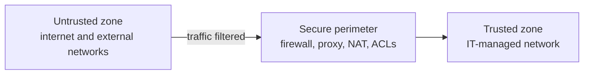
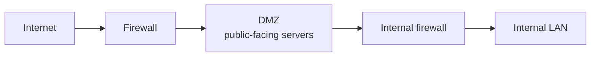
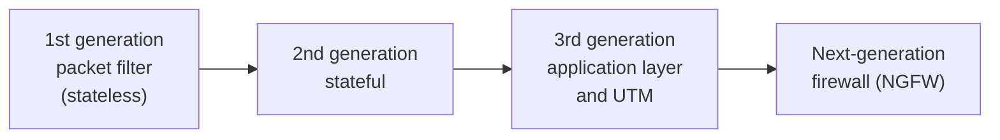
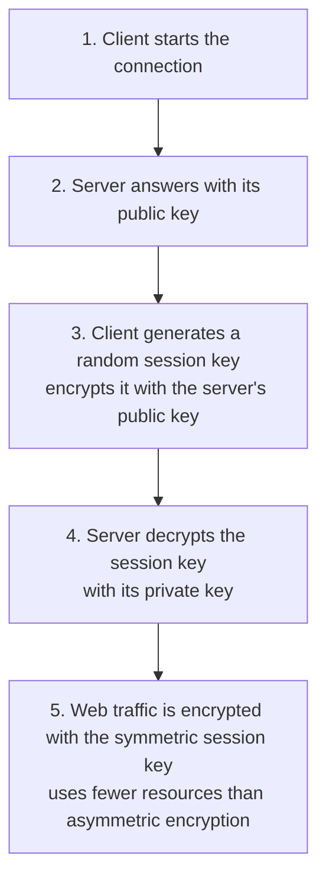
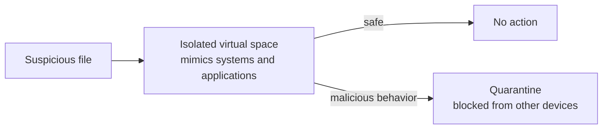
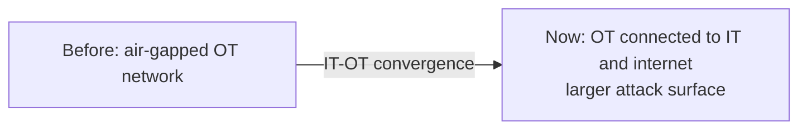

# Module 6: Secure Network

This module covers how networks are protected. You will compare the two main secure network models (**secure perimeter** and **zero trust**), see how **SD-WAN** and **SASE** secure and manage WAN traffic, and learn the key elements of a secure network: **centralized management, segmentation, firewalls, secure switching, encryption protocols, sandboxing**, common **network threats**, and **operational technology (OT) security**.

---

## 📚 Table of Contents

- [🎯 Learning Objectives](#-learning-objectives)
- [Lesson 1: Secure Network Overview](#lesson-1-secure-network-overview)
  - [1.1 What Is Network Security?](#11-what-is-network-security)
  - [1.2 The Two Secure Network Models](#12-the-two-secure-network-models)
  - [1.3 SD-WAN vs SASE](#13-sd-wan-vs-sase)
  - [1.4 What You Will Learn in This Module](#14-what-you-will-learn-in-this-module)
- [Lesson 2: Secure Perimeter](#lesson-2-secure-perimeter)
  - [2.1 What Is a Secure Perimeter?](#21-what-is-a-secure-perimeter)
  - [2.2 Perimeter Filtering by OSI Layer](#22-perimeter-filtering-by-osi-layer)
  - [2.3 Limitations of Secure Perimeters](#23-limitations-of-secure-perimeters)
- [Lesson 3: Zero Trust Principles](#lesson-3-zero-trust-principles)
  - [3.1 What Is Zero Trust?](#31-what-is-zero-trust)
  - [3.2 The Three Principles](#32-the-three-principles)
  - [3.3 Perimeter vs Zero Trust](#33-perimeter-vs-zero-trust)
  - [3.4 Implementing Zero Trust](#34-implementing-zero-trust)
- [Lesson 4: Centralized Security Network Management](#lesson-4-centralized-security-network-management)
  - [4.1 What Is Centralized Security Network Management?](#41-what-is-centralized-security-network-management)
  - [4.2 Data Fabric](#42-data-fabric)
  - [4.3 Fortinet Security Fabric](#43-fortinet-security-fabric)
  - [4.4 Benefits](#44-benefits)
- [Lesson 5: Network Segmentation](#lesson-5-network-segmentation)
  - [5.1 What Is Network Segmentation?](#51-what-is-network-segmentation)
  - [5.2 DMZ, North-South and East-West Traffic](#52-dmz-north-south-and-east-west-traffic)
  - [5.3 Physical and Logical Segmentation](#53-physical-and-logical-segmentation)
  - [5.4 Securely Accessing Segments](#54-securely-accessing-segments)
  - [5.5 Benefits of Segmentation](#55-benefits-of-segmentation)
- [Lesson 6: Firewalls](#lesson-6-firewalls)
  - [6.1 What Is a Firewall?](#61-what-is-a-firewall)
  - [6.2 The Four Generations](#62-the-four-generations)
  - [6.3 First Generation: Stateless Firewalls](#63-first-generation-stateless-firewalls)
  - [6.4 Second Generation: Stateful Firewalls](#64-second-generation-stateful-firewalls)
  - [6.5 Third Generation: Application Layer and UTM](#65-third-generation-application-layer-and-utm)
  - [6.6 Next-Generation Firewalls](#66-next-generation-firewalls)
- [Lesson 7: Secure Switching and Ports](#lesson-7-secure-switching-and-ports)
  - [7.1 How Switches Work](#71-how-switches-work)
  - [7.2 Storms](#72-storms)
  - [7.3 MAC Flooding Attacks](#73-mac-flooding-attacks)
  - [7.4 Defenses Against MAC Flooding](#74-defenses-against-mac-flooding)
  - [7.5 Secure Switching Best Practices](#75-secure-switching-best-practices)
- [Lesson 8: Security Protocols](#lesson-8-security-protocols)
  - [8.1 What Is a Security Protocol?](#81-what-is-a-security-protocol)
  - [8.2 S/MIME](#82-smime)
  - [8.3 HTTPS and TLS](#83-https-and-tls)
  - [8.4 SSH](#84-ssh)
- [Lesson 9: Sandbox](#lesson-9-sandbox)
  - [9.1 What Is a Sandbox?](#91-what-is-a-sandbox)
  - [9.2 Why Sandboxing Was Created](#92-why-sandboxing-was-created)
  - [9.3 Three Generations of Sandboxing](#93-three-generations-of-sandboxing)
  - [9.4 FortiSandbox](#94-fortisandbox)
- [Lesson 10: Common Network Threats and Prevention](#lesson-10-common-network-threats-and-prevention)
  - [10.1 Common Network Threats](#101-common-network-threats)
  - [10.2 Denial of Service Attacks](#102-denial-of-service-attacks)
  - [10.3 Preventing Network Threats](#103-preventing-network-threats)
- [Lesson 11: Operational Technology (OT) Security](#lesson-11-operational-technology-ot-security)
  - [11.1 What Is OT and Why It Matters](#111-what-is-ot-and-why-it-matters)
  - [11.2 IT vs OT](#112-it-vs-ot)
  - [11.3 IT-OT Convergence](#113-it-ot-convergence)
  - [11.4 OT Components](#114-ot-components)
  - [11.5 OT Threats and Challenges](#115-ot-threats-and-challenges)
  - [11.6 Benefits and Best Practices of OT Security](#116-benefits-and-best-practices-of-ot-security)
- [🌍 Real-World Scenarios](#-real-world-scenarios)
- [📊 Comparisons](#-comparisons)
- [🧠 Key Takeaways](#-key-takeaways)
- [📝 Quick Revision](#-quick-revision)
- [❓ Knowledge Check](#-knowledge-check)
- [🔗 Related Modules](#-related-modules)

---

## 🎯 Learning Objectives

After completing this module, you will be able to:

- Compare the **secure perimeter** and **zero trust** models and identify the benefits of each.
- Identify how **SD-WAN** and **SASE** secure and manage WAN traffic.
- Describe **centralized security network management** and the Fortinet Security Fabric.
- Explain **network segmentation**, microsegmentation, DMZs, and secure access to segments.
- Describe the **evolution of firewalls** from stateless to next-generation.
- Explain **secure switching**, MAC flooding, and port security.
- Describe **security protocols** (S/MIME, HTTPS/TLS, SSH) and why encryption protocols keep growing.
- Explain **sandboxing** and how it has evolved.
- Describe common **network threats** (spoofing, hijacking, replay, transitive, DoS) and how to prevent them.
- Define **operational technology (OT)**, how it differs from IT, and the common OT threats and best practices.

> 📝 **Note on structure:** The lesson list below follows the course page: **11 lessons** (Lesson 01 Secure Network Overview through Lesson 11 Operational Technology (OT) Security). The module introduction text is placed in Lesson 1.

> 📝 **Note on sources:** The supplied notes mixed original course text with supplementary notes. This README follows the course wording and marks differences with **⚠️ Flagged** callouts and added material with **(added)**.

---

# Lesson 1: Secure Network Overview

This lesson gives the big picture of the module: what network security is, the two main secure network models, the two WAN deployment approaches (SD-WAN and SASE), and the key elements you will study in the lessons that follow.

## 1.1 What Is Network Security?

> 💡 **Definition (course):** **Network security** is composed of **configurations and rules implemented on devices and systems** in the network.

- These rules ensure the **integrity, privacy, and usefulness** of the network.
- They cover both the **hardware and software** that make the network run.
- Security measures can be applied to **individual devices** or to **groups of components with the same level of vulnerability**.

> ⚠️ **Challenge:** Network threats keep **evolving** while the **attack surface is growing**. Keeping the network secure requires knowing the **concepts, models, and elements** around secure networks.

> 🔗 **Connection to Module 1 (added):** *Integrity* and *privacy* (confidentiality) are two of the three goals of the [CIA triad](Module-01-README.md#the-cia-triad), and *usefulness* is close to *availability*.

---

## 1.2 The Two Secure Network Models

| | **Secure Perimeter** | **Zero Trust** |
|---|----------------------|----------------|
| **Trust** | Anyone **inside** the perimeter is trusted. Anyone **outside** isn't | Every user and device is **untrusted by default**. No one gets explicit, full access |
| **Verification** | At **initial access**, using predefined rules and common policies | **Continuous**, with fine-grained rules and adaptive policies |
| **Segmentation** | Not microsegmented | **Microsegmentation** using the **principle of least privilege**. It minimizes the attack surface and prevents **lateral movement** |

Details: [Lesson 2: Secure Perimeter](#lesson-2-secure-perimeter) and [Lesson 3: Zero Trust Principles](#lesson-3-zero-trust-principles).

---

## 1.3 SD-WAN vs SASE

| | **SD-WAN** | **SASE** |
|---|-----------|----------|
| **Concept** | Creates a **logical network over the physical network** | **Cloud-based** and **globally distributed** through an **as-a-service** deployment |
| **Security** | **Available but not included by default** | **Built in** |
| **Connects** | **Branch offices** to networks, routing traffic by the organization's **configured policies** | **Endpoints to the edge**, sending traffic through globally distributed **points of presence (PoPs)** |

> 📖 **Added (from supplementary notes):** SASE (*Secure Access Service Edge*) combines networking and security capabilities into a cloud-delivered service. It can include SD-WAN, a **secure web gateway (SWG)**, a **cloud access security broker (CASB)**, **firewall as a service (FWaaS)**, and **zero trust network access (ZTNA)**.
>
> 🧠 **Easy memory:** **SD-WAN** answers *how should traffic travel between locations?* **SASE** answers *how should it travel and be secured wherever the user is?*

| Feature | SD-WAN | SASE (from the supplementary notes) |
|---------|--------|-------------------------------------|
| Main focus | WAN connectivity and traffic management | Networking combined with cloud-delivered security |
| Architecture | Overlay network over physical WAN links | Distributed cloud security and networking services |
| Example | Select the best link for branch traffic | Secure remote user access to company applications |

> 📝 **Note:** SD-WAN also appears as an *overlay* in [Lesson 5: Network Segmentation](#lesson-5-network-segmentation).

---

## 1.4 What You Will Learn in This Module

You will be able to:

- Compare the two main secure network models, **secure perimeter** and **zero trust**, and identify the benefits of each.
- Identify how network deployments such as **SD-WAN** and **SASE** secure and manage WAN traffic.
- Become familiar with the **key elements of a secure network**, such as a **firewall**.
- Explain **why encryption protocols are growing** in secure networks.
- Understand **how common network threats work**.

| Key Element | Where It Is Covered |
|-------------|---------------------|
| Secure perimeter | [Lesson 2](#lesson-2-secure-perimeter) |
| Zero trust | [Lesson 3](#lesson-3-zero-trust-principles) |
| Centralized security network management | [Lesson 4](#lesson-4-centralized-security-network-management) |
| Network segmentation | [Lesson 5](#lesson-5-network-segmentation) |
| Firewalls | [Lesson 6](#lesson-6-firewalls) |
| Secure switching and ports | [Lesson 7](#lesson-7-secure-switching-and-ports) |
| Security protocols (encryption) | [Lesson 8](#lesson-8-security-protocols) |
| Sandbox | [Lesson 9](#lesson-9-sandbox) |
| Common network threats and prevention | [Lesson 10](#lesson-10-common-network-threats-and-prevention) |
| Operational technology (OT) security | [Lesson 11](#lesson-11-operational-technology-ot-security) |

> 🎯 **Exam Focus:** The course ends the module with a quiz to validate your progress. The Knowledge Check in this README is my own.

---

# Lesson 2: Secure Perimeter

After this lesson you will be able to define a secure perimeter, describe data flow through it, and explain its limitations.

## 2.1 What Is a Secure Perimeter?

> 💡 **Definition:** A **secure perimeter** is a form of protection made up of **devices or techniques added to the edge of a managed network**.

- The **trusted zone** is the IT-managed portion of devices and applications across the LANs that join to form a WAN.
- A **remote office device** can be part of the perimeter if it connects to the trusted zone using **secure remote access**.
- 🏰 **Analogy:** Everything inside is protected like a **castle surrounded by a moat**. Everything outside is **untrusted**.
- Specific devices and applications act like **guards at the drawbridge**, checking and evaluating traffic. They use **authentication and authorization** applications that protect and provide **confidentiality** while **filtering traffic** to the trusted zone.



---

## 2.2 Perimeter Filtering by OSI Layer

| OSI Layer | Method | What It Does |
|-----------|--------|--------------|
| **Data link** | **MAC filtering** | An IT manager creates an **access control list (ACL)**, a defined list of devices with **known MAC addresses**. Only those devices pass |
| **Transport** | **Packet filtering** | Allows or denies packets based on **configured rules** |
| **Transport** | **NAT filtering** | Translates **public to private** and **private to public** IP addresses (and sometimes ports) so internal resources can be reached from the internet |
| **Application** | **Proxy filtering** | A gateway that **hides the internal user from the internet** |
| **Application** | **Application layer gateway (ALG)** | Inspects packets **up to Layer 7**, letting the device **open TCP/UDP data ports dynamically** |

**Packet filtering types:**

| Stateless | Stateful |
|-----------|----------|
| Each packet is checked on its own: **IP addresses, source and destination ports, protocol** | The device tracks the **5-tuple** and the **TCP/IP connection state**. **Return traffic** is valid only if it matches corresponding incoming traffic |

**ALG example:** protocols like **FTP** or **SIP** use a **control connection** that provides the port used for data. The perimeter device opens that **temporary port only for the matching session**.

> ⚠️ **Flagged (added by supplementary notes):**
> - The course describes proxy filtering as working "through the **man-in-the-middle** mechanism." A legitimate security proxy sits between client and server, but it is **not** a malicious MITM attack. Some proxies inspect HTTPS using an **organization-managed certificate**.
> - **MAC filtering** can be bypassed by **MAC spoofing**, so it is not strong authentication on its own.
> - **NAT** is not a replacement for a firewall.

> 📖 **Beginner Explanation (added):** The **5-tuple** is source IP, destination IP, source port, destination port, and protocol. NAT types include **static** (one-to-one), **dynamic** (pool), and **PAT** (many private addresses share one public address using ports).

---

## 2.3 Limitations of Secure Perimeters

Secure perimeters struggle with modern trends:

- **Remote working**
- **Bring your own device (BYOD)**
- **Internet of Things (IoT)**
- The **cloud** working model

IT departments find it harder to **update the perimeter dynamically**. These drawbacks led to the **zero trust** principle, built on the **evolution of the secure perimeter** and widely used to ensure greater trust.

> 🌍 **Real-world Scenario (added):** An employee connects to the office VPN with an infected laptop. If everything inside the VPN is trusted, malware can move from that laptop to internal servers.

---

# Lesson 3: Zero Trust Principles

After this lesson you will be able to explain the three principles of zero trust, describe its benefits compared with perimeter defense, and describe methods used to implement it.

## 3.1 What Is Zero Trust?

> 💡 **Definition:** In the **zero-trust** model, trust must be **explicitly derived from a mix of identity-based and context-based aspects**.

- Zero trust is **not a single product or service** you can buy. It is a **security concept or strategy**.

**Why the perimeter model struggles:**

- Perimeter networks are **closed, self-contained units** with firewalls like drawbridges. **VPNs** secure remote users and LAN-to-LAN links. Users authenticate with a **user name and password**, and the network assigns **roles**.
- If **credentials are compromised** or a **device is infected**, malware can **move laterally** across the network, infect other devices, and perhaps **exfiltrate valuable information**.
- 🐴 This resembles the **Trojan horse** myth: once the horse was inside Troy's walls, there was no way to prevent the attack.
- Business transformation is **decentralizing networks**: some components on-premises, some in a **private cloud**, others in the **public cloud**. With **BYOD, IoT, and remote workers**, the attack surface and number of attack vectors have grown drastically.

---

## 3.2 The Three Principles

| # | Principle | Meaning |
|---|-----------|---------|
| 1 | **Never trust** | **Always authenticate** a user or device to determine identity and verify what resources it is authorized to access |
| 2 | **Implement least privilege** | Users and devices get access **only to the resources they need** for their jobs or functions |
| 3 | **Assume the network is already breached** | Take precautions, such as **reducing the attack surface** |

### 🔑 Never Trust

- Demand the **identity of users and devices on an ongoing basis**, strengthened with **MFA**.
- Restrict access using **context**: the **time and date** of the request, the **geographic location** of the device, and the device's **security posture**.

> 📖 **Beginner Explanation (added): MFA factors:** something you **know** (password), something you **have** (token or authenticator app), something you **are** (fingerprint).

### 🔑 Least Privilege

Tools to deploy:

- A **privileged access management (PAM)** system
- Defining the **protect surface**
- Applying the **Kipling method**

### 🔑 Assume Breach

- **Prepare contingencies** for the worst situations, so plans can be invoked immediately after a breach.
- **Segment the network** into smaller sections to **restrict lateral movement**.

> 🔗 **Connection to Module 4:** Reducing the attack surface ties to [attack vector vs attack surface](Module-04-README.md#32-attack-vector-vs-attack-surface).

---

## 3.3 Perimeter vs Zero Trust

| Feature | Secure Perimeter | Zero Trust |
|---------|------------------|------------|
| Trust model | Trust inside, distrust outside | No automatic trust. A **no-trust zone** |
| Verification | Often at initial access | Proven through **MFA**, with risk judged by **context-based assessment** |
| Access | Broad policies | **Least privilege** for users, devices, and applications |
| Lateral movement | **Could not be restricted** | **Microsegmentation isolates** a compromised device or segment |
| Main concern | The network boundary | Each resource and access path |

> 📖 **Added nuance:** Zero trust doesn't mean typing your password every few seconds. Policies, sessions, and risk signals decide when to **re-verify**, such as when context changes or risk increases.

---

## 3.4 Implementing Zero Trust

| Method | Meaning |
|--------|---------|
| **PAM (privileged access management)** | Controls and monitors accounts with elevated permissions |
| **Protect surface** | A thorough review of the assets that need protection |
| **Kipling method** | Asking **what, why, when, where, and how** (the course's list) about access to reduce the attack surface |
| **Zero trust access (ZTA)** | A secure access method using **role-based access control**. Once identified, a user gets a **role** (employee, guest, contractor) that determines their resources. A user can have **more than one role** |
| **Endpoint software agents** | Report the device's **operating system, patch level, installed software**, and more, to assess its **risk** |
| **Network access control (NAC)** | **Identifies devices** on the network, giving IT security more visibility and control |
| **ZTNA (zero trust network access)** | Technology that automatically establishes a **secure session** between the end entity and the network **regardless of location**, with **granular control** of application access |

> ⚠️ **Flagged (added by supplementary notes):** The Kipling method usually has **six** questions: **who**, what, when, where, why, and how. The course text lists five. The course also calls ZTA "zero trust *access*," while many sources use "zero trust *architecture*." Know the course wording, and watch for both.

> 🎯 **Exam Focus:** Least privilege tightens restrictions on resource access. Preparing for the worst case means you are ready when a breach occurs. **Microsegmentation** isolates compromised parts.

---

# Lesson 4: Centralized Security Network Management

## 4.1 What Is Centralized Security Network Management?

> 💡 **Definition:** **Centralized security network management** is gathering **security-related data from various devices and applications into one central location**.

**How data is gathered:**

| Method | Notes |
|--------|-------|
| **Logs** | Record events and alerts |
| **SNMP (simple network management protocol)** | Collects information from network devices |
| **API (application programming interface)** | Also allows **scripting**, which can **reduce manual tasks and human error** |

**Objective:** a comprehensive view of network security status through typical management actions: **configuring, controlling, operating, and diagnosing** a security network.

> 📖 **Added (supplementary notes):** SNMPv3 supports authentication and encryption and is preferred over SNMPv1 and v2c for security-sensitive monitoring.

---

## 4.2 Data Fabric

In an expanding network (more IoT, remote users, cloud), administrators need **dynamic and elastic** centralized management. A possible solution is **data fabric**.

- **Data fabric architecture** (as defined by **Gartner**) lets you **monitor and manage data and applications wherever they are**, while staying **centrally governed**.
- 🧵 Like a **needle and thread**, it stitches the parts of the security network into a tapestry.
- It uses **AI** to consolidate more relevant data as data accumulates, improving decision-making. For example, repetitive tasks are first done **manually**. Over time **AI observes** them and begins to **automate** them, and through **machine learning (ML)** also makes **recommendations**.

---

## 4.3 Fortinet Security Fabric

The **Fortinet Security Fabric** is the course's example of centralized management:

- An **open ecosystem** of **APIs and fabric connectors** that integrate partners.
- A broad view of security and the network through the **Fabric Management Center**, with **end-to-end visibility**.
- Linked with **FortiGuard AI-powered security** for fast, coordinated detection.
- **Automation** makes dynamic adjustments to secure the entire attack surface through **zero-trust access**.

> 📖 **Added examples of products in the ecosystem:** **FortiGate** (next-generation firewall), **FortiManager** (central management), **FortiAnalyzer** (logging and reporting), **FortiClient** (endpoints), **FortiGuard** (threat intelligence). See [Module 2: Fortinet products](Module-02-README.md#69-fortinet-products-for-outbreak-defense).

---

## 4.4 Benefits

- **Broad visibility** with centralized reports and simpler analysis of security events. It helps avoid security issues, **reduces incident response time**, and minimizes disruptions.
- **Device integration**: central definition of **configurations and policy orchestration**.
- **Fewer repetitive and manual tasks**.
- **Easier maintenance**, from applying patches and updates to monitoring. This improves protection of the **entire digital attack surface** and **risk management**.
- **Easier capacity planning** and performance forecasts.
- **Easier compliance audits**.

---

# Lesson 5: Network Segmentation

## 5.1 What Is Network Segmentation?

> 💡 **Definition:** **Network segmentation** divides a network into **smaller, isolated segments**, so IT managers can better control and protect a large network from **breaches or malfunctions**.

- 🚢 **Analogy:** The compartments of a **submarine** are isolated, so if one floods, the others stay dry.
- Devices and applications with **similar functions** are grouped for easier management. An **HR** subnetwork operates separately from a **sales** subnetwork, which prevents confidential information from leaking between groups.

> ⚠️ **Added note:** Separate subnets alone don't guarantee security. **Routing and firewall policies** must enforce the separation.

---

## 5.2 DMZ, North-South and East-West Traffic

> 💡 **DMZ (demilitarized zone):** A segment where servers that must be **accessible from the internet** are placed, **separated from the internal network**. Internet users reach those servers without gaining access to the rest of the network.



| Term | Meaning |
|------|---------|
| **North-south traffic** | Traffic moving **in and out of the DMZ** (the course's classification) |
| **Microsegmentation** | The DMZ can be compartmentalized further. **Each resource** (hosts, users, applications) is **uniquely identified and protected**, achieved through **zero trust** |
| **East-west traffic** | Traffic that moves **across a specific data center or cloud network** |

> 📖 **Added:** More generally, north-south is traffic entering or leaving a network, and east-west is traffic between internal systems. Attackers can abuse poorly controlled east-west traffic to move between servers, which microsegmentation helps stop.

---

## 5.3 Physical and Logical Segmentation

| Type | How It Works | OSI Level (from the course) |
|------|--------------|-----------------------------|
| **Physical** | Uses **firewalls and hardware** such as routers and switches to break the network into physical sections or **subnets** | **Network layer**: a larger internal network is split into subnetworks. Data flow between subnets is limited by **firewall policies, ACLs, and routers** |
| **Logical** | Breaks networks into smaller sections, **often without new hardware or wiring** | **Data link layer**: **VLANs** let groups of devices communicate through switches *as if on the same wire* |
| **SD-WAN** | The physical network (the **underlay**) has an **overlay** network with **tunnel-encrypted virtual paths** | Described by the course as **application layer** |

> ⚠️ **Flagged (added by supplementary notes):** The course associates physical segmentation with Layer 3. In practice, *physical* separation (separate switches, cabling, or interfaces) is a design choice, while *routed subnet* separation works at Layer 3. They are related but not the same. Also, **SD-WAN does not guarantee security** or encryption by itself. That depends on the solution and configuration.

<details>
<summary>📖 Example (added): VLANs on a Cisco switch</summary>

```text
vlan 10
 name HR
vlan 20
 name FINANCE
interface fastEthernet 0/1
 switchport mode access
 switchport access vlan 10
interface fastEthernet 0/2
 switchport mode access
 switchport access vlan 20
```

Devices in different VLANs need a Layer 3 device (router or Layer 3 switch) to communicate, and **ACLs or firewall policies** should control that traffic.

</details>

---

## 5.4 Securely Accessing Segments

| Method | Description |
|--------|-------------|
| **Jump box** | A device with **enhanced access control and limited authorization** that acts as a **proxy** to devices in the internal segment. It has **extra monitoring and logging** to alert the IT manager if compromised |
| **Bastion host** | A server or computer whose purpose is to provide **access to a private network from an external network**. It is **configured to withstand attacks** and lets users reach subnets through **just one application**. It provides secure **SSH and RDP** connections to the internal segment |

> 📖 **Added comparison:** A jump box is usually an intermediate **administration** point. A bastion host is a hardened gateway often placed in a **DMZ** or boundary. The terms overlap in practice.

---

## 5.5 Benefits of Segmentation

- **Easier configuration**: the same parameters for a small subnetwork.
- **Fewer network broadcasts**: broadcasts stay within their subnet.
- **Less congestion**: traffic in one segment doesn't affect the rest.
- **Attacks limited to one segment**.
- **Greater protection for vulnerable devices**.
- **Compliance affects a smaller scope**, limiting costs.

---

# Lesson 6: Firewalls

After this lesson you will be able to define firewalls and their evolution, describe how they work, and explain the latest firewall status.

## 6.1 What Is a Firewall?

> 💡 **Definition (added from supplementary notes):** A **firewall** is a hardware device or software that **monitors incoming and outgoing network traffic** and decides whether to **allow or block** it based on **predefined security rules**.

> 🌍 **Analogy:** Like security guards at an office building who check who may enter and leave, a firewall checks **network traffic (data packets)** instead of people.

> 📖 **Course framing:** As networks grew, interconnected, and eventually connected to the internet, it became important to **control the flow of network traffic**. Firewalls became that means of control, and they had to **evolve alongside networks**. They are classified into **generations** (next section).

---

## 6.2 The Four Generations

As networks grew and connected to the internet, controlling traffic became important, and firewalls had to evolve with them.



> 🧠 **Remember:** 1st checks the packet. 2nd remembers the connection. 3rd understands the application. NGFW adds advanced, multi-layered security.

---

## 6.3 First Generation: Stateless Firewalls

> 💡 **Definition:** A **packet filter** (**stateless**) firewall examines **routing and transport layer information**: **source and destination addresses, protocols, and port numbers**. Policies use these attributes to decide which packets pass.

- Rules form an **ordered list**, matched **top to bottom**.
- The **last policy** can be **implicit** (deny by default) or **explicit** (perform a configured allow or deny).
- A matching packet passes. Otherwise it is **silently dropped or blocked**.

**Drawbacks:**

- Needs **extra configuration**. For example, an **additional policy for return traffic** in a session.
- Fails to manage protocols that **open random ports and use multiple connections**, like **FTP** (control and data connections).
- A **"one-size-fits-all"** approach. Bad actors can bypass rules and **inject rogue packets** through acceptable protocols and ports, or exploit **bugs in networking software**.

---

## 6.4 Second Generation: Stateful Firewalls

> 💡 **Definition:** A **stateful firewall** observes network connections over time, tracking the **5-tuple** and the **connection state** in its **session table**.

- It watches new connections form and **continuously examines traffic** both ways.
- If a connection behaves improperly, or **return traffic doesn't match** the corresponding incoming traffic, the firewall **blocks it**. Any packet **not part of a known conversation** or not matching an allowed policy is **dropped**.

**Drawback:** it still **cannot block rogue packets using an acceptable protocol**, such as **HTTP**. Since HTTP serves static text, e-commerce, file hosting, and other applications, and **all use the same port number**, the firewall cannot tell them apart. Firewalls had to look **deeper into the data payloads**.

---

## 6.5 Third Generation: Application Layer and UTM

> 💡 **Definition:** The third generation is still stateful, but it **understands application layer protocols** and controls different uses of the same basic protocol. This is **application layer filtering**. It understands protocols such as **HTTP, FTP, and DNS**.

- For HTTP it can distinguish **browser traffic, a blog, a file sharing site, e-commerce, social media, VoIP, and email**.
- **UTM (unified threat management)** firewalls also combine **antivirus, antispam, an intrusion prevention system (IPS), and a VPN**.

> ⚠️ **Note:** In the course, "UTM" is described in this lesson without a full expansion. "Unified Threat Management" comes from the supplementary notes.

---

## 6.6 Next-Generation Firewalls

**Why they are needed:** the internet changed work and commerce. **Multi-cloud** services, **mobile and IoT** devices expanded the network edges and **attack surface**. Threat actors evolved, and attacks can now come from **trusted users, devices, and applications** that spread malware knowingly or unknowingly. A firewall must prevent evolving attacks **at every edge** while delivering security, reliability, and performance. **Next-generation firewalls (NGFWs)**, such as **FortiGate**, provide these capabilities.

### ✈️ Airport Security Analogy

| Airport Step | NGFW Equivalent |
|--------------|-----------------|
| A security agent checks your **boarding pass** | Looks at packets and makes **rule-based allow or drop** decisions |
| Your **bags are scanned** for banned items | **Deep packet inspection (DPI)** |
| Suspicious items are set aside for **enhanced screening** | Malicious content is sent to a **sandbox** for analysis (see [Lesson 9](#lesson-9-sandbox)) |

### 🔧 Advanced Capabilities

- **Application control**: by **classification** or by **who the user is**. Application-level security helps protect web-browsing clients.
- **Segmentation approaches** that separate users, devices, and applications aligned to business needs. Segmenting instead of a **flat network** removes a **single point of entry**.
- **AI** helps firewalls move from **reactive to proactive**, enforcing security policies.
- **High-performance inspection** and greater visibility with little or no degradation, supporting modern **distributed data centers** in a **hybrid IT infrastructure**. This includes inspecting **applications, compute resources, analytics, encrypted data, and storage** across multiple private and public clouds.

> 📖 **Beginner Explanation (added):** *Multi-cloud* means using more than one cloud provider. A *hybrid* infrastructure mixes on-premises systems with cloud services.

### 📊 Four Generations Compared

| Feature | Stateless | Stateful | Application Layer | NGFW |
|---------|-----------|----------|-------------------|------|
| Packet filtering | Yes | Yes | Yes | Yes |
| Tracks connections | No | Yes | Yes | Yes |
| Understands applications | No | Limited | Yes | Yes |
| Deep packet inspection | No | No | Application-level inspection | Advanced |
| Sandboxing | No | No | Not defining | Can support it |
| AI-based security | No | No | Not defining | Can support it |

---

# Lesson 7: Secure Switching and Ports

After this lesson you will be able to define secure switching and ports, describe common threats, and identify best practices.

## 7.1 How Switches Work

- Switches operate at the **data link layer** of the OSI model. In the course's description they **assign packets to VLANs** based on the **source MAC address** of the frame.
- They keep port information (port capabilities, **VLAN parameters**, and **MAC addresses** of connected devices) in a **content-addressable memory (CAM) table**, and send frames to the corresponding ports.
- **Without secure switching**, switches are vulnerable to attacks at the data link layer.

> 📖 **Beginner Explanation (added):** The CAM table works like a MAC address table: it maps *MAC address + VLAN* to a *port*, so a frame goes only where it needs to.

---

## 7.2 Storms

- The CAM table allows faster forwarding and fewer collisions, but by default switches are prone to **storms**.
- A storm can flood a **broadcast, unicast, or multicast** frame when its **MAC address is not in the CAM table**.
- To avoid excessive flooding, a switch can limit the **maximum number of broadcast, unknown unicast, and multicast packets per second** on a port using a **configurable threshold**.

> 📖 **Added:** This protection is commonly called **storm control**. Flooding an unknown destination is normal switch behavior, and it becomes a problem only when it is excessive.

---

## 7.3 MAC Flooding Attacks

> 💡 **Definition:** In a **MAC flooding attack**, an attacker exploits how flood attacks work by filling the switch's **CAM table** with fake MAC addresses (**MAC spoofing**).

**Course example:** a switch with one VLAN and four ports. Its CAM table has one entry, for **device C** on **port 3**.

1. **Device C is compromised** and sends frames with **spoofed source MAC addresses E, F, and G**.
2. The switch learns the fake MACs on **port 3**.
3. Once the table is **full**, the switch **can't learn more** MAC addresses.
4. **Device A** sends a frame on port 1, but its MAC address **isn't added** to the full table.
5. **Device D** sends a frame to **A**. The switch doesn't know where A is, so it **floods the frame to all ports**.

**Two effects:**

| Effect | Meaning |
|--------|---------|
| **Denial of service** | Flooding **disrupts legitimate traffic** |
| **Information exposure** | The compromised device C **receives sensitive information** from other devices, such as D |

---

## 7.4 Defenses Against MAC Flooding

| Defense | How It Works |
|---------|--------------|
| **Limit entries per port or VLAN** | With a limit of **one entry per port**, spoofed frames from device C create no extra entries and are **dropped**. A's and D's MACs are then learned and frames are forwarded directly |
| **Dynamic MAC addresses** | The switch **learns them automatically**. They are **deleted after their expiry time** |
| **Static MAC addresses** | **Entered manually** for stricter policies. With a one-entry limit, the switch can **completely block spoofing and flooding** on that port |
| **Sticky MAC addresses** | **Learned on the port**, and the entry is **not deleted unless the switch is rebooted** (the course's wording). Removes the burden of typing static addresses |
| **802.1X authentication** | The device must be **authenticated before it can access the switch** |

> ⚠️ **Flagged (added by supplementary notes):** How long sticky entries persist depends on the switch. They can survive reboots if the configuration is saved. Check your device's behavior.

<details>
<summary>📖 Beginner Explanation (added): how 802.1X works</summary>

802.1X is a port-based access control standard with three roles: the **supplicant** (the device asking for access, such as a laptop), the **authenticator** (the switch controlling the port), and the **authentication server** (often a RADIUS server that verifies credentials). If authentication fails, access is denied or restricted.

</details>

---

## 7.5 Secure Switching Best Practices

1. **Protect physical switches locally**, in a closet or restricted room. Restrict management access with **authentication, authorization, and a secure protocol** like **SSH or HTTPS**.
2. **Separate switches** for better physical segmentation, especially between **internal and external networks**, so they can't be compromised at the same time.
3. **Restrict the number of MAC addresses on a port** to limit MAC flooding.
4. Configure **sticky or static MAC addresses** to reduce MAC spoofing and keep the address list up to date in a dynamic environment.
5. Use **ACLs of verified MAC addresses** to filter unverified addresses and prevent MAC flooding.
6. Add **port authentication**, such as **IEEE 802.1X**.
7. Implement **port mirroring** to actively monitor port activity and obtain a **trace** of monitored traffic.

> 📖 **Beginner Explanation (added):** *Port mirroring* copies traffic from a port to a monitoring port, where a tool such as Wireshark can analyze it.

---

# Lesson 8: Security Protocols

After this lesson you will be able to define security protocols and describe different ones.

## 8.1 What Is a Security Protocol?

> 💡 **Definition:** A **protocol** is a set of rules and methods used to establish communication between devices. A **security protocol** protects data delivered through **encrypted communication between two authenticated and legitimate participants**.

> 🌍 **Course analogy:** Two people speak in an uncommon language and think they are private, but a listener with a translator can decode them. To prevent a leak, they use a **code language known only to the two of them**, which is like encrypting data.

**Protocols used to be clear text.** As security became mandatory, they evolved:

| Purpose | Original (clear text) | Secured Version |
|---------|-----------------------|-----------------|
| Email | **MIME** | **S/MIME** |
| Web browsing | **HTTP** | **HTTPS** |
| Remote control | **Telnet** | **SSH** |
| Remote access | **L2TP** | **IPsec** |

> 📖 **Added clarification:** MIME is an email **message format** rather than an encryption protocol. S/MIME adds security to it.

---

## 8.2 S/MIME

1. The email is **signed with the sender's digital signature**.
2. It is then **encrypted with the receiver's public key**.
3. The receiver **decrypts it with their private key**.
4. The digital signature **confirms the sender's identity**.

| Benefit | Provided By |
|---------|-------------|
| **Authentication, non-repudiation, data integrity** | The **digital signature** |
| **Confidentiality** | **End-to-end encryption** |

> 📖 **Added:** In practice the email is encrypted with a **symmetric key**, and that key is protected with the receiver's public key. See [Module 5: Hybrid encryption](Module-05-README.md#37-hybrid-encryption) and [Digital signatures](Module-05-README.md#42-digital-signatures).

---

## 8.3 HTTPS and TLS

**HTTPS** gets its security from **Transport Layer Security (TLS)**.



- The default HTTPS port is **443**. (HTTP is **80**.)

**Course statement on MITM:** because the description **does not include authentication between client and server**, the communication is subject to a **man-in-the-middle (MITM)** attack, where an intermediate device **intercepts the initial HTTPS connection** on port 443 and **creates two sessions**.

> ⚠️ **Flagged (added by supplementary notes):** This is misleading. In normal TLS the **server is authenticated through its certificate**, and a properly implemented HTTPS connection with valid certificate verification is designed to prevent this interception. See [Module 5: Digital certificates](Module-05-README.md#52-digital-certificates). The MITM risk described applies when certificates are not verified.

---

## 8.4 SSH

- **SSH** is commonly used for **file transfer (SCP), tunneling, and network management** over default port **22**.
- It performs **end-to-end authentication** of the connection.

**Client authentication (course description):**

1. The **client's public key** is already stored on the SSH server.
2. When the server gets a connection request, it sends back a **random message encrypted with the client's public key**.
3. The client **decrypts it with its private key** and sends it back.
4. If it matches the original message, the **client is authenticated**.

**Further protection:**

- Communication is encrypted using the **Diffie-Hellman (DH) key exchange**.
- **Integrity** comes from a **message authentication code (MAC)** algorithm in **SSH version 2**.

| Telnet | SSH |
|--------|-----|
| Unencrypted, port 23 | Encrypted, port 22 |
| Avoid for secure management | Preferred |

> 📖 **Beginner Explanation (added):** Diffie-Hellman lets two parties agree on a shared secret over an insecure network. See [Module 5: Asymmetric algorithms](Module-05-README.md#35-asymmetric-algorithms).

---

# Lesson 9: Sandbox

After this lesson you will be able to describe a sandbox, why it was created, and how it has evolved.

## 9.1 What Is a Sandbox?

> 💡 **Definition:** A **sandbox** is a system that **confines the actions of an application** (such as opening a Word document or a browser) **within a safe virtual environment**, so malicious intent can be uncovered **without harming the network**.

- If something unexpected or dangerous happens, it affects **only the sandbox**.
- Sandbox technology is typically managed by the **information security team**, but **network, application, and desktop operations teams** also use it.

---

## 9.2 Why Sandboxing Was Created

- Threat actors exploit **vulnerabilities in legitimate applications** to compromise a device, then move through the network.
- **Firewalls and antivirus** stop **known** threats but are **helpless against zero-day attacks**.
- A **zero-day attack** is when a threat actor exploits an **unknown vulnerability**.
- **Sandboxing was created as a defense against zero-day attacks.**



> ⚠️ **Added note:** Sandboxing helps detect unknown threats, but it cannot guarantee detection of every zero-day exploit.

---

## 9.3 Three Generations of Sandboxing

| Generation | Key Features |
|------------|--------------|
| **First** | **Standalone solutions** that couldn't easily share threat intelligence or integrate with other vendors' products, so the **SOC needed a separate console** for each. Consolidating and analyzing data was **hard and slow** |
| **Second** | **Better integration** and **intelligence sharing**. Analysts correlate threat intelligence centrally and respond from a **single pane of glass**. The environment can share with a **cloud threat intelligence service**, which pushes intelligence to other networks |
| **Third** | Built for **AI-driven attacks**, as threat actors use **automation and AI** to speed up exploit development. It is based on a **threat analysis standard**. It helps **detect** breaches in time and also **prevent** them, using the **MITRE ATT&CK** language to categorize threat models. See [Module 2: MITRE ATT&CK](Module-02-README.md#54-mitre-attck) |

---

## 9.4 FortiSandbox

**FortiSandbox** is Fortinet's sandbox product. It:

- Is **high-performance**, using **AI and ML** to identify and isolate advanced threats **in real time**.
- Integrates with other security products in the **Fortinet Security Fabric** (a collective defense).
- Inspects **files, websites, URLs, and network traffic** for malicious activity, including **zero-day threats**.
- Analyzes suspicious files in a **secure virtual environment**.

---

# Lesson 10: Common Network Threats and Prevention

After this lesson you will be able to identify common network threats, understand their effects and prevention, and describe best practices.

## 10.1 Common Network Threats

> 💡 **Definition:** **Network threats** are unlawful or malicious activities that take advantage of network vulnerabilities to **breach, harm, or sabotage** valuable company information. Attackers also want **unauthorized access** to manipulate the network. Motivations can be **political, financial, or retaliatory**.

| Threat | What It Is | Prevention |
|--------|------------|------------|
| **Spoofing** | The attacker **impersonates an authorized device or user** to steal data, spread malware, or bypass access control. Can spoof any identifier, like a **MAC or IP address** | (see [Lesson 7](#lesson-7-secure-switching-and-ports) and [10.3](#103-preventing-network-threats)) |
| **Hijacking** | The attacker **intercepts a connection** to discover and possibly modify communications. **Man-in-the-middle** is an example | **End-to-end encryption with multifactor authentication** |
| **Replay attack** | Delayed rather than real-time: **intercepts and later resends** data. For example, replaying an authentication to reach confidential apps | A **one-time session token** |
| **Transitive attack** | Uses the **trust chain** between devices. If A trusts B, and B trusts C, then A could trust C. One corrupted device can lead to attack on the others | **Zero trust** |
| **Denial of service (DoS)** | Exhausts network resources to **block legitimate requests**, like a **traffic jam blocking emergency vehicles**. Often uses **botnets** | See [10.3](#103-preventing-network-threats) |

> 📖 **Added:** Replay defenses also include **nonces**, **timestamps**, and **sequence numbers**. See [Module 4: Botnets](Module-04-README.md#34-botnets-and-command-and-control).

---

## 10.2 Denial of Service Attacks

**Examples:** flood attacks (smurf, fraggle, SYN flood, Christmas tree), ping of death, teardrop, permanent DoS, and fork bomb.

| Attack | How It Works |
|--------|--------------|
| **Flood attacks** | Aim to **overwhelm a device**, usually by a **botnet** using **connectionless traffic** like UDP or ICMP |
| ↳ **Smurf** | The attacker **spoofs the victim's source IP** and **broadcasts an ICMP packet** to a network. Most devices **reply to the victim**, flooding it |
| ↳ **Fraggle** | Like smurf, but it sends a **spoofed UDP packet** to the router's **broadcast address** |
| ↳ **SYN flood** | A **protocol attack** on servers, proxies, or firewalls. The attacker creates an **incomplete TCP three-way handshake**, and the device **waits on half-open connections**, exhausting its resources |
| ↳ **Christmas tree** | Sends multiple TCP packets with the **FIN, URG, and PSH flags** set. They need more processing and can make routers and hosts **crash or reboot**. A **protocol analyzer** can identify them |
| **Ping of death** | A ping is typically **under 100 bytes**. This attack creates packets **larger than 65,535 bytes**. The source fragments them, and when the target reassembles them, a **buffer overflow or crash** can occur |
| **Teardrop** | Sends **fragmented packets with overlapping and oversized payloads**. Reassembly makes the fragments overlap, **crashing the target device** |
| **PDoS (permanent DoS)** | Exploits device vulnerabilities to **replace the software with a corrupted firmware image**, rendering the device useless. A **reboot isn't enough**. Recovery needs **reinstalling correct firmware or replacing hardware** |
| **Fork bomb** | A **fork** is a Unix/Linux system call that **replicates a process**. A fork loop keeps **replicating through child processes**, consuming CPU and memory, possibly causing a **kernel panic** that locks the system |

> 🧠 **Remember:** **Smurf = ICMP. Fraggle = UDP.**

> 📖 **Beginner Explanation (added):** In a normal TCP handshake the client sends **SYN**, the server replies **SYN-ACK**, and the client sends **ACK**. In a SYN flood the final ACK never arrives.

> 📖 **Added: DoS vs DDoS.** A DoS comes from one or a few sources. A **DDoS (distributed DoS)** comes from many distributed sources, such as a botnet, and is harder to block.

> 🔗 **Connection to Module 1:** DoS attacks the **Availability** part of the [CIA triad](Module-01-README.md#the-dad-triad) (the *D* in DAD).

---

## 10.3 Preventing Network Threats

| Attack | Prevention (from the course) |
|--------|------------------------------|
| Ping of death, Christmas tree, teardrop | Firewalls and other network devices run **anomaly checks of packets** |
| Fork bomb | **Limit the number of processes a user can own** |
| Smurf, fraggle | **Routers no longer forward packets** directed at their **broadcast addresses** |
| Floods in general | Firewall mechanisms such as **DoS sensors** or **network behavior analyzers using AI** keep traffic under expected amounts |

> 📖 **Added:** SYN floods are also reduced with **SYN cookies and rate limiting**.

**Two important best practices:**

1. **Close unnecessary ports.** Neglecting this is like leaving doors and windows open at home. A **port scan tool such as Nmap** gives a list of open ports. If a port can't be closed on the server itself, create a **firewall policy** blocking it on the front firewall, such as **FortiGate**.
2. **Fix known vulnerabilities.** Find them with a **penetration test** and **update network devices regularly with the latest patches**.

Like **network segmentation** and **zero-trust** principles, these are part of **hardening measures**.

> 📖 **Beginner Explanation (added):** *Hardening* means reducing weaknesses and unnecessary exposure in systems and networks. See [Module 2: Penetration testing](Module-02-README.md#23-penetration-testing).

---

# Lesson 11: Operational Technology (OT) Security

After this lesson you will be able to define OT, understand why OT security matters, tell IT from OT, identify common OT components, and recognize common OT threats and challenges.

## 11.1 What Is OT and Why It Matters

> 💡 **Definition:** **Operational technology (OT)** is hardware and software that **monitor and control physical devices, processes, and infrastructure**.

> 🌍 **Course scenario:** A major city has a sudden power outage. Traffic lights fail, water pumps shut down, and fuel distribution stops. These cascading failures can happen when OT systems are attacked.

- A cyberattack on OT can cause **operational disruption, environmental damage, or risk to public safety**.
- **OT security** protects operational systems from cyberthreats to ensure **safe, reliable, and continuous operation**.

### 🌍 Real-World OT Cyberattacks

| Case | What Happened |
|------|---------------|
| **University Hospital Düsseldorf (2020)** | A cyberattack disrupted IT systems, **halting treatment and emergency care** and causing patient diversion and delays |
| **Saudi Arabian industrial facility (2017)** | The **Triton** malware targeted **safety instrumented systems** in the oil and petrochemical sector, designed to manipulate safety controls and risking severe physical damage and human safety |
| **Nigeria Customs Service (August 2025)** | An attack disrupted its ICT platform, **B'Odogwu**, impairing cargo clearance at major ports, leaving goods stranded and causing demurrage and storage costs |

---

## 11.2 IT vs OT

| | **IT** | **OT** |
|---|--------|--------|
| **Purpose** | Manage information: processing, storing, transmitting data. Supports business systems and communications | **Control physical processes**, run machines, manage infrastructure |
| **Priority** | **Data confidentiality and integrity** | **Reliability, availability, stability, and safety** of physical operations |
| **Timing** | Tolerates some delay | Requires **real-time traffic without delays** |

> 📖 **Added example:** If IT goes down, employees may lose email. If OT goes down, a production line may stop completely, or machines may operate dangerously.

---

## 11.3 IT-OT Convergence

- Historically OT systems operated **in isolation** from IT networks and the internet. This **"air gap"** acted as a natural security barrier.
- **IT-OT convergence** integrates OT with enterprise IT for **real-time visibility, remote access, and efficiency**.
- Connecting a previously air-gapped OT network to the internet through the IT network **immediately exposes** the OT environment and all connected devices. As connectivity expands, so does the **attack surface**.



> ⚠️ **Flagged (added by supplementary notes):** Air gaps are not an absolute guarantee. Removable media, maintenance laptops, and other pathways can still introduce threats.

---

## 11.4 OT Components

| Component | Meaning |
|-----------|---------|
| **Industrial control systems (ICS)** | A subset of OT that monitors and controls industrial processes. Includes **SCADA, PLC, and DCS** |
| ↳ **SCADA** | **Centralized control and monitoring** of processes spread across **large geographic areas**, such as pipelines, power grids, and water systems |
| ↳ **PLC** | **Ruggedized industrial computers** that automate machinery on the factory floor, running **preprogrammed logic** from real-time sensor input |
| ↳ **DCS** | Controls **large, complex processes** (oil refining, chemical manufacturing) where **multiple control loops** operate at once |
| **Industrial IoT (IIoT)** | Interconnected **devices and sensors** in industrial environments for data collection, analysis, and automation. Bridges OT with IT, supporting **real-time monitoring and predictive maintenance** |
| **Human-machine interface (HMI)** | **Operator dashboards** that display real-time system data and allow control of processes |
| **Remote terminal unit (RTU)** | **Field devices** that collect data from physical equipment and send it to central **SCADA** systems, often in remote locations |

---

## 11.5 OT Threats and Challenges

### 🚨 Common OT Threats

| Threat | Meaning |
|--------|---------|
| **Malware** | Malicious software that disrupts or damages OT, compromises integrity, or enables further intrusion |
| **Ransomware** | Encrypts systems or restricts access until payment. Can **halt production** and disrupt critical services |
| **Targeted supply chain attacks** | Threat actors compromise a **trusted third-party vendor or software provider** to reach OT environments |
| **Insider threats** | Malicious or negligent actions by employees, contractors, or vendors with legitimate access. Authorized access can **bypass perimeter controls** |
| **Unauthorized remote access** | Poorly secured remote access pathways give attackers entry into industrial control systems |
| **Nation-state actors and APTs** | State-sponsored groups targeting critical infrastructure (energy, water, defense) for **espionage, disruption, or sabotage** |

> 🔗 See [Module 3: Insider threats](Module-03-README.md#41-what-is-an-insider-threat), [Module 4: Ransomware](Module-04-README.md#24-other-malware-types), and [Module 2: APTs](Module-02-README.md#51-attack-frameworks-and-apts).

### 🧱 Challenges

- **Legacy technologies** that can't easily support modern security tools.
- **Zero-downtime requirements** make patching hard without disrupting production.
- **Limited visibility** into network activity.
- Many industrial **protocols lack built-in security**, such as encryption.
- Traditional OT networks often **lack segmentation**, so threats move easily once inside.

---

## 11.6 Benefits and Best Practices of OT Security

### ✅ Benefits

| Benefit | Meaning |
|---------|---------|
| **Operational continuity** | Processes keep running. Unplanned downtime can cascade to services, supply chains, and communities |
| **Continuous monitoring and visibility** | Detect known and emerging threats by identifying connected devices, profiling traffic, and defining the attack surface |
| **Control of systems** | Systems perform **only their intended functions**, using **MFA, segmentation, microsegmentation, and sandboxing** |
| **Regulatory compliance** | Helps meet strict requirements (for example power grids and medical devices) and avoid penalties and shutdowns |
| **Equipment and personnel safety** | Reduces incidents that could endanger employees, communities, or infrastructure |

### 🛡️ Best Practices

| Area | What It Means |
|------|---------------|
| **Governance and risk management** | Defined roles, policies, and a risk framework aligned to industrial environments |
| **Network and access control** | **Segmentation** separating **OT from IT** using **firewalls and unidirectional gateways**. **Least privilege, MFA, and secure remote connectivity**. Structured **asset management** and planned **patching** |
| **Monitoring and detection** | **Continuous monitoring and anomaly detection** for real-time visibility |
| **Incident response and recovery** | **Comprehensive planning, regularly tested**, with recovery and restoration capabilities |
| **Workforce preparedness** | Ongoing **security awareness training** |

> 📖 **Beginner Explanation (added):** A *unidirectional gateway* lets data flow in only one direction, for example OT monitoring data going to IT, while blocking traffic that could carry commands back into OT.

> 📝 **Note:** The course includes two interactive scenario exercises in this lesson (assess a situation and make three decisions). Their content was not in the supplied notes.

---

## 🌍 Real-World Scenarios

| Scenario | Concept Applied |
|----------|-----------------|
| Only devices with approved MAC addresses can join a network | MAC filtering (perimeter) |
| A firewall allows reply traffic only for connections that started inside | Stateful packet filtering |
| An infected VPN laptop reaches many internal servers | Perimeter limitation and lateral movement |
| A remote user gets access to just one application after MFA and a device check | Zero trust (ZTNA, context-based access) |
| An admin reviews logs from all firewalls in one dashboard | Centralized security management |
| A public web server sits apart from the internal network | DMZ |
| An application server talks to a database server inside a data center | East-west traffic, microsegmentation |
| An admin reaches internal servers through one hardened gateway over SSH | Bastion host or jump box |
| A firewall tells social media from e-commerce even though both use HTTP | Application layer filtering |
| A firewall sends an unknown file to be run in isolation | Sandboxing (NGFW) |
| A compromised port sends thousands of fake MAC addresses | MAC flooding |
| A browser and server agree on a session key before encrypted browsing | HTTPS and TLS |
| An engineer manages a switch remotely instead of using Telnet | SSH |
| A botnet floods a site with ICMP replies from a spoofed address | Smurf attack |
| A factory's PLC network becomes reachable from the office network | IT-OT convergence risk |

---

## 📊 Comparisons

### Secure Perimeter vs Zero Trust vs Microsegmentation

| Secure Perimeter | Zero Trust |
|------------------|------------|
| Trust inside, distrust outside | Never trust, always verify |
| Verify at initial access | Continuous, adaptive verification |
| Lateral movement not restricted | Microsegmentation isolates compromised parts |

### Zero Trust Technologies

| Term | Purpose |
|------|---------|
| PAM | Control privileged accounts |
| NAC | Identify and control devices |
| ZTNA | Secure application access regardless of location |
| ZTA | Role-based secure access method |

### Firewall Generations

See the table in [6.6](#66-next-generation-firewalls).

### MAC Address Types

| Dynamic | Static | Sticky |
|---------|--------|--------|
| Learned automatically, expires | Entered manually | Learned automatically and retained |

### Network Threats

| Threat | Key Idea |
|--------|----------|
| Spoofing | Impersonating a device or user |
| Hijacking | Intercepting a live connection |
| Replay | Resending captured data later |
| Transitive | Abusing trust chains |
| DoS | Exhausting resources |

### Commonly Confused Concepts

| Pair | Difference |
|------|------------|
| Secure perimeter vs Zero trust | Boundary trust vs no automatic trust |
| SD-WAN vs SASE | SD-WAN: logical WAN, security not included. SASE: cloud-delivered, security built in |
| Segmentation vs Microsegmentation | Larger isolated zones vs fine-grained isolation of each resource |
| North-south vs East-west | In and out of the network vs inside the data center |
| Jump box vs Bastion host | Intermediate admin access vs hardened gateway from an external network |
| Stateless vs Stateful | Each packet alone vs tracked connections |
| Smurf vs Fraggle | ICMP vs UDP |
| Hijacking vs Replay | Real-time interception vs delayed resending |
| IT vs OT | Data confidentiality and integrity vs safety and availability of physical processes |
| SCADA vs PLC vs DCS | Centralized monitoring vs machine automation vs complex process control |

---

## 🧠 Key Takeaways

- ✅ A **secure perimeter** trusts the inside and distrusts the outside. It filters with **MAC filtering, packet filtering (stateless and stateful), NAT, proxy, and ALG**. Remote work, BYOD, IoT, and the cloud weaken it.
- ✅ **Zero trust** is a strategy, not a product: **never trust, least privilege, assume breach**. Tools include **MFA, PAM, protect surface, Kipling method, ZTA, NAC, ZTNA, and microsegmentation**.
- ✅ **SD-WAN** is a logical overlay network (security not built in). **SASE** is cloud-delivered with security built in.
- ✅ **Centralized management** collects data through **logs, SNMP, and APIs**, and **data fabric** with AI/ML helps manage dispersed networks. The **Fortinet Security Fabric** is the example.
- ✅ **Segmentation** (physical, logical, DMZ, microsegmentation) limits breaches. **Jump boxes** and **bastion hosts** give secure access to segments.
- ✅ Firewalls evolved: **stateless, stateful, application layer with UTM, NGFW** (DPI, sandboxing, AI, application control).
- ✅ **MAC flooding** fills the CAM table. Defend with **port limits, static or sticky MACs, 802.1X, ACLs, and port mirroring**.
- ✅ **S/MIME, HTTPS (TLS), and SSH** add encryption, authentication, and integrity to formerly clear-text protocols.
- ✅ **Sandboxes** run suspicious files in isolation, created to defend against **zero-day attacks**. They have evolved through **three generations**.
- ✅ Network threats: **spoofing, hijacking, replay, transitive, DoS** (smurf, fraggle, SYN flood, Christmas tree, ping of death, teardrop, PDoS, fork bomb). **Close unneeded ports and patch vulnerabilities.**
- ✅ **OT** controls physical processes and prioritizes **safety and availability**. **IT-OT convergence** enlarges the attack surface, so OT needs governance, segmentation, monitoring, response plans, and training.

---

## 📝 Quick Revision

**Models**
- Perimeter: trust inside, check at entry. Zero trust: verify continuously, least privilege, assume breach.
- SD-WAN: overlay, security not included. SASE: cloud PoPs, security built in.

**Management and segmentation**
- Data gathering: logs, SNMP, API. Data fabric (Gartner). Fortinet Security Fabric.
- Segmentation: subnets, VLANs, DMZ, microsegmentation. North-south vs east-west. Jump box and bastion host.

**Firewalls**
- Stateless (packet filter, ordered rules, implicit deny) → stateful (5-tuple, session table) → application layer plus UTM → NGFW (DPI, sandbox, AI).

**Switching**
- CAM table, storm control, MAC flooding. Defenses: port MAC limit, dynamic/static/sticky MAC, 802.1X, ACLs, port mirroring.

**Protocols**
- MIME→S/MIME, HTTP→HTTPS (TLS, port 443), Telnet→SSH (port 22, DH, MAC), L2TP→IPsec.

**Sandboxing**
- Isolated virtual environment. Zero-day defense. 3 generations. FortiSandbox.

**Threats**
- Spoofing, hijacking, replay, transitive, DoS. DoS types: smurf (ICMP), fraggle (UDP), SYN flood, Christmas tree (FIN, URG, PSH), ping of death (>65,535 bytes), teardrop, PDoS, fork bomb.

**OT**
- ICS (SCADA, PLC, DCS), IIoT, HMI, RTU. Threats: malware, ransomware, supply chain, insider, remote access, nation-state APTs. Practices: governance, network and access control, monitoring, response, training.

---

## ❓ Knowledge Check

**Q1. (Multiple choice)** What is the main idea of the zero trust model?

- A) Trust everyone inside the network
- B) Never trust, always verify, and grant least privilege
- C) Disable all authentication
- D) Block all internet traffic

<details>
<summary>Show answer</summary>

**B).** Zero trust treats every user and device as untrusted by default and grants only the access needed.

</details>

**Q2. (True/False)** A stateless firewall tracks the state of connections in a session table.

<details>
<summary>Show answer</summary>

**False.** A stateless (first generation) firewall checks each packet independently. A stateful firewall tracks connections in a session table.

</details>

**Q3. (Multiple choice)** Which statement best describes SASE?

- A) A logical network over physical links with security not included
- B) Cloud-based, globally distributed, with security built in
- C) A type of VLAN
- D) A password manager

<details>
<summary>Show answer</summary>

**B).** SD-WAN creates a logical network over the physical network, while SASE is cloud-delivered with security built in.

</details>

**Q4. (Multiple choice)** Where are servers that must be reachable from the internet usually placed?

- A) The internal LAN
- B) A DMZ
- C) The management VLAN only
- D) Inside the database segment

<details>
<summary>Show answer</summary>

**B) A DMZ.** It separates internet-facing servers from the internal network.

</details>

**Q5. (Conceptual)** What does a MAC flooding attack do, and name two defenses.

<details>
<summary>Show answer</summary>

It fills the switch's CAM table with fake MAC addresses so legitimate addresses can't be learned, causing flooding that disrupts traffic and can expose data. Defenses include limiting MAC addresses per port, static or sticky MAC addresses, 802.1X authentication, and ACLs of verified MAC addresses.

</details>

**Q6. (Multiple choice)** Which pair correctly matches a protocol with its default port?

- A) SSH 23, Telnet 22
- B) HTTP 443, HTTPS 80
- C) SSH 22, HTTPS 443
- D) SSH 80, HTTPS 22

<details>
<summary>Show answer</summary>

**C).** SSH uses port 22 and HTTPS uses port 443. (Telnet uses 23 and HTTP uses 80.)

</details>

**Q7. (Multiple choice)** Why was sandboxing created?

- A) To speed up the internet
- B) To defend against zero-day attacks that firewalls and antivirus miss
- C) To assign IP addresses
- D) To replace VLANs

<details>
<summary>Show answer</summary>

**B).** A sandbox runs suspicious files in an isolated environment to uncover malicious behavior from unknown vulnerabilities.

</details>

**Q8. (Multiple choice)** Which DoS attack uses a spoofed ICMP broadcast so many devices reply to the victim?

- A) Fraggle
- B) Teardrop
- C) Smurf
- D) Fork bomb

<details>
<summary>Show answer</summary>

**C) Smurf.** Fraggle is the UDP version.

</details>

**Q9. (True/False)** A replay attack happens in real time, while hijacking is delayed.

<details>
<summary>Show answer</summary>

**False.** It is the other way around. Hijacking is done in real time, and a replay attack intercepts data and resends it later. A one-time session token helps prevent replay.

</details>

**Q10. (Conceptual)** How do IT and OT differ in priorities, and why does IT-OT convergence increase risk?

<details>
<summary>Show answer</summary>

IT prioritizes data confidentiality and integrity, while OT prioritizes reliability, availability, stability, and safety of physical operations, with real-time requirements. Convergence connects once-isolated (air-gapped) OT systems to IT networks and the internet, which exposes them to the wider threat landscape and enlarges the attack surface.

</details>

---

## 🔗 Related Modules

| Module | Link |
|--------|------|
| ⬅️ Previous | [Module 5: Cryptography and the Public Key Infrastructure](Module-05-README.md) |
| ➡️ Next | [Module 7: Authentication and Access Control](Module-07-README.md) |

### 🔗 Connections to Earlier Modules

| Module 6 Topic | Connects To |
|----------------|-------------|
| Confidentiality, integrity, availability | [Module 1: CIA triad](Module-01-README.md#the-cia-triad) and [DAD triad](Module-01-README.md#the-dad-triad) |
| Authentication, authorization, accounting; MFA; ZTA roles | [Module 1: AAA framework](Module-01-README.md#the-aaa-security-framework) |
| Reducing the attack surface | [Module 4: Attack vector vs attack surface](Module-04-README.md#32-attack-vector-vs-attack-surface) |
| Botnets and DDoS | [Module 4: Botnets and C&C](Module-04-README.md#34-botnets-and-command-and-control) |
| MITRE ATT&CK in sandboxing | [Module 2: MITRE ATT&CK](Module-02-README.md#54-mitre-attck) |
| FortiAnalyzer, FortiClient, FortiGuard | [Module 2: Fortinet products](Module-02-README.md#69-fortinet-products-for-outbreak-defense) |
| Insider threats and lateral movement | [Module 3: Insider threats](Module-03-README.md#41-what-is-an-insider-threat) |
| TLS, S/MIME, SSH key exchange and certificates | [Module 5: Hybrid encryption](Module-05-README.md#37-hybrid-encryption), [Digital signatures](Module-05-README.md#42-digital-signatures), [Digital certificates](Module-05-README.md#52-digital-certificates) |
