# Module 7: Authentication and Access Control

This module explains the **authentication, authorization, and access control** processes and technologies that control user access to your network and to the resources in it. You will learn the authentication factors and **MFA**, how **single sign-on (SSO)** and **SAML** work, the protocols behind network authentication (**RADIUS, LDAP, TACACS+, PAP, CHAP, 802.1X, EAP**), the main **access control methods**, access control **best practices**, and **network access control (NAC)**.

---

## 📚 Table of Contents

- [🎯 Learning Objectives](#-learning-objectives)
- [Lesson 1: Authentication and Access Control Overview](#lesson-1-authentication-and-access-control-overview)
  - [1.1 Why Identity Matters](#11-why-identity-matters)
  - [1.2 Authentication: Identification and Verification](#12-authentication-identification-and-verification)
  - [1.3 Authorization and Access Control](#13-authorization-and-access-control)
  - [1.4 What You Will Learn in This Module](#14-what-you-will-learn-in-this-module)
- [Lesson 2: Authentication Methods](#lesson-2-authentication-methods)
  - [2.1 The Four Authentication Factors](#21-the-four-authentication-factors)
  - [2.2 Knowledge-Based Authentication](#22-knowledge-based-authentication)
  - [2.3 Possession-Based Authentication](#23-possession-based-authentication)
  - [2.4 Inherence-Based Authentication](#24-inherence-based-authentication)
  - [2.5 Behavior-Based Authentication](#25-behavior-based-authentication)
  - [2.6 Contextual Authentication Factors](#26-contextual-authentication-factors)
  - [2.7 Single-Factor vs Multi-Factor Authentication](#27-single-factor-vs-multi-factor-authentication)
  - [2.8 Combining MFA with Other Security Methods](#28-combining-mfa-with-other-security-methods)
- [Lesson 3: Single Sign-On](#lesson-3-single-sign-on)
  - [3.1 What Is Single Sign-On?](#31-what-is-single-sign-on)
  - [3.2 SSO vs Same Sign-On](#32-sso-vs-same-sign-on)
  - [3.3 SSO in the Cloud: IdP and SP](#33-sso-in-the-cloud-idp-and-sp)
  - [3.4 Advantages and Disadvantages of SSO](#34-advantages-and-disadvantages-of-sso)
  - [3.5 How SSO Works](#35-how-sso-works)
  - [3.6 SAML](#36-saml)
  - [3.7 FortiAuthenticator SAML Login](#37-fortiauthenticator-saml-login)
  - [3.8 SSO vs SAML vs OAuth](#38-sso-vs-saml-vs-oauth)
- [Lesson 4: Authentication Framework, Protocols and Tools](#lesson-4-authentication-framework-protocols-and-tools)
  - [4.1 Authentication Framework and AAA](#41-authentication-framework-and-aaa)
  - [4.2 RADIUS](#42-radius)
  - [4.3 LDAP and Active Directory](#43-ldap-and-active-directory)
  - [4.4 TACACS+](#44-tacacs)
  - [4.5 RADIUS vs TACACS+](#45-radius-vs-tacacs)
  - [4.6 PAP and CHAP](#46-pap-and-chap)
  - [4.7 IEEE 802.1X](#47-ieee-8021x)
  - [4.8 EAP and EAP Methods](#48-eap-and-eap-methods)
  - [4.9 Ports to Remember](#49-ports-to-remember)
- [Lesson 5: Access Control and Methods](#lesson-5-access-control-and-methods)
  - [5.1 What Is Access Control?](#51-what-is-access-control)
  - [5.2 Authentication vs Authorization](#52-authentication-vs-authorization)
  - [5.3 Where Access Control Applies](#53-where-access-control-applies)
  - [5.4 Mandatory vs Discretionary Access Control](#54-mandatory-vs-discretionary-access-control)
  - [5.5 Lattice-Based Access Control](#55-lattice-based-access-control)
  - [5.6 Rule-Set-Based Access Control](#56-rule-set-based-access-control)
  - [5.7 Role-Based Access Control](#57-role-based-access-control)
  - [5.8 Attribute-Based Access Control](#58-attribute-based-access-control)
  - [5.9 Comparing the Methods](#59-comparing-the-methods)
- [Lesson 6: Access Control Best Practices](#lesson-6-access-control-best-practices)
  - [6.1 Why Access Control Is Hard](#61-why-access-control-is-hard)
  - [6.2 The Access Control Life Cycle](#62-the-access-control-life-cycle)
  - [6.3 Groups and Roles Instead of Individuals](#63-groups-and-roles-instead-of-individuals)
  - [6.4 Human Error, Passwords and Self-Service](#64-human-error-passwords-and-self-service)
  - [6.5 File and Folder Permissions](#65-file-and-folder-permissions)
  - [6.6 Least Privilege and Zero Trust](#66-least-privilege-and-zero-trust)
  - [6.7 Governance and Communicating Policies](#67-governance-and-communicating-policies)
  - [6.8 Best Practices Summary](#68-best-practices-summary)
- [Lesson 7: Network Access Control](#lesson-7-network-access-control)
  - [7.1 What Is NAC?](#71-what-is-nac)
  - [7.2 How NAC Evolved](#72-how-nac-evolved)
  - [7.3 The BYOD and IoT Challenge](#73-the-byod-and-iot-challenge)
  - [7.4 Device Profiling and Segmentation](#74-device-profiling-and-segmentation)
  - [7.5 Additional NAC Capabilities](#75-additional-nac-capabilities)
  - [7.6 Benefits of NAC](#76-benefits-of-nac)
  - [7.7 FortiNAC](#77-fortinac)
  - [7.8 Putting It All Together](#78-putting-it-all-together)
- [🌍 Real-World Scenarios](#-real-world-scenarios)
- [📊 Comparisons](#-comparisons)
- [🧠 Key Takeaways](#-key-takeaways)
- [📝 Quick Revision](#-quick-revision)
- [❓ Knowledge Check](#-knowledge-check)
- [🔗 Related Modules](#-related-modules)

---

## 🎯 Learning Objectives

After completing this module, you will be able to:

- List the different types of **authentication methods** and define **multi-factor authentication (MFA)**.
- Explain **contextual authentication factors**.
- Explain how **single sign-on (SSO)** simplifies authentication and authorization, and describe **SAML**.
- Describe the **authentication framework** and the protocols used: **RADIUS, LDAP, TACACS+, PAP, CHAP, 802.1X, and EAP**.
- Describe the different types of **access control methods**.
- Explain how to configure **users and groups** to allow secure access, and describe the **access control life cycle**.
- Describe the best way to use **access control policies** to secure resources.
- Use a **network access control (NAC)** device to secure different types of assets.

> 📝 **Note on structure:** The lesson list follows the course page: **7 lessons**. Your notes came as two files, and the module's introduction text is placed in Lesson 1.

> 📝 **Note on sources:** The supplied notes mixed original course text with supplementary notes. This README follows the course wording and marks differences with **⚠️ Flagged** callouts and added material with **(added)**.

---

# Lesson 1: Authentication and Access Control Overview

## 1.1 Why Identity Matters

> 💡 **Key idea:** Cybersecurity requires the ability to **limit access based on a person's or device's identity**.

- Secure authentication, and being confident that you can **reliably and correctly identify** a user and device, is the **first step in enforcing robust access control**.
- Correctly identifying users and computers lets security systems implement **access control and authorization methods**.

---

## 1.2 Authentication: Identification and Verification

Authentication has **two parts**:

| Part | Meaning | Example |
|------|---------|---------|
| **1. Identification** | The object **reveals its identity**. The system trusts that this is its identity **even without proof** | Entering a username |
| **2. Verification** | The object must **prove** that it is who it claims to be | Entering a password |

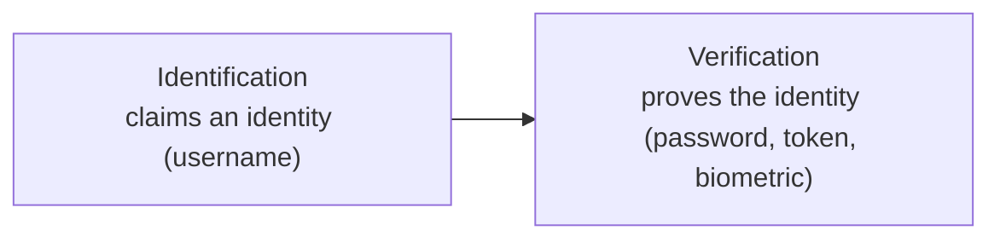

> 🧠 **Remember:** Authentication = **identification + verification**. A username alone only *claims* an identity.

> 🔗 **Connection to Module 1:** Authentication is the first **A** in the [AAA framework](Module-01-README.md#the-aaa-security-framework).

---

## 1.3 Authorization and Access Control

> 💡 **Authorization** based on identity determines **what resources the user can read, modify, or delete**.

> 🌍 **Real-world Scenario (added):** After you log in to a company laptop (authentication), the system lets you open only the files and applications your role allows (authorization).

There are many ways to authenticate users and implement access control, which the rest of this module covers.

---

## 1.4 What You Will Learn in This Module

| Course Objective | Where It Is Covered |
|------------------|---------------------|
| List different types of authentication methods | [Lesson 2](#lesson-2-authentication-methods) |
| Explain how single sign-on simplifies authentication and authorization | [Lesson 3](#lesson-3-single-sign-on) |
| Authentication framework, protocols, and tools | [Lesson 4](#lesson-4-authentication-framework-protocols-and-tools) |
| Describe the different types of access control methods | [Lesson 5](#lesson-5-access-control-and-methods) |
| Explain how to configure users and groups to allow secure access; best use of access control policies | [Lesson 6](#lesson-6-access-control-best-practices) |
| Use a network access control device to secure different types of assets | [Lesson 7](#lesson-7-network-access-control) |

---

# Lesson 2: Authentication Methods

After this lesson you will be able to define MFA, list the four authentication methods with examples, and explain contextual authentication factors.

## 2.1 The Four Authentication Factors

An entity (a **person, application, or device**) can prove its identity in several ways. The most common authentication factors are:

| Factor | Memory | Examples |
|--------|--------|----------|
| 🧠 **Knowledge** | Something you **know** | Password, PIN, security answers |
| 📱 **Possession** | Something you **have** | Phone, token, private key |
| 🧬 **Inherence** | Something you **are** | Fingerprint, face, iris |
| ✋ **Behavior** | Something you **do** | Typing pattern, voice, mouse movement |

> 📝 **Note:** Other factors can affect the authentication process but **do not verify identity**. These are **contextual** factors ([2.6](#26-contextual-authentication-factors)).

---

## 2.2 Knowledge-Based Authentication

> 💡 **Definition:** The **most common** method. You authenticate by divulging something that **only you and the authenticator know**.

| Example | How It Works |
|---------|--------------|
| **Questions and answers (Q&A)** | At registration you answer questions (favorite movie, favorite author). At login, the authenticator asks one or more of them |
| **Password** | A secret string |
| **PIN** | A personal identification number |

> 🌍 **Example:** At an ATM you insert your bank card and enter a PIN.

---

## 2.3 Possession-Based Authentication

> 💡 **Definition:** Authentication using **something you have that no one else has**. If you can prove you possess an item that only you should have, you must be who you say you are.

### 🔑 Digital Signatures and Private Keys

If you sign an object with a **private key only you can access**, it must be you authenticating. See [Module 5: Digital signatures](Module-05-README.md#42-digital-signatures).

### 💻 Device-Based Authentication

Registering your device with an authenticator gives it a **higher level of trust** in your identity, because only you use that device. It is usually **coupled with another method**, such as a password or PIN.

### 🔢 One-Time Passwords (OTP), Tokens and SMS

| Method | How It Works |
|--------|--------------|
| **Hardware token** | A dedicated device that generates an **OTP** using a **secret key and algorithm**. The authenticator shares the same key and algorithm, so it generates the **same code** |
| ↳ **Event-based token** | The code changes **each time the user presses the button** |
| ↳ **Time-based token** | The code changes **after a predefined time interval** |
| **Software token** | Works like a hardware token, but is **software installed on a device**, such as a phone |
| **SMS** | The authenticator sends a one-time code to the person's mobile device |

> 📝 **Note (from the course):** For SMS, "you might say this is something you *get* rather than something you *have*." It still shows the person can authenticate using a supported device known to the authenticator.

### ⏱️ HOTP and TOTP

| Algorithm | Full Form | Basic Idea |
|-----------|-----------|------------|
| **HOTP** | HMAC-based One-Time Password | Codes based on an **event counter** |
| **TOTP** | Time-based One-Time Password | Codes based on **time** |

**How TOTP works (course):** the **current time is combined with a secret key**, and the combination is the **input to a hash function**. The software token uses the **hash output** to generate the OTP.

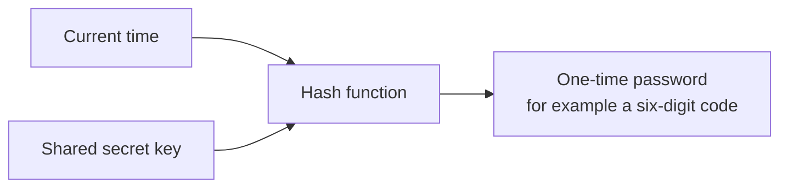

> 📖 **Beginner Explanation (added):** The authentication server holds the same secret key and clock, so it calculates the expected code on its own and compares it with what you typed. A TOTP code often changes about every 30 seconds. See [Module 5: Hashing](Module-05-README.md#41-what-is-hashing).

> ⚠️ **Added security note:** SMS OTP is generally **less secure** than authenticator apps or hardware tokens, because text messages can be intercepted or redirected.

> 🌍 **Example code only (added):** A hardware token might display `583 921`. This is an illustration, not a real code.

---

## 2.4 Inherence-Based Authentication

> 💡 **Definition:** Authentication using a **unique physical trait** of the person. These are **biometrics**.

Common traits: **fingerprints, retinas, irises, facial patterns, and hand measurements**.

- These are examples of **static (passive) biometric** authentication.
- **DNA** can be a definitive identification method, but inherence-based authentication does **not typically use it** to authenticate a person on a computer system.

> 🌍 **Real-world examples (added):** unlocking a phone with a fingerprint, unlocking a laptop with your face, biometric checks at an airport.

> ⚠️ **Flagged:** The course says the two most common biometrics in **ePassports** are fingerprints and retinas. Passport standards generally store a **facial image**, and may also include fingerprints or iris data. Treat the course statement as a simplification.

---

## 2.5 Behavior-Based Authentication

> 💡 **Definition:** Unlike inherence, behavior-based authentication uses **active biometric data**. The data is still an inherent trait, but you can describe it as **something a person does**.

| Example | What Is Observed |
|---------|------------------|
| **Voice identification** | Voice characteristics |
| **Keystroke dynamics** | How you type: speed, how long you hold keys, time between keys |
| **Mouse use characteristics** | Movement patterns, cursor speed, clicking behavior |

Less common methods: **signature analysis** (how you write your signature, including speed and movement) and **cognitive biometrics**.

| Inherence | Behavior |
|-----------|----------|
| Something you **are** | Something you **do** |
| Fingerprint, face, iris (static or passive) | Typing, voice, mouse patterns (active) |

---

## 2.6 Contextual Authentication Factors

> 💡 **Definition:** **Contextual** factors do **not verify identity**. The authentication process **changes depending on the status of the entity** trying to authenticate.

- **Unusual location:** the risk is greater, so the authenticator may demand a **more rigorous** process or **deny** the login.
- **Unusual behavior:** the risk is higher, so the authenticator may request **further proof of identity**.

> 🌍 **Real-world Scenario:** You normally log in from your office in Mumbai during working hours. One day someone tries to log in from an unfamiliar country at 3 AM. The system may request extra authentication, send an alert, temporarily block the login, or deny access.

> 🧠 **Remember:** Contextual factors **assess risk**. They are **not** authentication factors like a password or fingerprint.

---

## 2.7 Single-Factor vs Multi-Factor Authentication

| | **Single-Factor (SFA)** | **Multi-Factor (MFA)** |
|---|------------------------|------------------------|
| **Meaning** | The system asks for **one form** to prove identity, such as a username and password | **Two or more** forms of authentication |
| **Example** | Password only (knowledge) | Bank card (have) + PIN (know) |

> 💡 **MFA** gives the authenticator **greater confidence** in a user's identity. It is possible and even commonplace for a password to be compromised, but it is **far less likely** that a bad actor has compromised your password, **stolen your device**, **and** obtained a copy of your biometric data.

> ⚠️ **Never confuse:** Two passwords are **not** MFA, because both belong to the same category (knowledge). A password plus an authenticator-app OTP **is** MFA (knowledge + possession).

> 🌍 **Example:** ATM withdrawal = bank card (**possession**) + PIN (**knowledge**) = MFA.

---

## 2.8 Combining MFA with Other Security Methods

When you couple MFA with other network security techniques, you have a **powerful instrument** to defend your network:

| Technique | Purpose |
|-----------|---------|
| **MFA** | Verifies identity using multiple factors |
| **Device identification** | Identifies the device attempting to connect |
| **Security hygiene enforcement** | Checks whether the device meets security requirements |
| **Access control** | Limits what the user or device can access |

> 🌍 **Example (added):** A network engineer logs in with a password and an authenticator-app code. The company then checks that the laptop is an approved device that meets security requirements, and allows access only to the resources the engineer is authorized to use.

---

# Lesson 3: Single Sign-On

After this lesson you will be able to define SSO, describe how it works, and describe SAML.

## 3.1 What Is Single Sign-On?

Implementing authentication is like working a **balance sheet**: you must balance **security** and **productivity**.

- Too much security can frustrate users, tempt them into **shortcuts**, and reduce their effectiveness.
- Favoring productivity at the expense of security can make the network **vulnerable**.
- **SSO strikes the right balance.**

> 💡 **Definition (course):** **True SSO** is an authentication process in which a user **authenticates once** and can access **multiple resources across many systems and possibly domains**.

- Instead of authenticating on each system, **one authentication suffices**.
- It works when the system the user already authenticated with **passes an authentication token seamlessly** to other applications or sites.
- The token **could be a cookie, but only if the sites share a common parent domain**. Other token types let you **cross domains**.

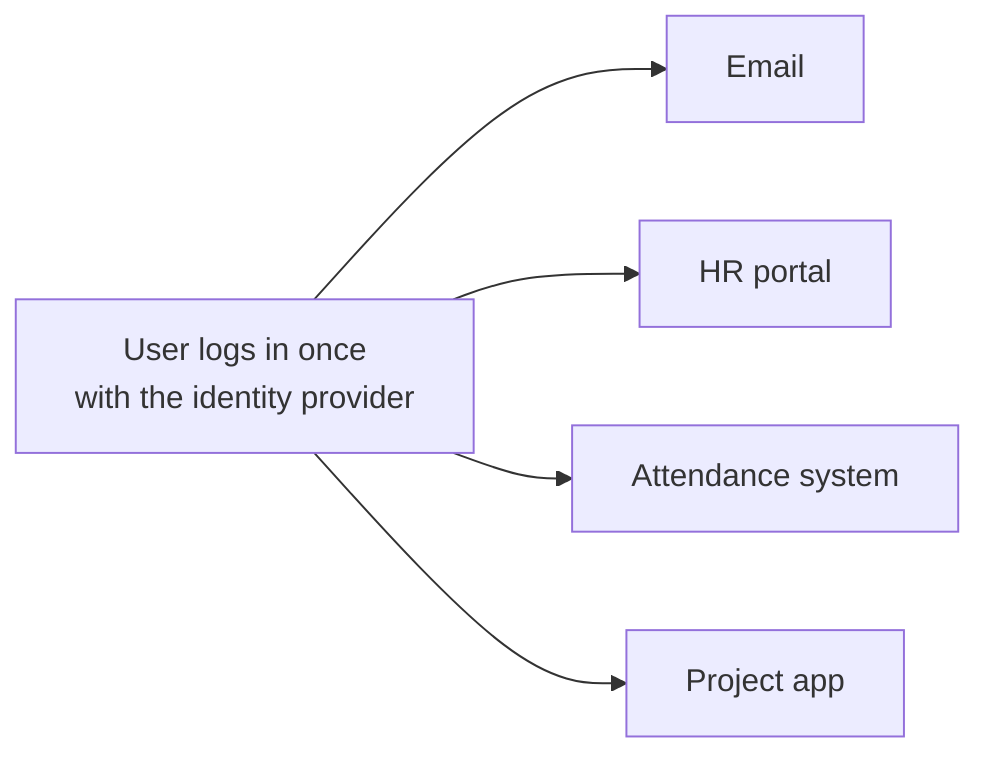

---

## 3.2 SSO vs Same Sign-On

> 💡 **Same sign-on (course):** An entity uses **credentials housed in a directory server** to access applications. Typically **LDAP-compliant directory servers** are used. The entity uses the same credentials, but **still has to authenticate to each application**.

| Feature | SSO | Same Sign-On |
|---------|-----|--------------|
| **Authentication** | One authentication session | The **same credentials** are reused |
| **Login required** | Usually once | Separately for **each** application |
| **Example** | Company SSO portal | Same LDAP username and password on different apps |

> 🧠 **Remember:** Same sign-on does **not** mean single sign-on.

> 📖 **Beginner Explanation (added): LDAP** (Lightweight Directory Access Protocol) is a protocol for accessing a central directory of users, groups, and other information. Applications can use it to verify users. See [4.3](#43-ldap-and-active-directory).

---

## 3.3 SSO in the Cloud: IdP and SP

SSO is common in **enterprises** where a user accesses many resources, and also in the **cloud**, across multiple domains and separate autonomous networks.

> 🌍 **Course example:** When you register on **Spotify**, you may be offered **Facebook, Apple, or Google** to use existing credentials. This works only because of **trust** between Spotify and those businesses.

Antonio has credentials on **Google**:

| Role | Who | What It Does |
|------|-----|--------------|
| **Identity provider (IdP)** | Google | Provides the **identity of the user** for authentication |
| **Service provider (SP)** | Spotify | **Provides a service** to Antonio |

> 🎯 **Exam Focus:** **IdP** = authenticates the user. **SP** = provides the requested service.

---

## 3.4 Advantages and Disadvantages of SSO

| ✅ Advantages | ⚠️ Disadvantage |
|--------------|-----------------|
| **No need to remember credentials** for dozens of sites | If credentials are **compromised**, the bad actor may have access to **all of the user's resources** |
| **Fewer redundant credentials** for organizations | |
| **Less administrative overhead** protecting and maintaining credential databases | |
| **Easier compliance and reporting** for IT through a centralized database | |
| **Higher productivity** (added) | |

> ✅ **The fix:** SSO is **not restricted to single-factor authentication**. You can implement **MFA** to strengthen authentication while using SSO for productivity and ease of use.

---

## 3.5 How SSO Works

An **IdP, an SP, and a user** are required.

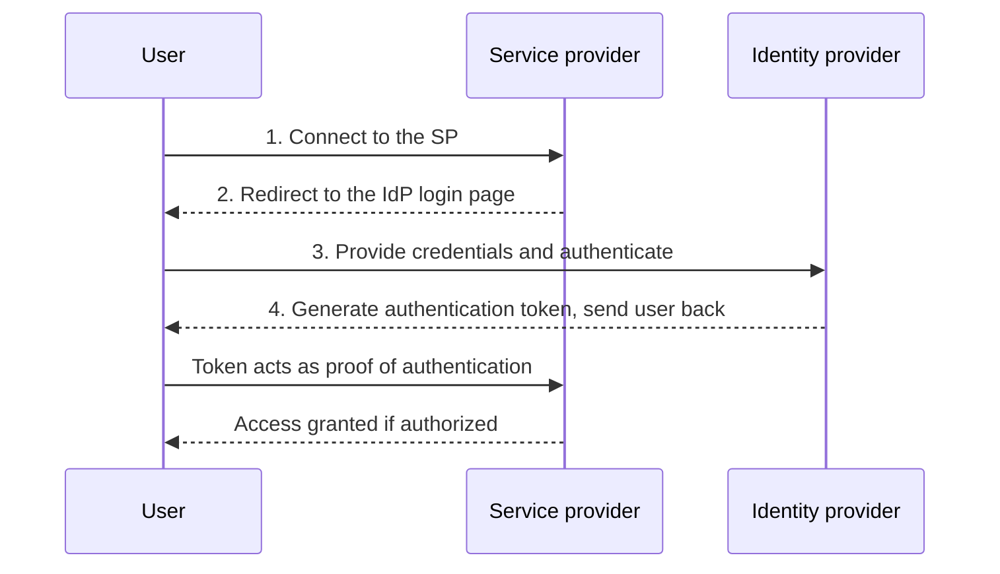

> 💡 **Authentication token (course):** a **package of information** providing facts about the user's authentication, **plus other optional content**. The embedded token acts as **proof** that the user has been authenticated.

> 📖 **Beginner Explanation (added):** The token is evidence of a successful login, like an entry pass. It is **not** necessarily the user's password.

---

## 3.6 SAML

SSO is a **concept** that needs a **protocol** to implement it. There are numerous SSO protocols, such as **OAuth** and **SAML**. Each handles details slightly differently while staying true to the SSO concept.

> 💡 **SAML version 2 (course):** an **open standard** for exchanging **authentication and authorization data** between parties, in particular between the **IdP and SP**. It is based on **XML**.

SAML inserts statements called **security assertions** into XML-based messages. There are several types:

| Assertion | What It Says | Example |
|-----------|--------------|---------|
| **Authentication assertion** | **How** the entity authenticated, and the **date and time** | Omar authenticated using his email address and password |
| **Attribute assertion** | **Additional information** about the entity | Omar is a gold card member |
| **Authorization assertion** | **What the entity is entitled to do** | Omar can access the HR portal |

> 📝 **Note:** Many assertions are **optional**, which leaves room for different implementations. For example, the IdP may be restricted to **authentication only**, leaving the SP to decide the entity's entitlements.

> 📖 **Beginner Explanation (added): XML** is a markup language for storing and exchanging structured information, such as `<Employee><Name>Omar</Name></Employee>`.

> ⚠️ **Flagged:** The course text writes XML as "Extendible Markup Language." The usual name is **Extensible Markup Language**.

---

## 3.7 FortiAuthenticator SAML Login

**FortiAuthenticator** is a Fortinet product and authentication platform that supports various authentication methods, **including SAML version 2**. In this example it acts as the **IdP**.

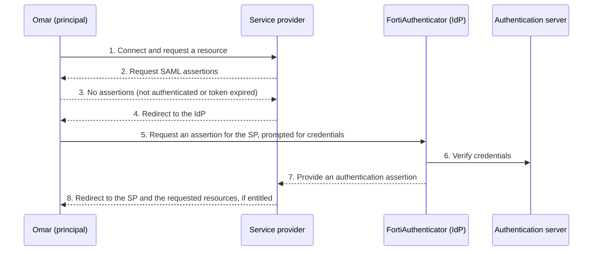

- The **entity** is also called the **principal**.
- FortiAuthenticator **verifies identity**, and the SP **provides the service** after validating the SAML information and checking authorization.

---

## 3.8 SSO vs SAML vs OAuth

| Term | What It Is | Main Purpose |
|------|------------|--------------|
| **SSO** | Authentication **concept** | Log in once and access multiple applications |
| **SAML** | **XML-based open standard** | Exchange authentication and authorization information between IdP and SP |
| **OAuth 2.0** | **Authorization framework** (added) | Let an application have limited access to resources without sharing your password |

> ⚠️ **Flagged (added by supplementary notes):** The course lists OAuth as an SSO protocol. Strictly, **OAuth 2.0 is mainly about authorization**, not authentication. **OpenID Connect (OIDC)** adds an authentication layer on top of OAuth 2.0 and is commonly used for modern SSO. Know the course wording for the exam.

---

# Lesson 4: Authentication Framework, Protocols and Tools

After this lesson you will be able to define the authentication framework, list the protocols and methods used for client-server authentication, and contrast **PAP vs CHAP** and **RADIUS vs TACACS+**.

## 4.1 Authentication Framework and AAA

> 💡 **Definition:** An **authentication framework** is the **basic schema or plan** for how entities will prove their identities within a system. It includes the **methods, forms, protocols, and other tools** used to authenticate persons, devices, and applications on a network.

> 🌍 **Example (added):** A company uses usernames and passwords, a central RADIUS server, network switches that control access, and an LDAP directory such as Active Directory. Together these form an authentication framework.

**AAA** (see [Module 1](Module-01-README.md#the-aaa-security-framework)):

| AAA Part | Question | Example on a switch |
|----------|----------|---------------------|
| **Authentication** | Who are you? | The switch verifies your username and password |
| **Authorization** | What can you do? | Decides if you can enter privileged mode |
| **Accounting** | What did you do? | Records your login and, if configured, your commands |

---

## 4.2 RADIUS

> 💡 **Definition:** **RADIUS** (Remote Authentication Dial-In User Service) is a **client-server AAA protocol and software** that lets remote access servers communicate with a **central server** to authenticate dial-in users and authorize their access to the requested system or service.

- The key word is **central**: most or all of a network's remote authentication needs can be met with **one server**, instead of maintaining credentials on many servers. This **simplifies administration** for the administrator and the user.
- RADIUS can also enable the **802.1X framework** ([4.7](#47-ieee-8021x)).

> 🔑 **RADIUS client:** the network device that forwards the request, such as a **FortiGate firewall**, switch, wireless access point, or VPN server. It is **not** necessarily the user's laptop.

### 📦 The RADIUS Exchange

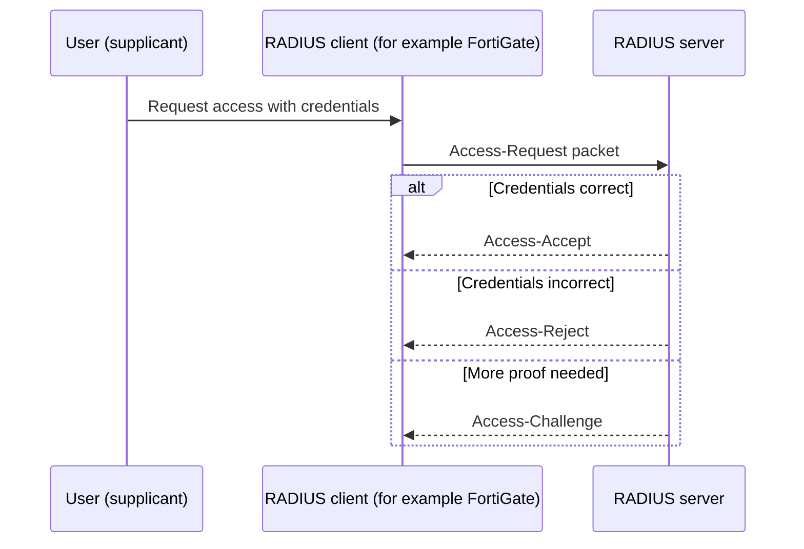

| Response | Meaning |
|----------|---------|
| **Access-Accept** | Credentials accepted |
| **Access-Reject** | Credentials incorrect, or access denied |
| **Access-Challenge** | The server asks the user for additional credentials |

> ⚠️ **Flagged:** The course says Access-Challenge occurs **only if two-factor authentication** is configured. Supplementary notes say it is commonly used in multi-step authentication but is **not limited to two-factor** setups. Know the course wording.

### 🗄️ Where Credentials Are Stored

- The **RADIUS server's own database**, or
- An existing source. Depending on the vendor, RADIUS servers typically support protocols and server types such as **SQL** and **LDAP**. It is common to use an LDAP directory such as **Microsoft Active Directory (AD)**.

> ⚠️ **Flagged:** The course says RADIUS enables the 802.1X framework "which uniquely encrypts user sessions." This is imprecise. **802.1X is an access-control framework**, and any session encryption depends on the EAP method and the network technology. See [Module 6: Secure switching (802.1X)](Module-06-README.md#74-defenses-against-mac-flooding).

---

## 4.3 LDAP and Active Directory

> 💡 **Definition:** **LDAP** (Lightweight Directory Access Protocol) is an **open, vendor-neutral, industry-standard application protocol** for accessing **directory services** over an IP network.

- Aside from RADIUS, LDAP authentication can be configured in other ways. For example, the supplicant talks to an **authentication proxy**, which could be a **firewall such as FortiGate**. The proxy **queries the LDAP server** for the user's credentials and privileges.
- So **LDAP does not require RADIUS**.

> 📖 **Beginner Explanation (added):** A *directory server* stores organized information about users, computers, and groups. **Microsoft Active Directory** is a directory service widely used in Windows-based organizations and supports LDAP, so a RADIUS server can use it as a source for authentication.

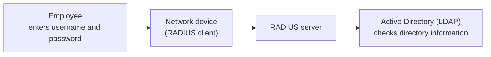

> 🧠 **Remember:** **LDAP** is a **directory access** protocol. **RADIUS** is an **AAA** protocol. They can work together but have different purposes.

---

## 4.4 TACACS+

> 💡 **Definition:** **TACACS+** (Terminal Access Controller Access-Control System Plus) is a **remote AAA protocol** that lets a remote access server communicate with an authentication server to **validate user access**. In this sense it is similar to RADIUS.

> 🌍 **Example (added):** An administrator logs in to a Cisco switch. Instead of the switch storing admin credentials locally, it contacts a TACACS+ server to verify identity and permissions.

---

## 4.5 RADIUS vs TACACS+

| Feature | RADIUS | TACACS+ |
|---------|--------|---------|
| **Encryption (course)** | Encrypts **passwords only** | Encrypts **all AAA protocols** |
| **Transport (course)** | **UDP** | **TCP** |
| Default ports (added) | UDP 1812 (authentication), 1813 (accounting) | TCP 49 |
| Typical use (added) | Wi-Fi, VPN, and network access | **Administrator access** to routers, switches, firewalls |
| AAA handling (added) | Authentication and authorization are more combined | AAA functions are separated |

> 🧠 **Remember:** **RADIUS = UDP**, passwords encrypted only. **TACACS+ = TCP**, all AAA communication encrypted.

> ⚠️ **Flagged (added by supplementary notes):** TACACS+ encrypts the **body** of the packet, not the header. "All AAA protocols" in the course is a simplification.

---

## 4.6 PAP and CHAP

Both are used to authenticate **PPP** sessions.

> 📖 **Beginner Explanation (added):** **PPP** (point-to-point protocol) is a suite of Layer 2 protocols that provides a standard way to transport multiprotocol data over point-to-point links and creates a foundation for network layer protocols. See [PPP description in the course](#46-pap-and-chap) below.

### 🔓 PAP: Password Authentication Protocol

**Two-way handshake:**

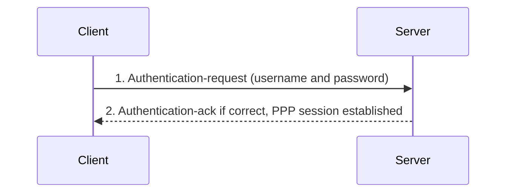

- The static username and password can pass through an **encrypted tunnel** to improve security, but they are still subject to **password guessing and snooping** attacks.
- 📖 **Added:** PAP itself sends the credentials in **clear text**. A tunnel protects them in transit, but PAP does not encrypt the password.

### 🔐 CHAP: Challenge Handshake Authentication Protocol

**Three-way handshake:**

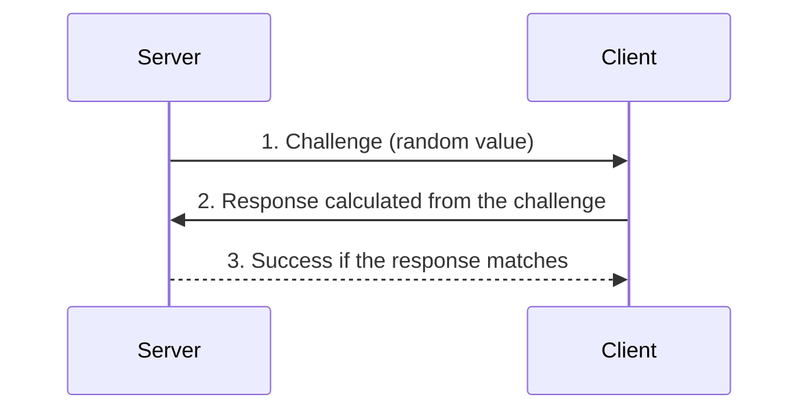

- Creates a **unique challenge phrase for each authentication session** by generating a **random string**.
- This gives **dynamic authentication information** for each session and **avoids static information**.
- Microsoft has its own version, **MS-CHAP**. The most current version in the course is **MS-CHAP version 2**.
- Both PAP and CHAP can be used with **VPNs**.

> ⚠️ **Flagged:** The course says the random string is combined with **"a hash result of the device hostnames."** In practice, the response is calculated from the **challenge and a shared secret** (the hostnames identify the peers). Know the course wording, but understand the challenge-response idea.

| Feature | PAP | CHAP |
|---------|-----|------|
| Handshake | **Two-way** | **Three-way** |
| Method | Sends username and password | **Challenge-response** |
| Password sent directly | Yes | No |
| Security | Weaker | Stronger than PAP |

> 🎯 **Exam Focus:** **PAP = 2-way. CHAP = 3-way.**

---

## 4.7 IEEE 802.1X

> 💡 **Definition:** **802.1X** is an **IEEE standard for port-based network access control (PNAC)**. It is part of the IEEE 802.1 group of networking protocols and provides an **authentication mechanism to devices wishing to attach to a LAN or wireless LAN**.

### 👥 The Three Players

| Player | Role | Example |
|--------|------|---------|
| **Supplicant** | The **client device** that petitions to join the LAN (Ethernet or wireless) | Employee laptop |
| **Intermediary (authenticator)** | A network device that bridges the client and the network and can **block or allow** access based on the result | Ethernet switch or wireless access point |
| **Authentication server** | A trusted server that **validates the supplicant's credentials** and accepts or rejects them. Typically supports **RADIUS and EAP** | RADIUS server |

- A wide range of factors is supported, including **knowledge** (username and password) and **possession** (digital certificate).

### 🔄 The 802.1X Sequence

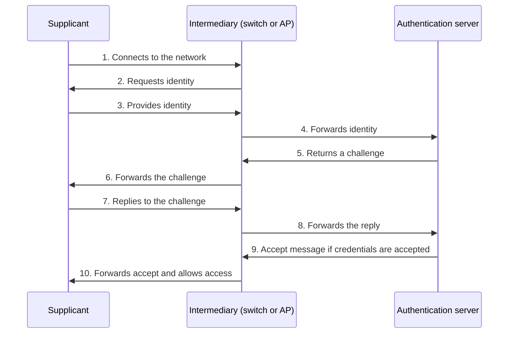

> 📝 **Note:** Authentication consists of **identification and verification** (steps 2 to 3 identify, steps 5 to 9 verify).

> 📖 **Beginner Explanation (added):** The switch does **not** normally check the password itself. It controls the port and passes messages to the authentication server. Until authentication succeeds, normal access is blocked, though authentication traffic is allowed.

> 🔗 **Connection:** 802.1X is one of the [defenses against MAC flooding](Module-06-README.md#74-defenses-against-mac-flooding) and the original basis of NAC ([Lesson 7](#lesson-7-network-access-control)).

---

## 4.8 EAP and EAP Methods

> 💡 **EAP (Extensible Authentication Protocol)** is an **authentication framework**, **not a specific authentication mechanism**. It provides common functions and **negotiation of authentication methods, called EAP methods**. There are **dozens** of EAP methods. The course describes three.

| Method | Full Name | Key Points (course) |
|--------|-----------|---------------------|
| **EAP-FAST** | Flexible Authentication via Secure Tunneling | Uses a **protected access credential (PAC)** that the authentication server can manage dynamically. A PAC is a credential generated by the server holding information specific to a peer. The server uses **TLS** to establish a secure tunnel to the peer |
| **PEAP** | Protected EAP | **Encapsulates EAP messages inside an encrypted and authenticated TLS tunnel**. Authenticates Wi-Fi LAN clients using **only server-side certificates**, which simplifies a secure Wi-Fi LAN |
| **LEAP** | Lightweight EAP | Used primarily in **Cisco Aironet wireless LANs**. Encrypts transmissions using **dynamically generated WEP keys** and supports **mutual authentication** between the wireless client and a RADIUS server |

> 📖 **Beginner Explanation (added):** *Mutual authentication* means both sides verify each other. See [Module 5: Digital certificates](Module-05-README.md#52-digital-certificates) for the certificates used with TLS.

> ⚠️ **Security note (added):** **LEAP is old** and has known weaknesses, and **WEP is obsolete**. Modern wireless networks should use appropriately configured **WPA2 or WPA3-Enterprise** with modern EAP methods.

---

## 4.9 Ports to Remember

> 📖 **Added from supplementary notes** (standard default ports; real deployments can differ):

| Protocol | Transport | Port |
|----------|-----------|------|
| RADIUS authentication | UDP | 1812 |
| RADIUS accounting | UDP | 1813 |
| TACACS+ | TCP | 49 |
| LDAP | TCP/UDP | 389 |
| LDAPS | TCP | 636 |

---

# Lesson 5: Access Control and Methods

After this lesson you will be able to explain how access control applies to **physical locations, hardware devices, and information**, define common access control methods, and explain which methods work best for different types of content.

## 5.1 What Is Access Control?

> 💡 **Definition:** **Access control** is the ability to **restrict access to a physical location or resource**.

You meet it every day: showing ID and a ticket to board a plane, using an employee ID to enter a workplace, or logging in to an online account.

> 💡 **Access control method:** the **system used to determine what resources a user is allowed to access** based on **authentication and the application of rules**. Rules can be **very simple** ("Allow everyone who has a name on this list") or **very complex** ("You need a valid government-issued photo ID, a fingerprint check, and a valid appointment").

Computers and electronic devices have access control methods built into their **operating systems, programs, and hardware**, controlling what users and programs may access, such as data or hardware resources.

---

## 5.2 Authentication vs Authorization

| Authentication | Authorization (access control) |
|----------------|--------------------------------|
| **Who you are** | **What you can access** |
| Example: entering a username and password | Example: being allowed to open a particular folder |

> 🌍 **Course analogy:** You can identify yourself properly to airport security, but without the correct authorization (a valid **ticket**) you won't board the plane.

> ⚠️ **Flagged:** The course says "access control, also called authorization." In practice, **authorization is a part of access control**: the decision about what an authenticated identity may do. Know the course wording, but note the difference.

---

## 5.3 Where Access Control Applies

| Area | Example |
|------|---------|
| 🏢 **Physical locations** | Office entry, server room, data center |
| 🖥️ **Hardware devices** | Routers, switches, printers, laptops |
| 📁 **Information** | Files, folders, databases, applications |

---

## 5.4 Mandatory vs Discretionary Access Control

These define whether the **object being restricted, or the enforcing agency, can change the access control rules**.

| | **Mandatory (MAC)** | **Discretionary (DAC)** |
|---|---------------------|-------------------------|
| **Who can change the rules?** | **No participating actor** can change the security requirements | The **enforcing agency or the subject** trying to gain access **can change access at their discretion** |
| **Course analogy** | A **lock** needs a key and can be changed only by a third party, such as a **locksmith** | A **security guard** lets an employee in without ID so they can get a new badge from HR |
| **In computers** | Forces **all users and programs to always check the enforcing engine** before accessing resources | A computer administrator grants themselves access to a file, or runs a program with **Microsoft User Account Control (UAC)** |
| **Flexibility** | Strict | Flexible |

> 🎯 **Exam Focus:** An access control method can be **either mandatory or discretionary, but not both**. It **can be combined with the other methods** in this lesson.

> 📖 **Beginner Explanation (added):** **MAC here means Mandatory Access Control**, not a MAC address (see [Module 6: MAC filtering](Module-06-README.md#22-perimeter-filtering-by-osi-layer)). A common DAC example is a user who owns a folder and decides who may read or edit it.

> ⚠️ **Flagged (added by supplementary notes):** The course gives UAC as a DAC example. UAC is better described as a privilege-elevation prompt. The point is that the subject can change access at their discretion.

> 🧠 **Remember:** MAC and DAC describe **who controls the access rules**. Lattice, rule-set, role-based, and attribute-based methods describe **how access decisions are made**.

---

## 5.5 Lattice-Based Access Control

> 💡 **Definition:** A model that grants permission to locations or materials based on an **assigned security level**. Users and devices are granted access to **everything at their level or below**.

- A basic user can access only the **lowest level** of resources.
- An administrator, CEO, or person with **top-secret clearance** can access the more restricted materials **and** all materials below their level.

| Employee | Security Level | Can Access |
|----------|----------------|------------|
| A | Public | Public |
| B | Confidential | Public, Confidential |
| C | Secret | Public, Confidential, Secret |
| D | Top Secret | All four levels |

> 🔗 **Connection to Module 1:** These are the [information classification labels](Module-01-README.md#information-classification).

> ⚠️ **Flagged (added by supplementary notes):** This is the **simplified model** from the course. Real lattice-based systems can also use compartments and a need-to-know rule.

---

## 5.6 Rule-Set-Based Access Control

> 💡 **Definition:** Enforces access usually through an **ordered list of rules**. Rules are **evaluated from the top down**, and as soon as a **match** is made, access is **allowed or denied** based on that rule.

- Commonly used in **firewall access rules**, but can be as simple as a **hotel door requiring keycard entry during the night**.

**Example firewall rules (added):**

| Priority | Rule | Action |
|----------|------|--------|
| 1 | Allow traffic from the NOC subnet | Allow |
| 2 | Deny traffic from a blocked IP address | Deny |
| 3 | Allow HTTPS traffic | Allow |
| 4 | Deny all other traffic | Deny |

### 🚪 Fail Open vs Fail Closed

If a request reaches the **bottom of the list without matching**:

| Behavior | Meaning | Door Example |
|----------|---------|--------------|
| **Fail open** | **Allows** the access | The door unlocks |
| **Fail closed** | **Denies** the access | The door stays locked |

> 📝 **Note (added):** For sensitive systems, **fail closed** is generally safer.

> 🔗 **Connection:** This is the same ordered-list idea as [stateless firewall rules in Module 6](Module-06-README.md#63-first-generation-stateless-firewalls).

> ⚠️ **Flagged:** The course calls this **rule-set-based** access control. Many sources call it **rule-based** access control (RuBAC). Don't confuse it with **role-based** (RBAC).

---

## 5.7 Role-Based Access Control

> 💡 **Definition:** Allows access to resources based on **roles defined by administrators** and assigned to users or devices. Roles map to a set of permissions, usually some form of **access control list (ACL)**. Access is granted if the user or device is **authenticated** and has the **appropriate role and permissions**.

| ✅ Advantage | ⚠️ Disadvantage |
|--------------|-----------------|
| **Flexible** in granting permissions to new users or devices: assign the right roles and they gain access | **Time is spent defining and setting up meaningful roles** |

**Example roles (added):**

| Role | Permissions |
|------|-------------|
| HR | Access employee records |
| Finance | Access financial records |
| NOC engineer | Access network monitoring tools |
| Network administrator | Configure routers, switches, and firewalls |
| General employee | Access normal office applications |

> 🧠 **Remember:** RBAC = access based on **job role**.

---

## 5.8 Attribute-Based Access Control

> 💡 **Definition:** ABAC **considers multiple attributes** to decide whether access should be allowed. A **rule engine collects and evaluates attributes against a policy**.

- Major benefit: it can **dynamically allow or deny** access based on **multiple factors**, not a static rule list like RBAC.
- Available attributes vary widely. **Nontraditional attributes** such as **patterns of behavior, geolocation, and current resource loads** can be considered.

| ⚠️ Disadvantages |
|------------------|
| Attributes can be **time-consuming and resource-intensive** to define |
| It may be **inefficient** when a simpler method would be **more time-efficient and secure** |
| **Extra expertise** is usually needed to avoid **configuration errors and security holes** |

**Example ABAC policy check (added):**

| Attribute | Condition |
|-----------|-----------|
| User | Must be an authorized employee |
| Device | Must be company-managed |
| Location | Must be an approved location |
| Time | Within specified hours |
| Security status | Device meets security requirements |

> 🌍 **Why ABAC helps (added):** An employee has the correct role (RBAC would allow), but connects from an unknown device in an unusual country at an unusual time. ABAC can deny access or ask for stronger authentication.

> 🧠 **Remember:** ABAC = access based on **attributes and conditions**.

---

## 5.9 Comparing the Methods

| Method | Main Idea | Simple Example |
|--------|-----------|----------------|
| **Mandatory (MAC)** | Rules cannot be changed by participating actors | Classified documents |
| **Discretionary (DAC)** | Owner or subject can change access | Sharing a folder |
| **Lattice-based** | Security levels | Public, Confidential, Secret |
| **Rule-set-based** | Ordered rules, first match wins | Firewall rules |
| **Role-based (RBAC)** | Job roles | HR, Finance, NOC |
| **Attribute-based (ABAC)** | Multiple attributes | User + device + location + time |

> 📝 **Note:** Access control methods are systems designed to make **allow or deny decisions** about whether a person, device, or program can access a specific resource. The course ends this lesson with a click-through card exercise (examples of each method), which was not included in the supplied notes.

---

# Lesson 6: Access Control Best Practices

After this lesson you will be able to describe the challenges of implementing a comprehensive access control policy, explain how the **security life cycle** applies to access control, and list common best practices.

## 6.1 Why Access Control Is Hard

Access control complexity has **exploded** with new devices and technology.

- Employees used to work on a **fixed desktop and phone infrastructure** in secured company buildings.
- Modern employees have **multiple internet-connected devices** they carry, **leave unattended** in public places, **connect to unsecured networks**, and still expect the same access to sensitive information.
- **Cyberattacks** and more sophisticated **social engineering** make correct deployment more important.

> 💡 **Goal:** Allow authorized users to access **their information when they need it, and nothing else**. This requires **constant re-evaluation** of policies, especially when employees are hired or leave, new data sources appear, or new technology creates new ways to access information.

### 🧱 Major Challenges

| Challenge | Meaning |
|-----------|---------|
| **Complexity of configuration** | The biggest hindrance. You often need **multiple types** of access control across computers, phones, doors, files, folders, networks, and devices such as printers and projectors. Keep the system **consistent and easy to follow** so changes are quick and problems are found |
| **Uniform policies across platforms** | A Windows solution may look very different from a Linux file system and may need different products, rules, and policies |
| **User frustration** | If users can't remember or easily change passwords, they get frustrated and **support and maintenance costs rise** without self-service tools |
| **Audit trail and accounting** | Multiple access solutions across buildings and locations make an **accurate audit trail** hard to maintain |
| **Adding and removing users everywhere** | Many devices and users with **partial, outdated policies** are a huge security risk and a support problem |

---

## 6.2 The Access Control Life Cycle

> 💡 **Access control is a life cycle.** As a user or device is **provisioned** and assigned permissions, it travels through the life cycle until it is **deprovisioned**, and the cycle starts again.

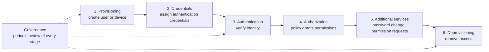

| Stage | What Happens |
|-------|--------------|
| **Provisioning** | The user or device is created and registered |
| **Credentials** | The administrator or security authority assigns **authentication credentials** |
| **Authentication** | The user or device authenticates |
| **Authorization** | An **access control policy** authorizes access to the required information using **permissions** |
| **Additional services** | Features such as **password changing** or **permission requests** |
| **Deprovisioning** | The administrator **removes the user from access control policies** and ensures it can no longer access information |

- A **governance system** (usually a team) **reviews and updates** access control methods and policies.
- Because authentication and access are so dynamic, **periodic reviews and tests of each stage** are important.

> 📖 **Added deprovisioning checklist:** disable the account, revoke credentials and tokens, remove the user from groups, revoke VPN and application access, and recover company devices and access cards.

> 🚨 **Critical:** **Old, unused accounts** and old policies are a major cause of breaches.

---

## 6.3 Groups and Roles Instead of Individuals

Shift from an **individual user-based approach**, where each user has rules assigned to their account, to a **group or role-based approach**.

- One change can affect **all relevant users**.
- It helps prevent **cybersecurity fatigue** from trying to assign rules to individual accounts correctly.

> 🌍 **Example (added):** A company has 50 NOC engineers. Instead of editing 50 accounts to give monitoring access, create a `NOC_Engineers` group, give it the permissions, and add or remove people as they join or leave.

---

## 6.4 Human Error, Passwords and Self-Service

> ⚠️ **The cause of most security breaches against physical and cyber assets is human error.**

| Practice | Why It Helps |
|----------|--------------|
| **Clear, published security policy** | Prevents accidental violations and helps people recognize a breach. It can be as simple as warning a guard about **tailgating**, or reporting a suspicious file permission or social engineering attempt to the IT support desk |
| **User education and tools** | Drastically reduce risk from human error |
| **Robust password policy** | **Long length, special characters, periodic changes**: one of the most effective and easy measures |
| **Self-service tools** | **Password reset and request forms** reduce support calls, improve security, and maintain a higher security posture |
| **Teach what IT will never do** | A user who knows **IT will never call and ask them to reset a password** is less susceptible to that social engineering attack |

> 🔗 **Connection:** See [Module 3: Tailgating](Module-03-README.md#35-tailgating) and the [first line of defense](Module-01-README.md#the-first-line-of-defense).

---

## 6.5 File and Folder Permissions

Understand how different devices handle file permissions and how to set them.

- Administrators must know which files and folders are **readable** (viewable) and which are **writeable** (changeable).
- **Windows and Linux** display and apply read and write permissions very differently, though they do the same thing: define what users and processes may do to specific files.

| ✅ Best Practice | Why |
|------------------|-----|
| **Restrict generic, unauthenticated users** from files. Allow only **authenticated users and appropriate system processes** | Most attacks hit file systems that grant only **basic user-level access** initially. Stopping these minimally protected accounts from exploring and reading files greatly increases security |
| **Understand how permissions are inherited and distributed** | It is usually unique to the OS or authentication system. Pay attention to permissions on an **individual file or folder**, or on **all files and folders in a location** |
| **Make new files and folders inherit the permissions of the parent** | Prevents a highly secured folder with **unsecured subfolders** holding important information |

> 🚨 **Why inheritance matters:** Generic users may be unable to see the top-level folder but can **directly access files in the subfolders**. **Network scanners and directory enumerators** can discover these vulnerable folders, a very common avenue of data loss.

**Common file permissions (added):**

| Permission | Meaning |
|------------|---------|
| Read | View file contents |
| Write | Modify file contents |
| Execute | Run a program or script |
| Delete | Remove a file |

> 🧠 **Remember (added):** A secured parent folder does **not** automatically guarantee that every child resource is secure. Check the **effective permissions**.

---

## 6.6 Least Privilege and Zero Trust

Two modern methodologies help define how access control is implemented.

### 🔒 Principle of Least Privilege (PoLP)

> 💡 **Definition:** **Allow things to access only what they need.**

> 🌍 **Course example:** If an employee needs access to their **desk, the break room, and a restroom**, allow physical access only to those. They don't need the warehouse. If a keycard is stolen, it is far less damaging than one with access to the whole building.

- It applies to **network, database, and folder access**, and in modern systems to **kernel resources, file systems**, and other parts of the OS.
- It **prevents malicious actors from moving laterally** from one compromised system to another.

### 🔐 Zero-Trust Architecture (ZTA)

> 💡 **Definition (course):** An extension of the traditional security model: a methodology to **enforce verification and authorization of all connections to resources regardless of where they come from**.

- Originally designed against external threats, it was adapted for **mobile devices** and **distributed, remote workforces**.
- Security is distributed: access to **all important resources is authenticated and authorized**, wherever access originates. A **local administrator in the same data center is treated the same as a remote user in a coffee shop**.
- **ABAC policies** validate attributes such as **username, connecting device properties, and location**.

> 🔗 **Connection to Module 6:** See [Zero trust principles](Module-06-README.md#32-the-three-principles).

| PoLP | Zero Trust |
|------|------------|
| **Limits what** a user can access | **Requires verification and authorization** before access |

> 🎯 **Exam Focus:** Working together, PoLP and ZTA **minimize attack surfaces** and, more importantly, **minimize damage and data compromise** when failures occur.

---

## 6.7 Governance and Communicating Policies

- **Rigorous administration of policies** is critical. A common mistake is **not allowing periodic review and updates**.
- **Effective governance** enforces **separation of duties**, so administrative and common user access can be modified to reflect current requirements.
- **One of the major causes of breaches is old access control policies and old, unused user accounts.**
- After creating strong **access control, escalation, and disaster recovery** policies, **communicate them to users** and let them review them. A **well-educated user is a powerful line of defense**: they use strong passwords, keep them secure, and report suspicious activity.

---

## 6.8 Best Practices Summary

| Best Practice | Why It Matters |
|---------------|----------------|
| Strong password policy | Makes guessing harder |
| MFA (added) | Adds another authentication layer |
| Regular permission reviews | Removes unnecessary permissions |
| Remove old accounts | Stops former employees keeping access |
| Group- and role-based permissions | Simplifies administration |
| User security awareness | Helps prevent human error and social engineering |
| Self-service password reset | Reduces support overhead and unsafe workarounds |
| Audit logging (added) | Helps investigate suspicious access |
| Separation of duties | Prevents one person having excessive control |
| Secure file permissions with inheritance | Prevents unauthorized reading and modification |
| Least privilege and zero trust | Reduces attack surface and damage |

> 📝 **Note:** The course ends this lesson with a click-through exercise on best practices, which was not included in the supplied notes.

---

# Lesson 7: Network Access Control

After this lesson you will be able to explain how **network access control (NAC)** protects networks, describe its evolution (including **BYOD and IoT**), identify additional capabilities, and list its benefits.

## 7.1 What Is NAC?

> 💡 **Definition (course):** **NAC** is an **appliance or virtual machine** that **controls access to a network**.

- It has **complete visibility** into network profiles and **categorizes devices automatically**.
- It **evaluates and classifies security-policy compliance** by **user, device, location, operating system**, and other criteria that may detect **unusual activity**.
- Many NAC solutions use a **centralized architecture** that improves control of devices across **large, multi-site networks**.

---

## 7.2 How NAC Evolved

### 🔌 Origin: 802.1X

NAC began as a network **authentication and authorization** method for devices joining the network, following the **IEEE 802.1X** standards. It involves **three parties**:

| Party | Role |
|-------|------|
| **Client device** | Provides credentials: username and password, **digital certificate**, or another means |
| **Authenticator** | A **network switch or wireless access point** that separates the protected and unprotected networks. Forwards credentials to the server |
| **Authentication server** | Verifies credentials. Depending on the outcome the authenticator **blocks the device or allows it** access |

> 🔗 See [4.7 IEEE 802.1X](#47-ieee-8021x).

### 🌐 Captive Portal

> 💡 **Captive portal:** another way to control access to a network, **especially a publicly available one**. Before access, you may have to interact with a **web page that asks you to agree to legal terms**.

> 🌍 **Example:** Connecting to Wi-Fi in a coffee shop or airport.

> ⚠️ **Added note:** A captive portal manages access. Simply accepting terms does **not** necessarily provide strong identity verification.

---

## 7.3 The BYOD and IoT Challenge

As endpoints multiplied, greater controls were needed. **Guest access, bring your own device (BYOD), and the Internet of Things (IoT)** created complex problems.

| Challenge | Why It Is a Problem |
|-----------|---------------------|
| **BYOD** | Devices are **personally owned**, not organizational assets. The company's **MIS department does not control what runs on them**, such as antivirus or unsafe applications |
| **IoT** | **Hardware with sensors** that transmit data over the internet, **dramatically expanding the attack surface**. Organizations buy IoT devices from vendors, and the devices **connect back to vendor networks** to report usage and maintenance needs |

> 🌍 **Why organizations tolerate IoT:** It saves **time and money**. For example, a printer low on toner can email the vendor, or even trigger delivery of new toner automatically.

**Why IoT is hard to secure:**

- The **variety of devices, lack of standards, and inability to secure** them make them a potential **conduit for contagion**.
- Many IoT devices **lack CPU cycles or memory** to host authentication and security software.
- They typically identify themselves with a **shared secret or unique serial number** inserted during manufacturing. If the secret becomes known, there is likely **no way to reset it**.
- Without the ability to install security software, there is **little visibility** into them.

> ✅ **NAC evolved to solve these weaknesses.**

> 🔗 **Connection:** See [Module 2: Attack surface](Module-02-README.md#13-threat-classification-and-attack-surface).

---

## 7.4 Device Profiling and Segmentation

### 📋 Profiling

When MIS introduces NAC, the **first thing it does is create profiles of all connected devices**. NAC then **permits access to network resources based on the device profile**, which is defined by **function**. A device with **no defined profile, or one that doesn't match a function, is denied entry**. This is like granting access by **need to know**.

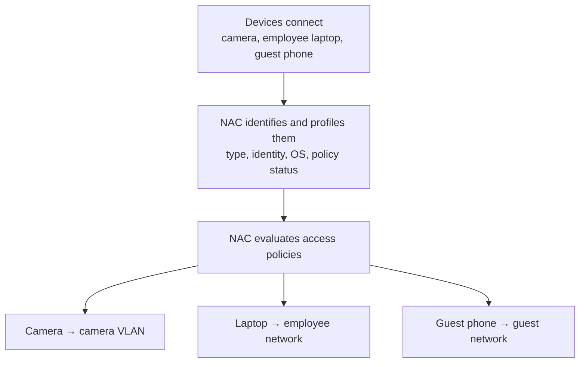

### 🧱 Segmentation by Device Function

> 🌍 **Course example:** NAC permits an **IP camera** to connect to a **network video recorder (NVR) server**, but **prevents it from connecting to a finance server**. A camera has no business talking to a finance server. NAC directs the camera to its **appropriate VLAN** and **the firewall does the rest**.

- The network becomes **segmented by device function**.
- If a device is compromised, malware can infect **only the objects it is permitted to connect to**. The compromised camera could infect the NVR, but **not** the finance server.
- This also applies to **contractors, partners, and guests**: they are **segmented by profile**, can gain secure access, and are **locked out of restricted areas**.
- **User and device policies must be adjusted** as people, endpoints, and the business change.

| Device | Permitted Communication (added) |
|--------|---------------------------------|
| IP camera | NVR server |
| Employee laptop | Approved employee applications |
| Finance computer | Finance resources |
| Guest smartphone | Guest internet access |

> 🧠 **Remember:** NAC **identifies and classifies** devices. **Segmentation and enforcement policies** restrict what they can communicate with.

> 🔗 **Connection to Module 6:** See [Network segmentation](Module-06-README.md#51-what-is-network-segmentation), [Zero trust implementation (NAC)](Module-06-README.md#34-implementing-zero-trust), and lateral movement limits.

---

## 7.5 Additional NAC Capabilities

| Capability | What It Does |
|------------|--------------|
| **Guest access management** | With wi-fi hotspots everywhere, NAC lets an organization **manage and authenticate temporary users and devices** through a **self-service portal**, such as free airport Wi-Fi |
| **Automatic threat response** | NAC can be integrated into the security framework. When a **breach is detected**, NAC automatically **notifies the security operations center (SOC)** and **coordinates with other security devices to neutralize the threat**. It can also produce **reports and insights** on attempted access |
| **Integration** | Integrates with other security point products such as **switches and network solutions** through the **open/RESTful API** or **secure shell (SSH)** |

> 📖 **Beginner Explanation (added):** A *SOC (security operations center)* is the team and facility that monitors and responds to security events. A *RESTful API* is a standard way for software to talk to other software over HTTP.

---

## 7.6 Benefits of NAC

| Benefit | Meaning |
|---------|---------|
| ✅ **Improved security** | **Oversight of all devices** in use. Authenticates users and devices the moment they enter the network |
| 💰 **Cost savings** | **Automated tracking and protection at scale** needs fewer IT resources |
| ⚙️ **Automation** | The number and variety of devices keep growing, so organizations **cannot manually verify** each endpoint's security policy. NAC automates authenticating users and devices and authorizing access |
| 😊 **Enhanced IT experiences** | **Seamless, frictionless** access when connecting |
| 🎛️ **Ease of control** | Visibility acts as a **24/7 inventory of all authorized endpoints**, helpful for knowing who has access and for **life-cycle management** when devices are phased out or replaced |

---

## 7.7 FortiNAC

> 💡 **FortiNAC** is Fortinet's NAC solution. It contains all the features in this lesson plus more, integrates easily with the **Fortinet Security Fabric**, and can **automatically isolate clients** that don't follow the set policies.

> 🌍 **Example (added):** A company uses FortiGate, FortiSwitch, FortiAP, and FortiNAC. An unknown laptop connects to a FortiSwitch. FortiNAC identifies it, evaluates its profile, and applies the access policy, restricting or isolating it if it is unauthorized or non-compliant.

> 🔗 See [Module 6: Fortinet Security Fabric](Module-06-README.md#43-fortinet-security-fabric).

---

## 7.8 Putting It All Together

> 📖 **Added from supplementary notes (not course text):** A new employee joins a company with many switches, access points, cameras, and servers.

| Step | Concept |
|------|---------|
| 1. Account is created | **Provisioning** |
| 2. Employee proves identity with credentials and MFA | **Authentication** |
| 3. Employee receives the NOC engineer role | **RBAC** |
| 4. Only the permissions needed for the job are granted | **Least privilege** |
| 5. Requests are evaluated whether inside or outside the office | **Zero trust** |
| 6. Laptop is identified and evaluated before network access | **NAC** |
| 7. Laptop reaches only the appropriate network resources | **Segmentation** |
| 8. Access activity is recorded | **Accounting and auditing** |
| 9. On leaving, accounts and access are revoked | **Deprovisioning** |

---

## 🌍 Real-World Scenarios

| Scenario | Concept Applied |
|----------|-----------------|
| Entering a username, then a password | Identification, then verification |
| ATM: card plus PIN | MFA (possession + knowledge) |
| An authenticator app shows a six-digit code that changes every 30 seconds | TOTP (possession) |
| A phone unlocks with your face | Inherence (static biometric) |
| A system notices unusual typing speed | Behavior-based authentication |
| Login attempt from a new country at 3 AM triggers an extra check | Contextual factor |
| One login opens email, HR, and attendance | SSO |
| Same LDAP password but separate logins for each app | Same sign-on |
| "Continue with Google" on Spotify | IdP (Google) and SP (Spotify) |
| An SP asks the IdP to confirm Omar's login | SAML authentication assertion |
| A FortiGate sends an Access-Request to a central server | RADIUS client and server |
| An admin logs in to a router that checks a TACACS+ server | TACACS+ (TCP) |
| A laptop plugs into a switch port that blocks it until it authenticates | 802.1X |
| Wi-Fi uses a TLS tunnel and server certificate only | PEAP |
| A door stays locked when the card reader loses its connection | Fail closed |
| Public documents, then confidential, secret, and top secret | Lattice-based access control |
| A new NOC engineer gets the NOC role and its permissions | RBAC |
| Access depends on user, device, location, and time | ABAC |
| A former employee's account is still active | Missed deprovisioning |
| A keycard opens only the desk, break room, and restroom | Principle of least privilege |
| An IP camera can reach the NVR but not the finance server | NAC with segmentation |
| A visitor accepts terms on airport Wi-Fi | Captive portal |

---

## 📊 Comparisons

### Authentication Factors

| Factor | Question | Examples |
|--------|----------|----------|
| Knowledge | What do you know? | Password, PIN, Q&A |
| Possession | What do you have? | Token, phone, private key |
| Inherence | What are you? | Fingerprint, iris, face |
| Behavior | What do you do? | Keystrokes, voice, mouse use |
| Contextual (risk only) | What is the situation? | Location, time, unusual behavior |

### SSO vs Same Sign-On

See the table in [3.2](#32-sso-vs-same-sign-on).

### RADIUS vs TACACS+

See the table in [4.5](#45-radius-vs-tacacs).

### PAP vs CHAP

See the table in [4.6](#46-pap-and-chap).

### EAP Methods

| Method | Key Idea |
|--------|----------|
| EAP-FAST | PAC plus TLS tunnel |
| PEAP | EAP inside a TLS tunnel, server certificate |
| LEAP | Legacy Cisco, dynamic WEP keys, mutual authentication |

### Access Control Methods

See the table in [5.9](#59-comparing-the-methods).

### RBAC vs ABAC

| RBAC | ABAC |
|------|------|
| Decides by **assigned role** | Decides by **multiple attributes** |
| Static role-to-permission mapping | Dynamic, policy-engine decisions |
| Easier to set up | Needs more expertise and resources |

### Commonly Confused Concepts

| Pair | Difference |
|------|------------|
| Authentication vs Authorization | Who you are vs what you can access |
| Identification vs Verification | Claiming an identity vs proving it |
| MFA vs two passwords | Different factor types vs the same type |
| Contextual factor vs authentication factor | Assesses risk vs proves identity |
| Inherence vs Behavior | Physical trait vs how you act |
| HOTP vs TOTP | Counter-based vs time-based |
| SSO vs Same sign-on | Authenticate once vs same credentials, separate logins |
| IdP vs SP | Authenticates the user vs provides the service |
| SAML vs OAuth | Authentication and authorization data exchange vs mainly authorization |
| LDAP vs RADIUS | Directory access vs AAA protocol |
| Supplicant vs Authenticator vs Authentication server | Client vs switch or AP vs credential checker |
| MAC (Mandatory) vs MAC (address) | Access control model vs hardware address |
| Fail open vs Fail closed | Allow vs deny when no rule matches |
| PoLP vs Zero Trust | Limit what is allowed vs verify every access |
| Provisioning vs Deprovisioning | Create and register vs remove access |

---

## 🧠 Key Takeaways

- ✅ **Authentication = identification + verification**. **Authorization** decides what an authenticated identity can read, modify, or delete.
- ✅ Four factors: **knowledge, possession, inherence, behavior**. **Contextual** factors only assess risk.
- ✅ **MFA** needs **two or more different factor types**. Two passwords are not MFA.
- ✅ **HOTP** is counter-based and **TOTP** is time-based. **SMS** codes are weaker than apps or tokens.
- ✅ **SSO** lets you authenticate once. **Same sign-on** reuses credentials with separate logins. Combine SSO with **MFA** to reduce its single-point-of-compromise risk.
- ✅ **IdP** authenticates and **SP** provides the service. **SAML 2.0** (XML) carries **authentication, attribute, and authorization assertions**.
- ✅ **RADIUS** (UDP, passwords encrypted) and **TACACS+** (TCP, all AAA encrypted) provide central AAA. **LDAP** accesses directories such as Active Directory.
- ✅ **PAP** is a two-way handshake. **CHAP** is a three-way challenge-response.
- ✅ **802.1X** has a **supplicant, authenticator, and authentication server**. **EAP** is a framework with methods such as **EAP-FAST, PEAP, and LEAP**.
- ✅ Access control methods: **mandatory, discretionary, lattice-based, rule-set-based, role-based, attribute-based**. A method is mandatory **or** discretionary, never both.
- ✅ Access control is a **life cycle** with **governance**. Remove **old accounts**, use **groups and roles**, secure **inheritance**, and educate users.
- ✅ **PoLP and ZTA** together reduce attack surface and damage.
- ✅ **NAC** profiles devices, grants access by function, segments the network, handles **guests**, responds to threats, and integrates through **API and SSH**. **FortiNAC** is Fortinet's solution.

---

## 📝 Quick Revision

**Authentication basics**
- Identification (claim) then verification (proof). Authorization = what you may do.
- Factors: knowledge, possession, inherence, behavior. Contextual = risk only.
- SFA = one factor. MFA = two or more different factors.
- Possession: device, private key, hardware token (event or time), software token (HOTP, TOTP), SMS.
- Inherence (static): fingerprint, iris, retina, face, hand. Behavior (active): voice, keystrokes, mouse use, signature analysis, cognitive biometrics.

**SSO**
- Authenticate once, token passed to other systems (cookie only with a shared parent domain).
- IdP + SP + user. Flow: connect to SP, redirect to IdP, authenticate, token, back to SP.
- SAML 2.0 (XML): authentication, attribute, authorization assertions. FortiAuthenticator = IdP example.

**Protocols**
- RADIUS: UDP 1812/1813, Access-Accept, Access-Reject, Access-Challenge.
- TACACS+: TCP 49, encrypts all AAA. LDAP: 389 and LDAPS 636.
- PAP: 2-way, CHAP: 3-way (MS-CHAPv2 from Microsoft).
- 802.1X: supplicant, authenticator, authentication server (RADIUS and EAP). EAP-FAST (PAC), PEAP (TLS tunnel), LEAP (Cisco, WEP).

**Access control**
- Physical, hardware, information. Mandatory vs discretionary (not both).
- Lattice (level or below), rule-set (top-down, fail open or closed), RBAC (roles), ABAC (attributes).
- Life cycle: provision, credentials, authenticate, authorize, services, deprovision, plus governance.
- Best practices: groups and roles, password policy, self-service, parent-to-child inheritance, PoLP, ZTA, remove old accounts, communicate policies.

**NAC**
- Appliance or VM, profiles devices, 802.1X origin, captive portal, BYOD and IoT, segmentation by function.
- Guest management, threat response, SOC notification, API and SSH integration.
- Benefits: security, cost savings, automation, IT experience, ease of control. FortiNAC.

---

## ❓ Knowledge Check

**Q1. (Multiple choice)** Which pair correctly describes the two parts of authentication?

- A) Encryption and decryption
- B) Identification and verification
- C) Authorization and accounting
- D) Provisioning and deprovisioning

Show answer

**B).** Identification is claiming an identity, and verification is proving it.

**Q2. (Multiple choice)** Which of these is MFA?

- A) Password and security question
- B) Two different passwords
- C) Password and an authenticator-app code
- D) Username and password

Show answer

**C).** It combines knowledge and possession. A password plus a security question are both knowledge, so that is not MFA.

**Q3. (Multiple choice)** Which factor is typing rhythm (keystroke dynamics)?

- A) Inherence
- B) Behavior
- C) Possession
- D) Contextual

Show answer

**B) Behavior.** It is active biometric data, something you do.

**Q4. (Conceptual)** A login from an unusual country triggers an extra check. What kind of factor caused this, and does it prove identity?

Show answer

A **contextual** factor. It does **not** verify identity. It helps assess risk, so the authenticator may demand stronger authentication or deny the login.

**Q5. (Multiple choice)** In "Continue with Google" on Spotify, which is the identity provider?

- A) Spotify
- B) Google
- C) The browser
- D) The user

Show answer

**B) Google.** It authenticates the user. Spotify is the service provider.

**Q6. (True/False)** Using the same LDAP password for several applications, but logging in to each one separately, is single sign-on.

Show answer

**False.** That is **same sign-on**. SSO means one authentication gives access to multiple resources.

**Q7. (Multiple choice)** Which pair correctly contrasts RADIUS and TACACS+?

- A) RADIUS uses TCP and TACACS+ uses UDP
- B) RADIUS uses UDP and encrypts passwords only. TACACS+ uses TCP and encrypts all AAA communication
- C) Both use UDP and encrypt nothing
- D) RADIUS is a directory and TACACS+ is a firewall

Show answer

**B).** This follows the course wording.

**Q8. (Conceptual)** In 802.1X, name the three players and give an example of each.

Show answer

The **supplicant** (client device, such as a laptop), the **intermediary or authenticator** (a switch or wireless access point), and the **authentication server** (typically supporting RADIUS and EAP).

**Q9. (Multiple choice)** An administrator wants one change to affect every NOC engineer. What should they use?

- A) Individual user permissions
- B) A group or role
- C) A shared password
- D) A captive portal

Show answer

**B) A group or role.** Moving from user-based to group- or role-based assignment simplifies administration and reduces fatigue and mistakes.

**Q10. (Multiple choice)** A firewall rule list reaches the bottom with no match and allows the traffic. What is this behavior called?

- A) Fail closed
- B) Fail open
- C) Lattice-based
- D) Mandatory

Show answer

**B) Fail open.** Fail closed would deny the access.

**Q11. (Conceptual)** Why should new folders inherit permissions from their parent folder?

Show answer

It prevents a highly secured folder from having unsecured subfolders that hold important information. Scanners and directory enumerators can find and read such subfolders, causing data loss.

**Q12. (Conceptual)** An IP camera is compromised. How does NAC with segmentation limit the damage?

Show answer

NAC profiles the camera by function and places it on its own VLAN, allowing it to reach only the NVR server. The firewall enforces this, so malware can infect only what the camera may connect to, such as the NVR, and not the finance server.

---

## 🔗 Related Modules

| Module | Link |
|--------|------|
| ⬅️ Previous | [Module 6: Secure Network](Module-06-README.md) |
| ➡️ Next | [Module 8: Endpoint Security](Module-08-README.md) |

### 🔗 Connections to Earlier Modules

| Module 7 Topic | Connects To |
|----------------|-------------|
| Authentication, authorization, accounting; RADIUS and TACACS+ as AAA protocols | [Module 1: AAA framework](Module-01-README.md#the-aaa-security-framework) |
| Information classification and lattice-based access control | [Module 1: Information classification](Module-01-README.md#information-classification) |
| Password policy, user education, human error | [Module 1: First line of defense](Module-01-README.md#the-first-line-of-defense) and [Module 2: Human weakness and passwords](Module-02-README.md#39-human-weakness-and-passwords) |
| Contextual and behavioral authentication, stolen credentials | [Module 3: Social engineering](Module-03-README.md) and [Insider threats](Module-03-README.md#41-what-is-an-insider-threat) |
| Tailgating and shoulder-surfing awareness | [Module 3: Tailgating](Module-03-README.md#35-tailgating) |
| Digital signatures and private keys as possession factors | [Module 5: Digital signatures](Module-05-README.md#42-digital-signatures) |
| TOTP uses hashing | [Module 5: Hashing](Module-05-README.md#41-what-is-hashing) |
| PEAP, EAP-FAST, and certificates | [Module 5: PKI](Module-05-README.md#13-what-is-pki) and [Digital certificates](Module-05-README.md#52-digital-certificates) |
| Zero trust, least privilege, and ZTA | [Module 6: Zero trust principles](Module-06-README.md#32-the-three-principles) |
| NAC, PAM, and ZTNA | [Module 6: Implementing zero trust](Module-06-README.md#34-implementing-zero-trust) |
| 802.1X on switch ports | [Module 6: Defenses against MAC flooding](Module-06-README.md#74-defenses-against-mac-flooding) |
| VLAN and device-function segmentation | [Module 6: Network segmentation](Module-06-README.md#51-what-is-network-segmentation) |
| Ordered firewall rules and rule-set-based access control | [Module 6: Stateless firewalls](Module-06-README.md#63-first-generation-stateless-firewalls) |
