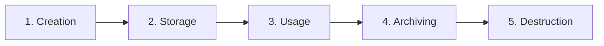
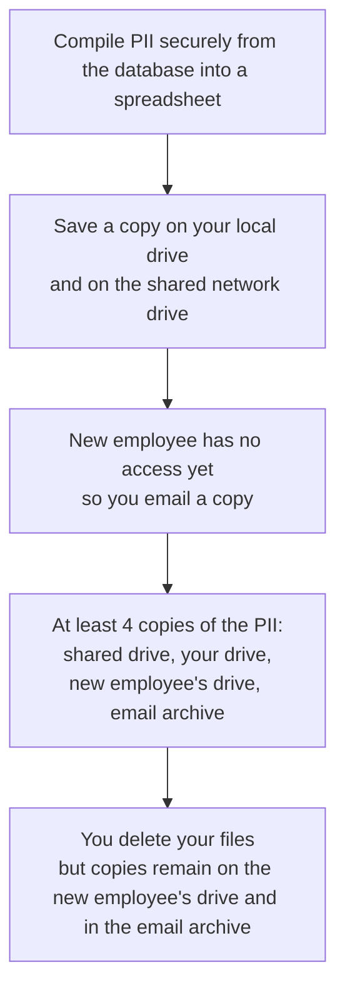
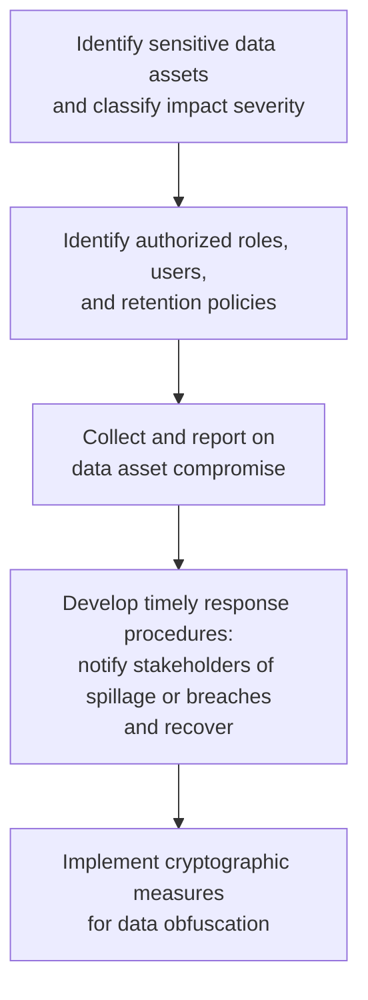
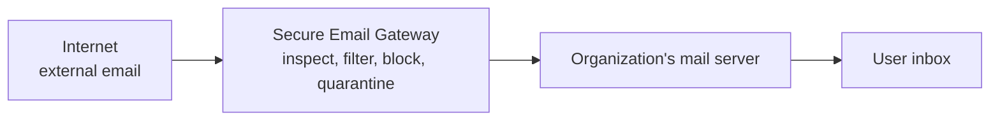
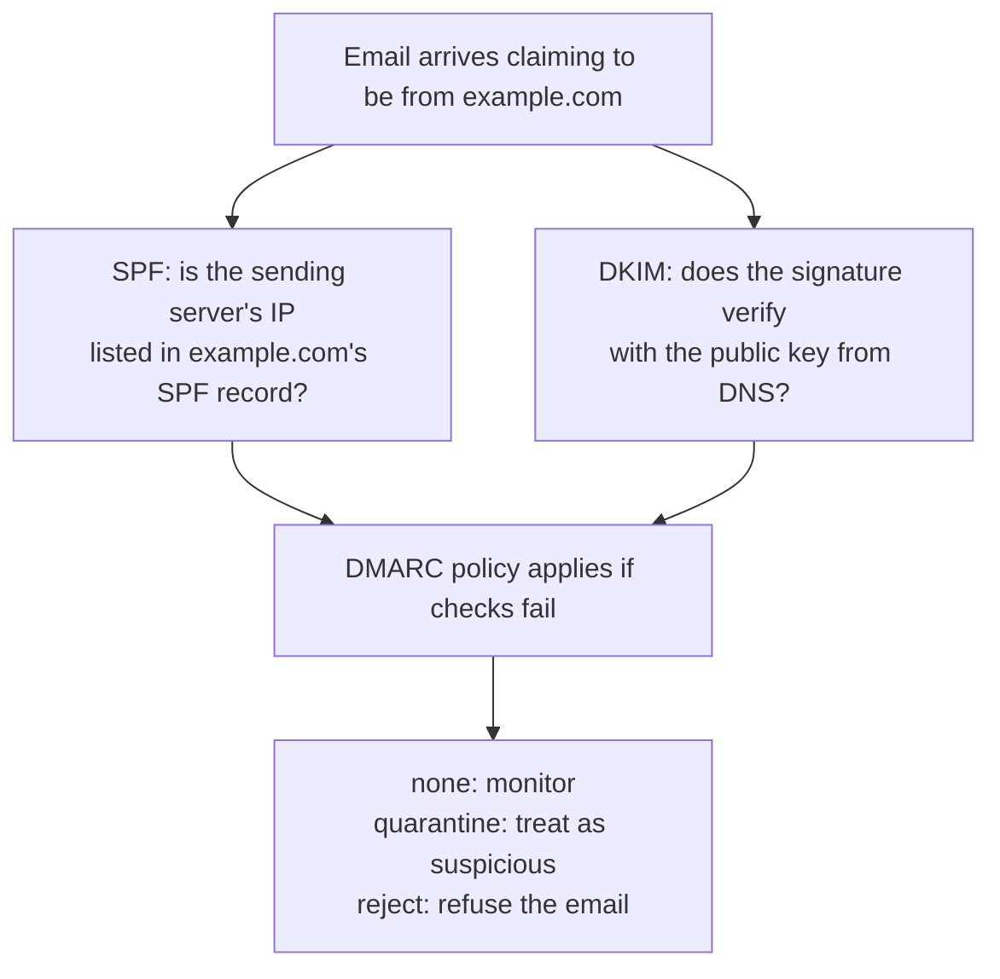
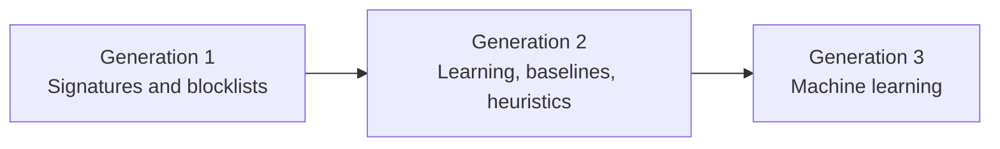
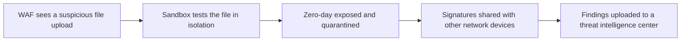
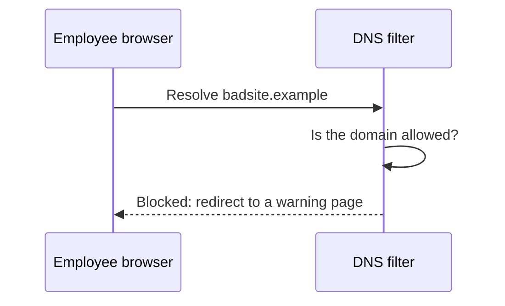

# Module 9: Secure Data and Applications

In this module you will learn why **data privacy and protection** matter, and the technologies and techniques used to secure data and applications: **data protection and the data life cycle**, **data privacy laws**, **secure email gateways (SEGs)**, **web application firewalls (WAFs)**, **content filters**, and **application hardening**.

---

## 📚 Table of Contents

- [🎯 Learning Objectives](#-learning-objectives)
- [Lesson 1: Secure Data and Applications Overview](#lesson-1-secure-data-and-applications-overview)
- [Lesson 2: Data Protection](#lesson-2-data-protection)
  - [2.1 What Is Data Protection?](#21-what-is-data-protection)
  - [2.2 Data Security vs Data Privacy](#22-data-security-vs-data-privacy)
  - [2.3 Three States of Data](#23-three-states-of-data)
  - [2.4 Data Protection Goals and Data Sovereignty](#24-data-protection-goals-and-data-sovereignty)
  - [2.5 Why Data Protection Matters](#25-why-data-protection-matters)
  - [2.6 Types of Sensitive Data](#26-types-of-sensitive-data)
  - [2.7 Risks to Data](#27-risks-to-data)
  - [2.8 The Data Life Cycle](#28-the-data-life-cycle)
  - [2.9 Scenario: Copies of Sensitive Data](#29-scenario-copies-of-sensitive-data)
  - [2.10 Best Practices to Protect Data](#210-best-practices-to-protect-data)
  - [2.11 Data Loss Prevention (DLP)](#211-data-loss-prevention-dlp)
- [Lesson 3: Data Privacy](#lesson-3-data-privacy)
  - [3.1 What Is Data Privacy?](#31-what-is-data-privacy)
  - [3.2 Why Data Privacy Matters](#32-why-data-privacy-matters)
  - [3.3 Privacy Risk](#33-privacy-risk)
  - [3.4 Role of Organizations](#34-role-of-organizations)
  - [3.5 Data Classification](#35-data-classification)
  - [3.6 Laws and Regulations](#36-laws-and-regulations)
- [Lesson 4: Secure Email Gateway](#lesson-4-secure-email-gateway)
  - [4.1 Spam and Phishing](#41-spam-and-phishing)
  - [4.2 What Is a Secure Email Gateway?](#42-what-is-a-secure-email-gateway)
  - [4.3 SEG Features](#43-seg-features)
  - [4.4 Content Filters vs Spam Filters](#44-content-filters-vs-spam-filters)
  - [4.5 SPF, DKIM and DMARC](#45-spf-dkim-and-dmarc)
  - [4.6 SEG Evolution and FortiMail](#46-seg-evolution-and-fortimail)
- [Lesson 5: Web Application Firewall](#lesson-5-web-application-firewall)
  - [5.1 What Is a WAF?](#51-what-is-a-waf)
  - [5.2 WAF vs Edge Firewall](#52-waf-vs-edge-firewall)
  - [5.3 History of the WAF](#53-history-of-the-waf)
  - [5.4 Common Web Application Attacks](#54-common-web-application-attacks)
  - [5.5 Three Generations of WAF](#55-three-generations-of-waf)
  - [5.6 Collective Defense](#56-collective-defense)
  - [5.7 FortiWeb](#57-fortiweb)
- [Lesson 6: Content Filters](#lesson-6-content-filters)
  - [6.1 What Is Content Filtering?](#61-what-is-content-filtering)
  - [6.2 Types of Content Filters](#62-types-of-content-filters)
  - [6.3 DNS-Based vs Web Filtering](#63-dns-based-vs-web-filtering)
  - [6.4 Benefits](#64-benefits)
- [Lesson 7: Application Hardening Techniques](#lesson-7-application-hardening-techniques)
  - [7.1 What Is Application Hardening?](#71-what-is-application-hardening)
  - [7.2 Web Browser Hardening](#72-web-browser-hardening)
  - [7.3 Proxy and Centralized Configuration](#73-proxy-and-centralized-configuration)
  - [7.4 Individual User Behavior](#74-individual-user-behavior)
  - [7.5 Benefits](#75-benefits)
- [🌍 Real-World Scenarios](#-real-world-scenarios)
- [📊 Comparisons](#-comparisons)
- [🧠 Key Takeaways](#-key-takeaways)
- [📝 Quick Revision](#-quick-revision)
- [❓ Knowledge Check](#-knowledge-check)
- [🔗 Related Modules](#-related-modules)

---

## 🎯 Learning Objectives

After completing this module, you will be able to:

- Explain the role of organizations in **data privacy**, especially **compliance** with laws and regulations.
- Explain why protecting data is an **ongoing effort throughout the data life cycle**.
- Define data protection, list **data types and risks**, and describe **best practices** to protect data.
- Define a **secure email gateway**, list its features, and explain **SPF, DKIM, and DMARC**.
- Explain how a **WAF** differs from a traditional edge firewall and describe the WAF's evolution.
- **Compare different content filters** and explain their benefits.
- Apply **application hardening** techniques.

> 📝 **Note on sources:** This README **follows the course wording** and uses the simplified notes for examples. Differences are marked **⚠️ Flagged**, added material **(added)**, and illustrative examples **(from notes)**.

> 📝 **Note on structure:** The lesson numbers follow the course page's lesson list (01 to 07). The supplementary notes numbered the lessons differently (they had no overview lesson), so I matched content by topic. Lesson 1 is built from the module introduction text.

---

# Lesson 1: Secure Data and Applications Overview

> 💡 **Key idea:** Sensitive information must be secured **on the internet and in applications**. **More applications and greater complexity lead to more opportunities for attacks.**

This module gives you an understanding of these fundamentals:

| Fundamental | Explanation |
|-------------|-------------|
| **Role of organizations in data privacy** | Especially **compliance with laws and regulations**. Compliance drives **consistency across all vertical markets** and ensures those storing sensitive data are **held accountable** for its safety |
| **Protecting data is ongoing** | Like other commodities, data has a **life cycle**, and those managing it are responsible for protection **at each stage**: from initial generation to eventual **archival or deletion** |
| **Content filters** | Help manage data by **restricting access to sensitive or harmful content** |
| **Application hardening** | Protecting an application by **eliminating vulnerabilities and increasing layers of security** |

| Lesson | Topic |
|--------|-------|
| [Lesson 2](#lesson-2-data-protection) | Data protection, data life cycle, DLP |
| [Lesson 3](#lesson-3-data-privacy) | Data privacy, classification, laws |
| [Lesson 4](#lesson-4-secure-email-gateway) | SEG, SPF/DKIM/DMARC, FortiMail |
| [Lesson 5](#lesson-5-web-application-firewall) | WAF, SQL injection, FortiWeb |
| [Lesson 6](#lesson-6-content-filters) | Search, email, DNS, and web filters |
| [Lesson 7](#lesson-7-application-hardening-techniques) | Browser and application hardening |

---

# Lesson 2: Data Protection

After this lesson you will be able to define data protection and its importance, list data types and risks, describe the data life cycle, and define best practices to protect data.

## 2.1 What Is Data Protection?

> 💡 **Definition:** Protecting sensitive data includes **security and privacy safeguards** for data **at rest, in use, and in transit** to ensure the **confidentiality, availability, integrity, and non-repudiation** of data assets. **Data protection = data privacy + data security.**

> 🌍 **Example (from notes):** A bank stores names, account numbers, passwords, phone numbers, and transactions. If an attacker steals them, customers lose money and the bank loses its reputation.

---

## 2.2 Data Security vs Data Privacy

### 🔒 Data security refers to (course):

- **Maintaining the integrity of digital and physical assets**, including the **tactics and techniques** that protect against **unauthorized access and exploitation** of sensitive data.
- Ensuring integrity **throughout the entire data life cycle**, including protecting personal data from **unauthorized third-party access and malicious attacks**.
- **Properly authorizing data use and access**, so only those with proper authority access sensitive data.

Data security **also includes**:

- **Data sovereignty**: data is subject to the **laws and governance structures of the nation where it is collected**.
- **Data privacy**.

| Data Security | Data Privacy |
|---------------|--------------|
| **How do we protect data?** | **How should we collect and use data?** |
| Preventing unauthorized access, theft, and modification | Proper handling of personal information |
| Example: encrypting customer information | Example: collecting customer information only for a valid purpose |

> 🧠 **Remember:** **Security = protecting data. Privacy = handling data responsibly.**

> 🚨 Even the most secure environments can be undermined, often inadvertently, by **a single person**. **Everybody** has a role in defending against internal or external breaches.

---

## 2.3 Three States of Data

| State | Meaning | Examples |
|-------|---------|----------|
| **Data at rest** | Stored, not moving | Files on a laptop, a server database, documents in cloud storage |
| **Data in transit** | Moving between locations | Sending an email, uploading a file, accessing a website |
| **Data in use** | Being accessed, processed, or modified | Editing a spreadsheet, viewing customer information, processing a transaction |

> 🎯 Data **constantly moves between rest, transit, and use**, and must be protected in **all three states**.

---

## 2.4 Data Protection Goals and Data Sovereignty

| Goal | Meaning | Example (from notes) |
|------|---------|----------------------|
| **Confidentiality** | Only authorized people can access data | Only HR can see salary records |
| **Integrity** | Data stays accurate and unchanged unless authorized | An attacker can't change a bank balance |
| **Availability** | Data is accessible when needed | Employees reach servers during working hours |
| **Non-repudiation** | A person cannot deny an action when reliable proof exists | A digitally signed document proves who signed it |

> 🔗 **Connection to Modules 1 and 5:** [CIA triad](Module-01-README.md#the-cia-triad) and [digital signatures](Module-05-README.md#42-digital-signatures) (non-repudiation).

> 💡 **Data sovereignty (from notes):** data is governed by the laws of the country where it is collected or stored, depending on the applicable rules. Example: an Indian company storing customer data on a server in another country may have to follow specific requirements for where data is stored, processed, and transferred.

---

## 2.5 Why Data Protection Matters

- **Course statistics:** In the **first half of 2021**, data breaches exposed **18.8 billion records**. The **average cost of a data breach in 2021 was $4.24 million**, up from **$3.86 million in 2020**.
- **Beyond financial risk:**
  - Loss of **intellectual property and proprietary data**.
  - Loss of **public and customer trust**.
  - **Legal risks**, including investigations by the **information commissioner's office** and even the police.
  - In the **payment card industry**, breaches with **non-compliance with data protection standards** can mean **lawsuits, loss of contracts, and ultimately loss of business**.

> ⚠️ **Flagged:** These figures are from the course (2021 and 2022) and are dated. Memorize them for the exam if asked, but don't treat them as current values.

> 📖 **Beginner Explanation (added):** A **data breach** happens when sensitive information is accessed, exposed, stolen, or disclosed without authorization.

---

## 2.6 Types of Sensitive Data

| Data Type | Meaning (course) | Example (from notes) |
|-----------|------------------|----------------------|
| **CUI** (controlled unclassified information) | **Government created or owned** information | Government technical documents |
| **PII** (personally identifiable information) | Can be **public, private, or restricted**, such as **addresses or biometric data** | Name, address, biometrics |
| **PHI** (protected health information) | Related to an individual's **health care and status** | Medical reports, patient records |
| **PCI data** (payment card industry) | Related to **administration and responsibility for electronic payments** | Card numbers, payment details |
| **Sensitive institutional data** | Protected under **legal, regulatory, administrative, and contractual** requirements | Company financial records |
| **IT security information** | **Sensitive data within a protected network** | Firewall configs, credentials, network diagrams |
| **Export control records** | Data on **exported items and export restrictions**, such as for **weapons** | Restricted technology documents |
| **Student education records** | Records maintained by an **educational agency or institution** | Marksheets, attendance |

> ⚠️ **Flagged:** The course writes "Personally identifiable *identification*", which is a typo for **information**.

---

## 2.7 Risks to Data

As data volumes explode, these risks grow:

| Risk | Meaning |
|------|---------|
| **Accidental data exposure** | For example, **APIs** let two applications interact in the cloud **without user action**. **Insecure external-facing APIs** can give unauthorized access to sensitive data |
| **Unintentional sharing of sensitive information** | For example **phishing**: attackers send a fraudulent message to trick the receiver into sharing information |
| **Infection by malicious software** | **Malware, ransomware, doxware, or leakware** compromise the confidentiality, integrity, and availability of data |

> 📖 **Beginner Explanation (added, from notes):** An **API (application programming interface)** is a way for two applications to communicate. **Ransomware** encrypts data and demands payment. **Doxware / leakware** steals data and **threatens to publish it** unless a ransom is paid.

### 🚨 Internal Threats

- An employee **inadvertently moving restricted data to the cloud** or giving authorized access to sensitive data.
- **Legitimate credentials stolen** and the account compromised.
- A **malicious employee** intentionally stealing confidential data for **fraud, sabotage, espionage, revenge, or extortion**.

> 🔗 **Connection to Modules 3 and 4:** [Insider threats](Module-03-README.md#41-what-is-an-insider-threat), [phishing](Module-03-README.md#24-phishing), and [ransomware](Module-04-README.md).

---

## 2.8 The Data Life Cycle

Risks exist throughout the life cycle, which has **five stages**:

| Stage | Meaning | Example (from notes) |
|-------|---------|----------------------|
| **Creation** | Data is generated or collected | A customer registers on a website |
| **Storage** | Saved for future use | Saved in a database |
| **Usage** | Accessed, processed, or modified | An employee views customer data |
| **Archiving** | Long-term retention of data not frequently needed | Old financial records move to archive |
| **Destruction** | Permanently removed when no longer required | Secure erasure under policy |

> 🧠 **Remember:** **Creation → Storage → Usage → Archiving → Destruction.** Security is required at **every stage**.

---

## 2.9 Scenario: Copies of Sensitive Data

> 🌍 **Course scenario:** You must create a document listing **customer names, email addresses, social security numbers, and dates of birth**.

- More copies mean **more risk and a company more susceptible to cyberattack**.
- Deleting from your drives doesn't destroy the **other copies**, so PII stays at risk.

> ✅ **Recommendation:** **Avoid emailing sensitive documents.** Send **links to secure shared drives**. Shared network drives with **access controls** are more secure and **limit copying**.

**Other life-cycle best practices:** follow **naming conventions**, **back up data** per policy, **archive** per policy, **delete** per guidelines, and follow the **data management policy**.

---

## 2.10 Best Practices to Protect Data

| Practice | Meaning |
|----------|---------|
| **Training** | Helps everybody understand the importance of data protection and become a **human firewall** against data theft. Covers **strong passwords, regular updates and patches, MFA, and controlling access** to sensitive data |
| **Data obfuscation or masking** | **Minimizes the value of sensitive data to unauthorized intruders** and differentiates information availability by authorization level |
| **Encryption** | Enhances **confidentiality** and can provide **integrity**, for example a **certificate digitally signing** data to show it wasn't changed |
| **Data resiliency** | For **availability and business continuity**: **regular backups or storage high availability** keep data accessible despite corruption or cyberattacks |
| **Secure destruction** | At end of life, use the correct procedure, such as **erasure**, which **overwrites existing data with meaningless pseudo-random patterns** |
| **Data loss prevention (DLP)** | **Automatic** detection and prevention of **breaches, exfiltration, or unwanted destruction** of sensitive data |

> 🌍 **Masking example (from notes):** `4532 1234 5678 9012` is shown as `XXXX XXXX XXXX 9012`.

> 📝 **Note (from notes):** Simply pressing **Delete** may not permanently remove data, which is why erasure is used.

> 🔗 **Connection to Module 5:** [Symmetric and asymmetric encryption](Module-05-README.md#34-symmetric-algorithms). **Connection to Module 8:** [Backups and patching](Module-08-README.md#36-endpoint-maintenance-patching-and-backups).

---

## 2.11 Data Loss Prevention (DLP)

> 💡 **DLP** helps organizations:
> - **Identify sensitive information** across multiple **on-premises and cloud-based** systems.
> - **Prevent accidental sharing** of data.
> - **Audit and monitor** data movements.
> - **Educate users** on staying compliant.
>
> DLP **reduces risks while improving regulatory compliance.**

### 📍 Where DLP Can Be Implemented

| Location | Purpose | Example (from notes) |
|----------|---------|----------------------|
| **Endpoint** | Usually a **software client** on a laptop or workstation | Stop copying confidential files to USB |
| **Network** | Usually on the **perimeter**, to detect **data in transit** | Detect sensitive data leaving the company |
| **Storage** | On **data-center servers**, to inspect **data at rest** | Find confidential records in a database |
| **Cloud** | **SaaS** that protects data stored in cloud services | Stop sensitive documents being shared publicly |

> 🌍 **Example (from notes):** An employee tries to send a database of card numbers to a personal email address. DLP detects the sensitive content and blocks the email.

> 🔗 **Connection to Module 8:** [DLP and FDE on endpoints](Module-08-README.md#35-protecting-data-fde-tpm-sed-and-dlp).

---

# Lesson 3: Data Privacy

After this lesson you will be able to define data privacy and its importance, describe the role of organizations, and explain how laws and regulations affect privacy.

## 3.1 What Is Data Privacy?

> 💡 **Definition:** **Data privacy** refers to the **proper handling of personal data and other sensitive data types**.

- It includes the **public's expectation of privacy** and the **right to control their own personal data**.
- Organizations must **balance processing personal data** with **respecting and protecting individual privacy preferences**.
- It focuses mainly on **processes used to collect, process, share, archive, and delete** sensitive data, **policies for acceptable levels of risk**, and **compliance** with data protection laws and regulations.

> 🌍 **Example (from notes):** You give an online shop your name, phone, email, address, and payment details. The company should collect only necessary information, explain why, restrict access, protect it, and follow rules for sharing and deleting.

---

## 3.2 Why Data Privacy Matters

| Reason | Meaning |
|--------|---------|
| **Data is extremely valuable** | It is an **asset** that must be protected once collected |
| **Privacy laws** | Ensure individuals have **control over their data** |
| **Transparency** | Organizations must say **what they collect, why, who can access it, and how they store, manage, delete, and share it** |
| **Governments recognize the right to privacy** | Reflected in many privacy and protection laws |
| **Collection is easier** | Technology makes collecting private data easier, so protecting it is vital |
| **Non-compliance consequences** | **Fines, lawsuits, reputational damage, loss of customer loyalty** |

---

## 3.3 Privacy Risk

> 💡 **Privacy risk** is **the likelihood of experiencing problems resulting from data processing.** That is why **data privacy and security go together.**

- A breach exposing **personally identifiable customer data** costs about **$150 per record** (course figure).

> 🌍 **Example (from notes):** A company shares customer phone numbers with unauthorized third parties. Customers get unwanted calls and scams. That is a privacy risk.

> ⚠️ **Flagged:** The $150 per record figure is from the course and may be dated.

---

## 3.4 Role of Organizations

Proprietary research, HR resources, and financial information must be protected to maintain operations. To protect private data, organizations must:

| Responsibility (from notes) | Example |
|-----------------------------|---------|
| Define access permissions | HR sees salaries, ordinary employees don't (least privilege) |
| Define retention policies | Keep financial records for the legally required period |
| Monitor and report breaches | Procedures to report data exposure |
| Incident response | Who to inform, how to contain, recover, and notify |

> 🔗 **Connection to Module 7:** [Least privilege](Module-07-README.md#66-least-privilege-and-zero-trust).

---

## 3.5 Data Classification

> 💡 All information assets should be assigned a **data classification level**, such as **Restricted, Confidential, Internal, or Public**, based on the **appropriate audience**. The **sensitivity level guides the selection of protective measures**, and **data handling controls differ by level**. All classification and handling **policies must be followed**.

| Classification | Meaning (from notes) | Example |
|----------------|---------------------|---------|
| **Public** | Anyone can access | Public company website |
| **Internal** | For employees | Internal announcements |
| **Confidential** | Restricted to authorized people | Salary records |
| **Restricted** | Highly sensitive, strict access controls | Critical credentials |

> ⚠️ **Flagged:** Class names and rules **vary between organizations**. The government-style levels in [Module 1](Module-01-README.md#information-classification) and [Module 7's lattice example](Module-07-README.md#55-lattice-based-access-control) use different labels. Know the idea (levels drive protection), and use the labels the exam question gives.

---

## 3.6 Laws and Regulations

Laws and regulations make sure individuals **control their data**. **Employees** must understand and follow the privacy rules of their organization, because **even the strictest regulations can be undermined, often inadvertently, by a single employee.**

| Name | Meaning (course list; descriptions from notes) |
|------|------------------------------------------------|
| **GDPR** | General Data Protection Regulation (European Union) |
| **ISO 27701** | Standard for privacy information management systems |
| **NIST SP 800-53** | Security and privacy controls for information systems and organizations |
| **SOC 2** | Framework evaluating controls for security, availability, confidentiality, processing integrity, and privacy |
| **PIPEDA** | Canadian federal private-sector privacy law |
| **CCPA** | California Consumer Privacy Act |
| **HIPAA** | US law protecting certain healthcare information |
| **PCI DSS** | Security standard for protecting payment card information |

> 🎯 **Exam Focus:** Match each name to its purpose. **HIPAA = health. PCI DSS = payment cards. GDPR = EU. CCPA = California. PIPEDA = Canada.**

---

# Lesson 4: Secure Email Gateway

After this lesson you will be able to define a SEG, explain its features, list mechanisms that identify legitimate senders and reduce spoofing, and define terms such as spam and phishing.

## 4.1 Spam and Phishing

Email is a fast, inexpensive way to communicate and also **affords anonymity**. Anyone can broadcast to a vast audience at almost no cost, so bad actors use email to **spread misinformation, promote fraud, steal personal information, and distribute malware**.

| | **Spam** | **Phishing** |
|---|----------|--------------|
| **Meaning** | **Unsolicited and irrelevant email** sent to many recipients | Spam that **entices recipients to click a link or download a file**; named by **America Online in 1996** |
| **Intent** | Often advertising or other unwanted purposes | **Malicious**: steal credentials, information, or money |
| **Always malicious?** | **Not necessarily** | Yes |

- Phishing relies on **human naivety, carelessness, or distraction**. Education has not ended it.
- **Growth:** 176 attacks recorded in **2004**, **28,000 in 2012**, and an estimated **500 million in 2022** (course). It is profitable and **the leading cause of data breaches**, costing an average **$4.35 million** per breach.

> ⚠️ **Flagged:** These statistics are from the course and dated.

> 🔗 **Connection to Module 3:** [Phishing](Module-03-README.md#24-phishing) and [spear phishing and whaling](Module-03-README.md#25-spear-phishing-and-whaling).

---

## 4.2 What Is a Secure Email Gateway?

> 💡 **Definition:** A **secure email gateway (SEG)** is a technology solution that protects organizations from **email-based threats** and ensures the **security and privacy of email communications**. It is a **barrier between the organization's email infrastructure and the external email network (the internet)**.

**Before an email reaches the inbox, the SEG can check (from notes):** is the sender legitimate, does it contain spam, do attachments contain malware, do links lead to malicious sites, and is sensitive company information leaving. Dangerous email can be **blocked, quarantined, or rejected**.

---

## 4.3 SEG Features

| Feature | What It Does |
|---------|--------------|
| **1. Content filtering** | Controls and manages **content that can be accessed or shared**. Used in web filtering, email filtering, and DLP to enforce content policies |
| **2. DLP** | Prevents **unauthorized or accidental leakage** of sensitive and confidential information |
| **3. Spam filtering** | Reduces spam reaching the inbox |
| **4. Authentication and identity verification** | Supports methods to **authenticate senders and validate email sources**, to **prevent spoofing and impersonation** |
| **5. Malware filtering** | **Scans attachments and links** for malware before they reach the inbox |
| **6. Encryption** | **Encrypts email** to protect content from unauthorized access **during transmission**. Some systems **digitally sign** emails to identify the sender and verify content integrity |

> 🌍 **Example (from notes):** An employee tries to send a spreadsheet of card details to a personal Gmail account. DLP detects it and blocks the email under policy.

> 📖 **Beginner Explanation (added):** **Email spoofing** is forging the sender address so an email looks like it came from a trusted person, for example appearing to come from `admin@company.com` when it didn't.

---

## 4.4 Content Filters vs Spam Filters

| | **Content filters** | **Spam filters** |
|---|---------------------|------------------|
| **Goal** | Control and manage the **types of content** accessed or shared | **Reduce the spam** reaching a user's inbox |
| **Targets** | A **broader range**: spam plus **inappropriate or sensitive data** | Emails with **spam characteristics** |
| **Technologies** | **Keyword matching, regular expressions, deep packet inspection, context-aware analysis** | **Bayesian filters, deny lists, allow lists, machine learning** |
| **How** | Enforce content policy | **Highly automated**, with algorithms and heuristics and **databases of known spammers and patterns** |

**What spam filters look at:** **suspicious sender addresses, excessive use of certain keywords, known spam patterns, and IP addresses with poor reputations.**

| Technique | Meaning (from notes) |
|-----------|----------------------|
| **Bayesian filter** | Uses probability to decide whether an email is spam from its characteristics |
| **Deny list** | Blocked senders, domains, or IPs |
| **Allow list** | Trusted senders, domains, or IPs |
| **Machine learning** | Learns from email patterns |

---

## 4.5 SPF, DKIM and DMARC

> 🎯 **Very important for the exam.** These three work together for email authentication.

| Technology | Full Form | Question It Answers | How |
|------------|-----------|---------------------|-----|
| **SPF** | **Sender Policy Framework** | Is this **server** allowed to send mail for this domain? | The receiving server checks the sender domain's **SPF record** to see whether the **sending server's IP address is authorized**. If not listed, the email may be **flagged, rejected, or otherwise handled** per the server's configuration |
| **DKIM** | **DomainKeys Identified Mail** | Is the email's **digital signature** valid? | The sending server **signs** the email with a **private key**. The receiver gets the **public key from DNS** and verifies the signature. This helps verify the sender domain and that **signed parts were not changed in transit** |
| **DMARC** | **Domain-based Message Authentication, Reporting, and Conformance** | What should the receiver do if authentication **fails**? | The domain owner publishes a **policy** for emails failing SPF and/or DKIM checks, plus **reporting** |

**DMARC policies (from notes):**

| Policy | Meaning |
|--------|---------|
| **None** | Monitor, no special handling requested |
| **Quarantine** | Treat as suspicious, often moved to spam |
| **Reject** | Reject emails that fail the DMARC checks |

> ⚠️ **Flagged (added):** SPF **alone has limitations**. The course says to use it **with DKIM and DMARC**. Per the notes, DMARC decisions also depend on the domain's configured policy and **alignment requirements**.

> 🔗 **Connection to Module 5:** DKIM relies on [digital signatures and public/private keys](Module-05-README.md#42-digital-signatures).

---

## 4.6 SEG Evolution and FortiMail

- SEGs **evolve as threats evolve**. Today they have **greater automation and machine learning**, which **reduces the load on security operations centers**.
- Some SEGs integrate with other network security devices such as **edge and segmentation firewalls and sandboxes**.

> 📖 **Beginner Explanation (added):** A **sandbox** runs a suspicious file in an isolated environment to observe its behavior safely. See [Module 6: Sandbox](Module-06-README.md#lesson-9-sandbox).

> 💡 **FortiMail** is **Fortinet's SEG**. It includes all the features above, including **SPF, DKIM, and DMARC** support, and **integrates with firewalls and sandboxing solutions**.

---

# Lesson 5: Web Application Firewall

After this lesson you will be able to explain how WAFs differ from traditional edge firewalls and describe the evolution of WAFs and their applications.

## 5.1 What Is a WAF?

> 💡 **Definition:** A **web application firewall (WAF)** is an **appliance or software that monitors HTTP/HTTPS traffic** and can **block malicious traffic to and from a web application**.

By inspecting HTTP traffic, a WAF can stop attacks that target web application flaws such as **SQL injection, cross-site scripting (XSS), file inclusion, and security misconfigurations**.

---

## 5.2 WAF vs Edge Firewall

| | **Edge (traditional) firewall** | **WAF** |
|---|-------------------------------|---------|
| **Level** | **Network level** | **Application level** |
| **Role** | **Secure gateway between the LAN and outside servers** | Targets **content from specific web applications** |
| **Decides by** | Network addresses, ports, protocols, connection rules | The **contents of HTTP/HTTPS requests** |
| **Example** | Blocking unwanted internet traffic to the internal network | Blocking a login request containing SQL injection |

> 🧠 **Remember:** **Traditional firewall = protects network traffic. WAF = protects web applications.**

---

## 5.3 History of the WAF

- The **ancestor** is the **application firewall of the 1990s**. Mostly network-based, it could target some applications or protocols such as **FTP and RSH (remote shell)**.
- The **World Wide Web debuted in 1991**, the "big bang" of the internet. Openness let anyone explore, and also let bad actors misuse it.
- As more people became victims of **espionage and theft**, a defense against **HTTP-based attacks** became a priority.
- **Why edge firewalls weren't enough:** all web applications use **HTTP and port 80 or port 443**. Edge firewalls decided using a **blocklist of network addresses** and by **blocking protocols and port numbers**, which couldn't separate good from malicious web traffic.

---

## 5.4 Common Web Application Attacks

| Attack | Meaning |
|--------|---------|
| **SQL injection** | Inserting malicious SQL into input fields to manipulate database queries |
| **Cross-site scripting (XSS)** | Injecting malicious scripts into a site that run in **another user's browser** |
| **File inclusion** | Exploiting a flaw to include unauthorized files, possibly exposing files or allowing code execution |
| **Security misconfiguration** | Insecure setup, for example **default passwords, debug mode in production, unnecessary services, public sensitive directories** |

### 💉 Course Scenario: SQL Injection

You run an online business. **John Smith** enters his user ID (`jsmith`) and password on the login page, and a **back-end database** verifies them. A bad actor doesn't know the password. Instead of `abc123`, he types **`2+2=4`**. `abc123` evaluates as false, but `2+2=4` is a **valid SQL statement that evaluates as true**, so the attacker is given access. The **first generation of WAFs used blocklists and signature-based HTTP attributes** to stop such attacks.

> ⚠️ **Flagged:** `2+2=4` is the course's **simplified teaching example**. Real injections typically close the query early, for example with a quote and an always-true condition. The idea is the same: **user input is treated as SQL code**. The notes add that a WAF helps, but the **strongest protection is secure coding, especially parameterized queries**.

---

## 5.5 Three Generations of WAF

| Generation | How It Works | Limitation |
|------------|--------------|-----------|
| **1. Signature-based** | **Blocklists and known signatures** of HTTP attributes alert the firewall to attacks | The **popularity of the internet** made applications more numerous and complex, so signature-based WAFs became **obsolete**. **False positives** (legitimate connections flagged as attacks) grew beyond the capacity of IT security teams |
| **2. Behavior-based** | **Learns application behavior** and builds a **baseline**, then judges attempts as **normal or irregular (suspect)**. Adds **session monitoring and heuristics** to detect variants of known signatures | IT teams overseeing learning **couldn't keep up** with rapid mutations and new exploits, and there was **no defense against zero-day attacks** |
| **3. Machine learning** | **Behavior analysis at machine speed**, **without human supervision**, adapting to changing threat attributes | |

**Features added to WAFs:** **DDoS defense, IP reputation, antivirus, DLP** (and bot protection per the notes).

> 📖 **Beginner Explanation (added):** A **baseline** is a reference for what normal activity looks like. A **zero-day attack** exploits an unknown weakness in application code, so the developer had "zero days" to fix it.

> 🌍 **Example (from notes):** A shopping site normally gets product views, cart additions, and payments. Sudden requests trying to reach restricted database functions look suspicious against the baseline.

**What modern WAFs can do:**

- Monitor HTTP traffic and **stop actions that violate acceptable behavior**.
- **Identify a user**, correlate attempted actions with their permissions, and **stop actions beyond the scope of their role**.

---

## 5.6 Collective Defense

Modern WAFs **share information and collaborate** with other security devices such as **firewalls and sandboxes**, which makes them part of a **collective defense**.

> 🔗 **Connection to Module 6:** [Sandbox](Module-06-README.md#lesson-9-sandbox) and threat intelligence in [Module 2](Module-02-README.md).

---

## 5.7 FortiWeb

> 💡 **FortiWeb** is **Fortinet's WAF**. It defends **web applications and application programming interfaces (APIs)** against **all OWASP Top 10 threats, DDoS attacks, bot attacks, and more**. It uses **advanced, ML-powered features** for real-time protection against **known and unknown threats**, and can **integrate with FortiGate and FortiSandbox**.

---

# Lesson 6: Content Filters

After this lesson you will be able to define content filtering, describe how content filters work, and explain their benefits.

## 6.1 What Is Content Filtering?

> 💡 **Definition:** **Content filtering** is a process to **screen or restrict access to objectionable emails, webpages, executables, and other suspicious items**. It is a common security measure often **built into internet firewalls** that blocks content containing **harmful, illegal, or inappropriate** information.

> 🌍 **Example:** Parents use web filtering to protect children from improper or graphic material. A company can block malicious, gambling, adult, and malware-distributing sites (from notes).

---

## 6.2 Types of Content Filters

| Filter | How It Works |
|--------|--------------|
| **Search engine filters** | **Rate web content by its text and images.** Each has a **weight** measured against a **classification set**. Weights vary with the level set to **off, moderate, or strict**. **Machine learning** helps define weights to **avoid false positives**. Content is classified as **safe, moderate, inappropriate, or rejected** (strict view), and results display only if they meet the set level |
| **Email filters** | Check the **header** of incoming mail against **real-time blackhole lists**. The **raw body** is scanned for inappropriate content, giving a **spam confidence level** similar to search engine weights. They also check **attachments**, keywords, and unauthorized file types such as **executables**. Users can **block, quarantine, or reject** malicious email, including phishing, while accepting appropriate email |
| **DNS-based content filters** | Check the website **during domain resolution** through DNS servers using **blocklists**. If not allowed, the browser is **redirected to a replacement message** saying the page is blocked. A company may instead use an **allowlist** of company-approved sites, and all other sites are blocked |
| **Web filters** | Like DNS-based filters **plus categorization of websites**. All sites and contents are **rated through machine learning**, and access to a URL is **allowed or blocked by its category and the user's profile** |

> 🌍 **Web filter example (course):** US schools must follow the **Children's Internet Protection Act (CIPA)**, which addresses children's access to **obscene or harmful content**, so elementary and high schools use web filters to block material harmful to minors.

> 📖 **Beginner Explanation (added, from notes):** **DNS** translates domain names into IP addresses. **Quarantine** moves suspicious content to an isolated place where users can't access it normally.

---

## 6.3 DNS-Based vs Web Filtering

| | **DNS-based filtering** | **Web filtering** |
|---|-------------------------|-------------------|
| **Checks** | **Domains during DNS resolution** | Web requests and **URLs** |
| **Granularity** | Can block an **entire domain** | **Category-based** policies |
| **Uses** | DNS **blocklists and allowlists** | **Website categories, user profiles, policies** |
| **Example** | Block a known malicious domain | Allow educational sites, block gambling |

> 🧠 **Remember:** **Blocklist = what is not allowed. Allowlist = what is allowed (all else blocked).**

---

## 6.4 Benefits

| Benefit | Explanation |
|---------|-------------|
| **Malware protection** | Block sites **known to carry malware**, protecting data and users |
| **Phishing and exploit kit protection** | Identify phishing or an **exploit kit** and **block access before a malicious download** is triggered |
| **Bandwidth efficiency** | Limiting users to **work-related internet** gives **faster connections for all employees** |
| **Productivity** | Web filtering of **social media and online shopping** sites increases staff productivity |

> 📖 **Beginner Explanation (added):** An **exploit kit** is a collection of tools that attackers use to exploit software vulnerabilities.

> 🔗 **Connection to Module 6:** Content filtering is built into firewalls. See [Network threats and prevention](Module-06-README.md#lesson-10-common-network-threats-and-prevention).

---

# Lesson 7: Application Hardening Techniques

After this lesson you will be able to define the importance of application hardening, describe its techniques, and explain its benefits.

## 7.1 What Is Application Hardening?

> 💡 **Definition:** The process of **securely configuring and maintaining apps** to protect the corresponding data.

- App stores and websites make it easy to download many applications. Bad actors can **maliciously tamper with apps and use them as an attack vector, even if downloaded from official and reputable sites**.
- **Hardening** is a recommended requirement in various **cybersecurity regulations and standards**. It **minimizes vulnerabilities and reduces the attack surface**, protecting application integrity and sensitive data.
- Organizations reinforce **company-approved tools and applications** and train employees on secure behavior.

> 📖 **Beginner Explanation (added):** The **attack surface** is the total number of possible entry points an attacker could use. Unused apps, unnecessary services, outdated software, and extra extensions all enlarge it. See [Module 8](Module-08-README.md#lesson-1-endpoint-security-overview).

---

## 7.2 Web Browser Hardening

Many applications are now **web-based**. IT recommends a **stable browser** that the employee's OS supports and that meets company security standards. Employees then **install and configure the approved browser** on all work devices.

| Technique | Guidance |
|-----------|----------|
| **Use approved browsers** | Compatible, stable, OS-supported, and compliant with security standards |
| **Manage cookies** | A **cookie** tracks an individual's **browsing history or authentication credentials**, and **flash cookies** (local shared objects) do too. **Clear all cookies at the end of a browsing session and allow only required cookies.** Manage cookies, cache, and history through the browser's advanced security options |
| **Manage add-ons** | Add-ons may hold sensitive information and **expose browsing data such as login credentials**. Install **only official add-ons the company approves** |
| **Use pop-up blockers** | Pop-ups are usually unwanted ads meant to entice clicks and may **download viruses or ransomware**. **Turn on pop-up blockers** and create an **allowlist** for trusted sites |
| **Control active content** | **ActiveX controls, Java applets, and Flash** can result in downloading malicious code that is injected into a device. Treat with care |

> 🌍 **Examples (from notes):** A website session cookie can be stolen and misused to access your account. A fake pop-up says "Your computer is infected! Click here to install antivirus."

> ⚠️ **Flagged:** **Flash is end-of-life** and no longer supported by modern browsers. The course still lists it as an example of active content, so keep it for the exam but don't expect to meet it today.

---

## 7.3 Proxy and Centralized Configuration

### 🌐 Proxy Server

> 💡 A **recommended company proxy** helps protect against attackers. It can **filter restricted sites** and **improve bandwidth usage through caching and content filtering**.

> 📖 **Beginner Explanation (added, from notes):** A proxy is an **intermediary** between a user and the internet. **Caching** stores frequently accessed content temporarily so it can be delivered faster next time. With 100 employees visiting the same approved site, a cache reduces repeated downloads.

### ⚙️ Configuration and Patching

- Browsing policies can be implemented through a **configuration file applied to all users**.
- Applications and extensions need **automatic updates and patch maintenance** to continuously fix vulnerabilities.
- Apply the configuration through a **patch management system**, or per user as a recommendation.

> 📖 **Beginner Explanation (added, from notes):** **Patch management** is identifying, testing, and installing software patches.

---

## 7.4 Individual User Behavior

| Behavior | Why |
|----------|-----|
| **Use updated antivirus** | Scans and blocks malicious code such as **worms, Trojan horses, and spyware** |
| **Use an application allowlist** | A list of **supported and recommended third-party applications**, which may also include **user account controls** to prevent unauthorized access |
| **Disable or remove obsolete or unused applications** | Avoids **backdoor openings** for attacks |
| **Security awareness training** | The **most valuable hardening technique**: each user becomes a **human firewall**. It helps users create **strong passwords**, **recognize social engineering**, and respond appropriately |

> 🔗 **Connection to Module 4:** [Worms and Trojans](Module-04-README.md). **Connection to Module 3:** [Social engineering](Module-03-README.md).

---

## 7.5 Benefits

- Provides a **high level of security and confidence** at the same time.
- **Improves application performance**, because it lowers the risk of attackers **slowing or blocking** applications.
- **Costly and effortful**, but **the return on investment is greater**. For example, it can **block an attacker from installing ransomware and stealing highly sensitive patient data from a hospital**.
- Provides a **safer environment** and **easier security compliance and audits**.

| Benefit (from notes) | Explanation |
|----------------------|-------------|
| Improved security | Fewer vulnerabilities and attack opportunities |
| Data protection | Protects sensitive information |
| Compliance | Helps meet standards and regulations |
| Reduced attack surface | Removes unnecessary apps, services, features |
| Business continuity | Lowers the risk of disruptive attacks |

---

## 🌍 Real-World Scenarios

| Scenario | Concept Applied |
|----------|-----------------|
| Sensitive spreadsheet emailed to a new hire, copies remain | Data life cycle risk, send links to secure drives instead |
| Card number shown as `XXXX XXXX XXXX 9012` | Data masking |
| Old records overwritten with random patterns | Secure destruction (erasure) |
| A server fails but a backup server takes over | Data resiliency |
| An email with card data to a personal address is blocked | DLP |
| A hospital collects patient data | PHI, needs privacy compliance (HIPAA) |
| A company that stores card data must comply | PCI DSS |
| Email claiming to be `admin@company.com` fails SPF/DKIM | Spoofing stopped by SPF, DKIM, DMARC |
| A DMARC policy of reject on failed checks | DMARC handling |
| Attachment is an infected executable and is quarantined | SEG malware filtering |
| A login form is sent `2+2=4` instead of a password | SQL injection, a WAF's job |
| A malicious script in a comment runs in other users' browsers | XSS |
| A WAF sends a suspicious upload to a sandbox | Collective defense |
| A school blocks adult sites by category | Web filter (CIPA) |
| A known malicious domain returns a block page | DNS-based filter |
| A company allows only approved sites | Allowlist |
| Browser pop-up says "Your computer is infected!" | Pop-up blocker, active content risk |
| Only approved apps can run | Application allowlisting |

---

## 📊 Comparisons

| Pair | Difference |
|------|------------|
| Data security vs data privacy | Protecting data vs handling personal data responsibly |
| Data at rest vs in transit vs in use | Stored vs moving vs being processed |
| Spam vs phishing | Unwanted email vs fraudulent email meant to trick |
| Content filter vs spam filter | Broad content policy (keywords, regex, DPI) vs reducing spam (Bayesian, lists, ML) |
| SPF vs DKIM vs DMARC | Authorized sending server vs digital signature vs policy and reports |
| Edge firewall vs WAF | Network level vs application level (HTTP/HTTPS) |
| Signature vs behavior vs ML WAF | Known patterns vs learned baseline vs machine-speed behavior analysis |
| DNS-based vs web filter | Domain during resolution vs categorized URL and user policy |
| Blocklist vs allowlist | Block listed items vs allow only listed items |
| Masking vs encryption | Hides values vs makes data unreadable without a key |
| Erasure vs Delete | Overwriting data vs removing a reference |

### 🧱 Where Each Tool Sits

| Tool | Protects | Fortinet Product |
|------|----------|------------------|
| SEG | Email | FortiMail |
| WAF | Web applications and APIs | FortiWeb |
| Content filter | Web, DNS, email, search | Built into firewalls and security services |
| DLP | Endpoint, network, storage, cloud | Part of several products |

---

## 🧠 Key Takeaways

- ✅ **Data protection = data security + data privacy**, across **rest, transit, and use**, for **confidentiality, integrity, availability, and non-repudiation**.
- ✅ The data life cycle: **creation, storage, usage, archiving, destruction**. **Fewer copies** means less risk. Share **links**, not attachments.
- ✅ Protect data with **training, masking, encryption, resiliency, secure destruction, and DLP** (endpoint, network, storage, cloud).
- ✅ **Privacy** means responsible handling. Organizations **identify, classify, control access, set retention, report breaches, and respond**. Laws include **GDPR, HIPAA, PCI DSS, CCPA, PIPEDA, SOC 2, ISO 27701, NIST SP 800-53**.
- ✅ A **SEG** guards email with **content filtering, DLP, spam and malware filtering, encryption, and sender authentication**. **SPF** checks the server, **DKIM** the signature, **DMARC** the policy. Fortinet's SEG is **FortiMail**.
- ✅ A **WAF** inspects **HTTP/HTTPS** at the application level against **SQL injection, XSS, file inclusion, and misconfiguration**. WAFs evolved from signatures to learning to **machine learning**. Fortinet's WAF is **FortiWeb**.
- ✅ **Content filters**: search engine, email, DNS-based, and web, protecting against malware, phishing, and exploit kits and improving bandwidth and productivity.
- ✅ **Application hardening**: approved browsers, cookie and add-on control, pop-up blockers, careful active content, proxy, patching, antivirus, **allowlisting**, removing unused apps, and **training**.

---

## 📝 Quick Revision

**Data protection**
- Security + privacy. Rest, transit, use. CIA plus non-repudiation. Data sovereignty.
- Types: CUI, PII, PHI, PCI, sensitive institutional, IT security info, export control, student records.
- Risks: accidental exposure (APIs), phishing, malware (ransomware, doxware, leakware), insiders.
- Life cycle: creation, storage, usage, archiving, destruction.
- Practices: training, masking, encryption, resiliency, erasure, DLP (endpoint, network, storage, cloud).

**Data privacy**
- Collect, process, share, archive, delete properly. Privacy risk. Classification: Restricted, Confidential, Internal, Public.
- Laws: GDPR, ISO 27701, NIST SP 800-53, SOC 2, PIPEDA, CCPA, HIPAA, PCI DSS.

**SEG**
- Spam vs phishing. Features: content filtering, DLP, spam, malware, encryption, authentication.
- SPF (server), DKIM (signature), DMARC (policy: none, quarantine, reject, plus reports). FortiMail.

**WAF**
- HTTP/HTTPS, application level. SQLi, XSS, file inclusion, misconfiguration.
- Signature, behavior (baseline), ML. DDoS, IP reputation, antivirus, DLP. FortiWeb (OWASP Top 10, APIs).

**Content filters**
- Search engine (off, moderate, strict), email (RBLs, attachments), DNS-based (blocklist, allowlist), web (categories, user profile, CIPA).
- Benefits: malware, phishing, exploit kits, bandwidth, productivity.

**Application hardening**
- Approved browser, cookies, add-ons, pop-ups, active content, proxy and caching, config file, patching, antivirus, allowlisting, remove unused apps, training.

---

## ❓ Knowledge Check

**Q1. (Multiple choice)** Which type of data is currently moving from one system to another?

- A) Data at rest
- B) Data in transit
- C) Data in use
- D) Archived data

Show answer

**B) Data in transit.** Data at rest is stored, and data in use is being processed.

**Q2. (Multiple choice)** Which stage comes after Usage in the data life cycle?

- A) Creation
- B) Storage
- C) Archiving
- D) Destruction

Show answer

**C) Archiving.** Creation, storage, usage, archiving, destruction.

**Q3. (Conceptual)** Why is emailing a sensitive spreadsheet risky, and what is the better approach?

Show answer

It creates extra copies (the recipient's drive and the email archive) that deleting your own copies doesn't remove. Instead, send a link to a secure shared drive with access controls, which limits copying.

**Q4. (Multiple choice)** What is the primary purpose of DLP?

- A) Increase internet speed
- B) Prevent sensitive information from leaking
- C) Create backups
- D) Block all email

Show answer

**B).** DLP identifies, monitors, and prevents unauthorized leakage or sharing of sensitive data, on endpoints, networks, storage, and in the cloud.

**Q5. (Multiple choice)** Which regulation protects certain US healthcare information?

- A) GDPR
- B) PCI DSS
- C) HIPAA
- D) PIPEDA

Show answer

**C) HIPAA.** GDPR is EU, PCI DSS is payment cards, PIPEDA is Canada.

**Q6. (Multiple choice)** Which email authentication technology checks whether the sending server is authorized for a domain?

- A) DKIM
- B) DMARC
- C) SPF
- D) DLP

Show answer

**C) SPF.** DKIM verifies a digital signature, and DMARC sets the policy and reporting when checks fail.

**Q7. (Conceptual)** What is the difference between spam and phishing?

Show answer

Spam is unsolicited, irrelevant email sent to many recipients, and it isn't always malicious. Phishing is spam or messages that entice the recipient to click a link or download a file to steal information, so it is malicious.

**Q8. (Multiple choice)** An attacker injects malicious SQL into a login form. What is this attack, and what product class helps stop it?

- A) Phishing, SEG
- B) SQL injection, WAF
- C) DDoS, content filter
- D) Spoofing, proxy

Show answer

**B) SQL injection, WAF.** A WAF inspects HTTP/HTTPS requests. Secure coding with parameterized queries is also needed.

**Q9. (Multiple choice)** Which content filtering method checks domains during DNS resolution?

- A) Email filtering
- B) DNS-based filtering
- C) Search engine filtering
- D) Application allowlisting

Show answer

**B) DNS-based filtering.** Blocked domains return a block page. Web filters add categorization.

**Q10. (Multiple choice)** What does application allowlisting do, and which Fortinet product provides SEG functionality?

- A) Allows every app, FortiWeb
- B) Allows only approved apps to run, FortiMail
- C) Blocks all internet, FortiGate
- D) Encrypts files, FortiAnalyzer

Show answer

**B).** Allowlisting permits only approved applications, and FortiMail is Fortinet's secure email gateway.

---

## 🔗 Related Modules

| Module | Link |
|--------|------|
| ⬅️ Previous | [Module 8: Endpoint Security](Module-08-README.md) |
| ➡️ Next | [Module 10: Cloud Security and Virtualization](Module-10-README.md) |

### 🔗 Connections to Earlier Modules

| Module 9 Topic | Connects To |
|----------------|-------------|
| CIA triad and non-repudiation | [Module 1: CIA triad](Module-01-README.md#the-cia-triad) |
| Data classification levels | [Module 1: Information classification](Module-01-README.md#information-classification) |
| Phishing, spoofing, spam | [Module 2: Phishing variants](Module-02-README.md#38-phishing-variants-and-trojans) and [Module 3: Phishing](Module-03-README.md#24-phishing) |
| Insider threats to data | [Module 3: Insider threats](Module-03-README.md#41-what-is-an-insider-threat) |
| Ransomware, doxware, worms, Trojans | [Module 4: Malware](Module-04-README.md) |
| Encryption, DKIM signatures, non-repudiation | [Module 5: Digital signatures](Module-05-README.md#42-digital-signatures) |
| Sandbox, firewalls, content filtering in firewalls | [Module 6: Sandbox](Module-06-README.md#lesson-9-sandbox) |
| Least privilege and data access | [Module 7: Least privilege](Module-07-README.md#66-least-privilege-and-zero-trust) |
| DLP, patching, backups, attack surface, EPP/EDR | [Module 8: Data protection on endpoints](Module-08-README.md#35-protecting-data-fde-tpm-sed-and-dlp) |
