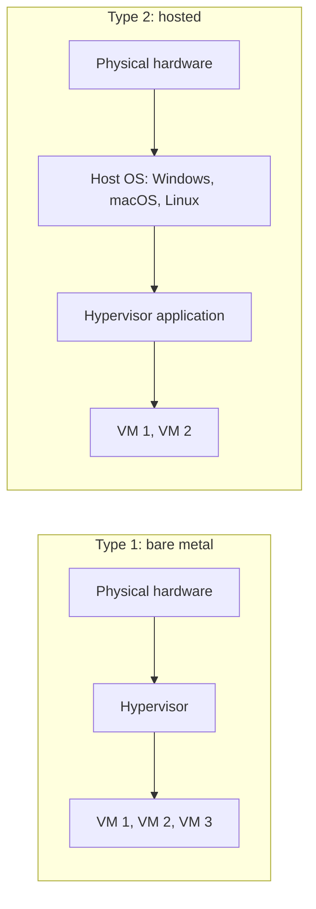
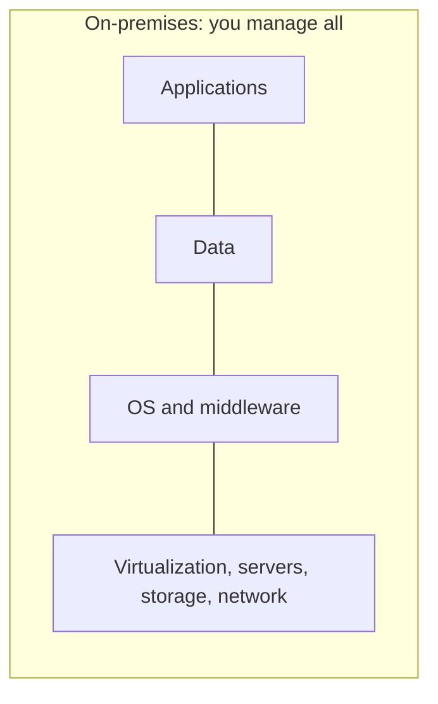
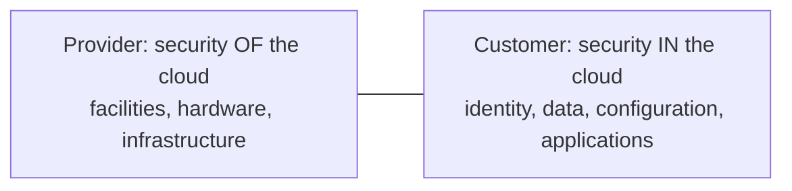
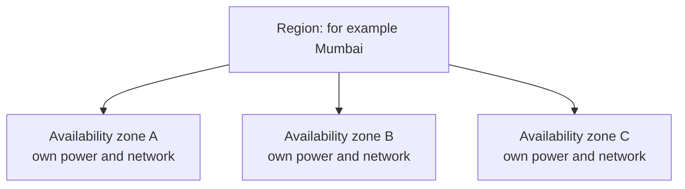
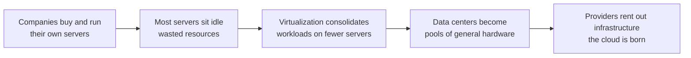
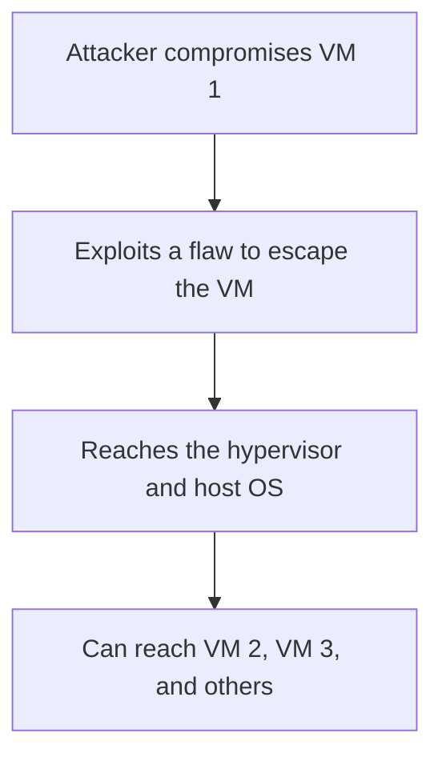
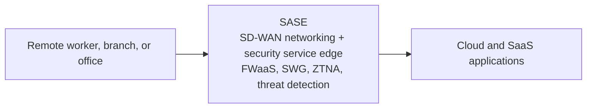
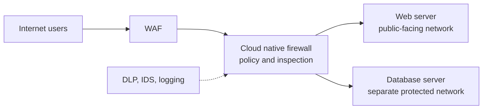
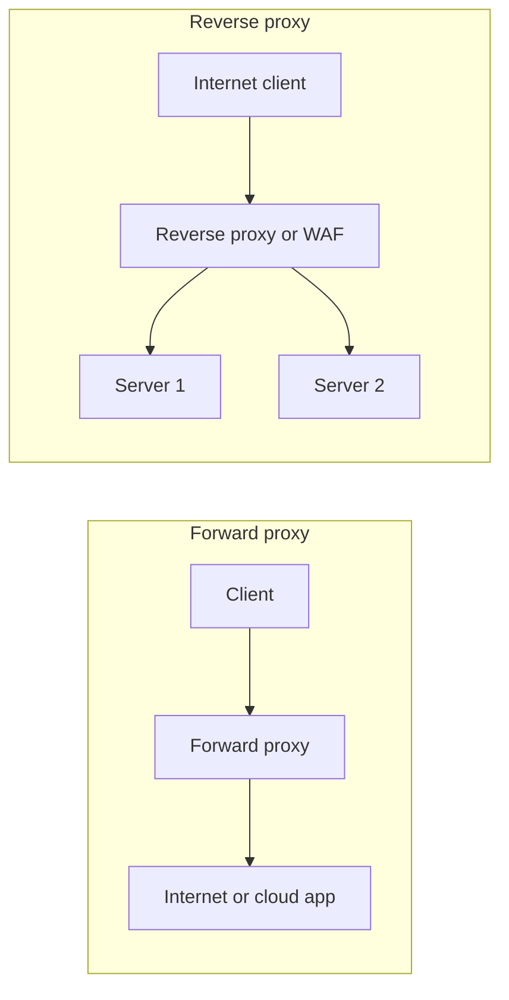
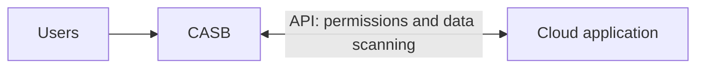

# Module 10: Cloud Security and Virtualization

In this module you will learn about the common threats associated with using **applications, virtual machines (VMs), and data in the cloud**, and how to mitigate them with security technology. You will also learn about **security services hosted in the cloud**, such as firewalls and email gateways, and how **APIs** help securely connect cloud services with other network components and third-party applications.

---

## 📚 Table of Contents

- [🎯 Learning Objectives](#-learning-objectives)
- [Lesson 1: Cloud Security and Virtualization Overview](#lesson-1-cloud-security-and-virtualization-overview)
- [Lesson 2: Virtualization Overview](#lesson-2-virtualization-overview)
  - [2.1 What Is Virtualization?](#21-what-is-virtualization)
  - [2.2 Advantages of Virtualization](#22-advantages-of-virtualization)
  - [2.3 Hypervisors: Type 1 vs Type 2](#23-hypervisors-type-1-vs-type-2)
  - [2.4 VMware Products](#24-vmware-products)
  - [2.5 Microsoft Hyper-V](#25-microsoft-hyper-v)
  - [2.6 Citrix Hypervisor](#26-citrix-hypervisor)
- [Lesson 3: Cloud Overview](#lesson-3-cloud-overview)
  - [3.1 What Is the Cloud?](#31-what-is-the-cloud)
  - [3.2 Benefits of the Cloud](#32-benefits-of-the-cloud)
  - [3.3 IaaS, PaaS and SaaS](#33-iaas-paas-and-saas)
  - [3.4 Shared Responsibility](#34-shared-responsibility)
  - [3.5 Regions and Availability Zones](#35-regions-and-availability-zones)
  - [3.6 Cloud Vendors and Products](#36-cloud-vendors-and-products)
- [Lesson 4: Cloud Security](#lesson-4-cloud-security)
  - [4.1 How the Cloud Came to Be](#41-how-the-cloud-came-to-be)
  - [4.2 Types of Cloud Services](#42-types-of-cloud-services)
  - [4.3 How Cloud Environments Are Secured](#43-how-cloud-environments-are-secured)
  - [4.4 Vendor Tool Problems and Multicloud](#44-vendor-tool-problems-and-multicloud)
- [Lesson 5: Virtual Machine Risks](#lesson-5-virtual-machine-risks)
  - [5.1 Secure Virtualization](#51-secure-virtualization)
  - [5.2 Securing VMs](#52-securing-vms)
  - [5.3 VM Escape](#53-vm-escape)
  - [5.4 Data Remanence](#54-data-remanence)
  - [5.5 Privilege Escalation](#55-privilege-escalation)
  - [5.6 Live VM Migration Attacks](#56-live-vm-migration-attacks)
- [Lesson 6: Common Cloud Threats](#lesson-6-common-cloud-threats)
  - [6.1 Configuration Errors](#61-configuration-errors)
  - [6.2 The Seven Common Risks](#62-the-seven-common-risks)
  - [6.3 Authentication and Authorization](#63-authentication-and-authorization)
  - [6.4 Data Protection and VM Creep](#64-data-protection-and-vm-creep)
  - [6.5 APIs and CORS](#65-apis-and-cors)
  - [6.6 Logging and Monitoring](#66-logging-and-monitoring)
- [Lesson 7: Cloud Hosted Security Services](#lesson-7-cloud-hosted-security-services)
  - [7.1 Security Devices in the Cloud](#71-security-devices-in-the-cloud)
  - [7.2 Cloud Firewalls, Email Gateways and WAFs](#72-cloud-firewalls-email-gateways-and-wafs)
  - [7.3 Authentication as a Service and CASB](#73-authentication-as-a-service-and-casb)
  - [7.4 Cloud Browser, Antivirus and Sandbox](#74-cloud-browser-antivirus-and-sandbox)
  - [7.5 SIEM, SOC and SOCaaS](#75-siem-soc-and-socaas)
  - [7.6 CNP, CNAP and SECaaS](#76-cnp-cnap-and-secaas)
  - [7.7 SASE](#77-sase)
- [Lesson 8: Securing the Cloud](#lesson-8-securing-the-cloud)
  - [8.1 Protecting Cloud Servers](#81-protecting-cloud-servers)
  - [8.2 Protecting Authentication and Applications](#82-protecting-authentication-and-applications)
  - [8.3 Forward Proxy vs Reverse Proxy](#83-forward-proxy-vs-reverse-proxy)
  - [8.4 API-Based Security with CASB](#84-api-based-security-with-casb)
  - [8.5 REST vs SOAP](#85-rest-vs-soap)
  - [8.6 Securing APIs](#86-securing-apis)
- [🌍 Real-World Scenarios](#-real-world-scenarios)
- [📊 Comparisons](#-comparisons)
- [🧠 Key Takeaways](#-key-takeaways)
- [📝 Quick Revision](#-quick-revision)
- [❓ Knowledge Check](#-knowledge-check)
- [🔗 Related Modules](#-related-modules)

---

## 🎯 Learning Objectives

After completing this module, you will be able to:

- Define **virtualization**, list its advantages, and contrast **type 1 and type 2 hypervisors**.
- Describe **cloud fundamentals**, the **IaaS/PaaS/SaaS** models, **shared responsibility**, and **regions and availability zones**.
- Explain the **unique security risks** of virtual and cloud-based machines (VM escape, data remanence, privilege escalation, live migration attacks, misconfiguration, VM creep, and more).
- List the **types of security services hosted in the cloud** (CNF, WAF, SEG, authentication as a service, CASB, cloud browser, antivirus, sandbox, SIEM, SOCaaS, SECaaS, SASE).
- Explain how **cloud-based security devices** protect online applications and devices, and how **proxies and APIs** secure connections to cloud services.

> 📝 **Note on sources:** This README **follows the course wording** and uses the simplified notes for examples. Differences are marked **⚠️ Flagged**, added material **(added)**, and illustrative examples **(from notes)**.

> 📝 **Note on structure:** The lesson boundaries follow the course page's lesson list (01 to 08), matched to each lesson's objectives. Lesson 1 is built from the module introduction text.

---

# Lesson 1: Cloud Security and Virtualization Overview

> 💡 **Key idea:** Servers are no longer limited to a piece of hardware in a basement closet. **Virtualization** lets you run multiple virtual computers on a single piece of hardware, so the number of devices running and connecting to each other, locally and over the internet, has **increased exponentially**. Many services and applications now exist **only virtually** and connect **only over the internet**.

- **Cloud computing advantages:** **availability, scalability, and cost.**
- **Drawback:** serious implications for **security**.
- With so many devices in the cloud, administrators find it **much harder to keep all online data, applications, and machines secure**, which is important so that **the compromise of one machine does not endanger the entire cloud environment**.
- Securing **virtual and real machines, servers, and applications** in the cloud needs a **specialized set of security tools**.

| Lesson | Topic |
|--------|-------|
| [Lesson 2](#lesson-2-virtualization-overview) | Virtualization and hypervisors |
| [Lesson 3](#lesson-3-cloud-overview) | Cloud fundamentals, service models, vendors |
| [Lesson 4](#lesson-4-cloud-security) | How cloud environments are secured |
| [Lesson 5](#lesson-5-virtual-machine-risks) | VM risks |
| [Lesson 6](#lesson-6-common-cloud-threats) | Cloud threats |
| [Lesson 7](#lesson-7-cloud-hosted-security-services) | Security services hosted in the cloud |
| [Lesson 8](#lesson-8-securing-the-cloud) | Protecting servers, authentication, proxies, and APIs |

---

# Lesson 2: Virtualization Overview

After this lesson you will be able to define virtualization, describe its advantages, list hypervisor types, and describe the differences between type 1 and type 2 hypervisors.

## 2.1 What Is Virtualization?

> 💡 **Definition:** **Virtualization** is the creation of a **virtual version of something**, such as an **operating system, server, storage device, or network resources**.

- It uses **software that emulates hardware functionality** to create a virtual system.
- Virtualization software **partitions hardware resources**, such as processing, memory, and networking, onto a **host machine**. The host **allocates these resources** so **multiple emulated machines** run on **one hardware platform**.
- IT organizations can run **multiple operating systems, more than one virtual system, and various applications** on a **single server**.

| Term (from notes) | Meaning |
|-------------------|---------|
| **Host machine** | The physical computer running virtualization |
| **Guest machine** | A virtual machine running inside the host |
| **Hypervisor** | Software that creates and manages VMs |

> 🌍 **Example (from notes):** One laptop runs three VMs: Windows 11, Ubuntu Linux, and Windows Server. A company with 10 physical servers each using 20% of capacity can run virtual servers on fewer physical machines.

---

## 2.2 Advantages of Virtualization

| Advantage | Meaning |
|-----------|---------|
| **Greater efficiency and economies of scale** | Efficient use of **CPU, memory, and storage** |
| **Lower costs** | Virtualized networks need **no excessive hardware** and have **lower energy costs** |
| **Use in many environments** | **Production, development, and test** environments, for example to virtualize **database services** or **application servers** |
| **Better disaster recovery** | Quick and easy management of production environments |
| **Isolation** | Development and test environments are **isolated** |

---

## 2.3 Hypervisors: Type 1 vs Type 2

> 💡 **Hypervisor** (also a **virtual machine monitor, VMM**): software that **enables the deployment and management of VMs**. It **partitions the hardware and system resources** of the host and **manages their allocation** to the VMs.

They fall into two categories. The **key difference is how they communicate with system hardware**.

| | **Type 1** | **Type 2** |
|---|-----------|-----------|
| **Also called** | **Bare metal** or **native** hypervisor | **Hosted** hypervisor |
| **Runs on** | **Directly on the physical hardware**, interacting with the CPU, memory, and storage | **Over an existing OS** as a **software application** |
| **Role** | Takes on the **role of the OS** and performs resource partitioning and management | Acts as a **VM manager** that coordinates calls for host resources **through the host OS** |
| **Hardware** | **Dedicated**, high-performance hardware designed to run many VMs. **Requires a management console** | **No dedicated hardware** needed |
| **Where used** | **Data centers** | An end user's **PC**: Windows, macOS, or Linux |
| **Examples** | **Oracle VM Server for SPARC, ESXi, Hyper-V, KVM** | **VMware Fusion, Oracle VirtualBox, Oracle VM for x86, Solaris Zones, Parallels Desktop, VMware Workstation Pro** |

> 🧠 **Remember:** **Type 1 = directly on hardware. Type 2 = runs over an existing OS.**

> ⚠️ **Flagged:** The course's example lists are reproduced as written. Some products blur the categories (for example **KVM** is part of the Linux kernel, and **Solaris Zones** is more of an OS-level isolation feature). For the exam, use the course's grouping above.

---

## 2.4 VMware Products

### 🏢 Enterprise products

| Product | What It Is |
|---------|-----------|
| **VMware ESXi** | An **enterprise-class type 1 hypervisor** for deploying and serving virtual computers. As a type 1 hypervisor it includes **vital OS components such as a kernel**, so it is **not a software application** and is installed at the **OS level** (on the hardware) |
| **VMware vCenter** | A software application for **centralized management of multiple ESXi hosts** through a **single interface**. Features include **vSphere vMotion, Distributed Resource Scheduler, High Availability, vSAN**, and more |
| **VMware vSphere** | A **software suite** that includes **ESXi, vCenter, and an HTML5-based vSphere client** |

### 💻 Desktop and end-user products

| Product | What It Is |
|---------|-----------|
| **VMware Workstation Pro** | A **type 2 hypervisor** for professional creation and management of VMs on **Windows or Linux** |
| **VMware Fusion** | The **macOS counterpart** to Workstation Pro. Connects to vSphere and manages **snapshots** |
| **VMware Player** | The **free, lightweight** counterpart with **basic management only**. It **cannot connect VMs to vSphere, create snapshots, or customize virtual networks** |

> ⚠️ **Flagged (added):** Vendor product lines and licensing change over time. The descriptions above are the course's. In the course text for ESXi the sentence is garbled ("must therefore 1 hypervisors"), so I kept only the clear parts.

---

## 2.5 Microsoft Hyper-V

> 💡 **Hyper-V** is Microsoft's best-known product for deploying and managing VMs. It has **three installation types**:

| Type | Description |
|------|-------------|
| **Windows Server Hyper-V** | Installed as a **role on Windows Server**, providing hypervisor service for managing resources. **The most common way** |
| **Hyper-V Server** | A **standalone** version. It needs **no license to install**, but **all VMs need a proper OS license** |
| **Client Hyper-V** | Included in **non-server operating systems**. **Not for production**, but for **development or testing** |

---

## 2.6 Citrix Hypervisor

> 💡 **Citrix Hypervisor** is a **type 1 hypervisor** developed by Citrix. It supports **Citrix Virtual Apps and Citrix Virtual Desktops**, enabling **centralized management and deployment of virtual applications and desktop environments**. Administrators can **deploy specific services to specific groups of users**.

> 🌍 **Example (from notes):** An organization gives employees virtual desktops they access remotely.

---

# Lesson 3: Cloud Overview

After this lesson you will be able to describe cloud fundamentals, explain the purpose and benefits of the cloud, name cloud vendors, and describe cloud products.

## 3.1 What Is the Cloud?

> 💡 **Definition:** The **cloud** refers to **software and services offered by companies that specialize in making their data center resources available over the internet**, rather than installing them on your computer or physical network.

- Many users use the cloud daily without realizing it, most commonly **internet data storage**. Once uploaded, data can be accessed **from anywhere, using any device with an internet connection**.
- Behind the scenes are **large, high-capacity data centers**. Cloud companies usually offer **data storage, computing power, whole networks**, and more, so businesses can **outsource parts or all of their IT services**.

> 🌍 **Example (from notes):** Instead of buying and maintaining 5 TB of storage yourself, you buy cloud storage from Google Drive or OneDrive.

---

## 3.2 Benefits of the Cloud

| Benefit | Meaning |
|---------|---------|
| **Easy access** | A **working internet connection is all that is required** |
| **High availability (HA) and fault tolerance** | Most providers let you configure them. They **keep services up in the event of a failure** and enable **disaster recovery** after data loss |
| **Reliable and safe at scale** | HA and fault tolerance make the cloud reliable for **processing and storing large amounts of data** |
| **Cost** | Pay a recurring operating cost instead of buying hardware |

> 📖 **Beginner Explanation (added, from notes):** **Scalability** means increasing or decreasing resources as workload changes. **Elasticity** means adjusting automatically to real-time demand, for example more servers during a festival sale and fewer afterwards.

---

## 3.3 IaaS, PaaS and SaaS

> 🎯 Three important service categories. **The main difference is how much of the underlying architecture the customer must manage.** Compared to on-premises (where the organization manages all hardware and software), the cloud relieves the customer of most of that responsibility.

| Model | Provider Supplies | Customer Handles | Examples |
|-------|-------------------|------------------|----------|
| **IaaS** (Infrastructure as a Service) | **Network, processing power, storage, servers**, fully managed by the provider. Customer pays for **only the resources used** | Their **own VM operating systems, middleware, data, and applications** | **Linux VM in AWS or Azure** |
| **PaaS** (Platform as a Service) | IaaS plus **OS, databases, and application run-time environments**. The provider manages and secures these | **Applications and data** | **Hosting a web application or web page**. Easier, more efficient, cheaper to **build, test, and deploy** applications |
| **SaaS** (Software as a Service) | **Almost everything**: architecture, platforms, environments. Software is hosted by a third party and used usually through a **browser, dashboard, or API** | Only **the software they want to use** | **Dropbox, OneDrive, Google Mail, Salesforce, DocuSign, Netflix** |

| Layer | IaaS | PaaS | SaaS |
|-------|------|------|------|
| Network, storage, servers, virtualization | Provider | Provider | Provider |
| OS and middleware | **Customer** | Provider | Provider |
| Application | **Customer** | **Customer** | Provider |

- **Why IaaS:** useful when **demand varies**, such as seasonal holidays when workloads increase. **Middleware** is software that bridges the OS and applications.
- Moving from company-owned capital hardware to a **recurring operating cost** is attractive to most organizations.

> 🧠 **Remember:** **IaaS = rent infrastructure. PaaS = rent a platform. SaaS = use ready-made software.**

> ⚠️ **Flagged (added):** The table shows the layers the provider manages. In **all three models the customer remains responsible for their data and for who has access to it**. SaaS products also have customer-side settings (permissions, sharing, MFA) that still need to be configured securely.

---

## 3.4 Shared Responsibility

> 💡 **Security is a shared responsibility** between the cloud provider and the customer.

| Cloud provider | Customer |
|----------------|----------|
| Responsible for the security **of the cloud** | Responsible for security **within the cloud** |
| Physical data centers, physical servers and network, underlying infrastructure, infrastructure availability (from notes) | User accounts and permissions, application security, data protection, access control, secure configuration (from notes) |

- **Most of the responsibility lies with the customer**, because most cloud security failures come from **weaknesses or flaws in their applications**.
- **Gartner estimates 99% of cloud security failures are user-driven**, attributed to **human error and security misconfiguration**.

> 🌍 **Example (from notes):** A company stores customer information in an AWS storage bucket. AWS protects its physical infrastructure, but if the company accidentally makes the bucket public, attackers may read it. That is a **customer-side misconfiguration**.

> ⚠️ **Flagged:** The 99% figure is the course's citation of a Gartner estimate and is dated. Remember the idea: **most failures are customer-side**. Also the **exact division of responsibility depends on the service model**.

> 🔗 **Connection to Module 7:** [Least privilege](Module-07-README.md#66-least-privilege-and-zero-trust) and [access control](Module-07-README.md#lesson-5-access-control-and-methods) apply directly to cloud identity.

---

## 3.5 Regions and Availability Zones

| Term | Meaning |
|------|---------|
| **Region** | A **geographical area** (for example the **US East Coast**) in which **multiple isolated groups of data centers** reside. The customer usually chooses it |
| **Availability zone (AZ)** | One of those isolated groups, usually **multiple data centers**. Each has its **own, usually redundant, power and networking** |

- Isolating groups of data centers into AZs gives **high availability and failover** between groups. The redundant design provides **almost 24/7 uptime** with minimal downtime.

> 🌍 **Example (from notes):** An application deployed across multiple AZs continues if one zone loses power.

---

## 3.6 Cloud Vendors and Products

| Platform | Launched | Notes (course) |
|----------|----------|----------------|
| **Amazon Web Services (AWS)** | **2006**, the first | Immense market share lead |
| **Microsoft Azure** | **2010** | Second in market share |
| **Google Cloud Platform (GCP)** | **2011** (Google App Engine announced **2008**) | Third-largest |

- Together the three hold **more than half of the market share**.
- Products span **computing power, storage, databases, networking, media services, mobile, machine learning (ML)**, and more. They serve businesses of all sizes, for example **eBay, PayPal, and Meta**.

---

# Lesson 4: Cloud Security

After this lesson you will be able to explain what the cloud is and how it came to be, identify the different types of cloud services, and describe how cloud environments are secured.

## 4.1 How the Cloud Came to Be

- **Before the cloud:** organizations bought computer systems for their own facilities, managed by teams of experts, often **more than one server per major application**. This was expensive in **hardware capital and labor**, but worth it for productivity.
- **Waste:** someone noticed that **only a few systems were fully busy** at any moment.
- **Virtualization** (from old **mainframe** technology) lets one server run the OS and applications of multiple servers. It **consolidates workloads onto fewer servers**, increasing use and saving money.
- Entrepreneurs built **enormous data centers** filled with general hardware and **rented out portions** so customers could run virtualized applications there. **The cloud was born.**

---

## 4.2 Types of Cloud Services

| Type | Course Description |
|------|--------------------|
| **IaaS** | Provides **networking, storage, physical servers, and virtualization**. Users still provide **computers with OS, middleware, data, and applications**. Good when **demand varies** (seasonal holidays). Examples: AWS, Azure, GCP |
| **PaaS** | Rented cloud **platforms for developers** to develop and deliver applications. Provides the **OS and middleware** on top of IaaS. Easier, more efficient, and cheaper to **build, test, and deploy** |
| **SaaS** | Software **hosted by a third party**, typically used through a **browser**. Examples: **Google Mail, Salesforce, DocuSign, Netflix** |

> 📖 **Beginner Explanation (added):** In the Module 8 lesson you saw SaaS apps like Dropbox and OneDrive. See also [Module 8](Module-08-README.md) for the same endpoints connecting to these services.

---

## 4.3 How Cloud Environments Are Secured

- **On-premises:** the picture is straightforward: put the right security technology at the right locations.
- **Cloud:** it is **not so clear**. **Security is a shared responsibility**, and is **designed in layers**, with **physical and logical components**.

| Who | Responsible for (IaaS example) |
|-----|-------------------------------|
| **Vendor** | **Availability** (infrastructure is highly available and **uptime is the vendor's responsibility**) and **securing only the infrastructure it provides** |
| **Customer** | When you install virtualized applications in the vendor's cloud, **you** secure **access, network traffic, and data and applications** |

---

## 4.4 Vendor Tool Problems and Multicloud

Most vendors supply some security tools for the customer's environment, but they pose problems:

| Problem | Why |
|---------|-----|
| **1. Basic functions only, shared with the infrastructure** | Vendors use **the same tools** to secure the underlying infrastructure. If an attacker **bypasses these tools at the infrastructure layer, they can likely bypass them at the customer's application level too** |
| **2. The multicloud problem** | Many organizations are **hybrid**: some apps in their **own data centers**, some in **Vendor-A IaaS**, some in **Vendor-B**, and others with **multiple SaaS vendors**. This is a **multicloud** environment with **multiple, independent, uncoordinated security solutions**, where **complexity scales geometrically** with the number of vendors |
| **3. Skills shortage** | **Highly trained security staff are scarce**, and integrating and operating multiple nonintegrated security environments is a burden |

> 💡 **Fortinet's answer (course):** A portfolio of security solutions that work **in a company's data center with the same consistent security**, and are **optimized for all the leading IaaS cloud providers**.

> 🌍 **Hybrid vs multicloud (from notes):** *Hybrid* = own data center plus cloud (for example AWS VMs and Microsoft 365 email). *Multicloud* = services from multiple cloud providers (for example AWS, Azure, and Google Cloud).

> 🔗 **Connection to Module 6:** [Fortinet Security Fabric](Module-06-README.md#43-fortinet-security-fabric) provides consistent security across environments.

---

# Lesson 5: Virtual Machine Risks

After this lesson you will be able to define secure virtualization, explain why securing local and cloud VMs is important, and describe typical threats to VMs and their hypervisors.

## 5.1 Secure Virtualization

> 💡 **Definition:** Virtualization is **using a single physical hardware resource to create multiple virtual instances of working devices**. Virtual hardware may be **local** (laptop, desktop, data center servers) or **hosted by a third party** in a cloud and accessed only through **browsers and APIs**. **Secure virtualization** is achieved through **processes, procedures, and policies** that keep the virtualized infrastructure secure and protected.

### Two Areas to Secure

| Area | Why |
|------|-----|
| **Physical security of the hardware** | A virtual server can contain **hundreds or thousands of VMs**. Losing or compromising **one server** can have severe consequences |
| **The hypervisor** | It has **direct access to all VMs it runs**. Securing its **integrity and administrator accounts** is critical to securing all VMs on it |

Virtualization improves **availability, scalability, and elasticity**, reducing infrastructure costs, but adds security challenges for **device uptime, data storage, and machine security**.

---

## 5.2 Securing VMs

**Start with traditional practices:**

- **Patch** the OS and applications regularly.
- **Access management** with strong password policies.
- Install **virtual firewalls** in line with the protected VMs.
- Implement **cloud-network segmentation** to reduce the attack surface.

**Virtualization-specific considerations:**

| Practice | Why |
|----------|-----|
| **Limit connectivity between the VM and the host** | Segments them and avoids **virus propagation** through activities such as **file sharing** |
| **Remove unnecessary virtual hardware** | Reduces the attack surface |
| **Avoid virtualization sprawl** | Use sound VM management planning and oversight, such as **allowing only specific administrators to deploy a standard list of validated VM images** |
| **Restrict physical and administrative access to the hypervisor** | Protects every VM it hosts |

> 📖 **Beginner Explanation (added, from notes):** **Virtualization sprawl** is creating too many VMs without managing or removing them, for example 50 test VMs nobody deletes that keep consuming resources and may hold vulnerabilities.

> 🔗 **Connection to Module 6:** [Network segmentation](Module-06-README.md#51-what-is-network-segmentation).

---

## 5.3 VM Escape

> 💡 **Definition:** An attacker **runs code on a VM that lets them break out and interact directly with the hypervisor**. They can then gain access to the **host OS and all other VMs** on that host.

**Prevention:** secure and **patch the hypervisor and all virtualized OSs**, use **strong access controls and passwords**, and allow only **verified and trusted applications**.

---

## 5.4 Data Remanence

> 💡 **Definition:** Because of its elasticity, virtualization can **create and remove large amounts of data dynamically**. If the data is not correctly erased, the **residual representation of digital data**, called **data remanence**, can be **stolen by an attacker**.

**Prevention:** use an appropriate **secure data destruction process**:

| Method | Meaning (from notes) |
|--------|----------------------|
| **Overwriting** | Replacing existing data with new data |
| **Degaussing** | Using a magnetic field to erase data on **magnetic media** |
| **Crypto-erasing** | Destroying the **encryption keys** so encrypted data becomes inaccessible |
| **Shredding** | Physically destroying the storage media |

> ⚠️ **Flagged (added):** Degaussing works on **magnetic** media only, not on SSDs or flash storage.

**Handling sensitive data:** identify how a hosted virtualization platform handles it. To control data security, **store sensitive information on a separate, secured database with proper protections, where VMs can access it**.

> 🔗 **Connection to Modules 8 and 9:** [Secure data destruction](Module-09-README.md#210-best-practices-to-protect-data) and [full disk encryption](Module-08-README.md#35-protecting-data-fde-tpm-sed-and-dlp).

---

## 5.5 Privilege Escalation

> 💡 **Definition:** When VMs have **weaknesses and vulnerabilities**, an attacker can exploit them so that the attackers **grant themselves access to data they are not supposed to have, bypassing the proper authorization channel**.

**Prevention:** **least privilege enforcement.**

> 🌍 **Example (from notes):** A normal user may access only one VM. Because of a vulnerability the attacker gains administrator privileges and reaches sensitive systems.

---

## 5.6 Live VM Migration Attacks

> 💡 **Definition:** For **availability and disaster recovery**, virtualization lets VMs **move from one server or hypervisor to another**. An attacker can potentially **intercept the live VM migration** and, acting as a **man in the middle**, **steal data or alter the VMs** during the migration.

**Prevention:** **encrypt the VMs and secure the data channels** used in migration. From the notes: restrict migration access and authenticate the participating systems.

| Threat | What Happens | Prevention |
|--------|--------------|-----------|
| **VM escape** | Attacker breaks VM isolation | Patch the hypervisor and guests, strong access control |
| **Data remanence** | Deleted data stays recoverable | Secure data destruction |
| **Privilege escalation** | Attacker gains unauthorized rights | Least privilege |
| **Live migration attack** | Attacker intercepts the VM move | Encryption and secure channels |

> 🔗 **Connection to Modules 5 and 6:** Encryption in transit ([Module 5](Module-05-README.md#34-symmetric-algorithms)) and man-in-the-middle attacks ([Module 6: Network threats](Module-06-README.md#lesson-10-common-network-threats-and-prevention)).

---

# Lesson 6: Common Cloud Threats

After this lesson you will be able to describe threats unique to cloud environments and list ways improper configuration can leave a cloud environment vulnerable.

## 6.1 Configuration Errors

> 🚨 According to the **Fortinet 2023 Cloud Security Report**, the **biggest threat to public clouds and virtual environments is perceived to be errors in configuration, setup, and deployment.** Cloud environments are complicated, with multiple security layouts, network designs, and infrastructure, so making sure every stage is secure is an enormous task with real impact if done wrong.

> ⚠️ **Flagged:** The report year is the course's citation. Remember the point: **misconfiguration is the leading perceived risk**.

---

## 6.2 The Seven Common Risks

| Risk | Meaning and Guidance (course) |
|------|-------------------------------|
| **Authentication and authorization** | Use **modern authentication methods** and enforce **secure authorization of only valid users and devices**, using **least privilege** |
| **VM creep** | **Frequent auditing** of cloud VMs and data to reduce your **footprint** and **attack surface**. Allow only resources that need to exist and be accessed, especially publicly |
| **Misconfigured storage** | Cloud storage is managed in units (**containers, disks, buckets, blobs**) with their **own rules, authentication, and ACLs**. Secure them to prevent **data loss and excessive resource usage** |
| **Data loss** | Besides configuring storage, use **DLP platforms**, **logging**, and other security tools, and consider how **cloud management companies handle data storage, rights, and ownership** |
| **Connectivity** | Always use **secure protocols such as HTTPS and SSH** when connecting to and maintaining cloud services. **Encrypt** data moving between cloud applications and storage |
| **Improper logging and monitoring** | Always have access to **security logs**. Providers keep logs differently, so **centralize collection** on a **SIEM** or other log collection point |
| **Rights and data ownership** | Ownership depends on the **customer's country**, the **provider's country of incorporation**, and the **SLA**. Know who owns the hosted data to avoid conflicts and local-law surprises |

---

## 6.3 Authentication and Authorization

- A top concern is **properly identifying and authorizing users and devices**. Connections come from **both local and public resources**, so the attack surface is large.
- Secure **authentication and authorization for users**, **management connections through HTTPS and API**, and **data connections to and from cloud services**. **One improperly secured data stream or incorrectly configured authentication profile** can give attackers a foothold in an interconnected environment.
- Use a comprehensive authentication suite such as **OAuth and SAML**: **token-based** systems that allow users and devices to connect to a wide variety of services, support **interoperability** between companies, services, and security devices, and can **simplify administration** with an authentication database for both local and cloud accounts.

> ⚠️ **Flagged:** The course text writes "Oath"; the standard is **OAuth**.

> 🔗 **Connection to Module 7:** [SSO, SAML, and OAuth](Module-07-README.md#38-sso-vs-saml-vs-oauth) and [MFA](Module-07-README.md#27-single-factor-vs-multi-factor-authentication).

---

## 6.4 Data Protection and VM Creep

### 💾 Data

- **Data is one of the most at-risk cloud resources**: personal information, credit cards, and intellectual property. Each type usually has its own rules, enforced by **provider policies, IAM systems, or storage ACLs**.
- Restrict access so only authorized devices and users reach **only the data they need**. **Centralized authentication** and **least privilege** simplify this.
- Use a **cloud-based DLP** system to monitor data connections between cloud services and detect large-scale leaks. Attackers have been successful in **exfiltrating data over time** from cloud storage.

### 🧹 VM Creep

- Audit and **remove VMs, storage, and other cloud services** that grow over time and aren't deleted after use. This **reduces storage demand and the attack surface**, and prevents **old undeleted systems becoming initial attack points**.

> 🌍 **Example (from notes):** An employee creates a test VM and forgets it. It stays active, unpatched, and becomes an unnecessary risk. Keep an inventory of deployed resources.

> 📖 **Beginner Explanation (added):** **VM creep** (cloud) and **virtualization sprawl** (Lesson 5) describe the same problem: uncontrolled growth of VMs. **IAM** means identity and access management.

### 🛡️ Cloud native protection

- Many of these monitoring functions are rolled into **cloud native protection (CNP)** or **cloud native application protection (CNAP)** platforms, which combine **DLP, auditing, and risk assessment** on one device.

> 🔗 **Connection to Module 9:** [DLP](Module-09-README.md#211-data-loss-prevention-dlp) and [data protection](Module-09-README.md#lesson-2-data-protection).

---

## 6.5 APIs and CORS

- Because **APIs** are used to **deploy, configure, and maintain** cloud services, take extra care to **secure API connections with encryption** so **passwords and encryption keys** aren't compromised.
- **API keys must be secured**, because attackers can use API interfaces to **modify cloud environments, allow unauthorized access, or delete cloud resources**.
- Restrict **cross-site policies and permissions** to only necessary connections. **Cross-origin resource sharing (CORS)** lets websites share resources, for example a cloud website loading graphics from another cloud storage device. But **incorrectly or broadly set CORS permissions** can be exploited for **cross-site scripting (XSS)**, tricking browsers or websites into accessing data and passing it to other sites.

> 🔗 **Connection to Module 9:** [XSS and web application attacks](Module-09-README.md#54-common-web-application-attacks).

---

## 6.6 Logging and Monitoring

- Cloud services are **distributed**, often across **multiple vendors and locations**, so a **comprehensive view** is hard. Logs can be **kept locally in the cloud, forwarded to the provider's logging solution, or ignored**.
- **Collect and collate logs as centrally as possible** to maintain **SLA targets** and quickly detect and prevent **data breaches and malicious activity**.
- Along with logging, use **real-time monitoring** of the health of cloud systems, storage, and connections for quicker response to **downtime and attacks**.

**Where to aggregate:**

- **Devices hosted in the cloud** close to the deployed services.
- **Locally hosted devices** that receive data from cloud resources.
- **A combination of both.**
- Logs collected by a **cloud solutions provider and proxied** to the security device of your choice.

> 📖 **Beginner Explanation (added, from notes):** A **SIEM** (security information and event management) collects and analyzes logs from many systems in one place. An **SLA** is a service level agreement.

---

# Lesson 7: Cloud Hosted Security Services

After this lesson you will be able to identify the security devices and services that can be hosted in the cloud, explain the benefits, and describe the features of cloud-based security services.

## 7.1 Security Devices in the Cloud

With cloud-based web servers, SaaS, and IaaS, cybersecurity platforms have also evolved to be **hosted in the cloud**. Traditional network devices such as **cloud native firewalls (CNFs), web application firewalls (WAFs), and email gateways** can be hosted in a variety of cloud environments to give **immediate security** to sensitive applications and data. These web-optimized devices can also provide **traditional network services** to cloud applications and servers, such as **high availability (HA), packet shaping, and latency optimization**.

**Benefits of hosting security in the cloud:**

- **Located close to cloud services.**
- **Simpler security for companies with many small branch offices**: centralized services can **reduce costs** by eliminating expensive **dedicated links to a main office** that may not be centrally located.
- **Centralized collection** of data from many endpoints, which makes **SIEM** work simpler.
- **Scalability and reliability**, so **backups and uptime metrics** are easier to keep.

---

## 7.2 Cloud Firewalls, Email Gateways and WAFs

| Service | What It Does in the Cloud |
|---------|---------------------------|
| **Cloud native firewall (CNF)** | Can **replace a locally hosted firewall** and **centralize network security in one place**, allowing only local traffic to be routed to each branch over a secure **VPN**. Large cloud data centers and SaaS environments may use CNFs as **an additional layer of protection** |
| **Secure email gateway (SEG)** | **All incoming email is scanned and verified in the cloud** before being forwarded to a local email server |
| **Cloud-based WAF** | Sits **in front of cloud-hosted web servers** to provide **load balancing, security, and scalability** to large web farms, plus **targeted protection** against common attacks and **maximized availability and uptime** |

> 🌍 **Example (from notes):** A cloud firewall allows HTTPS from the internet to a web server but blocks access to the database network.

> 🔗 **Connection to Module 9:** [SEG](Module-09-README.md#lesson-4-secure-email-gateway) and [WAF](Module-09-README.md#lesson-5-web-application-firewall).

---

## 7.3 Authentication as a Service and CASB

### 🔐 Authentication as a Service

> 💡 **Cloud-based authentication** helps companies host and configure **IAM, single sign-on (SSO), and two-factor authentication in a central location** for **both local and cloud services**. It usually uses some form of **LDAP, SAML, or OAuth**. It **simplifies identity management** and centralizes user policies **if most applications support the method**. **Authentication proxies** can extend support to additional methods.

### 🛡️ CASB

> 💡 **A cloud access security broker (CASB)** is a **further refinement of authentication as a service**. It lets you **authenticate and control user access to cloud-based applications regardless of where the users come from and how they authenticate**. Instead of authenticating on each individual cloud application, **authentication is handled by the CASB**, which **authorizes users to access the defined applications**.

> 🌍 **Example (from notes):** An employee tries to upload confidential documents to an unauthorized cloud storage app. The CASB detects and restricts it under company policy.

> 🔗 **Connection to Module 7:** [SSO and SAML](Module-07-README.md#lesson-3-single-sign-on) and [LDAP](Module-07-README.md#43-ldap-and-active-directory).

---

## 7.4 Cloud Browser, Antivirus and Sandbox

| Service | How It Works |
|---------|--------------|
| **Cloud browser** (also **remote browser** or **remote browser isolation, RBI**) | A **web browser SaaS instance that runs in the cloud** and behaves like a normal local browser. **All network connections and file access are controlled in a tightly secured remote sandbox**, **limiting damage** from executed files and making it **easier to defend the user from XSS and other network attacks**, because the browser isn't on the user's machine |
| **Cloud antivirus** | Accepts files from local or cloud servers and **inspects them for malicious code** using **traditional lists plus heuristic and AI-based services** |
| **Cloud sandbox** | **Creates a VM of a target OS and executes the file in an isolated, secured environment**. Execution, behavior, and **disk and memory usage** are analyzed to decide whether the file is safe |

> 🧠 **Remember (from notes):** **Antivirus scans files. A sandbox runs suspicious files in isolation to watch their behavior.**

> 🔗 **Connection to Module 6:** [Sandbox](Module-06-README.md#lesson-9-sandbox) and [Module 8: EDR](Module-08-README.md#44-edr-and-ioc).

---

## 7.5 SIEM, SOC and SOCaaS

- A **central cloud logging server** can accept logs from **local hardware devices across the internet**, **cloud service applications**, and **cloud security infrastructure**. Centralizing it makes processing and review with a **SIEM** much simpler.
- Centralized security information also **empowers security operations centers (SOCs)**, which need quick, reliable, centralized data to monitor **indicators of compromise (IOC)** and general network health. SOCs are responsible for **escalating and responding** to malicious activity.
- **SOC-as-a-Service (SOCaaS):** leverage **external company expertise**: a dedicated security operations staff does **day-to-day monitoring** and is **immediately available** to respond.

> 🌍 **Example (from notes):** A small company that can't afford a 24/7 security team buys SOCaaS from a security provider.

> 🔗 **Connection to Module 8:** [SOC and CVE](Module-08-README.md#46-soc-and-cve).

---

## 7.6 CNP, CNAP and SECaaS

| Term | Meaning |
|------|---------|
| **CNP / CNAP** (cloud native protection / cloud native application protection) | Services where security companies integrate **software agents and accounts** to **examine and monitor cloud environments** and run **security and penetration testing assessments** to find **risk factors**. They **vary widely by vendor**, so verify they support your environment and the services you need |
| **SECaaS** (Security-as-a-Service) | CNP and other **bundled cloud security services**: a **single vendor** provides **multiple online security tools and devices**, integrated in one platform. Services such as **disaster recovery, virus scanning, intrusion protection, and authentication** can be provided, ranging from **a simple web firewall to fill a temporary gap** to **a complete security infrastructure in the cloud** where the only local device in each office is **a simple router or firewall** |

> ⚠️ **Flagged:** The course uses "CNP, or CNAP" almost interchangeably. The notes treat them as **related but not identical**: CNP as cloud-focused protection broadly, and CNAP as protection of **cloud-native applications and their infrastructure**. For the exam, know they are cloud-native security platforms.

---

## 7.7 SASE

> 💡 **SASE (secure access service edge)** is a **cloud architecture model that combines network and SECaaS functions and delivers them as a single cloud service**. Based on Fortinet's implementation, it aims to **extend networking and security beyond simple connections between offices and cloud applications**.

- It lets **remote workers** use **firewall-as-a-service (FWaaS), secure web gateway (SWG), zero-trust network access (ZTNA)**, and **threat detection functions**, **regardless of location**.
- It combines **secure networking from software-defined WAN (SD-WAN)** with a **security service edge** containing SECaaS products to **validate and secure connections to hosted applications**.

> 🔗 **Connection to Module 6:** [SD-WAN vs SASE](Module-06-README.md#13-sd-wan-vs-sase) and [ZTNA in zero trust](Module-06-README.md#34-implementing-zero-trust).

---

# Lesson 8: Securing the Cloud

After this lesson you will be able to describe how to protect common cloud servers using cloud-based security services, list ways enterprises can let users connect securely to cloud services, and explain how APIs enable connections between cloud services.

## 8.1 Protecting Cloud Servers

- Protecting cloud servers such as **email or web servers** is straightforward in many environments: deploy a **WAF** and a **CNF** directly into their **virtual networks**. This lets the administrator **partition the public-facing cloud network from the protected network** containing the servers.
- At that **virtual network perimeter**, cloud-native devices perform **policy rules, traffic inspection, and authentication**. You can also add **enhanced logging and data monitoring** using **DLP or intrusion detection systems** to prevent unauthorized access and data loss.
- Host **DLP scanners, antivirus engines, and sandboxes in the cloud next to the servers**, for **immediate security services** instead of sending data over potentially unsecured links.
- **Easily replicate** these services in additional cloud locations for another layer of security with **minimal deployment and administrative cost**.

> 🌍 **Example (from notes):** Web server, internal database, and authentication server: users reach the web app through a WAF and CNF, and the database lives on a separate protected network.

---

## 8.2 Protecting Authentication and Applications

- Secure authentication and applications **as close to the cloud services as possible**. **Long connection times** between authenticating servers and their applications cause **usability problems**.
- Sensitive data passes between the **user, application server, and application**, so control and secure these links. Ensure users authenticate over an **encrypted link such as SSL, or a VPN**.
- Protect cloud-hosted **authentication servers**, such as **Active Directory or LDAP**, with a **CNF**, and enforce **least privilege** so that **only allowed applications can access authenticated users** and **administrators are restricted to known devices and network links**. **Proxy connections** and control access through **network controls or authorization restrictions**.

> 🔗 **Connection to Module 7:** [LDAP and Active Directory](Module-07-README.md#43-ldap-and-active-directory) and [least privilege](Module-07-README.md#66-least-privilege-and-zero-trust).

---

## 8.3 Forward Proxy vs Reverse Proxy

Control over connections to cloud applications is usually either **client-side** or **server-side**.

| | **Forward proxy** | **Reverse proxy** |
|---|-------------------|-------------------|
| **Position** | Between the **client** and the destination server | **In front of the servers and applications** to be protected |
| **How** | Often a **network firewall** that accepts the connection and **brokers it forward** to the destination. **No client connection ever connects directly to an application** | **Verifies and authenticates all incoming connections** before passing traffic to the target server |
| **Advantages** | **Very granular enforcement** of user traffic. Authenticates and enforces all client connections | Can **load balance** across identical servers for **scalability**. A **WAF** is a reverse proxy that gives **application-specific protection** |
| **Disadvantages** | Needs **one in front of each user**, which is hard with **many branch offices and remote workers**. **Limited use** for protecting cloud applications from **external internet threats** | Must be deployed **directly in front of the application**, and is **hard to deploy in a cloud with applications in multiple locations and shifting data centers** |
| **Protects** | Clients | Servers and applications |

> 🧠 **Remember:** **Forward proxy = protects clients. Reverse proxy = protects servers.**

> 🔗 **Connection to Module 9:** The proxy used for [application hardening](Module-09-README.md#73-proxy-and-centralized-configuration).

---

## 8.4 API-Based Security with CASB

> 💡 **API (application programming interface):** used to **submit and receive information** from an application. Uses include **configuring firewalls, Twitter bots, pulling data from weather and mapping sites, and online payments**. APIs are growing because they are **easy to use and work with many device types**, including **IoT** (for example a smart refrigerator whose API connects to a mobile app).

A **third way** of securing cloud applications (besides proxies):

- **CASB servers use APIs to communicate directly with cloud application providers** to **configure and allow authorized users** and **scan stored data** to ensure security and prevent data loss.
- Instead of a proxy in front of every cloud app, **cloud applications are configured to work with the CASB**, which enforces authentication and access. This **greatly simplifies deployment**: configuration happens only on the cloud application and the CASB.
- **Limitation:** not all cloud applications have a **compatible API**. In that case a **proxy must be used**. Many CASBs can **also act as a proxy**.

---

## 8.5 REST vs SOAP

| | **REST** (representational state transfer) | **SOAP** (simple object access protocol) |
|---|--------------------------------------------|------------------------------------------|
| **How** | **Simple request-and-response model**, like retrieving a web page. Request information or send **basic configuration changes** | **XML schema** packages the request as an **HTTP POST**. The server receives the full request and replies with another **SOAP envelope** containing the response body |
| **Speed** | Quicker | Tends to be **slower** because requests and responses are packaged in an XML envelope |
| **Use** | **Quick configuration and simple monitoring**. **More commonly used overall** | **Legacy applications**, or applications that need **stateful sessions** |

> 📖 **Added (from notes):** REST commonly uses HTTP methods: **GET** (retrieve), **POST** (create or submit), **PUT** (update), **DELETE** (delete). REST is generally an **architectural style** and often uses **JSON**, while SOAP is a **protocol** that uses **XML**.

> 🌍 **Example (from notes):** To get a network device's information you send a REST **GET** to its API.

---

## 8.6 Securing APIs

APIs exchange sensitive information such as **usernames and passwords**, so securing them is critical (from notes also tokens, keys, and configuration data).

| Method | Description |
|--------|-------------|
| **HTTPS** | Encrypts the connection between client and server |
| **VPN** | An encrypted tunnel between the **client and server** |
| **API gateway** | **A WAF that identifies and scans API connections and enforces security**: it **verifies the authentication used by the API session** and **enforces API schemas** |

> 💡 **API schema:** the **set of commands and API calls the API is expected to use**. If a request **deviates from the expected commands, the API gateway blocks it**.

> 🌍 **Course example:** If the API call to **change an IP address** isn't part of the approved schema, the API gateway blocks it **even from a valid user session**. This ensures the session uses only approved commands and **prevents malicious actors injecting commands into the API**.

> 🌍 **Example (from notes):** An API approved only for `GET` device configuration. An attacker sends `DELETE` device configuration. The gateway checks the request against the schema and blocks it.

> 📝 **From notes:** An API gateway can also apply **rate limits**.

---

## 🌍 Real-World Scenarios

| Scenario | Concept Applied |
|----------|-----------------|
| One laptop runs Windows, Ubuntu, and a server VM | Type 2 hypervisor (VMware Workstation, VirtualBox) |
| A company installs ESXi on a rack server and runs 20 VMs | Type 1 hypervisor |
| A company rents a Linux VM from AWS | IaaS |
| A developer hosts a web app without managing servers | PaaS |
| Staff use Gmail and Salesforce | SaaS |
| A storage bucket is accidentally made public | Customer-side misconfiguration, shared responsibility |
| An app is deployed across multiple availability zones | High availability and failover |
| Attacker escapes one VM and reaches the hypervisor | VM escape |
| Deleted VM data is recovered from storage | Data remanence |
| A normal user becomes administrator through a flaw | Privilege escalation |
| A running VM moved between servers is intercepted | Live migration attack |
| 50 forgotten test VMs remain active | VM creep, sprawl |
| Logs from AWS, Azure, and on-premises go to one platform | SIEM |
| A small firm buys monitoring from a provider | SOCaaS |
| An employee uploads documents to an unapproved app, and it is blocked | CASB |
| A remote browser renders a risky site away from the laptop | RBI |
| Unknown file is run in an isolated VM to watch behavior | Cloud sandbox |
| Remote workers get SD-WAN plus FWaaS, SWG, and ZTNA | SASE |
| An API call to change an IP address is blocked despite a valid login | API gateway schema enforcement |

---

## 📊 Comparisons

| Pair | Difference |
|------|------------|
| Type 1 vs Type 2 hypervisor | Directly on hardware (bare metal) vs over an existing OS (hosted) |
| ESXi vs vCenter vs vSphere | Hypervisor vs central management of ESXi hosts vs the suite |
| IaaS vs PaaS vs SaaS | Rent infrastructure vs rent a platform vs use finished software |
| Region vs availability zone | Geographic area vs isolated data center group within it |
| Hybrid vs multicloud | Own data center plus cloud vs multiple cloud providers |
| VM escape vs privilege escalation | Break out of the VM to the hypervisor vs gain unauthorized rights |
| Data remanence vs data loss | Residual data after deletion vs data deleted, stolen, corrupted, or exposed |
| Virtualization sprawl vs VM creep | The same uncontrolled-growth problem, on-premises vs cloud wording |
| CNF vs WAF | Network-level traffic control vs web application (HTTP/HTTPS) protection |
| Antivirus vs sandbox | Scans files vs runs them in isolation to observe behavior |
| SIEM vs SOC vs SOCaaS | Log collection and analysis vs the team vs an outsourced team |
| CASB vs forward proxy vs reverse proxy | Broker between users and cloud apps (API or proxy) vs protects clients vs protects servers |
| REST vs SOAP | Simple, common, lightweight vs XML envelope, slower, legacy and stateful |
| HTTPS vs VPN vs API gateway | Encrypts the connection vs encrypted tunnel vs scans and enforces schemas |

### 🛠️ Cloud Hosted Security Services

| Service | Role |
|---------|------|
| CNF | Cloud-hosted firewall, central network security |
| WAF | Protects cloud web servers |
| SEG | Cloud email scanning |
| Authentication as a service | IAM, SSO, two-factor |
| CASB | Controls access to cloud apps |
| RBI | Browser runs in a cloud sandbox |
| Cloud antivirus and sandbox | File scanning and behavior analysis |
| SIEM, SOC, SOCaaS | Central logging and monitoring |
| CNP, CNAP, SECaaS | Bundled cloud security |
| SASE | SD-WAN plus security service edge |

---

## 🧠 Key Takeaways

- ✅ **Virtualization** runs multiple VMs on one machine. A **hypervisor** manages them: **type 1 (bare metal, data centers)** or **type 2 (hosted, runs over an OS)**.
- ✅ The **cloud** rents data center resources over the internet. **IaaS, PaaS, and SaaS** differ in how much the customer manages. **Security is a shared responsibility**: provider secures **of** the cloud, customer secures **in** the cloud, and most failures are customer-side.
- ✅ **Regions** contain **availability zones** that give HA and failover.
- ✅ Vendor security tools are basic and don't solve the **multicloud** problem. Staff with security skills are scarce.
- ✅ **VM risks:** **VM escape, data remanence, privilege escalation, live migration attacks.** Defend with patching, least privilege, secure destruction, and encryption.
- ✅ **Cloud threats:** misconfiguration (the top perceived risk), authentication and authorization, **VM creep**, misconfigured storage, data loss, connectivity, **logging and monitoring**, and **data ownership**.
- ✅ **Cloud-hosted security:** CNF, WAF, SEG, authentication as a service, **CASB**, cloud browser (RBI), cloud antivirus and sandbox, **SIEM/SOC/SOCaaS**, **CNP/CNAP/SECaaS**, and **SASE**.
- ✅ Secure cloud servers with a **WAF and CNF** at the virtual perimeter, protect authentication servers, and use **forward proxies, reverse proxies, or API-based CASB**.
- ✅ Secure **APIs** with **HTTPS, VPN, or an API gateway** that enforces the **API schema**. **REST** is common and lightweight, **SOAP** uses XML.

---

## 📝 Quick Revision

**Virtualization**
- Software emulates hardware. Host, guests. Benefits: efficiency, lower cost, DR, isolation.
- Type 1: bare metal, data center (ESXi, Hyper-V, KVM). Type 2: hosted (Workstation Pro, Fusion, VirtualBox).
- VMware: ESXi, vCenter, vSphere, Workstation Pro, Fusion, Player. Hyper-V: Windows Server, Hyper-V Server, Client. Citrix Hypervisor: type 1.

**Cloud**
- IaaS (VM in AWS/Azure), PaaS (OS and middleware, hosting), SaaS (Dropbox, OneDrive). Shared responsibility. Region and availability zone.
- AWS 2006, Azure 2010, GCP 2011. Hybrid and multicloud.

**VM risks**
- VM escape (patch hypervisor), data remanence (overwrite, degauss, crypto-erase, shred), privilege escalation (least privilege), live migration MITM (encrypt).

**Cloud threats**
- Authentication and authorization (OAuth, SAML), VM creep, misconfigured storage (buckets, blobs, ACLs), data loss (DLP), connectivity (HTTPS, SSH), logging (SIEM), data ownership (country, SLA). API keys and CORS.

**Cloud security services**
- CNF, WAF, SEG, authentication as a service, CASB, RBI, antivirus, sandbox, SIEM, SOC, SOCaaS, CNP/CNAP, SECaaS, SASE (SD-WAN + FWaaS, SWG, ZTNA).

**Securing the cloud**
- WAF and CNF at the virtual perimeter. Protect AD and LDAP. Forward proxy (clients) vs reverse proxy (servers) vs API-based CASB.
- REST (simple) vs SOAP (XML envelope). Secure APIs: HTTPS, VPN, API gateway with schema.

---

## ❓ Knowledge Check

**Q1. (Multiple choice)** Which hypervisor runs directly on physical hardware?

- A) Type 1
- B) Type 2
- C) Hosted hypervisor
- D) Desktop application

Show answer

**A) Type 1** (bare metal), for example ESXi. Type 2 is hosted over an existing OS.

**Q2. (Multiple choice)** A company rents a Linux VM from AWS and installs its own applications. Which service model is this?

- A) SaaS
- B) PaaS
- C) IaaS
- D) SECaaS

Show answer

**C) IaaS.** The provider supplies infrastructure and the customer manages the OS, applications, and data.

**Q3. (Conceptual)** Explain the shared responsibility model.

Show answer

The provider is responsible for the security of the cloud (infrastructure and its availability). The customer is responsible for security within the cloud (access, network traffic, data, applications, configuration). Most cloud security failures are customer-driven, for example misconfiguration.

**Q4. (Multiple choice)** An attacker breaks out of a VM and reaches the hypervisor. What is this called?

- A) Data remanence
- B) VM escape
- C) VM creep
- D) Phishing

Show answer

**B) VM escape.** Patch the hypervisor and guest OSs and use strong access controls.

**Q5. (Multiple choice)** What does VM creep mean?

- A) An attacker intercepts VM migration
- B) Residual data remains after deletion
- C) Uncontrolled growth of VMs and cloud resources
- D) A VM escapes its hypervisor

Show answer

**C).** Audit and remove unused resources to reduce the attack surface.

**Q6. (Conceptual)** Name four methods to destroy data and prevent data remanence.

Show answer

Overwriting, degaussing (magnetic media only), crypto-erasing (destroying encryption keys), and shredding (physical destruction).

**Q7. (Multiple choice)** Which solution authenticates and controls user access to cloud applications regardless of where users come from?

- A) CASB
- B) Hypervisor
- C) SOAP
- D) Availability zone

Show answer

**A) CASB.** It can work through APIs or as a proxy.

**Q8. (Multiple choice)** Which proxy sits in front of backend servers and can load balance?

- A) Forward proxy
- B) Reverse proxy
- C) Transparent bridge
- D) DHCP relay

Show answer

**B) Reverse proxy.** A WAF is an example. A forward proxy protects clients.

**Q9. (Conceptual)** An API call to change an IP address isn't in the approved schema, but the user has a valid session. What happens, and what blocks it?

Show answer

The call is blocked by an API gateway, which is a WAF that verifies authentication and enforces the API schema. Even a valid session can use only approved commands.

**Q10. (Multiple choice)** A company wants SD-WAN combined with cloud-delivered security (FWaaS, SWG, ZTNA). Which architecture is this?

- A) IaaS
- B) SaaS
- C) SASE
- D) VMware ESXi

Show answer

**C) SASE.** It combines SD-WAN networking with a security service edge delivered from the cloud.

---

## 🔗 Related Modules

| Module | Link |
|--------|------|
| ⬅️ Previous | [Module 9: Secure Data and Applications](Module-09-README.md) |
| ➡️ Next | *This is the last module.* Back to the [main README](../README.md) |

### 🔗 Connections to Earlier Modules

| Module 10 Topic | Connects To |
|-----------------|-------------|
| Cloud as an expanded attack surface, CIA | [Module 1: CIA triad](Module-01-README.md#the-cia-triad) |
| Man-in-the-middle, encryption in transit | [Module 5: Symmetric algorithms](Module-05-README.md#34-symmetric-algorithms) |
| Security Fabric, segmentation, sandbox, SD-WAN and SASE, ZTNA | [Module 6](Module-06-README.md#43-fortinet-security-fabric): [segmentation](Module-06-README.md#51-what-is-network-segmentation), [sandbox](Module-06-README.md#lesson-9-sandbox), [SD-WAN vs SASE](Module-06-README.md#13-sd-wan-vs-sase) |
| SSO, SAML, OAuth, LDAP, least privilege | [Module 7](Module-07-README.md#lesson-3-single-sign-on) and [least privilege](Module-07-README.md#66-least-privilege-and-zero-trust) |
| EDR, SOC, patching, backups | [Module 8](Module-08-README.md#44-edr-and-ioc) |
| DLP, SEG, WAF, XSS, proxies, data destruction | [Module 9](Module-09-README.md#lesson-5-web-application-firewall) | 
